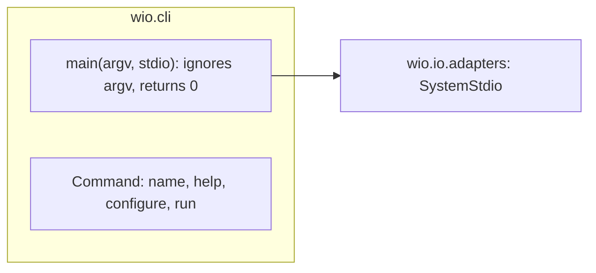
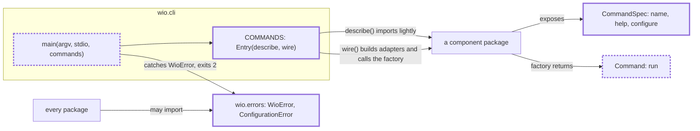

<!-- wio
id = "9wbqyb"
template = "feature.parent"
roots = ["@descendants"]
depends_on = ["ew60gw"]
-->

# The wio command line

## Purpose

Every subcommand of wio needs one entry point that tells a person or an agent
what wio is, runs the command chosen and reports every outcome the same way,
before the first subcommand can exist.

## Goals

- A person or an agent can run `wio` to see what it is and which subcommands it
  has, and ask which version is installed.
- Every run ends with one exit code and its message on one stream, so a caller
  can tell success, a failed check, its own mistake and a bug in wio apart.
- A subcommand joins the command line with one entry in a table, and the
  component behind it never learns which adapters implement its ports.
- Every package can raise the errors that wio reports as the user's to fix, from
  one module that depends on nothing.

## Glossary

- **Failed check**: a command's finished answer "no", reported as its output and
  exit code 1, and never as an exception.
- **Bug**: an exception that escapes a command and is not a `WioError`.

## Non-Goals

- Implementing any subcommand, which the Work of each component does.
- `wio init`, which comes in v0.2.
- Color, a pager and shell completion.
- Wiring adapters that differ by platform: the first Work that adds one gives
  the wiring the platform.
- A separate exit code for configuration errors.

## Assumptions

- **A-1**: The package metadata of this project, which names the distribution
  `work-it-out`, holds the `Summary` and the version that `wio` shows, equal to
  the `description` and `version` of `pyproject.toml`, in the synchronized
  environment and in an installed wheel (checked for the synchronized
  environment on 2026-11-03).

## Mechanisms

- `argparse`, with one subparser per command, for the usage, the help and the
  usage errors.
- `importlib.metadata`, reading the `Summary` and the version of the
  `work-it-out` distribution.
- Python 3.15 `lazy import` in the package of every command, so that importing
  the package to describe the command loads none of its implementation.
- `wio.errors`, a module of exception classes that the command line catches.
- `tach check`, for the dependency direction of `wio.errors`.

## Constraints

- **Exit codes.** A run exits 0 on success, 1 on a failed check, 2 on a usage
  error or a `WioError`, and 70 on a bug. Notes and warnings never change the
  code.
- **A failed check is a result.** A command returns it and never raises for it;
  it raises a `WioError` only for what the user must fix before the command can
  answer.
- **Streams.** Standard output carries what the command was asked for, the
  findings of a check included. Standard error carries diagnostics about the run
  itself and error messages in plain text, also with `--json`. There is no color
  and no pager, and output is deterministic: sorted, with no timestamps.
- **`--json`.** It is an option of each command, declared by the command's
  `configure`. With it, standard output holds one JSON document and nothing
  else.
- **Import-light commands.** Importing the package of a command to describe it
  loads no module of its implementation.
- **Dependency direction.** `wio.errors` imports nothing else from `wio`, and
  every package may import it.
- **Verification.** The leaves verify the exit codes, the streams for errors and
  the import-light rule with fake commands. The `--json` rule is verified by the
  Work of each command, in its own criteria, because only a real command has an
  output to check. The parent verifies the installed command.

## Visuals

The before state is drawn from `main` at commit
`16dbe2d636c984a42cb976ec50c272d790f10233` and checked against `src/wio/cli`,
`src/wio/ports.pyi` and `tach.toml` at that commit. The after state is
provisional: the packages and their edges are required, and the names inside
`wio.cli` are not.

Before: the entry point ignores its arguments, and a command is one object that
describes itself and runs.

After: a table of entries, a description apart from the command, and errors that
the entry point catches. Bold boxes are added, and `main` and `Command` change.

## Acceptance criteria

### **AC-1** The installed `wio` introduces itself and reports mistakes

An installed `wio` shows what it is, its version and a usage error without the
source tree.

#### The installed command

- **Given** the wheel built from the tree, installed into a fresh environment.
- **When** `wio`, `wio --version` and `wio nope` run there.
- **Then** `wio` prints the package's `Summary` and the usage to standard output
  and exits 0; `wio --version` prints `wio` and the wheel's version and exits
  0; `wio nope` prints nothing to standard output, names `nope` on standard
  error and exits 2.

### **AC-2** The delivered command line passes every check

With both children delivered, the repository's two gates, `make check` and
`make slow`, pass.

#### The whole tree

- **Given** the tree with both children delivered.
- **When** `make check` runs, and then `make slow`.
- **Then** both exit 0.

## Additional context

- [v0.1 scope](../../../../docs/v0.1-scope.md) names the command line as a part
  and its outcome; the command-line leaf adds this Work to its order of work.
