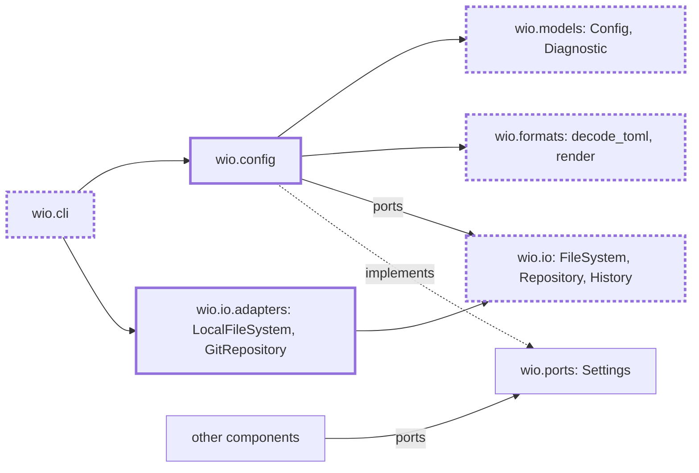

<!-- wio
id = "hwn995"
template = "feature.parent"
roots = ["@descendants"]
depends_on = []
-->

# The wio config command

## Purpose

Every command needs the project's settings read from one file and checked, and a
person needs to see what they are and where each value comes from.

## Goals

- A command receives the project's settings as one immutable `Config`, or is
  refused with every error of the config at once.
- A person or an agent can see every setting, its source and its meaning from
  the command line.
- A person or an agent that edits the config is told what is wrong with it in
  the same turn.
- The ports that components use to reach files and the repository name no tool.
- A run that finds no problem loads nothing it does not need.
- The documents describe the config and its commands as they are.

## Glossary

- **Diagnostic**: one finding of a check, with a severity (`error`, `warning` or
  `note`), the place it is about and a message.
- **Source**: whether a setting's value comes from the file or is the default.

## Non-Goals

- Writing the config, and `wio init`, which comes in v0.2.
- A walk up the directories, a per-directory override and a second config file.
- Checks that parse a template or a rule file, which the contracts, templates
  and rules Works add to the same check run.
- Suppressing a diagnostic and giving it a stable code.

## Assumptions

- **A-1**: The cli Work (PR #72) and the rule presets Work (PR #60) are
  delivered, so the command table, `wio.errors` and the rule-selection schema
  exist.
- **A-2**: Python 3.15's built-in `frozendict` and `lazy import` are available
  wherever wio runs.

## Mechanisms

- `wio.config`, the component that holds the loader, the checks and the
  `config` command.
- `wio.models.config`, `Diagnostic` and `wio.formats`' decoder and renderer,
  shared with every other component.
- The `FileSystem`, `Repository` and `History` ports of `wio.io`, with
  `LocalFileSystem` and `GitRepository`.
- The `Settings` port of `wio.ports`, which every other component reads the
  config through.

## Constraints

- **The config is one file.** It is `.agents/wio/config.toml` at the root of the
  repository that holds the working directory, and a missing file or a missing
  repository is a configuration error, while an empty file is valid.
- **Unknown keys are errors.** A key the schema does not know, in any table, is
  an error, so a mistyped key is caught when `wio config check` runs.
- **Messages tell how to fix the edit.** A diagnostic names the key path, what
  was found, what is valid and what the setting is for.
- **Nothing is imported before it is needed.** Rarely used modules load lazily,
  and a run that finds no problem imports neither `tomlkit`, `json` nor
  `difflib`.
- **Output is deterministic.** It is sorted and has no timestamps.
- **Verification.** The location of the config is verified by the loader's
  AC-1, unknown keys and the content of messages by the loader's AC-4, the
  order and the shape of diagnostics by the model's AC-3 and AC-4, the sorted
  output of the commands by the show leaf's AC-2, and what a run imports by
  AC-2 of this parent.

## Visuals

Before, `Config` is an empty stub and nothing reads the file (`main` at commit
`e7b10d8cde19aaf60eaae4a650ffd96b29dcd6d3`). After, the
component reads it through the ports, and every other component reads it through
`Settings`. Bold boxes are added and bold dashed boxes change.

## Acceptance criteria

### **AC-1** The installed package shows a project's settings

The built wheel gives a working `wio config`, `wio config list` and
`wio config show` in a project that is not this repository.

#### The installed command

- **Given** the wheel built from the tree, run with
  `uv run --no-project --isolated --with <wheel>`, and a git repository whose
  config sets one stage.
- **When** `wio config`, `wio config list` and `wio config show stages` run
  there.
- **Then** the first prints the help, the second lists every setting with its
  source, the keys the stage sets marked `file` and the rest `default`, and the
  third prints the stage in full; each exits 0.

### **AC-2** A run with no problem loads no rarely used module

`wio config check` on a valid config imports neither `tomlkit`, `json` nor
`difflib`.

#### A fresh interpreter

- **Given** a new Python process and a repository with a valid config.
- **When** `main(["config", "check"], stdio)` of `wio.cli` runs in that
  process and `sys.modules` is read.
- **Then** none of the three is there.

### **AC-3** The documents describe the config and its commands

`docs/concepts.md` and `docs/v0.1-scope.md` state the three commands (`list`,
`show` and `check`, with bare `wio config` showing the help), that an unknown
key is an error, that skills are looked up in the repository only, that a stage
has exactly one of `goal` and `skill`, and the `Diagnostic` and its shared
output, and they say which checks the rules Work owns, not `wio config`. They no
longer list the field names of a stage's session policy or the names of the
config tables among the open points, nor `wio config list <kind>`.

### **AC-4** The glossary defines the new terms

`GLOSSARY.md` defines Diagnostic, Source, Check and Check run.

## Additional context

- [v0.1 scope](../../../../docs/v0.1-scope.md) names `wio config` as a part and
  its outcome; this Work adds `list`, `show` and the diagnostics.
- [Config in the concepts](../../../../docs/concepts.md#the-config) lists every
  table and key.
- The leaves are [ports](ports/README.md), [decoder](decoder/README.md),
  [model](model/README.md), [loader](loader/README.md), [show](show/README.md)
  and the [checks](checks/README.md) parent with its
  [command](checks/command/README.md),
  [pipelines](checks/pipelines/README.md),
  [rule selection](checks/rule-selection/README.md) and
  [paths and skills](checks/paths-and-skills/README.md).
