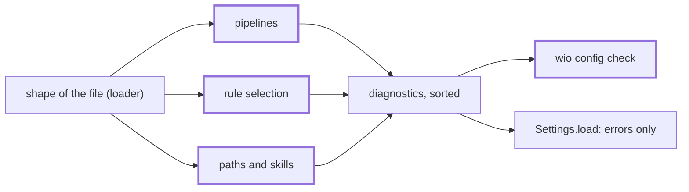

<!-- wio
id = "x1eqww"
template = "feature.parent"
roots = ["@descendants"]
depends_on = []
-->

# Checking the settings

## Purpose

A person or an agent that has just edited the config must learn at once
everything that is wrong with it, and no command may run on a config that has an
error.

## Goals

- `wio config check` reports every problem of the config in one run, in a form a
  hook can feed back to an agent.
- The same errors stop every other command, so no component sees a config that
  fails a check.
- The repository's own config passes, and a hook after each edit proves it
  stays so.

## Glossary

- **Check**: a function from the `Config` and what it may read to diagnostics;
  one concern, such as the references among stages.
- **Pass**: the loader's run of the shape and then every check, which `check`
  prints and `Settings.load` refuses on.

## Non-Goals

- Checks that parse a template or a rule file, which the contracts, templates
  and rules Works add to the same pass when they deliver: a template's kind and
  directives, a ruleset's manifest, codes, families and presets, whether a
  qualified reference resolves to a rule, and whether a root reaches a
  root-independent ruleset.
- Reporting an unused stage, root or preset: templates and contracts name them
  too, which the config cannot see.
- Suppressing a diagnostic, and a stable code for one.

## Assumptions

- **A-1**: Every check this Work needs reads only the config, the directory
  listings under the repository root and the existence of files.

## Mechanisms

- The ordered list of checks and the pass of the loader.
- `wio.formats`' renderer of diagnostics, shared by every `check` command.
- `prek.toml` and `.claude/settings.json`, for the hooks of this repository.

## Constraints

- **One pass.** A check never stops the others: the pass runs every check even
  when one reports an error, and output is sorted, as the render does.
- **Errors block everywhere.** A check that reports an error is run by
  `Settings.load` too, so it must be cheap and local: it reads paths, names and
  listings, and parses neither a template nor a rule.
- **Warnings and notes appear only in `wio config check`.** They never change an
  exit code and are not printed by other commands.
- **Messages** follow the loader's rule: they name the key path, what was found,
  what is valid and what the setting is for.
- **Verification.** Each check is verified by the leaf that adds it, through
  `wio config check` and through `Settings.load`; the system-level guarantees
  are verified by this parent.

## Visuals

The checks join one pass behind the loader. Bold boxes are added.

## Acceptance criteria

### **AC-1** One run reports every problem, sorted

`wio config check` on a config with problems in several groups reports all of
them once, in the order of the renderer, and a problem in one group never hides
another.

#### Several groups

- **Given** a config with an unknown key, a stage preset that names a missing
  stage, a rule reference to a missing ruleset, a root path outside the
  repository and a stage whose skill exists nowhere.
- **When** `wio config check` runs.
- **Then** each of the five is reported once, the output is sorted, and the exit
  code is 1.

### **AC-2** Every error also stops the other commands

An error that `wio config check` reports makes `Settings.load` raise, so any
command exits 2 with the same errors on standard error.

#### Each group

- **Given** a config with one error from each of the groups of AC-1.
- **When** `wio config list` runs.
- **Then** it exits 2, standard output is empty and standard error holds each
  of the five errors; a config with only a warning or a note loads, and `list`
  prints nothing of the warning.

### **AC-3** This repository's config passes

`wio config check` passes on `.agents/wio/config.toml` of this repository, and
the file's header no longer says that nothing reads it.

#### The repository

- **Given** the delivered tree.
- **When** `wio config check` runs in it.
- **Then** it exits 0 with no error, and the header comment of the config
  describes what reads it.

### **AC-4** The installed package checks a project's config

The built wheel gives a working `wio config check` in a project that is not this
repository.

#### The installed command

- **Given** the wheel built from the tree, run with
  `uv run --no-project --isolated --with <wheel>`, and a repository with a valid
  config and with an invalid one.
- **When** `wio config check` runs in each.
- **Then** the first exits 0 and the second exits 1 with its errors on standard
  output.

## Additional context

- [The concepts on checking rules](../../../../../docs/concepts.md#checking-rules)
  list the rule-selection checks this parent's leaves share out.
