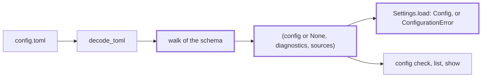

<!-- wio
id = "fhr0z7"
template = "feature.leaf"
roots = ["wio", "repo"]
depends_on = ["ky2ztw", "wxwwnt", "309p3v"]
-->

# Loading the settings

## Purpose

A command needs the project's settings read from one file, checked for shape,
and handed over as a `Config` with the source of every value, or refused with
every problem at once.

## Goals

- The config is found from the working directory, and its absence is a clear
  error.
- A file becomes a `Config`, or a list of diagnostics that says how to fix each
  problem of it, the shape and every check together, in one run.
- The source of every setting, the file or the default, is known without being
  part of `Config`.
- Every other component receives a `Config` with no error in it, or none.
- Further checks join the same pass without a change to the loader's callers.

## Glossary

- **Shape**: whether the file's keys, types and values fit the schema, which is
  what this Work checks; whether the names a value refers to exist is a check of
  [the checks Work](../checks/README.md).
- **Key path**: the dotted names that lead to a value, such as
  `stages.define.session`; a list item adds its index, as in
  `stages.define.rules_include[0]`, and a key that contains a dot is quoted.

## Non-Goals

- The cross-reference, path and skill checks, and the `wio config check`
  command, which are the checks Work's.
- Printing the settings, which the show Work does.
- A walk up the directories, a per-directory override and an environment
  variable that points at another file.
- Mentioning `wio init` in a message, which comes in v0.2.
- Reading `continuable`: the field exists so that people and agents can read it.

## Assumptions

- **A-1**: A `Repository` finds the root of the repository that contains the
  working directory, and the config is at
  `<root>/.agents/wio/config.toml`.
- **A-2**: A TOML date or time is never a valid setting, because no key of the
  schema holds one.

## Mechanisms

- `Repository.root` and `FileSystem.read_text`, through the ports, to find and
  read the file.
- `decode_toml` and `TomlSyntaxError` of `wio.formats`, for the text.
- A walk of the `Config` dataclasses with `dataclasses.fields`, which builds
  the value, the diagnostics of its shape and the source of each key path from
  the same schema. It builds a best-effort `Config` even when the file has
  errors: an invalid value gets its default and an unknown key is dropped, so
  the checks can run and one run reports every problem.
- For an unknown key, a search of the other tables of the schema for a field of
  that name, which gives the hint of where the key belongs.
- `difflib.get_close_matches`, imported only when a diagnostic needs a closest
  match.
- `wio.config`, which holds the loader and adapts it to the `Settings` port of
  `wio.ports`.

## Constraints

- **What a message holds.** An unknown key names the valid keys beside it, the
  closest match and, when another table has a key of that name, the tables it
  belongs to. A wrong type or value names the received value, the expected type
  or the allowed values, and the setting's description. A stage with both or
  neither of `goal` and `skill` says what each is. Nothing is coerced: an
  integer where a string belongs is an error.

## Visuals

Before, no loader exists (`main` at commit
`e7b10d8cde19aaf60eaae4a650ffd96b29dcd6d3`). After, it is one function with two
views. Bold boxes are added.



## Acceptance criteria

### **AC-1** The config is found at the root of the repository

The loader reads `<root>/.agents/wio/config.toml`, where the root is that of the
working directory, and refuses when there is no repository or no file.

```python
@dataclass(frozen=True)
class Loaded:
    config: Config | None
    diagnostics: tuple[Diagnostic, ...]
    sources: frozendict[str, Literal["file", "default"]]


def load_config(repository: Repository, files: FileSystem) -> Loaded: ...
```

#### Found from a subdirectory

- **Given** a repository whose config sets `[works] hierarchy = "nesting"`, and
  the working directory in a subdirectory.
- **When** `load_config` runs.
- **Then** `config.works.hierarchy` is `"nesting"`.

#### Missing

- **Given** a directory outside any repository, and a repository without a
  config file.
- **When** `load_config` runs in each.
- **Then** each raises `ConfigurationError` that names the path looked at and
  does not mention `wio init`, and an empty config file loads without error.

### **AC-2** A key the file does not set keeps its default

The loader builds `Config` from the table of the file, and a key it does not
set has the default of its field.

#### An empty file and a partial one

- **Given** an empty file, and a file that sets only `[trailers] reader = "git"`
  and one stage.
- **When** `load_config` runs on each.
- **Then** the first gives `Config()` with no diagnostics, and the second gives
  `trailers.reader` `"git"`, one stage with `session` `"any"` and `continuable`
  true, and every other field its default.

### **AC-3** The source of every setting is known

`sources` maps every key path of the effective settings to `file` or `default`,
built from the fields of `Config`, so it cannot drift from the schema.

#### Defaults and file values

- **Given** a file that sets `[works] hierarchy = "flat"`, which is the default,
  and one stage with `goal` set.
- **When** `load_config` runs.
- **Then** `works.hierarchy` is `file`, `works.dir` is `default`,
  `stages.define.goal` is `file`, `stages.define.session` is `default`, and
  every key path of `Config()`, with those of the stage, has an entry, except
  the optional settings that are absent: `bundle.size_threshold`,
  `stages.define.judge` and `stages.define.roots` have none.

#### A new field

- **Given** the dataclasses of `Config`.
- **When** the key paths of `sources` for an empty file are compared with the
  fields found by walking them.
- **Then** they are the same set.

### **AC-4** Every shape problem is reported at once

The loader returns all the diagnostics of the shape of a file, each naming the
key path and how to fix it, with no `Config` when any is an error; it still runs
the checks of AC-7 on a best-effort `Config`, in which an invalid value has its
default and an unknown key is dropped.

#### An unknown key

- **Given** a stage with a key `sessions`.
- **When** `load_config` runs.
- **Then** `config` is `None` and one error is at `stages.define.sessions` that
  says the key is unknown, suggests `session`, and lists the valid keys of a
  stage.

#### A key that belongs elsewhere

- **Given** `rules_exclude` on a root, and `rule_presets` on an action.
- **When** `load_config` runs.
- **Then** each unknown-key error names the tables whose schema has a key of
  that name, such as a stage and a rule preset for `rules_exclude`, and a root
  for `rule_presets`; the always fields are named as top-level keys.

#### A wrong value and a wrong type

- **Given** `[works] hierarchy = "nest"` and `[trailers] reader = 3`.
- **When** `load_config` runs.
- **Then** two errors come back at once: `works.hierarchy` names the received
  `"nest"`, the allowed `"flat"` and `"nesting"` and the setting's description,
  and `trailers.reader` names the received `3`, the expected string and the
  description.

#### The other vocabularies

- **Given** a stage with `session = "later"` and `judge = "robot"`.
- **When** `load_config` runs.
- **Then** one error lists `"any"` and `"fresh"`, and one lists `"human"`.

#### A date or a time

- **Given** a key set to a TOML date, and another to a TOML time.
- **When** `load_config` runs.
- **Then** each has an error at its key path that says no setting holds a date
  or a time.

#### Both or neither of goal and skill

- **Given** one stage with both `goal` and `skill`, and one with neither.
- **When** `load_config` runs.
- **Then** each has an error that says what `goal` and `skill` are and that
  exactly one is needed.

### **AC-5** A syntax error is one diagnostic with a position

A file that is not valid TOML gives one error at
`<file>:<line>:<column>` and no `Config`.

#### An invalid file

- **Given** a config whose second line is `b = = 2`.
- **When** `load_config` runs.
- **Then** `diagnostics` is one error whose `where` is
  `.agents/wio/config.toml:2:5`, the path relative to the repository root with
  the line and the column.

### **AC-6** `Settings.load` returns a `Config` or refuses

`Settings.load` returns the `Config` when no diagnostic is an error, and
otherwise raises `ConfigurationError` that carries every error and renders
them, warnings and notes never blocking.

```python
class ConfigSettings:
    def __init__(self, repository: Repository, files: FileSystem) -> None: ...
    def load(self) -> Config: ...
```

#### Valid and invalid

- **Given** a valid config, one with two shape errors, and one that has a
  warning and a note and no error.
- **When** `load` runs on each.
- **Then** the first returns the `Config`, the second raises with both errors in
  `diagnostics` and in its message, and the third returns the `Config`.

### **AC-7** A further check joins the same pass

A check is a function from the `Config` and what it may read to diagnostics,
kept in one ordered list that the loader runs after the shape, also when the
shape has errors, on the best-effort `Config`, so a leaf that
adds one changes neither the loader's callers nor `Settings.load`. The second
parameter holds the repository root and the `FileSystem`; its shape is
provisional, and the list and the pass are required.

```python
Check = Callable[[Config, CheckInputs], Iterable[Diagnostic]]
```

#### An added check

- **Given** a check that returns an error at `x`, added to the list, and a file
  with a valid shape, and then one with an unknown key.
- **When** `load_config` and `Settings.load` run on each.
- **Then** for the first the diagnostics hold that error, `config` is `None` and
  `load` raises; for the second they hold the unknown-key error and that error,
  both at once.

### **AC-8** Loading imports nothing it does not use

A valid file loads without importing `difflib`, `json` or `tomlkit`.

#### A fresh interpreter

- **Given** a new Python process and a valid config.
- **When** `load_config` runs and `sys.modules` is read.
- **Then** none of the three is there, and `difflib` is there after a config
  with an unknown key.

## Additional context

- [Concepts: the config](../../../../../docs/concepts.md#the-config) lists
  every table and key the shape covers.
