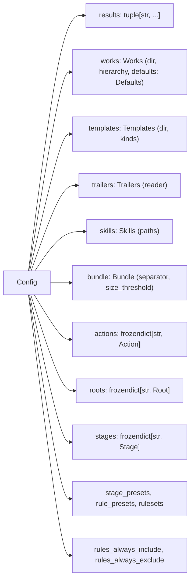

<!-- wio
id = "309p3v"
template = "feature.leaf"
roots = ["wio", "repo"]
depends_on = []
-->

# The types of the settings and of diagnostics

## Purpose

Every component must receive the settings and report the problems of a check as
plain, immutable types, defined once, before any of them can read the config.

## Goals

- A component receives the settings as one immutable `Config` whose fields hold
  the defaults.
- Every check of every component reports its findings as `Diagnostic`s that
  print the same way.
- A `ConfigurationError` carries the diagnostics that caused it.
- Each setting's meaning is available to a message as a one-sentence
  description.

## Non-Goals

- Reading the file or building a `Config`, which the loader does.
- Judging the data: a `Config` holds what it is given.
- A code on a diagnostic, and a way to suppress one: both are open points of
  [the concepts](../../../../../docs/concepts.md#15-open-points).
- A structured location in a diagnostic: `where` is a string.
- Other models of `wio.models`.

## Assumptions

- **A-1**: Python 3.15's `frozendict` is hashable when its keys and values are,
  and every value in a `Config` is a frozen dataclass, a tuple, a string, a
  number or a boolean.
- **A-2**: `wio.models` imports nothing from `wio` and `wio.errors` imports only
  `wio.models`, after the dependency change of PR #80.

## Mechanisms

- `dataclasses.dataclass(frozen=True)` and `dataclasses.field(default=...,
  metadata={"description": ...})` for every type of `Config`.
- The built-in `frozendict` for the open tables, built through one helper of
  `wio.models` that holds the only pyrefly suppression, as the
  [known issues](../../../../../docs/known-issues.md) say.
- `wio.formats`, for the renderer of diagnostics: `json` is imported only when
  JSON is asked for.
- `wio.errors.ConfigurationError`, extended with the diagnostics.

## Visuals

Before, `Config` is a stub with no fields (`main` at commit
`e7b10d8cde19aaf60eaae4a650ffd96b29dcd6d3`). After, it is a tree. The field
names are required and equal the TOML keys; the nested type names are the leaf's
to settle.



## Acceptance criteria

### **AC-1** `Config` is an immutable tree whose fields hold the defaults

A `Config` built with no arguments is the effective settings of an empty config
file, it cannot be changed, and two equal configs compare and hash equal. Every
field is named as its TOML key, so a key path such as `works.defaults.actions`
is a chain of field names.

```python
@dataclass(frozen=True)
class Config:
    results: tuple[str, ...] = ("pass", "fail", "unknown")
    works: Works = Works()
    templates: Templates = Templates()
    trailers: Trailers = Trailers()
    skills: Skills = Skills()
    bundle: Bundle = Bundle()
    actions: frozendict[str, Action] = frozendict()
    roots: frozendict[str, Root] = frozendict()
    stages: frozendict[str, Stage] = frozendict()
    stage_presets: frozendict[str, tuple[str, ...]] = frozendict()
    rule_presets: frozendict[str, RulePreset] = frozendict()
    rulesets: frozendict[str, Ruleset] = frozendict()
    rules_always_include: tuple[str, ...] = ()
    rules_always_exclude: tuple[str, ...] = ()
```

#### The defaults

- **Given** `Config()`.
- **When** its fields are read.
- **Then** `works.hierarchy` is `"flat"`, `works.dir` is `.agents/wio/works`,
  `templates.dir` is `.agents/wio/templates`, `trailers.reader` is `"scan"`,
  `bundle.separator` is a blank line, `bundle.size_threshold` is `None`, the
  skill paths are `()`, and every open table is empty.

#### Immutability

- **Given** a `Config` with one stage.
- **When** a field is assigned, or a stage is added to `stages`.
- **Then** each raises, and `hash` of the config equals `hash` of an equal one.

The field names of a stage are `goal`, `skill`, `roots`, `rules_include`,
`rules_exclude`, `gate`, `judge`, `session` (`"any"` by default) and
`continuable` (`true` by default); an optional setting with no default, such as
`judge` and `roots`, is `None`, and a list is an empty tuple. The names of the
other nested types are provisional.

### **AC-2** Every setting has a description

Each field of every type of `Config` carries a one-sentence description in its
metadata, which a message can quote.

#### Completeness

- **Given** every dataclass reachable from `Config`.
- **When** their fields are listed.
- **Then** each has a non-empty `description` in its metadata.

### **AC-3** A diagnostic has a severity, a place and a message

A `Diagnostic` is immutable, and a list of them has one order wherever it is
printed.

```python
Severity = Literal["error", "warning", "note"]


@dataclass(frozen=True)
class Diagnostic:
    severity: Severity
    where: str
    message: str
```

```python
def sort_diagnostics(
    diagnostics: Iterable[Diagnostic],
) -> tuple[Diagnostic, ...]: ...
```

#### The order

- **Given** a note at `b`, an error at `b`, an error at `a` and a warning at
  `a`.
- **When** they are sorted with `sort_diagnostics`.
- **Then** the order is by `where`, then error, warning and note, then
  `message`: the error at `a`, the warning at `a`, the error at `b`, the note
  at `b`. `where` is compared as a plain string, so `x[10]` sorts before `x[2]`.

### **AC-4** One renderer prints diagnostics as text or JSON

`wio.formats` renders a list of diagnostics as one line each,
`error|warning|note: <where>: <message>`, or as a JSON array, in the order of
AC-3, so every `check` command prints the same.

```python
def render_text(diagnostics: Iterable[Diagnostic]) -> str: ...
def render_json(diagnostics: Iterable[Diagnostic]) -> str: ...
```

#### Text and JSON

- **Given** the list `[error at stages.x "unknown stage", note at a
  "reserved"]`.
- **When** both renderers run on it.
- **Then** the text is the two lines `note: a: reserved` and
  `error: stages.x: unknown stage`, in that order, and the JSON is an array of
  two objects with `severity`, `where` and `message`, in the same order; an
  empty list renders as empty text and as `[]`.

#### Importing

- **Given** a new Python process.
- **When** it imports `wio.formats` and calls `render_text`.
- **Then** `json` is not in `sys.modules`.

### **AC-5** A configuration error carries its diagnostics

`ConfigurationError` keeps the diagnostics it was raised with, and a message
built from them.

```python
class ConfigurationError(WioError):
    diagnostics: tuple[Diagnostic, ...]

    def __init__(self, message: str, diagnostics: Iterable[Diagnostic] = ()): ...
```

#### With and without diagnostics

- **Given** `ConfigurationError("no config at /x")`, and one raised with two
  error diagnostics and the rendered text as its message.
- **When** each is caught as `WioError`.
- **Then** the first has no diagnostics and `str` of it is the message, and the
  second keeps both diagnostics in order and `str` of it is the rendered text.

### **AC-6** One helper builds every `frozendict`

`wio.models` has one function that freezes a mapping, and it holds the only
suppression of pyrefly's `frozendict` stub error.

```python
def freeze[K, V](mapping: Mapping[K, V]) -> frozendict[K, V]: ...
```

#### The suppression

- **Given** the delivered tree.
- **When** `# pyrefly: ignore` is searched in `src`.
- **Then** one occurrence names `bad-argument-count` and the known issue, in
  that helper, and `make check` passes.

## Additional context

- [Known issues](../../../../../docs/known-issues.md) records the stub gap this
  Work works around.
- [Config in the concepts](../../../../../docs/concepts.md#the-config) lists
  every table and key.
