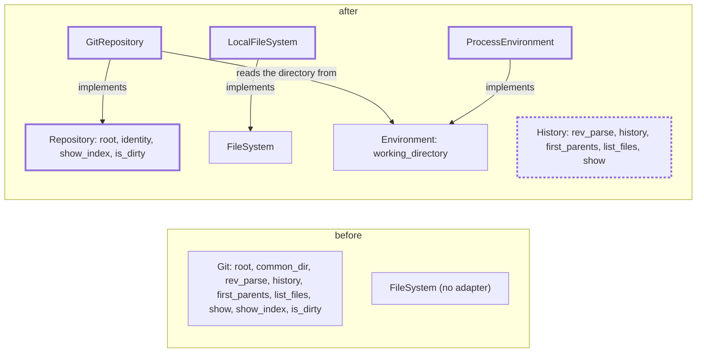

<!-- wio
id = "ky2ztw"
template = "feature.leaf"
roots = ["wio", "repo"]
depends_on = []
-->

# Ports and adapters for files and the repository

## Purpose

Config, and every component after it, must read files and find the repository
through ports that name no tool, so that wio can run on another version control
system, with real adapters for the local disk and for git.

## Goals

- A component can read, write and list files on the local disk through
  `FileSystem`.
- A component can ask where the repository is, and which clone it belongs to,
  through `Repository`, without a word of git in the port.
- A component that reads revisions asks `History`, a port apart from
  `Repository`.
- The adapter that finds the repository is given the working directory through
  `Environment` and never reads the process's own, so a test can fix it like
  every other input.

## Non-Goals

- An adapter for `History`, which the trailers Work adds with its reader.
- A second version control system, and pygit2, which has no Python 3.15 wheel.
- Members of `Environment` beyond `working_directory`, and the adapters of
  `Clock`, `Entropy` and `Directories`, which the Work that first needs them
  adds.
- New members of `FileSystem`, such as walking a tree or telling a symbolic
  link, which the Work that needs them adds.

## Assumptions

- **A-1**: `git` is installed wherever wio runs, because the `git` trailer
  reader needs it too.
- **A-2**: Nothing implements or imports `Git` outside the stubs, the glossary
  and the architecture README, so renaming it breaks no code.
- **A-3**: `GitRepository` has all four members of `Repository`, though config
  needs two, because a class that lacks a member of the port cannot be wired
  where the port is expected; the two it does not implement raise
  `NotImplementedError` until the trailers Work, which owns what they mean.
- **A-4**: `ProcessEnvironment` has every member of `Environment`, though the
  repository needs only `working_directory`, so that it can be wired where the
  port is expected; the others raise `NotImplementedError` until the Work that
  first needs them, which owns what they mean.

## Mechanisms

- `pathlib.Path` methods, in `LocalFileSystem` in `wio.io.adapters`.
- `subprocess.run` of `git rev-parse --show-toplevel` and
  `git rev-parse --path-format=absolute --git-common-dir`, in `GitRepository` in
  `wio.io.adapters`, run in the directory that the `Environment` it is given
  reports.
- `pathlib.Path.cwd`, in `ProcessEnvironment` in `wio.env.adapters`, the one
  place that reads the process's working directory.
- The stubs `src/wio/io/ports.pyi` and `src/wio/models/commits.pyi`, which are
  the spec of the ports and are provisional only in the members the trailers
  Work may still extend.

## Visuals

Before, one port mixes where the process is with how history is read (`main`
at commit `e7b10d8cde19aaf60eaae4a650ffd96b29dcd6d3`). After, two
ports split them, and the adapters of `wio.io.adapters` implement the ones that
exist; `GitRepository` is given an `Environment`, which `ProcessEnvironment`
implements. Bold boxes are added, and bold dashed boxes change.



## Acceptance criteria

### **AC-1** The ports of `wio.io` name no tool

`src/wio/io/ports.pyi` declares `Repository` and `History` in place of `Git`,
each with a docstring for every member that says what it guarantees, and nothing
in the repository still names `Git` as a port.

```python
class Repository(Protocol):
    def root(self) -> Path: ...
    def identity(self) -> Path: ...
    def show_index(self, path: Path) -> str | None: ...
    def is_dirty(self) -> bool: ...


class History(Protocol):
    def rev_parse(self, revision: str) -> str: ...
    def history(self, revision_range: str) -> Sequence[Commit]: ...
    def first_parents(self, revision: str) -> Sequence[Commit]: ...
    def list_files(self, revision: str) -> Sequence[Path]: ...
    def show(self, revision: str, path: Path) -> str | None: ...
```

`identity` is described as the absolute path that every checkout of one clone
shares, and `Repository` and `History` raise `RuntimeError` outside a
repository, as `Git` did; the message of `Repository` names the working
directory. `src/wio/models/commits.pyi`,
`src/wio/trailers/ports.pyi`, `GLOSSARY.md` and `src/wio/README.md` use the new
names, and the glossary defines Repository (the working tree the process runs
in and the state of its index and changes), History (the revisions of a
repository, read by revision and never changed) and Identity (the path that
every checkout of one clone shares).

### **AC-2** `LocalFileSystem` reads, writes and lists files on the disk

A `LocalFileSystem` is a `FileSystem` over the local disk, with every member of
the port (`read_text`, `read_bytes`, `write_text`, `append_text`, `exists`,
`is_dir`, `is_file` and `list_dir`, as the
[stub](../../../../../src/wio/io/ports.pyi) declares them), and its listings
never depend on the order the disk returns.

#### Reading and writing

- **Given** a directory with a UTF-8 file `a.txt` holding `héllo\r\n` and a file
  `b.bin` that is not valid UTF-8.
- **When** `read_text(a.txt)`, `read_bytes(b.bin)` and `read_text(b.bin)` run.
- **Then** the first returns `héllo\r\n` with its line end as stored, the second
  returns the bytes, and the third raises `UnicodeDecodeError`.

#### Creating parents and appending

- **Given** a directory without a subdirectory `x/y`.
- **When** `write_text(x/y/f, "a")` and then `append_text(x/y/f, "b")` run.
- **Then** `x/y/f` holds `ab`, and `exists`, `is_file` and `is_dir` answer for
  the file, the directory and a missing path.

#### Listing and missing paths

- **Given** a directory holding `b`, `a` and `c`, a file, and a path that does
  not exist.
- **When** `list_dir` runs on the directory, on the file and on the missing
  path, and `read_text` on the missing path.
- **Then** the listing is `a`, `b`, `c`, the listing of the file raises
  `NotADirectoryError`, and the listing and the read of the missing path raise
  `FileNotFoundError`.

### **AC-3** `GitRepository` finds the root and the identity of a repository

A `GitRepository` is given an `Environment`, and answers where the working tree
is and which clone it belongs to, from the working directory that the
`Environment` reports. It runs git there and calls nothing that reads the
process's own working directory.

```python
class GitRepository:
    def __init__(self, environment: Environment) -> None: ...
```

#### From a subdirectory

- **Given** a git repository with a subdirectory `sub`, the process running in
  `sub`, and a `ProcessEnvironment`.
- **When** `root()` and `identity()` run.
- **Then** `root()` is the absolute path of the top of the repository, and
  `identity()` is the absolute path of its `.git` directory.

#### From a linked worktree

- **Given** a clone and a linked worktree made with `git worktree add`.
- **When** `identity()` runs in each.
- **Then** both return the same path, and `root()` differs.

#### From the directory the environment reports

- **Given** a git repository with a subdirectory `sub`, an `Environment` whose
  `working_directory()` is `sub`, and a process running elsewhere.
- **When** `root()` runs.
- **Then** it is the absolute path of the top of that repository.

#### Outside a repository

- **Given** a directory that no git repository contains, as the working
  directory of an `Environment`.
- **When** `root()` or `identity()` runs.
- **Then** it raises `RuntimeError` whose message names that directory.

### **AC-4** The members trailers owns are declared and not yet implemented

`GitRepository` satisfies `Repository` where it is wired, and `show_index` and
`is_dirty` say that the trailers Work implements them.

#### Not implemented

- **Given** a `GitRepository` in a git repository.
- **When** `show_index(Path("f"))` and `is_dirty()` run.
- **Then** each raises `NotImplementedError` whose message names the trailers
  Work.

#### Wired as the port

- **Given** a module that assigns a `GitRepository(environment)` to a variable
  annotated `Repository`, with an `environment` annotated `Environment`.
- **When** `pyrefly check` runs.
- **Then** it reports no error.

### **AC-5** `ProcessEnvironment` reports the process's working directory

A `ProcessEnvironment` is an `Environment` of which only `working_directory` is
implemented, and it satisfies the port where it is wired.

#### The working directory

- **Given** a process running in a directory.
- **When** `working_directory()` runs.
- **Then** it returns the absolute path of that directory.

#### Not implemented

- **Given** a `ProcessEnvironment`.
- **When** `get("HOME")` runs.
- **Then** it raises `NotImplementedError` whose message names the Work that
  first needs it.

#### Wired as the port

- **Given** a module that assigns a `ProcessEnvironment()` to a variable
  annotated `Environment`.
- **When** `pyrefly check` runs.
- **Then** it reports no error.

## Additional context

- [Ports of `wio.io`](../../../../../src/wio/io/ports.pyi) are the stub this
  Work changes.
- [The architecture of `src/wio`](../../../../../src/wio/README.md) states who
  owns a port.
