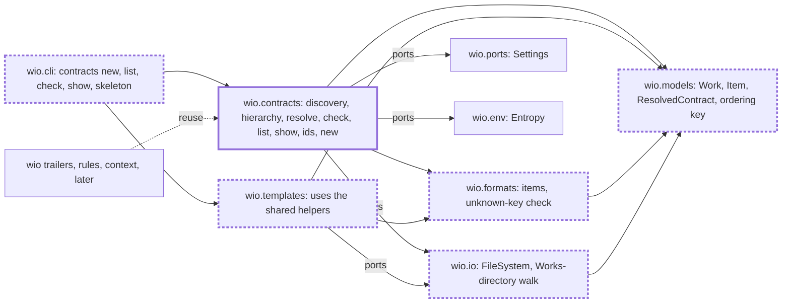

<!-- wio
id = "912c07"
template = "feature.parent"
roots = ["@descendants"]
depends_on = []
-->

# The wio contracts command

## Purpose

People and agents who run a workflow need to create, list, check and show the
Work contracts that drive it, and the code that finds and reads Works must be
one that `wio trailers`, `wio rules` and `wio context` reuse, so every command
agrees on what a Work is, what it inherits and what it depends on.

## Goals

- A person or an agent can create a Work from a kind's entry template, from any
  template, or as a bare contract. It gets a new id and a place that follows the
  hierarchy mode.
- A stage can rewrite an existing Work in another template's shape and keep its
  id and dependencies, so the Work keeps its records.
- A person or an agent can list the Works with their hierarchy and show one
  Work in its resolved form, with inherited sections, actions, roots and
  dependents.
- A person or an agent that edits a contract is told what is wrong with the
  contracts, all at once.
- An agent that edits a contract, and a commit that changes one, is told of a
  problem at once.
- The finding of Works, their hierarchy, dependencies, inheritance and items
  live in one place that `wio trailers`, `wio rules` and `wio context` reuse.

## Glossary

- **Resolved view**: a Work's contract together with the sections its ancestors
  mark as inherited, which `wio contracts show` prints and a context bundle
  later shows.
- **Item**: a part of a section that carries an id, such as a criterion
  `AC-1`. A Work's items are those of its own sections only.
- **Skeleton for an existing Work**: the skeleton of a template that keeps the
  Work's `id` and `depends_on`, as `wio contracts skeleton` prints it. A
  skeleton that `wio templates show` prints has no `id`.

## Non-Goals

- Rewriting, moving or deleting a Work. wio creates a contract, and people and
  agents change it.
- Looking up a dependency that is no longer in the tree in the history, the note
  and the history window of ids. They arrive with `wio trailers`.
- Id generators other than the random one, and a config key to pick one.
- Importing existing specs: `wio contracts adopt`, `wio init` and a default
  path for `new` belong to v0.2.
- Tracking items of a parent through the items of its children.
- A single `wio check` that runs every check.
- Judging whether every criterion was delivered, or how a workflow splits Works.
- Giving `wio config check` a line and a column, and one ordering of
  diagnostics for all three `check` commands.

## Assumptions

- **A-1**: The templates Work is delivered. The block reader, outline, directive
  parser, skeleton and TOML writer in `wio.formats` are used as they are.
- **A-2**: The config Work is delivered. `Config` carries `[works] dir`,
  `hierarchy` and `defaults.actions`, and `[templates]` with its kinds.
- **A-3**: The `FileSystem` and `Entropy` ports need no new member.
  `FileSystem.write_text` creates parent directories but overwrites, so `new`
  checks that the path does not exist first. Two creators racing for one path
  are not handled.
- **A-4**: `wio trailers` and its record reader do not exist yet. Nothing in
  this Work reads a commit message or the history.
- **A-5**: `.agents/wio/works` holds only this Work's own contracts while it is
  delivered, so system-level criteria build their own repositories.
- **A-6**: `jq` is on the `PATH` where the hook runs, and the `PostToolUse`
  payload of an edit carries `tool_input.file_path`, as the existing hooks rely
  on.
- **A-7**: A project has at most a few hundred Works, so every command and hook
  reads them all on each run, with no index or cache.

## Mechanisms

- `wio.contracts`, the component behind `wio contracts`: discovery of Works,
  the hierarchy and dependency graph, the resolved view, the check, `list`,
  `show`, `skeleton`, the id generator and `new`. It imports no other
  component.
- `wio.formats`, which gains the finder of the items of a section and the
  unknown-key check with its suggestion, and whose block reader, outline,
  directive parser, skeleton and TOML writer `wio.contracts` reuses.
- `wio.models`, which gains `Work`, the item type and the real
  `ResolvedContract`, and keeps the ordering key of diagnostics and `has_error`
  beside `Diagnostic`.
- `wio.io`, which gains the walk of the Works directory that `wio.templates`
  and `wio.contracts` share, beside the `FileSystem` port it walks.
- The ports `FileSystem`, `Entropy`, `Settings` and `Repository`, which the
  component reads files, randomness, the config and the repository root
  through.
- `wio.cli`'s table of commands, which gains `contracts` with `new`, `list`,
  `check`, `show` and `skeleton`.
- The `PostToolUse` entry of `.claude/settings.json` and the `wio-contracts`
  hook of `prek.toml`, which run `wio contracts check` after an agent's edit of
  a contract and in a commit that changes one.
- The split between `wio.contracts`, `wio.formats`, `wio.models` and `wio.io`
  is fixed; `Work`, the item type, `ResolvedContract` and the id generator's
  interface are provisional, for the children that build them to decide.

## Constraints

- **A Work is created, never rewritten.** The only write is `new` creating one
  new file. `skeleton`, `list`, `show` and `check` write nothing, and an
  existing path is never overwritten.
- **The tree is read as it is on disk.** The working tree is read, with no
  symbolic link followed and neither `.gitignore` nor a glob consulted. The
  hierarchy and the dependents are computed from the layout and the metadata,
  never stored.
- **Unknown metadata keys warn.** A wrong type is an error. The reserved
  `tracks` and the project's own `[x]` table are left alone. A contract has no
  `parent` or `children` key.
- **One Diagnostic, every problem at once.** Discovery reports and does not
  raise, so one broken Work hides no other problem. Ordering uses the file, line
  and column key that the shared leaf extracts, and rendering keeps that order.
- **Output is deterministic.** It is sorted or in a fixed order and has no
  timestamps, and `--json` prints one array or object that parses.
- **Ids are 6 lowercase Crockford base32 characters from `Entropy`.** An id is
  unique among the Works of the tree and may be one that a deleted Work had.
- **Nothing is imported before it is needed.** `list` and `check` without
  `--json` import neither `tomlkit` nor `json`, and `list` imports no Markdown
  parser. Only `new` and `skeleton` import the writer.
- **One reader, one writer, one Markdown parser.** Only `wio.formats` imports
  `tomllib`, `tomlkit` and `markdown_it`, and ruff's `banned-api` reports any
  other import.
- **Dependency direction.** `wio.contracts` imports `wio.formats`,
  `wio.models`, `wio.io` and ports, never another component. The review of each
  child checks the imports of its files, because `tach check` alone can pass a
  forbidden one ([known issues](../../../../docs/known-issues.md)).

## Visuals

Before (`main` at `929f0d4`), `wio.contracts` holds only its docstring and
`wio.cli` has no `contracts` command. The walk of the Works directory, the
unknown-key check, `has_error` and the ordering key are private to
`wio.templates`, and `ResolvedContract` is a stub in `wio.models`. After, the
component exists, the shared pieces live where both components can import them,
and the later commands read Works through it. Bold boxes are added and bold
dashed boxes change.

## Acceptance criteria

### **AC-1** The installed package creates, lists, shows and checks Works

The built wheel gives a working `wio contracts new`, `list`, `show` and `check`
in a project that is not this repository.

#### The installed command

- **Given** the wheel built from the tree, run with
  `uv run --no-project --isolated --with <wheel>`, and a git repository whose
  config declares the kind `feature` with the entry template `feature.draft`,
  `hierarchy = "nesting"` and the actions, stage presets and stages that the
  three `feature` templates name, and whose templates directory holds them.
- **When** `wio contracts new feature --title "Read config"`,
  `wio contracts list`, `wio contracts show <id>` and `wio contracts check` run
  there, with the id that `new` printed.
- **Then** `new` prints the new id and the path of the Work, `list` lists the
  Work with that id and title, `show` prints it, and `check` passes; each exits
  0.

#### A kind or an id that does not exist

- **Given** the same wheel and repository.
- **When** `wio contracts new nosuch --title "X"` and
  `wio contracts show zzzzzz` run.
- **Then** each prints an error that names `nosuch` or `zzzzzz`, and exits 2.

### **AC-2** A new Work is valid at once and sits in its parent's tree

A Work made by `new` passes `check`, a child made with `--parent` is listed
under its parent, and the resolved view of the child holds what its parent
passes on.

#### A parent and a child

- **Given** a repository as in AC-1, and a Work `T` whose contract is in the
  `feature.parent` template, with a Glossary and a Constraints section.
- **When** `wio contracts new feature --parent <T> --title "Child"` runs, and
  then `wio contracts check`, `wio contracts list` and
  `wio contracts show <child id>`.
- **Then** `check` passes, `list` indents `Child` below `T`, and `show` prints
  the Glossary and the Constraints of `T` as inherited sections and none of
  `T`'s other sections.

### **AC-3** A Work moves to another template and keeps its identity

The skeleton of an existing Work keeps its `id` and `depends_on`, takes the new
template's roots and actions, and says what it dropped.

#### Moving a leaf to the parent template

- **Given** a Work `W` from `feature.leaf` with `roots = ["api"]`, an action
  override and `depends_on = ["a7b2c4"]`, and the template `feature.parent`.
- **When** `wio contracts skeleton feature.parent --work <W>` runs.
- **Then** standard output is the skeleton of `feature.parent` with the `id` of
  `W` and `depends_on = ["a7b2c4"]`, with `roots = ["@descendants"]` and no
  directive comment, standard error names the roots and the override of `W`
  that it did not carry, nothing is written, and it exits 0.

#### Keeping the roots

- **Given** the same Work and template.
- **When** `wio contracts skeleton feature.parent --work <W> --keep roots` runs.
- **Then** the skeleton has `roots = ["api"]`, and standard error names only
  the override.

#### A Work or a template that does not exist

- **Given** the same repository.
- **When** the command runs with an id that no Work has, and with a template
  that no file has.
- **Then** each prints an error that names it, and exits 2.

### **AC-4** `check` reports every problem at once

`wio contracts check` finds problems across the whole tree in one run, in a
fixed order.

#### A tree with four problems

- **Given** a repository whose Works include two with one id, two that depend
  on each other, one that lacks a section its template requires, and a
  directory under `nesting` that holds two marked files.
- **When** `wio contracts check` runs, and then `wio contracts check --json`.
- **Then** both report all four problems, each with the paths it concerns, in
  the same order, the second as one JSON array that parses, and each exits 1.

#### A clean tree and a warning

- **Given** a tree with no error, and a Work whose metadata has an unknown key.
- **When** `wio contracts check` runs.
- **Then** it prints the warning that names the key and the key it is close to,
  and exits 0.

### **AC-5** This repository's own Works agree across the commands

While this Work is delivered, its own contracts are found, listed and shown, and
no command changes them.

#### The repository's own Works

- **Given** this repository.
- **When** `wio contracts list`, `wio contracts show <id of a leaf>` and
  `wio contracts check` run.
- **Then** `list` shows this Work with its leaves nested below it, `show` prints
  the leaf with this Work's Glossary and Constraints, and `check` passes.

#### Nothing is written

- **Given** this repository's Works and a hash of each contract.
- **When** `list`, `show`, `skeleton` and `check` run on them.
- **Then** the hash of every contract is unchanged.

#### The same output twice

- **Given** this repository's Works.
- **When** `list`, `show` and `check` each run twice.
- **Then** the two outputs of each command are identical.

### **AC-6** A run that reads no skeleton or body loads no writer or parser

`wio contracts list`, without `--json`, imports none of `tomlkit`, `json` and
`markdown_it`, and `wio contracts check`, without `--json`, imports neither
`tomlkit` nor `json`.

#### A fresh interpreter

- **Given** a new Python process and a repository with valid Works.
- **When** `main(["contracts", "list"], stdio)` and then
  `main(["contracts", "check"], stdio)` of `wio.cli` run in that process and
  `sys.modules` is read.
- **Then** after the first none of the three modules is there, and after the
  second neither `tomlkit` nor `json` is there.

### **AC-7** `wio.contracts` depends on nothing it should not

No module of `wio.contracts` imports another component, `tomllib`, `tomlkit` or
`markdown_it`.

#### A module that imports one

- **Given** a module of `wio.contracts` that imports `wio.templates`, another
  that imports `tomlkit` and a third that imports `markdown_it`.
- **When** `tach check` and `ruff check` run on `src/wio`.
- **Then** `tach` reports the first, and ruff reports `TID251` for the second
  and the third.

### **AC-8** `wio templates` behaves as before

Once the shared helpers have moved out of `wio.templates`, its commands print
the same on this repository's templates.

#### The repository's own templates

- **Given** this repository's templates.
- **When** `wio templates list`, `wio templates show feature.parent` and
  `wio templates check` run before and after the helpers move.
- **Then** each prints the same bytes and exits with the same code.

## Additional context

- [v0.1 scope](../../../../docs/v0.1-scope.md) names `wio contracts` as a part
  and its outcome; this Work adds `skeleton`, which carries a Work's identity
  into a skeleton, and settles how items are found and how the resolved view
  renders inherited sections.
- [Work contract](../../../../docs/concepts.md#3-work-contract) and
  [Nesting](../../../../docs/concepts.md#5-nesting) in the concepts say what a
  Work, a hierarchy and an inherited section are.
- The `templates` Work left the reader, the outline, the directive parser and
  the skeleton in `wio.formats` for this Work to reuse.
- The ordering that the shared leaf extracts is the one of
  `wio templates check`. It is replaced when `wio config check` gets a line and
  a column and the three commands share one ordering.
- Each leaf names the documents it touches in its own context.
