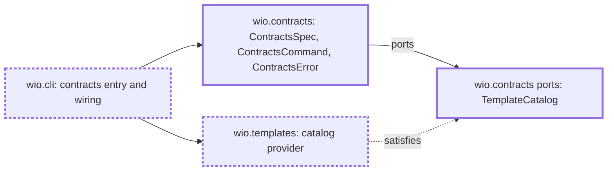

<!-- wio
id = "sz1zsq"
template = "feature.leaf"
roots = ["wio"]
depends_on = ["h69nf8"]
-->

# The contracts command group and the template catalog

## Purpose

Every contracts subcommand needs the same command group, the same way to find a
template, and the same conventions. They are built once, so that no subcommand's
leaf creates them and two leaves delivered together do not collide, and so that
`wio.contracts` reaches the templates without importing the component that
owns them.

## Goals

- `wio contracts` is a command of wio with its own help, which works outside a
  repository.
- A subcommand is added to the group by one entry, without editing another
  subcommand.
- The template a contract names is found, and a template that
  `wio templates check` rejects is told from one that does not exist.
- A mistake the user must fix in a contracts command ends in a message and exit
  code 2.

## Glossary

- **Catalog**: the port through which `wio.contracts` asks for templates, and
  the object of `wio.templates` that satisfies it.

## Non-Goals

- Any subcommand of the group. `new`, `list`, `show`, `check` and `skeleton` are
  the work of their own leaves.
- Reading a template's directives or actions, which a contract's leaves do from
  the template's path.
- Changing what `wio templates list`, `show`, `check` and `directives` print.
- Wiring the `Entropy` port, which the leaf that creates Works adds.

## Assumptions

- **A-1**: The shared leaf is delivered, so `check_templates` already uses the
  shared helpers for the ordering and the rendering of its findings.
- **A-2**: `wio.cli` describes every command from its component's `describe()`
  and wires only the one that was chosen, as it does for `wio templates`.
- **A-3**: `discover` and `check_templates` of `wio.templates` give a provider
  everything it needs without being changed, when it is given the `Config`, the
  repository root and a `FileSystem`.

## Mechanisms

- `ContractsSpec` and `ContractsCommand` in `wio.contracts`, built as
  `TemplatesSpec` and `TemplatesCommand` are, with a table of subcommands that
  is a parameter of both and that a leaf adds one entry to.
- The port `TemplateCatalog` in `wio/contracts/ports.pyi`, with
  `find(name)`, which gives the `Template` or none, and `is_rejected(name)`,
  which says whether `wio templates check` reports an error for the template
  file of that name.
- A class in `wio.templates` that satisfies the port from `discover` and
  `check_templates`, built from the `Config`, the repository root and a
  `FileSystem`, and that imports nothing from `wio.contracts`.
- `ContractsError`, which extends `WioError`, in `wio.contracts.errors`.
- `wio.cli`'s table of commands and its wiring function for `contracts`, the
  one place where the group, the settings, the repository, the file system and
  the catalog meet.
- The names and signatures above are provisional, for the architecture stage to
  decide, except the two members of the port.

## Constraints

- **A subcommand is one entry.** Its arguments and its handler are registered in
  the table of subcommands, so adding one changes that table and a module of its
  own and nothing of another subcommand.
- **Bare `wio contracts` reads nothing.** It writes its help, loads no config
  and finds no repository, so it works anywhere. Describing the command does no
  I/O and imports neither the config loader nor a codec.
- **`is_rejected` is keyed by name.** It is true when an error is reported for a
  file whose name without `.md` is the name, also for a template that discovery
  could not build and that `find` therefore does not give. A warning never
  rejects, and a name that no file has is not rejected. When the templates
  directory itself is refused, it is false for every name.
- **The provider discovers once and checks once.** It runs `discover` once, on
  the first call of `find` or `is_rejected`, and `check_templates` once, on the
  first call of `is_rejected`, and keeps what they return.
- **Neither package imports the other.** `wio.contracts` never imports
  `wio.templates`, `wio.templates` never imports `wio.contracts`, and only
  `wio.cli` builds the catalog and hands it to the group.
- **A user's mistake is a `ContractsError`.** It carries the message, the
  command line prints it, and the exit code is 2. A failed check is exit code 1
  and any other exception is a bug.

## Visuals

Before (`main` at `929f0d4`), `wio.cli` has no `contracts` command,
`wio.contracts` holds only its docstring, and `wio.templates` offers its
templates only to its own command. After, the group exists, `wio.templates`
satisfies a port that `wio.contracts` declares, and `wio.cli` wires them. Bold
boxes are added and bold dashed boxes change.

## Acceptance criteria

### **AC-1** `wio contracts` prints its help anywhere

Bare `wio contracts` writes its help and exits 0 without a repository or a
config, and `wio --help` lists the command.

#### Outside a repository

- **Given** a directory that is not in a git repository.
- **When** `wio contracts` and `wio --help` run there.
- **Then** the first prints a help text that names `wio contracts` and exits 0,
  and the second lists `contracts` with its one-line help.

#### Nothing heavy is loaded

- **Given** a new Python process.
- **When** `main(["contracts"], stdio)` of `wio.cli` runs and `sys.modules` is
  read.
- **Then** none of `tomlkit`, `json`, `markdown_it` and `wio.config.loader` is
  there.

### **AC-2** A subcommand is added by one entry

A subcommand registered in the table is described in the help and run by the
group, and the group knows nothing else of it.

#### A fake subcommand

- **Given** a group built with a table of one entry `ping`, whose handler writes
  `pong`.
- **When** `wio contracts --help` and `wio contracts ping` run through it.
- **Then** the help lists `ping` and the second prints `pong` and exits 0.

#### An unknown subcommand

- **Given** the same group.
- **When** `wio contracts nosuch` runs.
- **Then** it prints a usage error that names `nosuch` and exits 2.

### **AC-3** The catalog finds a template

`find` gives the `Template` of a name with its `path`, and none for a name that
no built template has.

#### Found and missing

- **Given** a config whose `[templates.kinds]` declares the kind `feature`, and
  a templates directory with the valid template `feature.leaf` of that kind in a
  subdirectory.
- **When** `find("feature.leaf")` and `find("nosuch")` run.
- **Then** the first gives that template with its `path` relative to the
  repository root and the second gives none.

### **AC-4** A rejected template is told from a missing one

`is_rejected` is true for a name whose file has an error in
`wio templates check`, and false for the rest.

#### Each case

- **Given** a config whose `[templates.kinds]` declares the kind `feature` with
  the entry template `good`, and templates of that kind named `good`, `warned`
  with a repeated `##` heading, `badkey` with an unknown key, `unclosed` whose
  block does not close, `baddirective` with the directive list
  `<!-- wio: mandatory -->`, and two files named `twin` in different
  subdirectories.
- **When** `is_rejected` runs for each of them and for `nosuch`, and `find` runs
  for `unclosed`.
- **Then** it is false for `good`, `warned` and `nosuch`, and true for `badkey`,
  `unclosed`, `baddirective` and `twin`, and `find("unclosed")` gives none.

#### A refused directory

- **Given** a templates directory that is a symbolic link.
- **When** `is_rejected` runs for any name.
- **Then** it is false.

### **AC-5** The templates are discovered once and checked once

The reads the catalog makes are those of one discovery and one check, however
often it is asked.

#### Counting the reads

- **Given** a catalog over a file system that counts the reads of each
  template, and the counts of a reference run of `discover` and of
  `check_templates` on the same templates.
- **When** `find` runs twice, and then `is_rejected` runs three times.
- **Then** after `find` the counts are those of the reference `discover`, and
  after `is_rejected` they exceed them by exactly those of the reference
  `check_templates`.

### **AC-6** A mistake the user must fix exits 2

A `ContractsError` raised by a subcommand is printed as a message and exits 2,
and a failed check exits 1.

#### An error and a check

- **Given** a group with a subcommand that raises `ContractsError("no such
  Work")` and one that returns 1.
- **When** each runs.
- **Then** the first writes the message to standard error and exits 2, and the
  second exits 1 with nothing on standard error.

### **AC-7** The two packages do not import each other

`wio.contracts` imports nothing of `wio.templates`, and `wio.templates` imports
nothing of `wio.contracts`.

#### An import in each direction

- **Given** a module of `wio.contracts` that imports `wio.templates`, and a
  module of `wio.templates` that imports `wio.contracts`.
- **When** the imports of the two packages are read from their syntax trees, and
  `tach check` runs.
- **Then** the syntax trees show both imports, and `tach check` reports them,
  though its pass alone does not prove that there is none.

## Additional context

- The catalog is the pattern of the architecture's ports. The ports that
  `wio.context` and `wio.trailers` declare for what they need of contracts are
  satisfied the same way, and are not built by this Work.
- Each subcommand's leaf adds its entry to the table and its own wiring to
  `wio.cli`, and the leaves that read templates use `find` and `is_rejected`.
