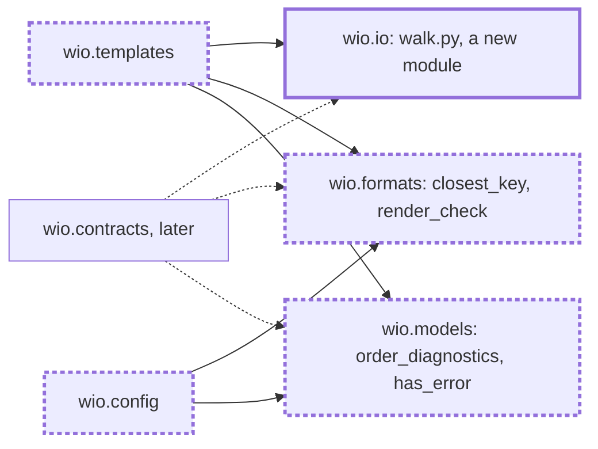

<!-- wio
id = "h69nf8"
template = "feature.leaf"
roots = ["wio"]
depends_on = []
-->

# Shared helpers of the templates and contracts commands

## Purpose

`wio.templates` and `wio.contracts` need the same walk of the Works directory,
the same ordering and rendering of a check's findings, and the same suggestion
for a mistyped key, and neither component may import the other. Each helper
therefore moves to a package both may import, so one copy exists and the later
commands use it. `wio.config` already has its own copies of two of them, and
joins them.

## Goals

- One walk of the Works directory, which `wio templates` uses and
  `wio contracts` will use.
- One place that finds the closest known key to a mistyped one, used by
  `wio config`, `wio templates` and later `wio contracts`, and the only importer
  of `difflib`.
- One `has_error`, one ordering of diagnostics by file, line and column, and one
  rendering of a check's result, used by `wio templates` and later by
  `wio contracts`, with `has_error` also used by `wio config`.
- A person who mistypes a key in a template is told the closest valid key, as a
  person who mistypes a key in the config already is.
- Every other output of `wio config` and `wio templates` stays as it is.

## Glossary

- **Closest key**: the one known key that `difflib.get_close_matches` ranks
  first for a mistyped key, with its default cutoff, or none.

## Non-Goals

- The unknown-key check of a contract, a warning that names the closest key,
  which the check-works leaf builds with the function made here.
- Joining the messages of the three commands for an unknown key. Each keeps its
  own wording, and only the matching is shared.
- Giving `wio config check` a line and a column, or one ordering of diagnostics
  for all three `check` commands, and changing `sort_diagnostics`.
- Sharing what is specific to one command: grouping templates by name, finding
  the templates that discovery could not build, and finding the Works.

## Assumptions

- **A-1**: The existing tests of `wio config` and `wio templates` pin their
  messages and their output, so a move that changes either shows as a failing
  test.
- **A-2**: A component may import a function from `wio.io`, not only a port,
  because `tach.toml` lets every component depend on `wio.io`. `walk.py` is the
  first module of `wio.io` that holds runtime code besides its adapters, so the
  description of `wio.io` as only ports changes with it.
- **A-3**: `difflib.get_close_matches(key, known, n=1)` with its default
  cutoff is what both sites of `wio config` use today, and what the new callers
  need.

## Mechanisms

- A module `walk.py` in `wio.io` with two functions: `walk_markdown(directory:
  Path, files: FileSystem) -> Iterator[Path]`, which yields the Markdown files
  below a directory, and `refuse_directory(directory: Path, written: str, files:
  FileSystem, *, noun: str, default: str) -> list[Diagnostic] | None`, which
  judges the directory itself and returns its one error, or none. Both read no
  file.
- In `wio.formats`: `closest_key(key: str, known: Iterable[str]) -> str | None`,
  the one importer of `difflib`, lazily, and `render_check(diagnostics:
  Iterable[Diagnostic], *, as_json: bool, passes: str) -> str`.
- In `wio.models.diagnostics`, beside `Diagnostic` and `sort_diagnostics`:
  `order_diagnostics(diagnostics: Iterable[Diagnostic]) -> tuple[Diagnostic,
  ...]`, which reuses that module's rank of severities, and
  `has_error(diagnostics: Iterable[Diagnostic]) -> bool`.
- The callers that change: `wio.templates` (discovery, check and command) and
  `wio.config` (`messages.py`, `keypath.py`, `loader.py` and `report.py`).
- Ruff's `banned-api` table, which gains `difflib`, as it bans `tomllib` and
  `markdown_it`, with the exemption that `wio.formats` already has.
- The names and the signatures above are fixed. The tests and what else a
  module holds are for the architecture stage.

## Constraints

- **Moved, not changed.** Every output of `wio config` and `wio templates` is
  byte for byte what it was, except the message of a mistyped key in a template,
  which gains the closest key. The existing tests of both components run
  unchanged to show it, and only the tests that assert that message change.
- **Nothing is imported before it is needed.** `difflib` loads on the first call
  of `closest_key`, as the config's own README already requires, and `json`
  loads only when `render_check` renders JSON.
- **The helpers import only what they need.** `wio.io.walk` imports the
  `FileSystem` port, `Diagnostic` of `wio.models` and the standard library.
  `closest_key` imports `difflib` and nothing else. `render_check` imports
  `render_text` and `render_json` of `wio.formats` and `wio.models`.
  `order_diagnostics` and `has_error` import only the standard library, `re`
  among it.

## Visuals

Before (`main` at `929f0d4`), `wio.templates` holds the walk, `has_error`, the
ordering and the rendering of a check, and `wio.config` matches keys with its
own `difflib` calls and repeats `has_error` inline. After, one copy of each
lives where both components, and later `wio.contracts`, can import it. Bold
boxes are added and bold dashed boxes change.

## Acceptance criteria

### **AC-1** The walk yields the visible Markdown files

`walk_markdown` yields the files whose names end in `.md` with that case, below
a directory, and nothing else.

#### A tree with files to skip

- **Given** a tree held by a fake `FileSystem`: `a.md`, `B.MD`, `notes.txt`,
  `sub/f.md`, `.hidden/c.md`, a symbolic link to a directory that holds `d.md`,
  and a symbolic link to a file named `e.md`.
- **When** `walk_markdown` runs on its root over a fake that records every read
  and lists its entries in the
  order `a.md`, `B.MD`, `notes.txt`, `sub`, `.hidden`, the link to the directory
  and the link to the file.
- **Then** it yields `a.md` and `sub/f.md`, in that order, and it has read no
  file.

### **AC-2** The directory itself is judged with the caller's noun

`refuse_directory` returns a list of one error for a directory that cannot be
walked, and none for one that can, or for a missing directory whose `written`
form equals `default` as text.

#### Each case

- **Given** `noun="templates"` and `default=".agents/wio/templates"`, and a
  directory that is a symbolic link, one that is missing and written as
  `other`, one that is a file, one that is missing and written as
  `.agents/wio/templates`, and an ordinary directory.
- **When** `refuse_directory` runs on each.
- **Then** the first three return a list of one error whose message is `The
  templates directory must not be a symbolic link`, `The templates directory
  does not exist` and `The templates directory is not a directory`, whose place
  is the path as written, and the last two return none.

#### Another noun

- **Given** `noun="Works"` and a directory that is a symbolic link.
- **When** `refuse_directory` runs on it.
- **Then** the message reads `The Works directory must not be a symbolic link`.

### **AC-3** The closest key is found, and `difflib` loads only then

`closest_key` returns the closest known key or none, and importing `wio.formats`
or running a command that finds no mistyped key imports neither `difflib` nor
`json`.

#### The match

- **Given** the known keys `description` and `kind`.
- **When** `closest_key` runs for `descriptions`, for `zzz`, and for `kind` with
  no known keys.
- **Then** the results are `description`, none and none.

#### A fresh interpreter

- **Given** a new Python process, a valid config and valid templates.
- **When** `wio.formats` is imported, then `main(["config", "check"], stdio)`
  and `main(["templates", "check"], stdio)` of `wio.cli` run in text form, and
  `sys.modules` is read, and then `closest_key` is called and it is read again.
- **Then** neither `difflib` nor `json` is there the first time, and `difflib`
  is there the second.

### **AC-4** `wio config` says what it said

The two sites of `wio config` that suggest a key give the same messages as
before, and `wio config` imports `difflib` nowhere itself.

#### A mistyped setting and a mistyped key

- **Given** a config with a `[stages]` table, and another whose stage `define`
  has a `goal` and the key `sessionn` and no other problem.
- **When** `wio config show stagez` and `wio config check` run on them.
- **Then** the first prints an error that names `stagez` and says
  ``Did you mean `stages`?`` and exits 2, and the second reports the unknown key
  `sessionn` with ``Did you mean `session`?`` and exits 1, each with the text it
  had before this change.

#### The import

- **Given** the new `difflib` entry of ruff's `banned-api`, and a module of
  `wio.config` that imports `difflib`.
- **When** `ruff check` runs on `src/wio`.
- **Then** it reports `TID251` for that import, and reports none for the import
  in `wio.formats`.

### **AC-5** A template says the closest key

The error of an unknown key in a template's metadata names the closest key when
there is one, and is as it was when there is none.

#### Close and far

- **Given** a config that declares the kind `feature`, and two templates of that
  kind, one whose metadata has the key `descriptions` and one that has the key
  `zzz`.
- **When** `wio templates check` runs.
- **Then** it reports ``Unknown key `descriptions` in the metadata. Did you mean
  `description`?`` and ``Unknown key `zzz` in the metadata``, each at its file,
  and no other finding, and exits 1.

### **AC-6** `has_error` tells an error from the rest

`has_error` is true when a diagnostic is an error, and false for warnings and
notes alone.

#### The helper and `config`

- **Given** the diagnostics `a.md:2: warning` and `a.md: note`, and the same
  with `b.md: error` added, and a config with a warning and no error and one
  with an error.
- **When** `has_error` runs on both sets, and `wio config check` runs on both
  configs.
- **Then** `has_error` is false and then true, and `wio config check` exits 0
  and then 1, with the output it had.

### **AC-7** Diagnostics are ordered by file, line and column as numbers

`order_diagnostics` orders by file, then line and column as numbers, then
severity and message, and puts a place that is not a file last.

#### The order

- **Given** the diagnostics `a.md:10: error`, `a.md:2:10: error`,
  `a.md:2:3: error`, `a.md:2: warning`, `a.md:2: error`, `a.md: note`,
  `b.md: error` and `nofile: error`.
- **When** `order_diagnostics` runs on them.
- **Then** the order is `a.md`, then `a.md:2` error, `a.md:2` warning,
  `a.md:2:3`, `a.md:2:10`, `a.md:10`, then `b.md`, then `nofile`.

### **AC-8** A check's result is rendered with the sentence it is given

`render_check` prints the sentence it is given when there is nothing to report.

#### Nothing to report

- **Given** no diagnostic.
- **When** `render_check` runs with `passes="The contracts pass."`, in text and
  as JSON.
- **Then** the renderings are `The contracts pass.` and `[]`, each ending in a
  newline.

### **AC-9** `wio templates` prints what it printed

Apart from a mistyped key, every output of the commands of `wio templates` is
the same.

#### The repository's templates and a broken directory

- **Given** this repository's templates, and a repository whose templates
  directory is a symbolic link.
- **When** `wio templates list`, `wio templates check` and
  `wio templates check --json` run on each.
- **Then** on the first, the outputs and exit codes are those of the commands
  before this change, and `check` prints `The templates pass.`. On the second,
  `check` prints `error: .agents/wio/templates: The templates directory must
  not be a symbolic link` and exits 1, and `list` prints that error and the line
  `` `wio templates check` shows every problem. `` and exits 2.

### **AC-10** There is one copy of each helper

After the move, each helper is defined once, in the package named for it, and
the components use it.

#### The sources

- **Given** the sources of `src/wio` after the change.
- **When** their syntax trees are searched for the definitions of the helpers,
  for the use of `severity == "error"`, and for the imports of the helper
  modules.
- **Then** `walk_markdown` and `refuse_directory` are defined only in
  `wio.io.walk`, `closest_key` and `render_check` only in `wio.formats`, and
  `order_diagnostics` and `has_error` only in `wio.models.diagnostics`;
  `wio.templates` defines none of `_walk`, `_walk_visible`, `_refuse_directory`,
  `_has_error`, `_order_key` and `render_check`; `wio.config` has no `any(...)`
  of `severity == "error"`, and imports `has_error` where it asks whether there
  is an error, in the check of the loaded diagnostics of `loader.py` and in the
  exit code of `report.py`, and `closest_key`, while the filter that selects the
  errors of the loaded diagnostics stays; `difflib` is imported only in
  `wio.formats`; and each helper module imports only what the Constraints list.

## Additional context

- The check-works leaf builds the unknown-key warning of a contract on
  `closest_key`.
- The ordering moved here is the one of `wio templates check`. It is replaced
  when `wio config check` gets a line and a column and the three commands share
  one ordering.
- This leaf changes tests of `wio templates` and `wio config`.
