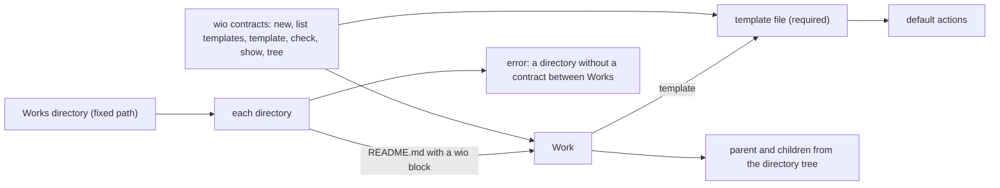
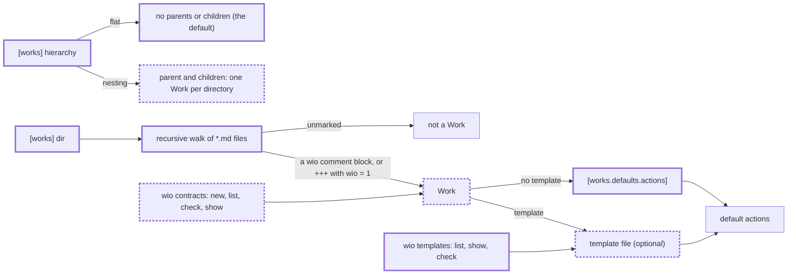

<!-- wio
id = "2fh1ar"
template = "feature.parent"
roots = ["@descendants"]
depends_on = []
-->

# Finding Work contracts in any Markdown file

## Purpose

A project with its own spec files must be able to adopt wio by marking those
files, without moving them into one directory per Work, naming them `README.md`
or writing templates first.

## Goals

- A project with existing spec files can adopt wio by marking those files and
  adding a few lines of config, without moving or renaming a file or writing a
  template.
- The design documents describe one model of which files are Works, how Works
  relate and where their actions come from.
- `wio contracts` serves contracts and `wio templates` serves templates, so each
  command covers the term of wio it names.
- wio's own repository keeps its layout and its workflow under the new model.

## Glossary

- **Marked file**: a `.md` file under the Works directory whose metadata wio
  recognizes as a Work's: a `<!-- wio` comment block, or `+++` front matter
  that holds the marker.
- **Marker**: the key `wio = 1` in a contract's metadata, whose value is the
  version of the metadata format.
- **Hierarchy mode**: the setting `[works] hierarchy`, `flat` or `nesting`,
  which says whether directories give Works parents and children.

## Non-Goals

- Implementing any component: `wio.contracts` and `wio.templates` are built by
  their own Works against the design this Work leaves.
- Reading YAML front matter, which is expected in v0.2.
- Importing existing specs without marking them: a mode that takes every `.md`
  file with front matter and an `id`, configurable id generation and a looser
  id format are one item for later.
- `wio init` and `wio contracts adopt`, which come in v0.2.
- A hierarchy given by a `parent` field, a configurable file name for
  `wio contracts new`, and a named file template as the default.
- Generated integrations with workflows such as Kiro, for v0.3 or later.
- Defining the `config` Work (`hwn995`), which takes up the `[works]` and
  `[templates]` tables when it is defined.

## Assumptions

- **A-1**: The layouts of Spec Kit, Kiro, OpenSpec, superpowers, and ADR and
  RFC folders, surveyed below, are representative of the spec workflows wio
  should admit without restructuring.
- **A-2**: The tools that write or read those files keep a leading
  `<!-- wio -->` comment or `+++` block that a person adds, and do not drop it
  when they regenerate a file.

## Mechanisms

- `docs/concepts.md`, the design of the engine, where the model of Works,
  templates and their configuration is stated, with its Open points (section
  15).
- `docs/v0.1-scope.md`, where the outcome of `wio contracts` and
  `wio templates` and the list "Not in v0.1" are stated.
- `GLOSSARY.md` and `src/wio/GLOSSARY.md`, where the terms Work, Work contract,
  Template, Kind and Component are defined.
- `.agents/wio/config.toml`, wio's own config, the first consumer of the model.
- `uv run rumdl check`, which lints the Markdown and renders every Mermaid
  block through `scripts/check_mermaid.py`.

## Constraints

- **Design only.** The children change documents, wio's own config and the
  `Component` type of `src/wio/cli/table.py`, and implement no command.
- **One owner per topic.** Each child changes the sections of its own topic
  and links to a statement another child owns instead of restating it:
  - which files are Works and the marker: the marked-files leaf (`bgctsc`);
  - parents, children and the hierarchy modes: the hierarchy leaf (`jsymcg`);
  - templates, kinds and default actions: the optional-templates leaf
    (`ms5t0t`);
  - the commands `wio contracts` and `wio templates`: the templates-command
    leaf (`be2081`).
- **Open points in one place.** What a child defers is stated once, in the Open
  points of `docs/concepts.md`, and, when it is a feature planned for a later
  version, also in "Not in v0.1" of `docs/v0.1-scope.md`.
- **Existing contracts stay valid.** No contract in wio's Works directory is
  moved, renamed or changed for this Work: the comment form needs no marker,
  and every Work directory there holds one contract.
- **Terms.** The terms of this Glossary go into `GLOSSARY.md` with the child
  that introduces them, and the documents use them as defined.
- **Verification.** Each child's review judges its own sections. The
  integration stage of this parent judges AC-1 to AC-3, which only the joined
  documents can establish.

## Visuals

The before state is drawn from `docs/concepts.md` and `docs/v0.1-scope.md` on
`main` at commit `55706d117db746a0269431956c65777c4dfa0afe`. The after state
is the design the children settle: the keys and commands are required, and the
labels are provisional.

Before: a Work is a directory whose `README.md` has a `wio` block, every Work
names a template, and `wio contracts` serves contracts and templates alike.

After: any marked file is a Work, the hierarchy is a mode, templates are
optional, and templates have a command of their own. Bold boxes are added, and
bold dashed boxes change.

## Acceptance criteria

### **AC-1** The documents state one model of Works

A reader of the design documents finds one account of which files are Works,
how they relate, where their actions come from and which command serves
contracts or templates, with nothing left of the old model.

- No section of `docs/concepts.md`, `docs/v0.1-scope.md`, `docs/workflow.md`,
  `docs/split-exercises.md`, `GLOSSARY.md` or `src/wio/GLOSSARY.md` states that
  a Work is a directory whose `README.md` is its contract, that every contract
  names a template, that a directory between two Works must be a Work, or that
  `wio contracts` lists or prints templates.
- The documents state `wio contracts` and `wio templates` as two commands with
  no subcommand in common, and every mention of a removed form, such as
  `wio contracts template` or `wio contracts tree`, is gone.
- Where two sections describe the same rule, such as the Works directory's
  key or the effect of `flat` on `@descendants`, one states it and the other
  links to it.

### **AC-2** The documents show a project adopting wio without restructuring

`docs/concepts.md` holds a worked example of adopting wio in a project with
existing spec files, which only the three design changes together make
possible.

- The example starts from a flat folder of at least two spec files whose names
  are not `README.md`, without templates, such as the dated files of
  superpowers.
- It shows the `+++` block each file gains, with the marker and an id, and the
  config the project adds, with `[works] dir` and `[works.defaults.actions]`
  and nothing else.
- It states which Works wio finds, that none of them has a parent, and which
  actions each has and where they come from, each consistent with the sections
  that state those rules.
- The example fails this criterion if any step needs a template, a `[kinds]`
  table, a moved or renamed file, or a directory per spec.

### **AC-3** wio's own repository follows the new model unchanged

wio's own config and Works satisfy the documented rules of the `nesting` mode,
without a contract being edited.

- `.agents/wio/config.toml` sets `[works] hierarchy = "nesting"` and declares
  its kinds in `[templates.kinds]`, with no `[kinds]` table left.
- Every directory under `.agents/wio/works` holds at most one marked file, no
  marked file sits directly in `.agents/wio/works`, and every contract there
  still uses the comment form without the marker.
- No contract under `.agents/wio/works` is edited to satisfy the new rules.

## Additional context

Survey of current spec layouts, from each tool's own documentation, which is
the basis of A-1:

- [Spec Kit](https://github.com/github/spec-kit/blob/main/spec-driven.md): one
  directory per feature, `specs/003-chat-system/`, named like its git branch
  and holding `spec.md`, `plan.md`, `tasks.md`, `research.md`,
  `data-model.md`, `quickstart.md` and `contracts/`. No front matter, no id,
  no relation between specs.
- [Kiro](https://kiro.dev/docs/specs/best-practices/): one directory per
  feature under `.kiro/specs/`, holding `requirements.md` (or `bugfix.md`),
  `design.md` and `tasks.md`. No front matter, no id, no relation between
  specs. Kiro generates these files, which A-2 is about.
- [OpenSpec](https://github.com/Fission-AI/OpenSpec): one directory per change,
  `openspec/changes/<change>/`, holding `proposal.md`, `design.md`, `tasks.md`
  and delta `specs/`, with an optional `.openspec.yaml` beside them, and
  finished changes under `changes/archive/`. No front matter, no id; "each
  change is self-contained".
- [superpowers](https://github.com/obra/superpowers): flat files,
  `docs/superpowers/specs/YYYY-MM-DD-<topic>-design.md` and
  `docs/superpowers/plans/YYYY-MM-DD-<feature>.md`. No front matter, no id; a
  plan names its spec in a header line of its body.
- ADRs and RFCs ([MADR](https://adr.github.io/madr/),
  [log4brains](https://github.com/thomvaill/log4brains),
  [Rust RFCs](https://github.com/rust-lang/rfcs)): numbered or dated files in
  one folder, which MADR may split into category subdirectories. MADR's
  optional YAML front matter has `status` and `date` but no id, and a `parent`
  key that Jekyll uses for navigation, which a later `parent` mode would have
  to avoid.

None of the surveyed tools carries an id that wio could reuse, so adopting
wio means adding the whole metadata block, and a directory there groups one
unit's files, never a hierarchy of units. The decisions of each child are in
its draft: [marked files](marked-files/README.md),
[hierarchy modes](hierarchy-modes/README.md),
[optional templates](optional-templates/README.md) and
[the `wio templates` command](templates-command/README.md).
