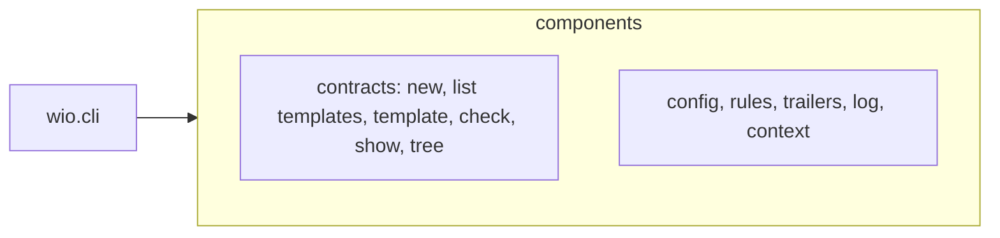
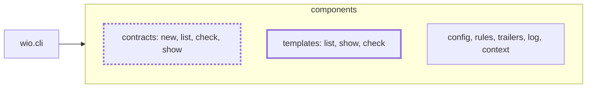

<!-- wio
id = "be2081"
template = "feature.leaf"
roots = ["wio", "repo"]
depends_on = ["jsymcg", "ms5t0t", "41wfqk"]

[actions]
deliver = [
    "implementation",
    "implementation-review",
    "promote-docs",
    "docs-review",
]
-->

# The wio templates command

## Purpose

People and agents must find contracts under `wio contracts` and templates under
`wio templates`, because each command should cover only the term of wio that
it names.

## Goals

- People and agents find contracts under `wio contracts` and templates under
  `wio templates`, with no subcommand in both.
- One command lists the Works of a repository, in either hierarchy mode.
- A project without templates passes `wio config check` and
  `wio templates check`.
- The table of commands admits `wio.templates` as a component.

## Non-Goals

- Implementing `wio contracts` or `wio templates`: their own Works build them
  against the design this leaf leaves.
- Deciding where the code that reads templates lives, which those Works decide
  within the rule that components never import one another.
- Changing what `wio templates show` prints, which keeps what
  `wio contracts template` prints today.

## Assumptions

None.

## Mechanisms

- `src/wio/cli/table.py`, whose `Component` type names the components the
  table of commands admits.
- `tests/unit/cli/test_table.py`, whose
  `test_the_component_names_match_the_packages` requires `Component` to name
  exactly the component packages under `src/wio`.
- `tests/unit/test_packages.py`, whose `PACKAGES` lists every package of v0.1
  and checks that its docstring is one sentence.
- `tach.toml`, whose modules give each component its allowed dependencies.
- `docs/v0.1-scope.md`, whose table of parts and whose sections per command
  state each command's outcome, including the steps of the define skill.
- `docs/concepts.md`, `docs/workflow.md`, `docs/split-exercises.md`,
  `README.md`, `GLOSSARY.md` and `.agents/wio/config.toml`, which name the
  commands that change.
- `src/wio/README.md`, `src/wio/cli/README.md` and `src/wio/GLOSSARY.md`,
  which list the components.

## Constraints

- **Only the scaffold.** The new package holds a docstring and nothing else.
  Verified by implementation-review.

## Visuals

The before state is checked against `src/wio/README.md`, `src/wio/cli/table.py`
and `docs/v0.1-scope.md` on `main` at commit
`55706d117db746a0269431956c65777c4dfa0afe`. Only the components and the commands
that change are shown; the bold box is added and the bold dashed box changes.

Before: six components, and `wio contracts` serves templates too.

After: seven components, and `wio templates` serves templates.

## Acceptance criteria

### **AC-1** Two commands share no subcommand

`docs/v0.1-scope.md` states `wio contracts` and `wio templates` as two
commands, so a person or an agent finds each under the term it names. It
states these rules:

- The table of parts lists `wio templates` beside `wio contracts`, and each
  has a section with its purpose, outcome and usage.
- `wio contracts` has `new`, `list`, `check` and `show`; `wio templates` has
  `list`, `show` and `check`.
- `wio contracts new [<kind>]` is the signature of `new`, and
  `wio contracts show <id or file>` that of `show`; a `show` argument that
  contains `/` or ends in `.md` is a path, and any other is an id.
- `show` given an id that no Work has is an error; given a path that does not
  exist, it gives the reason the marked-files leaf (`bgctsc`) states.
- No file under `docs/`, neither `README.md` nor `GLOSSARY.md`, and no stage
  goal in `.agents/wio/config.toml` names `wio contracts template` or
  `wio contracts tree`; the steps of the define skill name
  `wio templates show`. Work contracts under `.agents/wio/works` are outside
  this rule, because they record what changed.

### **AC-2** `wio contracts list` lists the Works

The outcome of `wio contracts list` in `docs/v0.1-scope.md` states what it
prints, so one command shows the Works of a repository in either mode. It
states these rules:

- It prints each Work's id, title, path, template, roots and dependencies, and
  no status; the template is empty for a contract without one.
- It lists Works and never templates.
- With no Works it prints an empty list and exits 0.
- Under `nesting` it indents each child below its parent; under `flat` it is a
  plain list.
- The columns and the shape of its `--json` output are provisional.

### **AC-3** `wio templates show` keeps the skeleton

The outcome of `wio templates show` states what `wio contracts template` did,
so a define skill keeps its way to rewrite a Work in another template. It
states these rules:

- `wio templates show <name>` prints the template prepared as a contract
  skeleton, without an id and without creating a Work.
- `--work <id>` prints the skeleton for that Work, carrying its id and
  dependencies, `--keep roots` and `--keep actions` carry more, and what is not
  carried is listed on standard error.
- An unknown template name is an error, and so is a `--work` id that no Work
  has.

### **AC-4** `wio templates` lists and checks the templates

The outcomes of `wio templates list` and `wio templates check` state what each
does, so a project without templates passes every check. They state these
rules:

- `wio templates list` prints each template's name, kind, shape and
  description; with no templates it prints an empty list and exits 0.
- `wio templates check` checks the templates themselves: their keys, their
  kinds and their directives, and that each kind in `[templates.kinds]` names
  an entry template that exists and has that kind. With no templates it
  passes.
- `wio config check` checks the shape of the `[templates]` table and reads no
  template, in `docs/concepts.md` and `docs/v0.1-scope.md` alike; with no
  `[templates]` table it passes, because the optional-templates leaf (`ms5t0t`)
  makes the table optional, linking to it.
- `wio contracts check` reports a contract whose template is missing, or that
  `wio templates check` rejects, and points to `wio templates check` instead
  of repeating its findings.

### **AC-5** The command sections link to the rules they serve

The command sections of `docs/v0.1-scope.md` and `docs/concepts.md` link to
the sections the earlier leaves wrote, so each rule is stated once. They
state:

- `wio contracts show` links to the reasons of the marked-files leaf
  (`bgctsc`) and to the `nesting` reasons of the hierarchy leaf (`jsymcg`),
  and to the optional-templates leaf's (`ms5t0t`) rule that it names where each
  action comes from.
- `wio contracts new` links to the bare contract of `ms5t0t` and to the
  `--parent` rule of `jsymcg`.
- `wio contracts list` links to the hierarchy modes of `jsymcg`.

### **AC-6** The table of commands admits `wio.templates`

The code and the architecture documents name a seventh component, so a later
Work can add the `wio templates` entry to the table of commands.

- `Component` in `src/wio/cli/table.py` names `templates` beside the six
  components it names today.
- `src/wio/templates/__init__.py` exists, starts with the SPDX line, and holds a
  one-sentence docstring that says it is the `wio templates` command, and
  nothing else.
- `tests/unit/test_packages.py` lists `templates` in `PACKAGES`, and `tach.toml`
  declares `wio.templates` with the dependencies the other components have,
  without adding it to the dependencies of `wio.cli`, since nothing imports
  it yet.
- `make check` passes, so `test_the_component_names_match_the_packages`, the
  package test, `tach check` and `pyrefly` accept the new component.
- `src/wio/README.md`, its diagram included, `src/wio/cli/README.md` and the
  Component entry of `src/wio/GLOSSARY.md` name seven components.

## Additional context

- A leaf of [Finding Work contracts in any Markdown file](../README.md)
  (`2fh1ar`), and the last one delivered, so its links close the ones its
  siblings left out.
- It depends on the command table (`41wfqk`), which owns the `Component` type.
- The split follows `wio rules`, which already has a command of its own.
