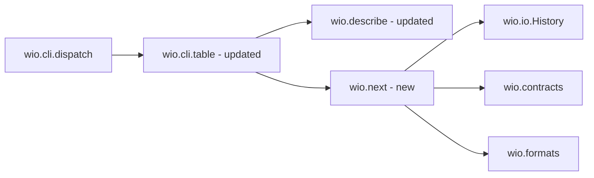

<!-- wio
id = "45f1sa"
template = "feature.parent"
roots = ["@descendants"]
depends_on = []
-->

# Next step advisor (wio next)

## Purpose

Let agents and drivers ask wio which Work, action and stage to run next (and
which Works can proceed in parallel), computed deterministically from git
trailer history and contracts instead of manual guesswork.

## Goals

- Read `Wio-*` records from git history while ignoring records of reverted
  commits.
- Determine the next action and stage for each active Work from its resolved
  pipelines, gate results, `judge = "human"` requirements, `invalidated_by`
  staleness rules and dependency graph.
- Expose `wio next [<work>] [--json]` printing ready steps (including parallel
  Works) and the exact `wio context <work> <action> <stage>` command to run, or
  explaining why a requested Work is blocked or complete.
- Make `next` discoverable offline through `wio.cli.table` and `wio describe`.

## Non-Goals

- Executing stages, mutating contracts or creating commits.
- Enforcing or blocking a driver from choosing another action or stage.
- Reading non-git external issue trackers or CI status.

## Assumptions

- **A-1** First-parent git history from `HEAD` is sufficient to reconstruct
  effective `Wio-*` records for the current branch.
- **A-2** Reverted commits are identified by git's standard revert message line
  `This reverts commit <sha>.`.

## Mechanisms

- `wio.next` (new package under `src/wio/next/`) owns the history record
  reader, state/staleness evaluator, text/JSON renderer and CLI command.
- `wio.io.History` provides the first-parent commit stream; `wio.formats`
  parses `Wio-*` trailers with the configured `trailers.reader`.
- `wio.cli.table` and `wio.describe` register `next` as a top-level subcommand.

## Constraints

- **C-1 Read-only.** `wio next` never writes to the working tree, git
  repository or event log (system-level, verified by acceptance tests in
  `tests/acceptance/next/`).
- **C-2 Architecture boundary.** `wio.next` respects `tach.toml` dependency
  rules and imports `json` only through `wio.formats.encode_json`
  (architectural integration, verified by `tach check` and `ruff check`).
- **C-3 Deterministic output.** Identical repository history, contracts and
  config produce byte-for-byte identical text and JSON output with no
  timestamps (system-level, verified by unit and acceptance tests).

## Visuals

Baseline: `4a173b4` (`main`). Before (current CLI dispatch and describe):

After (provisional addition of `wio.next` registered in `wio.cli.table` and
`wio.describe`):

## Acceptance criteria

### **AC-1** `wio next` proposes ready stages including parallel Works

Running `wio next` (text and `--json`) in a repository with active Works
outputs every ready Work's next action, stage and `wio context` command,
respecting `depends_on`, parent-after-children, gate passes and
`invalidated_by` staleness; when no Work is ready (all blocked, done, or no
Works exist), it reports none and exits 0.

### **AC-2** Reverted commits do not advance or pass stages

If a commit carrying `Wio-*` trailers (including a gate `pass`) is reverted by
a later revert commit, `wio next` treats its records as absent; reverting the
revert restores them.

### **AC-3** Single-Work query reports ready, blocked or done state

Running `wio next <work>` reports the next step when ready, names blocking
dependencies or incomplete children when blocked, and reports complete when all
non-on-demand actions have passed (unknown Work error handling is owned by
`rqms5z`).

### **AC-4** `next` is discoverable offline through `wio describe`

Running `wio describe` and `wio describe next` includes `next` and passes
`tests/tooling/test_describe_sync.py`.
