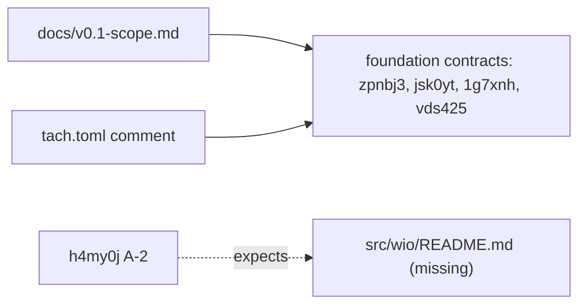
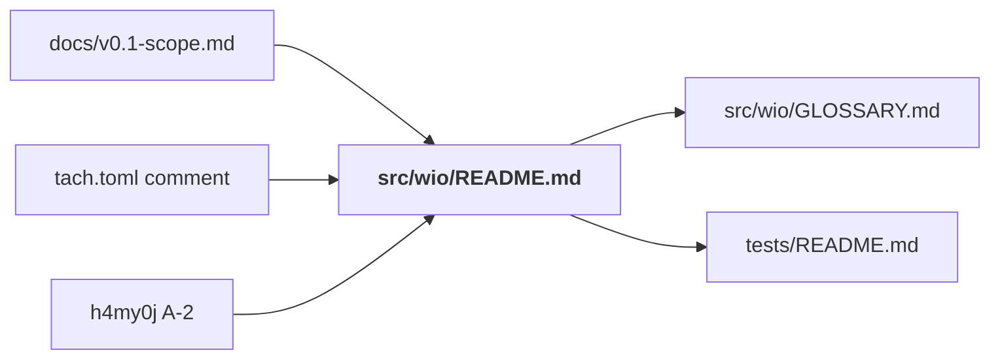

<!-- wio
id = "ew60gw"
template = "feature.leaf"
roots = ["wio", "repo"]
depends_on = ["qg33gf"]

[actions]
deliver = [
    "implementation",
    "implementation-review",
    "promote-docs",
    "docs-review",
]
-->

# Promote the architecture

## Purpose

The architecture of `src/wio` is stated only in the contracts of the delivered
v0.1 foundation Work, which later Works will change, so agents that read a
finished contract as current truth drift from the code.

## Goals

- An agent working in `src/wio` reads the architecture's rules, their reasons
  and their checkers in one document next to the code.
- A later Work changes the architecture by editing that document, not by
  amending a delivered contract.
- No guarantee of the foundation Work is lost when this Work retires it.
- Every agent knows how the `README.md` files on a path combine.
- The terms that the promote stages use are defined in the root glossary.
- The documents next to the code stay out of the wheel.

## Glossary

- **Promote**: to carry what a contract guarantees, with its reasons and
  diagrams, into the documents next to the code.
- **Retire**: to delete a contract once what it guarantees was promoted, which
  git history keeps. A Work retires its own tree and each delivered Work its
  contract says it retires, with that Work's descendants.

## Non-Goals

- A `README.md` for any package below `src/wio`: per-package facts stay in the
  docstrings of the stubs, which `AGENTS.md` calls the architecture spec.
- Changing a stub, a module of `tach.toml` or any code in `src/wio`.
- Changing the config, a stage or a rule.
- Changing the contracts that depend on this Work, the `cli` Work (`9wbqyb`)
  and the `wio.errors` Work (`h4my0j`).
- Promoting the provisional Protocol tables of the skeleton Work, which the
  stubs replaced.
- Changing `docs/concepts.md`.

## Assumptions

- **A-1**: `uv_build`, at the version `uv.lock` pins, drops every `README.md`
  under `src/wio` from the wheel when `wheel-exclude` lists `**/README.md`, and
  still writes the project `README.md` into `METADATA` as the long
  description (tried in a clone of commit `d6f96e0` on 2026-11-03).
- **A-2**: A retired Work that others depend on is read from the history
  ([concepts](../../../../docs/concepts.md) section 4), so retiring this Work
  and the foundation Work needs no change of `9wbqyb` or `h4my0j`.
- **A-3**: Only `docs/v0.1-scope.md` (two links) and the header comment of
  `tach.toml` refer to the foundation Work by path, and
  `tests/scripts/test_records.py` uses its ids only as sample data, as `grep`
  shows at commit `d6f96e0`.
- **A-4**: Most guarantees of the test DSL Work (`vds425`) are already in
  `tests/README.md` and `tests/GLOSSARY.md`, so promote-docs adds only what it
  finds missing.
- **A-5**: `wio trailers` does not exist yet, so the records of this Work are
  written by hand.

## Mechanisms

- `src/wio/README.md`, the architecture of the packages of `src/wio`.
- `"**/README.md"` in `wheel-exclude` of `[tool.uv.build-backend]` in
  `pyproject.toml`, and a slow test in `tests/packaging/test_build.py`.
- The stage `implementation` adds the exclusion and the test before
  `promote-docs` writes the first `README.md` under `src/wio`, so no wheel built
  in between ships it.
- The stage `promote-docs` writes the documents and, once the driver confirms,
  deletes `.agents/wio/works/v0-1-foundation/` and
  `.agents/wio/works/promote-architecture/`.

## Constraints

- `src/wio/README.md` states only what holds for `src/wio` and its descendants,
  and links to `src/wio/GLOSSARY.md` for the terms Component, Port and Adapter
  instead of defining them again (`DOC001`, `WRT001`).
- The guarantees in the documents are verified by the human gate `docs-review`,
  because no tool reads prose; the wheel exclusion is verified by the slow
  packaging test, which `make build` and `make slow` run.

## Visuals

Verified against commit `d6f96e0`. Before, the documents link to the contracts
for the architecture:

After, the contracts are in the history only, and the documents link to the
architecture next to the code:

## Acceptance criteria

### **AC-1** The architecture document states the dependency direction

`src/wio/README.md` states which packages of `src/wio` each package may import,
with the reason for the layering, as the same modules and dependencies that
`tach.toml` declares. It states that no component imports another and that they
meet only in `wio.cli`, and that a dependency that exists only for a type is
still a dependency, which is why tach counts `TYPE_CHECKING` imports.

#### The direction as stated

- **Given** the delivered `src/wio/README.md` and `tach.toml`.
- **When** a reviewer compares the dependency direction the document states with
  the `[[modules]]` of `wio` in `tach.toml`.
- **Then** both name the same modules with the same allowed dependencies, and
  the document gives the reason for the layering and for counting
  `TYPE_CHECKING` imports.

### **AC-2** The architecture document states the rules of ports and adapters

`src/wio/README.md` states, each with its reason:

- A port is owned by its consumer in `<package>/ports.pyi`, imported only under
  `TYPE_CHECKING` and satisfied structurally; `wio.io` and `wio.env` own their
  ports as shared infrastructure.
- A port that two or more components consume unchanged is declared once in
  `src/wio/ports.pyi`, which no package owns; a consumer that needs another view
  declares its own port, and a shared port with one consumer left moves back to
  it.
- A shared-type stub is the spec until the Work that implements the type writes
  a `.py` with the same annotations and docstrings and deletes it, while a port
  stays a `.pyi`.
- One adapter per port, except a port of `wio.env` whose behavior differs by
  platform, which has one per supported platform; any other extra adapter needs
  a reason in the contract of the Work that adds it, and fakes live under
  `tests`.
- Only `wio.cli` and the unit tests import an adapter.
- Components reach the filesystem, standard streams and git only through the
  ports of `wio.io`, and the process environment only through those of
  `wio.env`.

#### The rules as stated

- **Given** the delivered `src/wio/README.md`.
- **When** a reviewer reads it for each rule above.
- **Then** each is stated with its reason, and none contradicts the stubs.

### **AC-3** The architecture document says which check verifies each rule

`src/wio/README.md` states that `tach check` verifies the dependency direction,
the counting of `TYPE_CHECKING` imports and the adapter visibility in `.py`
code, that `pyrefly check` verifies that the ports resolve, and that the review
of each Work verifies the rest, because tach reads no `.pyi` file. It states
that `exact` stays off and why, and that a change of the locked `tach` version
repeats by hand the trials of a forbidden import, a type-only import and an
adapter import before it merges.

#### The verification as stated

- **Given** the delivered `src/wio/README.md`.
- **When** a reviewer reads its verification section.
- **Then** every rule of AC-1 and AC-2 has a named checker, and the section
  names the three trials and when they are repeated.

### **AC-4** The architecture document shows the packages as they are

`src/wio/README.md` has a Mermaid diagram of the packages of `src/wio` and their
allowed imports, which names the revision it was verified against, and every
edge it draws is a dependency `tach.toml` allows at that revision.

#### The diagram

- **Given** the delivered `src/wio/README.md` and `tach.toml` at the revision
  the diagram names.
- **When** a reviewer compares the diagram's nodes and edges with the modules
  and their `depends_on`.
- **Then** every package of `src/wio` is a node, every edge is allowed, and
  `rumdl check` renders the block.

### **AC-5** No guarantee of the foundation tree is lost

Every guarantee that the contracts of `zpnbj3`, `jsk0yt`, `1g7xnh` and `vds425`
state, read from commit `d6f96e0`, is in `src/wio/README.md`, `tests/README.md`,
a `GLOSSARY.md`, a stub docstring or `AGENTS.md` with its reason, or the driver
was told which one is dropped and why. Provisional tables and names the stubs
replaced are not guarantees.

#### Contract against documents

- **Given** the four contracts at commit `d6f96e0` and the delivered documents.
- **When** the reviewer of `docs-review` goes through each criterion and
  constraint of the four contracts.
- **Then** each one is found in a document with its reason, or is in the list
  of dropped guarantees the driver accepted.

### **AC-6** The documents link to the architecture, not to the contracts

`docs/v0.1-scope.md` and the header comment of `tach.toml` link to
`src/wio/README.md` where they linked to the foundation Work, and no file in the
delivered tree links to a path under `.agents/wio/works/v0-1-foundation/` or
`.agents/wio/works/promote-architecture/`.

#### No dangling link

- **Given** the delivered tree.
- **When** a reviewer searches the files that git tracks for the paths
  `works/v0-1-foundation` and `works/promote-architecture`.
- **Then** there is no match, `docs/v0.1-scope.md` and `tach.toml` name
  `src/wio/README.md`, and a mention of a retired Work by its id, such as
  `ew60gw` in the `depends_on` of `9wbqyb`, is not a link.

### **AC-7** Every agent knows how README files combine

`AGENTS.md` states, next to the sentence on `GLOSSARY.md`, that a `README.md`
covers its directory and its descendants, and that a nearer one adds to a
farther one and never overrides it.

#### The sentence

- **Given** the delivered `AGENTS.md`.
- **When** a reviewer reads its opening paragraph.
- **Then** it states both rules for `README.md` and still states that the
  nearest `GLOSSARY.md` wins.

### **AC-8** The root glossary defines Promote and Retire

The root `GLOSSARY.md` defines **Promote** and **Retire** as this contract's
Glossary does, and no other `GLOSSARY.md` defines them.

#### The entries

- **Given** the delivered glossaries.
- **When** a reviewer reads them.
- **Then** the root one has both entries, matching this contract's Glossary in
  meaning, and no other one has either.

### **AC-9** The wheel ships no README file of the source tree

`wheel-exclude` lists `"**/README.md"`, and a slow test in
`tests/packaging/test_build.py` fails when a `README.md` is in the wheel, while
the wheel's `METADATA` still carries the project `README.md`.

#### A README under the source

- **Given** a `README.md` under `src/wio`, added locally by the reviewer when
  the tree has none yet.
- **When** `make build` runs.
- **Then** the packaging test passes, and fails once the reviewer removes
  `"**/README.md"` from `wheel-exclude`.

### **AC-10** The foundation Work and this Work are retired

After the driver confirmed that the contracts are spent, the last commit of
`promote-docs` deletes `.agents/wio/works/v0-1-foundation/` with its three
children and `.agents/wio/works/promote-architecture/`, and changes no other
contract.

#### The retiring commit

- **Given** the delivered branch.
- **When** a reviewer reads the last commit of `promote-docs`.
- **Then** it deletes exactly those two directories, carries a record of
  `promote-docs` for `ew60gw`, and the `depends_on` of `9wbqyb` and `h4my0j`
  still names `ew60gw`.

### **AC-11** The repository's checks pass

#### The checks

- **Given** the delivered tree.
- **When** a reviewer runs `make check` and then `make slow`.
- **Then** both exit 0.

## Additional context

- [Roots and rulesets](../../../../docs/concepts.md) are sections 8 and 9 of the
  concepts document, and `DOC001` to `DOC003` in
  [the docs ruleset](../../rules/docs/) say how the documents are written.
- The [`wio.errors` Work](../cli/errors/README.md) extends `src/wio/README.md`
  with its module, as its A-2 says.
