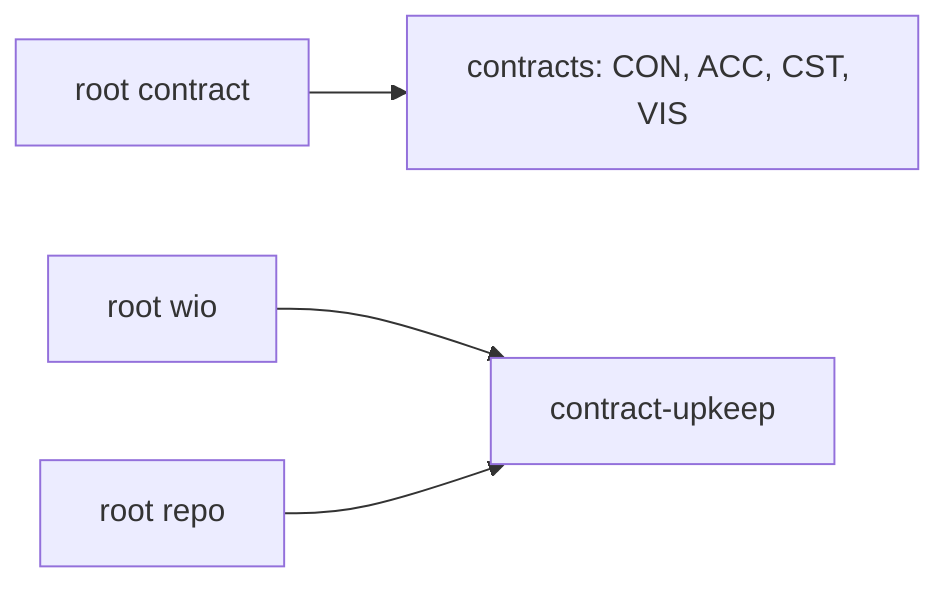
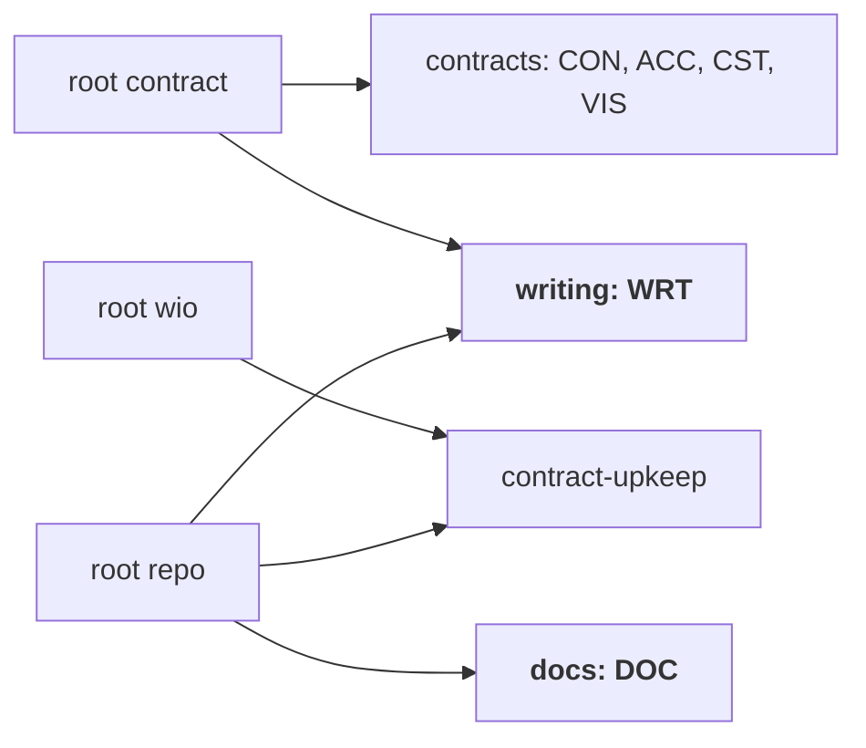

<!-- wio
id = "qg33gf"
template = "feature.leaf"
roots = ["repo"]
depends_on = []

[actions]
deliver = ["implementation", "implementation-review"]
-->

# The promote-docs stage

## Purpose

A delivered Work's lasting rules, reasons and diagrams need a stage that moves
them into the documents next to the code, so the contract can be retired
instead of drifting from what later Works change.

## Goals

- A delivered Work's lasting rules, reasons and diagrams have a stage that
  carries them into the `README.md` and `GLOSSARY.md` files of the directories
  the Work touched.
- A human judges, from a fresh session, that the documents lost no guarantee
  the contract stated, before the contract is retired.
- A contract is retired only on the driver's decision, and a Work tree is kept
  until its top Work has promoted. A Work can also retire delivered Works that
  its contract names.
- The sessions of the new stages receive the rules for writing documents and
  none of the rules for delivering code.
- The rules for linking and for diagrams are written once and reach contract
  sessions and document sessions alike.

## Glossary

- **Promote**: to carry what a contract guarantees, with its reasons and
  diagrams, into the documents next to the code.
- **Retire**: to delete a contract after what it guarantees was promoted. Git
  history keeps it. A Work retires its own contract and those of its
  descendants, and also those of any delivered Work, with that Work's
  descendants, that its contract says in prose it retires.

## Non-Goals

- Changing the engine: this is a change of this repository's config and rules.
  A per-binding choice of rules, tag aliases and any-of tag matching stay for
  later.
- Deleting a contract automatically.
- Promoting any Work: the first use is the promote-architecture Work
  (`ew60gw`), whose contract says in prose that it retires the foundation Work
  (`zpnbj3`). No metadata field or fixed phrase marks a retired Work.
- Delivering this Work through the stage it adds: it cannot use a stage before
  it exists.
- Changing the `contract-upkeep` ruleset: its rules carry the tag `delivery`,
  which the new stages do not have.

## Assumptions

- **A-1**: Nothing reads `.agents/wio/config.toml` yet, as its header says, so
  until `wio config check` exists a reviewer reads the files and parses them
  with `tomllib`. Verified at commit `81ae1be`.
- **A-2**: A ruleset can be bound to several roots, and a rule applies to a
  stage only when every tag of the rule is among the stage's tags, as
  [concepts](../../../../docs/concepts.md) sections 8 and 9 describe.
- **A-3**: Only this Work refers to the rules `CON008` and `VIS002`, so moving
  them breaks no link. Verified with `grep` at commit `81ae1be`.
- **A-4**: A Work that others depend on is read from the history once it is
  retired, so retiring the foundation Work needs no change of its dependents
  ([concepts](../../../../docs/concepts.md) section 4).
- **A-5**: `wio trailers` does not exist yet. The goal of `docs-review` names it
  as the goals of the existing gates do, and the record is written by hand
  until it exists.
- **A-6**: The change touches only config and rule files, so the pipeline
  `implementation`, `implementation-review` is enough for its delivery, and the
  driver deletes this contract by hand once it is delivered. The config and
  rule files are their own documentation, so nothing else needs promoting.

## Mechanisms

- Two stages, `promote-docs` and `docs-review`, in `.agents/wio/config.toml`,
  appended to the presets `typed-boundary` and `integrate`.
- A ruleset `writing` (family `WRT`) with the rules for any document, bound to
  the roots `contract` and `repo`.
- A ruleset `docs` (family `DOC`) with the rules for the documents next to the
  code, bound to the root `repo`.
- The tags `docs`, `promote`, `links` and `diagrams` in the config's vocabulary.
- The six contract stages gain the tags `links` and `diagrams`, so contract
  sessions keep the two moved rules.
- `CON008` and `VIS002` leave the `contracts` ruleset and return as `WRT001`
  and `WRT002`. Their old codes are not reused.

## Constraints

- The stages select the root `repo` only, so their sessions receive no rule of
  the roots `contract` or `wio`.
- `docs-review` is judged by the human, as `review-contract` is, because
  retiring a contract leaves history as the only copy.
- The rules are written in the style of the existing ones: a metadata block,
  one imperative, and a `Why:` paragraph.

## Visuals

Verified against `.agents/wio/config.toml` at commit `81ae1be`. Rulesets in
bold are added or moved by this Work.

Before, the two rules live in `contracts`, which only the root `contract`
binds:

After, `writing` carries them to both roots:

The presets gain the pair at their end:

- `typed-boundary`: `architecture`, `architecture-review`, `wiring`,
  `wiring-review`, `implementation`, `implementation-review`, then
  `promote-docs`, `docs-review`.
- `integrate`: `integration`, `system-review`, then `promote-docs`,
  `docs-review`.

## Acceptance criteria

### **AC-1** A stage carries a Work's lasting content into the documents

The config declares the stage `promote-docs`, whose goal tells the agent to
carry the lasting rules, reasons and diagrams of the contracts it promotes (the
Work's own and descendants', and those of the delivered Works its contract says
it retires) into the `README.md` and `GLOSSARY.md` of the directories they
touched, and to link instead of copying. Its `roots` are `["repo"]` and its tags
are `docs`, `promote`, `links` and `diagrams`.

#### The stage as declared

- **Given** the config of the delivered tree, parsed with `tomllib`.
- **When** a reviewer reads `stages["promote-docs"]`.
- **Then** it has no `gate` or `judge`, `roots == ["repo"]`, exactly those four
  tags, and a goal that names `README.md`, `GLOSSARY.md`, the Work's
  contract and the Works its contract says it retires as the sources.

### **AC-2** A contract is retired only on the driver's decision

The goal of `promote-docs` says that a Work with a parent promotes and keeps
every contract; that a Work without a parent deletes its own contract, those of
its descendants and those of the delivered Works its contract says it retires,
each with its descendants, in the last commit of the stage; and that it deletes
them only after the driver confirms that they are spent. That confirmation is
the driver's own, separate from the judgment of `docs-review`.

#### A child promotes and keeps its contract

- **Given** a Work that has a parent.
- **When** an agent follows the goal of `promote-docs` for it.
- **Then** the goal tells it to promote and to delete nothing.

#### A Work that retires another Work

- **Given** a Work without a parent whose contract says in prose that it
  retires a delivered Work.
- **When** an agent follows the goal after the driver confirmed.
- **Then** the goal tells it to delete the named Work's contract and those of
  that Work's descendants, together with its own.

#### A top Work whose driver has not confirmed

- **Given** a Work without a parent, promoted, whose driver has not said that
  its contracts are spent.
- **When** an agent follows the goal.
- **Then** the goal tells it to ask the driver and to keep the contracts until
  the driver confirms.

### **AC-3** A human judges that the documents lost no guarantee

The config declares the gate `docs-review` with `gate = true`, `judge =
"human"`, `session = "fresh"`, `roots = ["repo"]` and the tags `docs`,
`promote`, `review`, `links` and `diagrams`. Its goal tells the reviewer to read
the contract from the working tree when it was kept and from the commit before
its deletion when it was deleted, to check that every guarantee the contract
states is in the documents with its reason, and to record `pass`
with `wio trailers --result --judge human` only once the driver confirmed the
review, whatever they said when asked about the deletion.

#### The gate as declared

- **Given** the config of the delivered tree, parsed with `tomllib`.
- **When** a reviewer reads `stages["docs-review"]`.
- **Then** every field above holds, and the goal names both the working tree
  and the history as the places to read the contract.

### **AC-4** The pair ends the delivery of leaves and parents

The presets `typed-boundary` and `integrate` end with `promote-docs`,
`docs-review`, in that order, and every other preset is unchanged.

#### The presets

- **Given** the config of the delivered tree, parsed with `tomllib`.
- **When** a reviewer reads `[presets]`.
- **Then** `typed-boundary` is the six stages of the Visuals followed by the
  pair, `integrate` is `integration`, `system-review`, then the pair, and
  `define-feature`, `amend-contract` and `ratify-contract` are as before.

### **AC-5** The shared rules are written once

`.agents/wio/rules/writing/` holds `ruleset.toml` (name `writing`, family `WRT`)
and the rules `WRT001` (link instead of copying, tag `links`) and `WRT002`
(diagrams from verified source, tag `diagrams`), worded for any document. The
files `CON008-*.md` and `VIS002-*.md` no longer exist, and `writing` is bound to
the roots `contract` and `repo`.

#### Moved, not copied

- **Given** the delivered tree.
- **When** a reviewer lists `.agents/wio/rules` and reads the bindings of
  `[[roots]]`.
- **Then** no rule file outside `writing` states either rule, the roots
  `contract` and `repo` list `writing`, and `contracts` is still bound to
  `contract` alone.

### **AC-6** Three docs rules cover the documents next to the code

`.agents/wio/rules/docs/` holds `ruleset.toml` (name `docs`, family `DOC`) and
three rules, and `docs` is bound to the root `repo` only. None of the rules
carries the tag `review`:

- `DOC001`, tag `docs`: a `README.md` states what is true at its directory's
  level, a nearer one adds to a farther one and never overrides it.
- `DOC002`, tag `promote`: carry every guarantee of the contract into the
  documents with its reason and the check that verifies it, or tell the driver
  which one is dropped.
- `DOC003`, tag `docs`: add a term to the `GLOSSARY.md` of the directory that
  owns it, only when it could be read more than one way.

#### Each rule is well formed

- **Given** the three rule files.
- **When** a reviewer reads them.
- **Then** each has a metadata block whose `code` matches its file name, a body
  of one paragraph whose first word is a verb, and a `Why:` paragraph, and no
  two rules state the same instruction.

### **AC-7** The new stages receive the writing and docs rules only

A session of `promote-docs` or `docs-review` receives `WRT001`, `WRT002` and
all three `DOC` rules, and no rule of `contracts` or `contract-upkeep`.

#### Computing the selection for the new stages

- **Given** the config of the delivered tree and the rule files.
- **When** a reviewer applies all-of tag matching to `promote-docs` and
  `docs-review`, over the rulesets bound to the root `repo`.
- **Then** each receives exactly those five rules, and the `contract-upkeep`
  rules are out because they carry `delivery`.

### **AC-8** The contract stages keep their rules and gain two

A session of each of the six contract stages, `define`, `review-contract`,
`amend`, `review-amendment`, `ratify` and `review-ratify`, receives the rules it
receives today except `CON008` and `VIS002`, and also `WRT001` and `WRT002`. It
receives no `DOC` rule.

#### Computing the selection for the contract stages

- **Given** the config of the delivered tree, the rule files and the config of
  commit `81ae1be`.
- **When** a reviewer applies all-of tag matching to each of the six stages in
  both trees, over the rulesets bound to the root `contract`.
- **Then** the two selections differ only by `CON008` and `VIS002` leaving and
  `WRT001` and `WRT002` arriving, and the stages `architecture` to
  `system-review` receive neither `WRT` rule nor a `DOC` rule.

### **AC-9** The six contract stages declare the new tags

The six contract stages keep the tags they have today and add `links` and
`diagrams`.

#### The tags as declared

- **Given** the config of the delivered tree, parsed with `tomllib`.
- **When** a reviewer reads the `tags` of the six stages.
- **Then** each is its tag list at commit `81ae1be` followed by `links` and
  `diagrams`.

### **AC-10** The vocabulary declares every tag in use

The config declares the tags `docs`, `promote`, `links` and `diagrams` in
`tags`, and every tag a stage or a rule uses is declared.

#### Nothing undeclared

- **Given** the config and all rule files of the delivered tree.
- **When** a reviewer collects every tag used by a stage or a rule.
- **Then** each is in `tags`.

### **AC-11** The new files are well formed

Each new ruleset's `name` equals its directory, every new rule file's code and
name match its file name, and the repository's checks pass.

#### The checks

- **Given** the delivered tree.
- **When** a reviewer reads `ruleset.toml` and the metadata block of each new
  rule file, and runs `make check`.
- **Then** the names and codes match, and `make check` exits 0.

## Additional context

- [Roots and rulesets](../../../../docs/concepts.md) are sections 8 and 9 of the
  concepts document: how rulesets bind to roots and how tags select rules.
- [The promote-architecture Work](../promote-architecture/README.md) overrides
  its `deliver` pipeline to the new pair and is the stage's first use.
