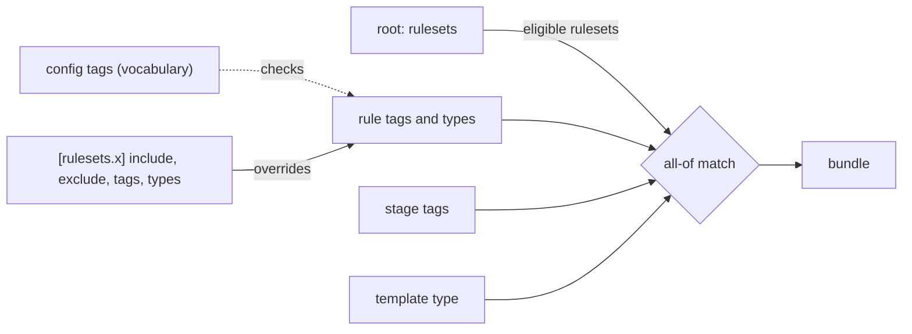
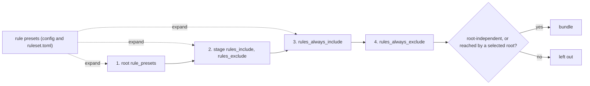

<!-- wio
id = "xxbge6"
template = "feature.leaf"
roots = ["repo"]
depends_on = []

[actions]
deliver = ["promote-docs", "docs-review"]
-->

# Rule presets in place of tags

## Purpose

Tags are a global vocabulary that no ruleset owns and that means something
different on a rule, a stage and a template, so the design should select rules
by names that exist, before the config Work turns tags into code.

## Goals

- A reader of the design learns how rules are selected from roots, stages and
  two config-wide fields, without a tag vocabulary.
- A ruleset copied from another repository is used by naming its presets and
  codes, with no mapping of its tags or types onto the repository's own.
- A misspelled rule, family or preset name is an error that names it, instead
  of a rule that silently never loads.
- A reader can tell a stage preset from a rule preset wherever either is
  mentioned.
- Every decision of the design is stated with a short reason, so a later Work
  can tell what it would break by changing it.
- The `config` Work (`hwn995`) and the migration of wio's own config can be
  done against the design without reopening its decisions.

## Glossary

- **Layer**: one source of a rule selection (the presets of the selected roots,
  the stage, `rules_always_include` or `rules_always_exclude`), applied in that
  order.

## Non-Goals

- Updating the Intent of the `config` draft (`hwn995`), which is the next step
  and its own commit.
- Migrating `.agents/wio/config.toml`, the rule files under
  `.agents/wio/rules/` and `docs/workflow.md`, which explains that config, so
  they change together in a later step.
- Changing any code, a module of `tach.toml` or a stub's declarations; only
  the docstrings of two stubs change.
- Joining stage presets, so that one is built from others.
- Globs or file types in a root's `paths`.
- A layer for actions, templates or contracts, or rules inherited down the Work
  tree.

## Assumptions

- **A-1**: Nothing reads `.agents/wio/config.toml` yet, as its header says, so
  the design can lead wio's own config by one step without breaking a command.
- **A-2**: The `config` Work is still a `feature.draft`, so its Intent changes
  under `define` and needs no `amend`.
- **A-3**: At commit `c2bce06`, no code in `src` implements tags, presets or
  rule selection, and only the docstrings of `src/wio/models/rules.pyi` and
  `src/wio/models/config.pyi` mention tags.
- **A-4**: At commit `c2bce06`, the files outside `.agents/wio/` that describe
  tags or a preset as a list of stages are `docs/concepts.md`, `GLOSSARY.md`,
  `README.md`, `docs/README.md`, `docs/v0.1-scope.md`,
  `docs/split-exercises.md`, `docs/workflow.md`, `tests/README.md` and those
  two stubs.
- **A-5**: `wio trailers` does not exist yet, so the records of this Work are
  written by hand.
- **A-6**: Until the migration that follows this Work, `docs/workflow.md` and
  `.agents/wio/config.toml` still describe tags and contradict the design, which
  is accepted for one step because nothing reads that config (A-1).

## Mechanisms

- `docs/concepts.md`, sections 2 (the symbol tables), 7 (Stage), 9 (Roots and
  rulesets), 10 (Rules), 11 (The context compiler) and 13 (Presets), states the
  design.
- `GLOSSARY.md` defines the terms, and `README.md`, `docs/README.md`,
  `docs/v0.1-scope.md`, `docs/split-exercises.md` and `tests/README.md` follow
  them.
- The docstrings of `Rule`, `Decision` and the config model in
  `src/wio/models/rules.pyi` and `src/wio/models/config.pyi` state how a rule
  is selected.
- The stage `promote-docs` writes these files, and `docs-review` judges them
  against this contract.

## Constraints

- `promote-docs` writes `docs/concepts.md`, the other documents of AC-11 and
  the two stub docstrings, beyond the README and GLOSSARY files its goal names,
  because this Work's guarantees are a design and that is where the design
  lives.
- A root **reaches** a ruleset when its `rule_presets`, with config presets
  expanded, name any family, code or preset of that ruleset, even if excludes
  leave none of its rules selected, so that binding does not change when a
  preset's contents do.
- Each decision is stated with its reason in one or two sentences. The reasons
  are those below, or those of the Intent committed in `c2bce06` where this
  table has none:

  | Decision | Reason |
  | --- | --- |
  | Stage preset and rule preset are named apart | Two things called "preset" would bring back the ambiguity that tags had. |
  | `[rule_presets.<name>]` is a keyed table | TOML then rejects a duplicate name when it parses. |
  | A root's `rule_presets` takes presets only | A root reads as the guidelines of its code, and picking single rules lives in presets that can be reused. |
  | Binding is implicit, by reach | A separate list of rulesets on a root would repeat what its presets already name. |
  | Eligibility is per ruleset, not per rule | Per rule, a stage could only narrow what roots chose, and a reviewer-only rule from a code ruleset would be impossible. |
  | `root_independent` is explicit | If an unbound ruleset counted as root-independent, a forgotten binding would leak its rules into every bundle. |
  | A Work with no roots gets only root-independent rules | A Work still being defined has no code yet, so only the rules about how to work apply. |
  | Roots, then stage | The stage is the specific procedure, so it can drop a rule its roots bring. |
  | Exclude after include within a layer | A layer can then take a preset minus a few of its rules. |
  | A preset resolves to a set first | An exclude inside a nested preset never reaches outside it. |
  | `rules_always_include` overrides earlier excludes | "Always" then means always; a default that a stage may drop belongs to a root or a stage. |
  | Every ruleset has a reserved `all` preset | A root or an always field can then take a whole ruleset while taking presets only. |
  | At most one alias per ruleset | Several names for one ruleset make the config harder to search. |
  | Codes may repeat across rulesets, and the prefix-clash check goes | A qualified name is unique, so two rulesets can share a family. |
  | A preset cycle is an error | A cycle has no resolved set. |
  | Bundles, gates and events use qualified canonical names | A bare code is ambiguous across rulesets, and renaming an alias never rewrites the history. |
  | A bundle groups by family, not by preset | A rule can arrive through several presets, and moving it between presets should not move it in the bundle. |
  | A bundle does not say why a rule is selected | The agent needs the rule, and the bundle id stays the same when presets are reorganised. |
  | `--work` needs `--stage` | The stage's `roots` decide which of the Work's roots count. |
  | A ruleset nothing reaches is a warning | It is data on disk that may be waiting to be used. |
  | A rule in both always fields is a warning | The veto wins, but one of the two entries is usually stale. |
  | An exclude of a rule its layer never included is not reported | Excluding ahead of a ruleset update is common, and a warning would be noise. |

- The documents describe the design as it holds, not the discussion that led to
  it and not the tags it replaces
  ([`DOC002`](../../rules/docs/DOC002-describe-the-current-state.md)), except
  where the design says why it has no tag, type, action, template or contract
  selection.
- The word "preset" alone is used only where both kinds are meant; elsewhere
  the text says "stage preset" or "rule preset".
- Examples use the rulesets `mattpocock` (alias `mp`), `py`, `process`,
  `contracts` and `billing`, so a reader meets the same names throughout.
- The human gate `docs-review` judges AC-1 to AC-12; AC-1 to AC-11 need a
  reader because no tool reads prose.
- Once the driver confirms that the contract is spent, the last commit of
  `promote-docs` retires this contract and changes no other.

## Visuals

Before, checked against `docs/concepts.md` at commit `c2bce06`: a rule carries
tags and types, the config remaps them and declares the vocabulary, and a
stage's tags select the rules whose tags it has all of.

After, proposed: the consumers name rules, codes and presets in four layers, and
a rule applies when it is selected and its ruleset is root-independent or
reached by a root the stage selects.

## Acceptance criteria

### **AC-1** The glossary names both kinds of preset and no tag

`GLOSSARY.md` defines **Preset** as a named, reusable selection of two kinds,
**Stage preset** as a named, ordered list of stages that can be an action's
pipeline, and **Rule preset** as a named selection of rules with
`rules_include` and `rules_exclude`, declared in the config or in a
`ruleset.toml`. It defines **Layer** with the meaning this contract's Glossary
gives it. It has no entry for Tag, and its entries for Action, Config,
Root, Ruleset and Stage describe roots selecting rule presets, stages selecting
rules, and a ruleset with presets and an optional alias.

#### The entries

- **Given** the delivered `GLOSSARY.md`.
- **When** a reviewer reads it.
- **Then** the three preset entries and Layer have those meanings, no entry
  defines or relies on tags, and the five entries agree with the design.

### **AC-2** A rule file and a ruleset manifest hold only what selection needs

`docs/concepts.md` states that a rule file's metadata is `code` and `name` only,
and that a `ruleset.toml` holds `name`, `description`, `[families]` and
`[rule_presets.<name>]`, whose references are bare names of the ruleset's own
families, codes and presets because a ruleset is portable data. It states that
every ruleset has a reserved preset `all`, that codes are unique within a
ruleset and need not be unique across rulesets, and why the family prefix-clash
check is no longer needed.

#### The rule and the manifest

- **Given** the delivered `docs/concepts.md`.
- **When** a reviewer reads section 10 and the symbol tables of section 2.
- **Then** a rule file shows no `tags` or `types`, the manifest shows
  `[rule_presets.<name>]`, and each statement above has its reason.

### **AC-3** The config declares rule selection in named places

`docs/concepts.md` states, in the symbol table of the config and in the text,
that the config holds `[stage_presets]` in place of `[presets]`,
`[rule_presets.<name>]` with `rules_include` and `rules_exclude`,
`[rulesets.<name>]` with only `alias` and `root_independent`, `rule_presets` on
a root in place of `rulesets`, `rules_include` and `rules_exclude` on a stage,
and `rules_always_include` and `rules_always_exclude` at the top level, with no
`tags` vocabulary. It states that the preset tables are keyed, that a root's
`rule_presets` takes presets only, that a ruleset is bound to a root implicitly
when the root reaches it, with reach as the Constraints define it, and that a
ruleset has at most one alias.

#### The config symbols

- **Given** the delivered `docs/concepts.md`.
- **When** a reviewer compares the config's symbol table with sections 7, 9, 10
  and 13.
- **Then** each key above is in the table with its section, no table or
  section names a tag vocabulary, `[presets]`, a ruleset's `include`,
  `exclude`, `tags` or `types`, or a root's `rulesets`, and each statement has
  its reason.

### **AC-4** A reference's form tells its kind

`docs/concepts.md` states the forms of names and references: `<ruleset>.<item>`
with exactly one dot; a family as uppercase letters, a code as a family and
digits, a preset as lowercase letters, digits and `_`; a ruleset name or alias
as lowercase letters, digits, `-` and `_`; and a bare name as a config preset.
It states that names are case-sensitive, that an alias works wherever a
ruleset prefix does while records, bundles and `wio rules list` show the
canonical name, and that a cycle between presets is an error that names the
cycle.

#### The forms

- **Given** the delivered `docs/concepts.md`.
- **When** a reviewer classifies `mp.TSX`, `mp.TSX012`, `mp.docs`,
  `feature_rules` and `mattpocock.ERR003` by the stated forms.
- **Then** each has exactly one kind, the reason for telling the kind by form
  is stated, and no example contradicts the forms.

### **AC-5** Selection is four layers in a stated order

`docs/concepts.md` states the layers in order (the presets of the roots the
stage selects, the stage, `rules_always_include`, `rules_always_exclude`), that
within a layer the exclude runs after the include, and that a preset resolves
to a set before it enters a layer. It states that `rules_always_include`
overrides any earlier layer's exclude and is for project-wide rules, with
"fix the underlying problem" in a root-independent `process` ruleset as the
example, and that `rules_always_exclude` is the final veto and takes codes and
families only, so editing a preset never widens it.

#### The order of the layers

- **Given** the delivered `docs/concepts.md`.
- **When** a reviewer resolves, by the text alone, a rule that a root's preset
  includes, the stage excludes and `rules_always_include` names, and a rule
  that a stage includes and `rules_always_exclude` names.
- **Then** the first applies and the second does not, and the reasons for the
  order, for the override and for the veto are stated.

### **AC-6** The design says why only roots and stages select

`docs/concepts.md` states that no action, template or contract selects rules
and that a Work's selection is not inherited by its children, each with its
reason: one action runs different stages in different templates, guidance for
writing a type's contract belongs in its template's authoring comments, a
type-specific procedure is a stage of the template's pipeline, and rules that
follow an area of code belong to a root that a Work lists, shown with a
`billing-legacy` root and its `billing` ruleset.

#### The missing layers

- **Given** the delivered `docs/concepts.md`.
- **When** a reviewer looks for where a bugfix's rules for `define` and for
  `deliver`, and the rules for a Work touching legacy billing code, come from.
- **Then** the text answers each one without an action, template or contract
  selection, and states the reasons above.

### **AC-7** Roots decide which selected rules apply

`docs/concepts.md` states that a rule applies when the layers select it and its
ruleset is either `root_independent` or reached by a root the stage selects,
with the formula and a table of four rows: a selected rule of a reached
ruleset, the same rule when the stage selects another root, a rule nothing
selects, and a selected root-independent rule with any roots or none. It states
that eligibility is per ruleset, so a stage can add a reviewer-only rule from a
ruleset its roots reach, that `root_independent` is explicit so a forgotten
binding never leaks rules, and that a Work with no roots gets only
root-independent rules.

#### The applies table

- **Given** the delivered `docs/concepts.md`.
- **When** a reviewer reads the formula and the table.
- **Then** the four rows give yes, no, no and yes, and each statement above has
  its reason.

### **AC-8** A bundle groups and names rules without tags

`docs/concepts.md` states that a bundle shows root-independent rules first,
under `Rules for every root:`, then one group per set of roots, and within a
group orders rules by ruleset, by family with its topic, and by code. It states
that a rule is shown by its qualified canonical name and its name, such as
`mattpocock.ERR003 errors-carry-context`, which gates and events use too, and
that a bundle does not say why a rule was selected, so the bundle id does not
change when a preset is reorganised.

#### The bundle

- **Given** the delivered `docs/concepts.md`.
- **When** a reviewer reads section 11.
- **Then** the grouping, the naming and the absence of the selection's source
  are stated with their reasons, and no grouping by tags remains.

### **AC-9** `wio rules list` shows any selection and its source

`docs/concepts.md` states the flags `--preset`, `--root`, `--stage`, `--work`
(which needs `--stage`), `--path` and `--explain` in a table of the layers and
roots each combination applies; that the always fields apply whenever a layer
does; that the header names the layers applied; that rules whose roots are not
applied are listed with the roots their ruleset is reached by; and that
`--explain` gives each rule's source and why a rule is out. The table states
these rows:

| Flags | Layers applied | Roots |
| --- | --- | --- |
| `--preset <name>` | the preset, expanded, without the always fields | not applied |
| `--root <name>` | that root's presets, always fields | that root |
| `--stage <name>` | the stage, always fields | not applied |
| `--root` and `--stage` | the root's presets, the stage, always fields | that root |
| `--work <id> --stage <name>` | what `wio context` selects | the roots the stage selects for that Work |
| `--path <file>` | the presets of the roots containing the file, always fields | those roots |
| `--path` and `--stage` | as for `--path`, and the stage | those roots |

`--work` without `--stage` is an error, and `--action` and `--template` are
not flags, because neither owns a layer.

#### The flags

- **Given** the delivered `docs/concepts.md`.
- **When** a reviewer compares the description of `wio rules list` with the
  table above.
- **Then** every row is stated with the same layers and roots, `--work` without
  `--stage` is an error, and no flag selects by tag, type, action or template.

### **AC-10** The checks of rule selection are listed by severity

`docs/concepts.md` states as errors an unresolved reference, a name of the wrong
form, a qualified reference in a `ruleset.toml`, a preset cycle, a preset in
`rules_always_exclude`, a ruleset preset named `all`, a duplicate or clashing
alias, a root-independent ruleset reached by a root, a `rules_*` key on a
template, a contract or an action, `rules_exclude` on a root, and an always
field anywhere but the config's top level; as warnings a rule nothing selects, a
ruleset nothing reaches, a stage's selection from a ruleset no root reaches, and
a rule in both always fields; and as a note the list of `rules_always_include`.

#### The checks

- **Given** the delivered `docs/concepts.md`.
- **When** a reviewer reads the checks of `wio config check` and
  `wio rules check`.
- **Then** each item above is there with its severity, and no check of a tag
  vocabulary, effective tags or types, or family prefixes remains.

### **AC-11** The other documents follow the design

`README.md`, `docs/README.md`, `docs/v0.1-scope.md`, `docs/split-exercises.md`,
`tests/README.md` and the docstrings of `src/wio/models/rules.pyi` and
`src/wio/models/config.pyi` describe rule selection by roots, stages and the
always fields, say "stage preset" for a list of stages, and do not mention
tags or rule types. `docs/split-exercises.md` replaces its `tag-matching` and
the tag and type parts of `rule-selection` with the layers of this design.

#### No tag outside the follow-ups

- **Given** the delivered tree.
- **When** a reviewer searches the files that git tracks, outside
  `.agents/wio/`, `docs/workflow.md` and `pyproject.toml` (whose
  `preset = "strict"` is a tool setting), with
  `git grep -n -i -E '\btag|preset'`, which matches `tags` and `tagged` but not
  `stage`.
- **Then** no match describes a tag or a rule type, every `preset` names its
  kind or means both, and the stub docstrings match AC-7.

### **AC-12** The repository's checks pass

#### The checks

- **Given** the delivered tree.
- **When** a reviewer runs `make check`.
- **Then** it exits 0, and `rumdl check` renders every Mermaid block.

## Additional context

- [The concepts](../../../../docs/concepts.md) are the design this Work changes;
  `DOC001` to `DOC003` in [the docs ruleset](../../rules/docs/) say how the
  documents are written.
- [The `config` draft](../config/README.md) is updated next, and the migration
  of wio's own config follows, keeping each stage's rules as they are today.
