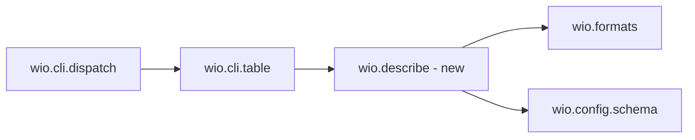

<!-- wio
id = "4t3yaf"
template = "feature.parent"
roots = ["@descendants"]
depends_on = []
-->

# Self-describing CLI (wio describe)

## Purpose

Let agents and users discover the exact behavior, semantics and contracts of
the installed version of wio offline from the command line, without web search
or stale hand-maintained prose.

## Goals

- Agents can run `wio describe` to get a concise, deterministic overview of wio
  (version, exit codes, core concepts and subcommands) without a repository or
  config file.
- Agents can run `wio describe <command>` to inspect the semantics, invariants
  and code-derived reference tables of any registered subcommand.
- Both `wio describe` and `wio describe <command>` support `--json` for
  structured machine consumption.
- Descriptions stay synchronized with the live CLI command table, config schema
  and directive table via automated anti-drift tests.

## Non-Goals

- Replacing `--help` flags or generating man pages.
- Adding `<command> describe` subcommands to existing commands (which would
  collide with `<work>` in `wio context <work>` and `wio trailers <work>`).
- Reading project-specific `.agents/wio/config.toml` or repository state.

## Assumptions

None.

## Mechanisms

- `wio.describe` (new package under `src/wio/describe/`) holds the frozen
  descriptor data models, code-derived collectors, per-command descriptor
  registry, text/JSON renderers and CLI entry point.
- `wio.cli.table` registers `describe` in the top-level `ENTRIES` table so
  `wio describe` is dispatched like every other subcommand.
- `tests/tooling/` enforces anti-drift invariants verifying that every entry in
  `wio.cli.table` has a descriptor and that derived schema/directive facts
  match the live code.

## Constraints

- **C-1 Offline and config-free.** `wio describe` and `wio describe <command>`
  must succeed outside any git repository and without `.agents/wio/config.toml`,
  performing no filesystem or network I/O (verified by acceptance tests in
  `tests/acceptance/describe/`).
- **C-2 Architecture boundary.** `wio.describe` must respect `tach.toml`
  dependency rules and import `json` only through `wio.formats.encode_json`
  (verified by `tach check` and `ruff check`).
- **C-3 Deterministic output.** Identical installed versions must produce
  byte-for-byte identical text and JSON output with no timestamps (verified by
  unit and acceptance tests).

## Visuals

Baseline: `b25b42e` (`main`). Proposed addition of `wio.describe` alongside
existing CLI subcommands (provisional module layout):

## Acceptance criteria

### **AC-1** Top-level and per-command descriptions work end-to-end

Running `wio describe` and `wio describe <command>` through the installed CLI
succeeds with exit code 0 in both text and `--json` forms for every registered
command, and fails with exit code 2 for an unknown command name.

- **Given** a working directory outside any git repository and with no
  `.agents/wio/config.toml`.
- **When** `wio describe`, `wio describe --json`, `wio describe <command>` and
  `wio describe <command> --json` are executed for every command in
  `wio.cli.table`.
- **Then** each exits 0, produces deterministic output, and `wio describe
  nosuch` exits 2 naming the valid commands on stderr.

### **AC-2** Descriptions stay synchronized with live code

Adding or removing a subcommand in `wio.cli.table`, or changing config schema
keys or template directives, is reflected in `wio describe` output or caught by
the anti-drift tooling test suite.

- **Given** the integrated `wio.describe` package and `tests/tooling/` suite.
- **When** `make check` runs.
- **Then** every registered subcommand has a valid descriptor and all
  code-derived tables match the live modules.
