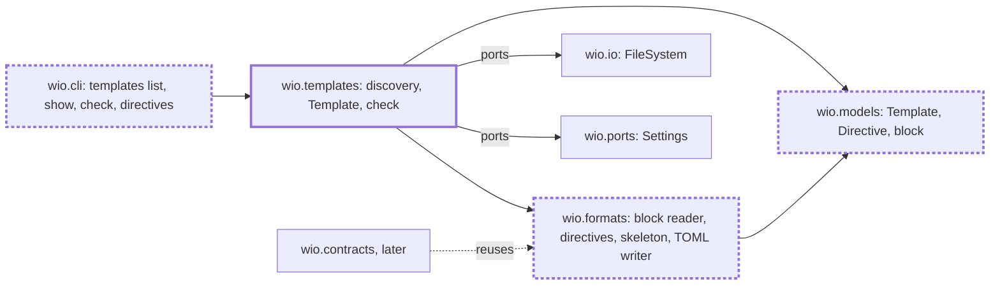

<!-- wio
id = "p53zv3"
template = "feature.parent"
roots = ["@descendants"]
depends_on = []
-->

# The wio templates command

## Purpose

People and agents who design a workflow need to find, print and check the
templates that contracts follow without creating a Work, and the code that
reads a template must be one that the contracts command can reuse.

## Goals

- A person or an agent can see the templates of a project, grouped by kind,
  with the entry template of each kind marked.
- An agent can print any template as the contract skeleton to rewrite a
  contract in, with nothing around it.
- A person or an agent can learn from the command line which directives a
  template may use, with their syntax and an example, even outside a
  repository.
- A person or an agent that edits a template is told what is wrong with it.
- An agent that edits a template, and a commit that changes one, is told of a
  problem in the project's templates at once.
- A template is named by its file, so its name cannot differ from where it
  lives.
- The metadata block, the directive grammar and the skeleton live only in
  `wio.formats`, where `wio contracts` can reuse them.
- The documents describe the command and the grammar as they are.

## Glossary

- **Template name**: the name of the template's file without `.md`, which
  `[templates.kinds]`, a contract's `template` key and `wio templates show`
  refer to; there is no `name` key.
- **Skeleton**: the template prepared as a contract, as
  [from template to contract](../../../../docs/concepts.md#from-template-to-contract)
  says, and as `wio templates show` prints it: it has the `template` key and no
  `id`.

## Non-Goals

- `wio templates show --work` and `--keep`, which need to find and read a Work
  and belong to the contracts Work.
- Finding the items of a section and applying a directive to a contract's body,
  which the contracts Work decides.
- Writing, changing or moving a template, or moving a Work between templates.
- Changing the three `feature` templates, other than dropping their `name` key.
- Limiting `wio templates check` to one file, which can come later if a full
  check is too slow or too noisy for a hook.

## Assumptions

- **A-1**: The config Work is delivered, so `[templates]` is loaded and checked
  in its shape and `wio config check` reads no template.
- **A-2**: `tomlkit` and `markdown-it-py` can be added as runtime dependencies
  under the project's `exclude-newer` guard.
- **A-3**: The contracts Work, delivered after this one, takes the block reader,
  the directive parser and the skeleton from `wio.formats` as they are.
- **A-4**: Nothing wio imports at start-up, and nothing in the standard library
  that `list` and `check` use, imports `json` or `tomlkit`.
- **A-5**: `jq` is on the `PATH` where the hook runs, and the `PostToolUse`
  payload of an edit carries `tool_input.file_path`, as the config's hook
  already relies on.
- **A-6**: This repository's three `feature` templates pass
  `wio templates check` once their `name` key is dropped.
- **A-7**: Ruff's `banned-api` table can ban `tomlkit` outside `wio.formats` as
  it bans `tomllib`.
- **A-8**: `wio.cli` can run a command without finding the repository or loading
  the config, as bare `wio config` does, so `wio templates directives` needs
  neither.

## Mechanisms

- `wio.formats`, which gains the reader of the metadata block, the parser of
  directives and the table of directives that it and `wio templates directives`
  share, the outline of a Markdown body, built on `markdown-it-py`, the preparer
  of a skeleton and a TOML writer on `tomlkit`.
- `wio.templates`, the component that finds the templates, builds a `Template`
  and judges it for `check`.
- `wio.models`, which gains `Template`, `Directive` and the metadata block, the
  plain types that the codecs and the component pass to each other.
- `wio.cli`'s table of commands, which gains `templates` with `list`, `show`,
  `check` and `directives`.
- The `FileSystem` port of `wio.io` and the `Settings` port of `wio.ports`,
  which the component reads files and the config through.
- The `PostToolUse` entry of `.claude/settings.json` and the `wio-templates`
  hook of `prek.toml`, which run `wio templates check` after an agent's edit of
  a template and in a commit that changes one.
- The `tomlkit` writer in `wio.formats` and the split between `wio.formats` and
  `wio.templates` are fixed; `Template`, `Directive` and the block type are
  provisional, for the children that build them to decide.

## Constraints

- **Templates are read, never written.** No command of wio changes a template.
- **Unknown keys are errors.** A key the schema does not know in the metadata of
  a template is an error, as in the config, and the keys under `[contract]` are
  free.
- **Output is deterministic.** It is sorted and has no timestamps, and `--json`
  prints one JSON array or object that parses.
- **Nothing is imported before it is needed.** `list` and `check` import neither
  `tomlkit` nor `json` unless `--json` asks for it, only preparing a skeleton
  imports the writer, and `list` reads no body and imports no Markdown parser.
- **One writer.** Only `wio.formats` imports `tomlkit`, as only it imports
  `tomllib`, and ruff's `banned-api` reports any other import.
- **Dependency direction.** `wio.templates` imports `wio.formats`, `wio.models`
  and ports, never another component, and the review of each child checks the
  imports of its files, because `tach check` alone can pass a forbidden one
  ([known issues](../../../../docs/known-issues.md)).
- **Verification.** The constraints and goals are established as follows.
  - Read, never written: AC-3.
  - Unknown keys are errors: AC-3 and the check leaf.
  - Output sorted, without timestamps and the same on every run: AC-3 and the
    discovery, show and directives reference leaves.
  - What `list` and `check` import: AC-2; that the writer is imported only to
    prepare a skeleton: the skeleton leaf; that only the outline imports a
    Markdown parser: the outline leaf.
  - One writer: AC-5.
  - The grammar that `directives` prints: the directives and directives
    reference leaves.
  - The problems that `check` reports: the check leaf.
  - The hooks: AC-4 and the hooks leaf.
  - The dependency direction: the review of each child and `tach check`.

## Visuals

Before (`main` at commit `b1b4477`), `wio.templates` holds only its docstring
and `wio.formats` only the TOML decoder and the diagnostic renderers. After, the
component and the three codecs exist, and `wio.contracts`, built later, reads
templates and contracts through the same codecs. Bold boxes are added and bold
dashed boxes change.

## Acceptance criteria

### **AC-1** The installed package lists, shows, checks and explains templates

The built wheel gives a working `wio templates list`, `show`, `check` and
`directives` in a project that is not this repository, and `directives` outside
any repository.

#### The installed command

- **Given** the wheel built from the tree, run with
  `uv run --no-project --isolated --with <wheel>`, and a git repository whose
  config declares the kind `feature` with the entry template `feature.draft`
  and whose templates directory holds `feature.draft` and `feature.leaf`.
- **When** `wio templates list`, `wio templates show feature.leaf` and
  `wio templates check` run there.
- **Then** the first prints the kind `feature` with its two templates and marks
  `feature.draft` as the entry, the second prints the skeleton of
  `feature.leaf`, and the third passes; each exits 0.

#### A name that no template has

- **Given** the same wheel and repository.
- **When** `wio templates show nosuch` runs.
- **Then** it prints an error that names `nosuch` and exits 2.

#### Outside a repository

- **Given** the same wheel and a directory that is not in a git repository.
- **When** `wio templates directives` and `wio templates directives --json` run
  there.
- **Then** the first prints every directive of the grammar with its syntax,
  meaning and an example, and the second prints the same as one JSON array; each
  exits 0.

### **AC-2** A run that reads no skeleton or body loads no writer or parser

`wio templates list`, without `--json`, imports none of `tomlkit`, `json` and
`markdown_it`, and `wio templates check`, without `--json`, imports neither
`tomlkit` nor `json`.

#### A fresh interpreter

- **Given** a new Python process and a repository with valid templates.
- **When** `main(["templates", "list"], stdio)` and then
  `main(["templates", "check"], stdio)` of `wio.cli` run in that process and
  `sys.modules` is read.
- **Then** after the first none of the three modules is there, and after the
  second neither `tomlkit` nor `json` is there.

### **AC-3** This repository's templates agree across the three commands

The three `feature` templates of this repository are found, shown and judged
without a `name` key, and a broken copy of one is reported by place. It is an
integration criterion across the reader, the grammar, the discovery and the
check, each of which has criteria of its own in its leaf.

#### The repository's own templates

- **Given** this repository.
- **When** `wio templates list --kind feature`,
  `wio templates show feature.parent` and `wio templates check` run.
- **Then** the first lists `feature.draft` as the entry, `feature.leaf` and
  `feature.parent`, the second prints a skeleton with no `name`, `kind`,
  `shape`, `description` or `[actions]` and no directive comment, with nothing
  else on standard output and nothing on standard error, and the third passes.

#### Nothing is written

- **Given** this repository's templates and a hash of each file.
- **When** `wio templates list`, `show` and `check` run on them.
- **Then** the hash of every template is unchanged.

#### The same output twice

- **Given** this repository's templates.
- **When** `wio templates list`, `show feature.parent` and `check` each run
  twice.
- **Then** the two outputs of each command are identical.

#### A `name` key

- **Given** a copy of this repository's templates in which one template has the
  key `name = "x"` in its metadata.
- **When** `wio templates check` runs.
- **Then** it prints an error that names that template's file and the key
  `name`, and exits 1.

#### A broken copy

- **Given** a copy of this repository's templates in which the heading of one
  section carries the directive `mandatory`, which the grammar does not have.
- **When** `wio templates check` runs.
- **Then** it prints an error that names that template's file and heading and
  exits 1.

### **AC-4** An edit that breaks a template is reported at once

An agent that edits a template gets the diagnostics of `wio templates check`
back in the same turn, and a commit that changes a template is refused while the
templates have an error.

#### An agent's edit

- **Given** this repository's hook command for `PostToolUse` and a template that
  has an error.
- **When** the hook receives the edit of a file in `.agents/wio/templates/`, and
  again the edit of a file elsewhere.
- **Then** the first exits 2 with the diagnostics on standard error, and the
  second exits 0 and prints nothing.

#### A commit

- **Given** this repository's `prek.toml` and a staged template with an error.
- **When** the `wio-templates` hook runs.
- **Then** it fails and prints the diagnostics.

### **AC-5** Only `wio.formats` reads or writes TOML

No module of `wio` other than `wio.formats` imports `tomllib` or `tomlkit`.

#### A module that imports one

- **Given** a module of `wio.templates` that imports `tomlkit`, and another that
  imports `tomllib`.
- **When** `ruff check` runs on `src/wio`.
- **Then** it reports `TID251` for each import.

### **AC-6** The documents describe the command and the grammar

`docs/concepts.md`, `docs/v0.1-scope.md`, `docs/workflow.md`,
`src/wio/formats/README.md` and `GLOSSARY.md` state what the command, the hooks
and the codecs do as they are. They name the four subcommands, `list --kind`,
the entry marker, the grouped layout and the bare skeleton that `show` prints.
They say a template is named by its file and has no `name` key, that the quoted
form of `pattern` is the way to write a comma, and that `wio.formats` holds the
block reader, the directive parser, the skeleton and the only `tomlkit` writer.
They list `--work`, `--keep` and the finding of items under `wio contracts`,
they no longer list the form of a `pattern` among the open points, and the
glossary defines Template name and Skeleton.

## Additional context

- [v0.1 scope](../../../../docs/v0.1-scope.md) names `wio templates` as a part
  and its outcome; this Work changes `list`, drops the template's `name` and
  moves `--work` and `--keep` to the contracts Work.
- [Templates in the concepts](../../../../docs/concepts.md) say what a template
  is, how a skeleton is prepared and which directives exist.
- Each child updates the sentences of the documents about its own part: the
  block reader, the outline, the directives and the skeleton leaves
  `src/wio/formats/README.md` and the concepts; discovery, show, check and the
  directives reference the scope and the concepts, and discovery and skeleton
  the glossary; the hooks leaf `docs/workflow.md`. The parent's promote stage
  checks that the documents agree.
- The children are [block reader](block-reader/README.md),
  [outline](outline/README.md), [directives](directives/README.md),
  [skeleton](skeleton/README.md),
  [discovery](discovery/README.md), [show](show/README.md),
  [check](check/README.md), [hooks](hooks/README.md) and
  [directives reference](directives-reference/README.md).
