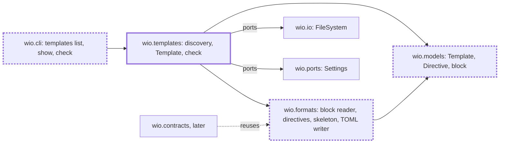

<!-- wio
id = "p53zv3"
template = "feature.parent"
roots = ["@descendants"]
depends_on = []
-->

# The wio templates command

## Purpose

People and agents who design a workflow need to find, print and check the
templates that contracts follow without creating a Work, and the code that
reads a template must be one that the contracts command can reuse.

## Goals

- A person or an agent can see the templates of a project, grouped by kind,
  with the entry template of each kind marked.
- An agent can print any template as the contract skeleton to rewrite a
  contract in, with nothing around it.
- A person or an agent that edits a template is told what is wrong with it.
- A template is named by its file, so its name cannot differ from where it
  lives.
- The metadata block, the directive grammar and the skeleton are read and
  written by one implementation that `wio contracts` reuses.
- The documents describe the command and the grammar as they are.

## Glossary

- **Template name**: the name of the template's file without `.md`, which
  `[templates.kinds]`, a contract's `template` key and `wio templates show`
  refer to; there is no `name` key.
- **Skeleton**: a template prepared as a contract, as `wio contracts new` would
  write it but without an `id`: the metadata of `[contract]` promoted to the top
  level, the template's own keys, the directives and the comments of the
  metadata removed, and the body's authoring comments kept.

## Non-Goals

- `wio templates show --work` and `--keep`, which need to find and read a Work
  and belong to the contracts Work.
- Finding the items of a section and applying a directive to a contract's body,
  which the contracts Work decides.
- Writing, changing or moving a template, or moving a Work between templates.
- Changing the three `feature` templates, other than dropping their `name` key.

## Assumptions

- **A-1**: The config Work is delivered, so `[templates]` is loaded and checked
  in its shape and `wio config check` reads no template.
- **A-2**: `tomlkit` can be added as a runtime dependency under the project's
  `exclude-newer` guard.
- **A-3**: The contracts Work, delivered after this one, takes the block reader,
  the directive parser and the skeleton from `wio.formats` as they are.

## Mechanisms

- `wio.formats`, which gains the reader of the metadata block, the parser of
  directives, the preparer of a skeleton and a TOML writer on `tomlkit`.
- `wio.templates`, the component that finds the templates, builds a `Template`
  and judges it for `check`.
- `wio.models`, which gains `Template`, `Directive` and the metadata block, the
  plain types that the codecs and the component pass to each other.
- `wio.cli`'s table of commands, which gains `templates` with `list`, `show` and
  `check`.
- The `FileSystem` port of `wio.io` and the `Settings` port of `wio.ports`,
  which the component reads files and the config through.

## Constraints

- **Templates are read, never written.** No command of wio changes a template.
- **Unknown keys are errors.** A key the schema does not know in the metadata of
  a template is an error, as in the config, and the keys under `[contract]` are
  free.
- **Output is deterministic.** It is sorted and has no timestamps, and
  `--json` is plain data for a program.
- **Nothing is imported before it is needed.** `list` and `check` import neither
  `tomlkit` nor `json` unless `--json` asks for it, and only preparing a
  skeleton imports the writer.
- **One writer.** Only `wio.formats` imports `tomlkit`, as only it imports
  `tomllib`, and ruff's `banned-api` reports any other import.
- **Dependency direction.** `wio.templates` imports `wio.formats`, `wio.models`
  and ports, never another component, and the review of each child checks the
  imports of its files, because `tach check` alone can pass a forbidden one
  ([known issues](../../../../docs/known-issues.md)).
- **Verification.** What a run imports is verified by AC-2, the output of
  `list` and `show` by the criteria of the discovery and show leaves, the
  problems that `check` reports by the criteria of the check leaf, and the
  dependency direction by the review of each child and by `tach check`.

## Visuals

Before, `wio.templates` holds only its docstring and `wio.formats` only the TOML
decoder and the diagnostic renderers. After, the component and the three codecs
exist, and `wio.contracts`, built later, reads templates and contracts through
the same codecs. Bold boxes are added and bold dashed boxes change.

## Acceptance criteria

### **AC-1** The installed package lists, shows and checks templates

The built wheel gives a working `wio templates list`, `show` and `check` in a
project that is not this repository.

#### The installed command

- **Given** the wheel built from the tree, run with
  `uv run --no-project --isolated --with <wheel>`, and a git repository whose
  config declares the kind `feature` with the entry template `feature.draft`
  and whose templates directory holds `feature.draft` and `feature.leaf`.
- **When** `wio templates list`, `wio templates show feature.leaf` and
  `wio templates check` run there.
- **Then** the first prints the kind `feature` with its two templates and marks
  `feature.draft` as the entry, the second prints the skeleton of
  `feature.leaf`, and the third passes; each exits 0.

### **AC-2** A run that reads no skeleton loads no writer

`wio templates list` and `wio templates check`, without `--json`, import neither
`tomlkit` nor `json`.

#### A fresh interpreter

- **Given** a new Python process and a repository with valid templates.
- **When** `main(["templates", "list"], stdio)` and then
  `main(["templates", "check"], stdio)` of `wio.cli` run in that process and
  `sys.modules` is read.
- **Then** neither module is there.

### **AC-3** This repository's templates agree across the three commands

The three `feature` templates of this repository are found, shown and judged
without a `name` key, and a broken copy of one is reported by place.

#### The repository's own templates

- **Given** this repository.
- **When** `wio templates list --kind feature`,
  `wio templates show feature.parent` and `wio templates check` run.
- **Then** the first lists `feature.draft` as the entry, `feature.leaf` and
  `feature.parent`, the second prints a skeleton with no `name`, `kind`,
  `shape`, `description` or `[actions]` and no directive comment, and the third
  passes.

#### A broken copy

- **Given** a copy of this repository's templates in which the heading of one
  section carries the directive `mandatory`, which the grammar does not have.
- **When** `wio templates check` runs.
- **Then** it prints an error that names that template's file and heading and
  exits 1.

### **AC-4** The documents describe the command and the grammar

`docs/concepts.md`, `docs/v0.1-scope.md`, `src/wio/formats/README.md` and
`GLOSSARY.md` state what the command and the codecs do as they are. They name
the three subcommands, `list --kind`, the entry marker and the grouped layout,
and the bare skeleton that `show` prints. They say a template is named by its
file and has no `name` key, that the quoted form of `pattern` is the way to
write a comma, and that `wio.formats` holds the block reader, the directive
parser, the skeleton and the only `tomlkit` writer. They list `--work`, `--keep`
and the finding of items under `wio contracts`, and they no longer list the form
of a `pattern` among the open points.

## Additional context

- [v0.1 scope](../../../../docs/v0.1-scope.md) names `wio templates` as a part
  and its outcome; this Work changes `list`, drops the template's `name` and
  moves `--work` and `--keep` to the contracts Work.
- [Templates in the concepts](../../../../docs/concepts.md) say what a template
  is, how a skeleton is prepared and which directives exist.
- The children are [block reader](block-reader/README.md),
  [directives](directives/README.md), [skeleton](skeleton/README.md),
  [discovery](discovery/README.md), [show](show/README.md) and
  [check](check/README.md).
