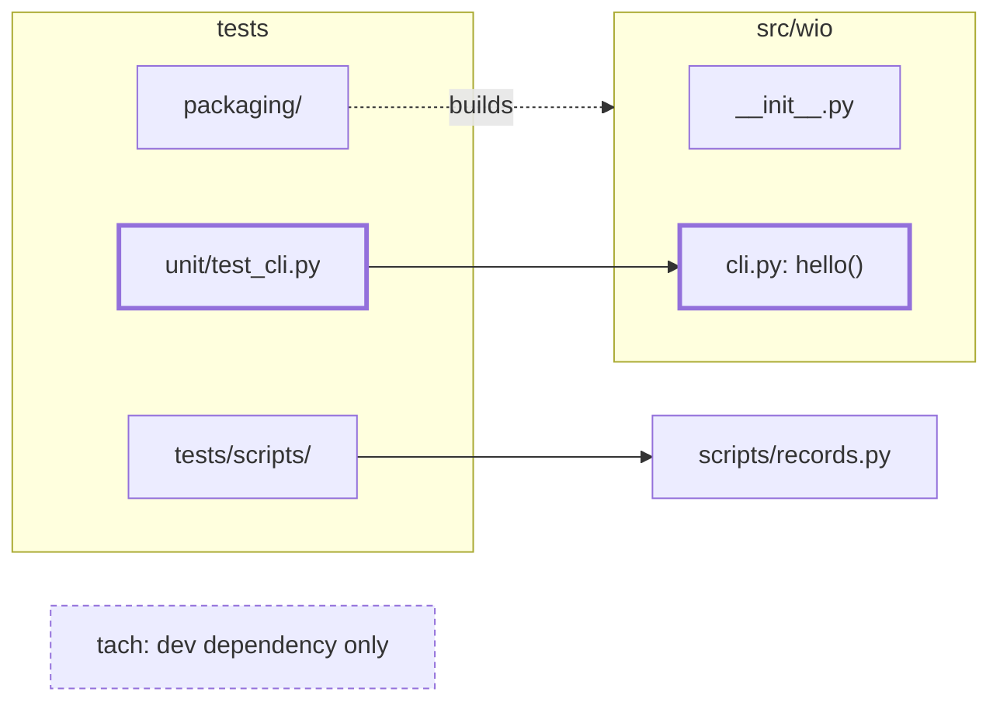
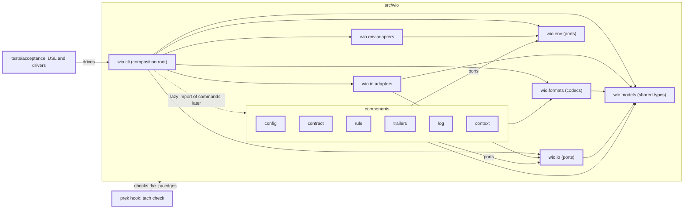

<!-- wio
id = "zpnbj3"
template = "feature.parent"
roots = ["@descendants"]
depends_on = []
-->

# v0.1 foundation

## Purpose

Every v0.1 component needs a fixed place, a typed boundary to the others and a
test setup before any of them is built, so that each can be delivered alone.

## Goals

- The repository's own checks reject a change that breaks the dependency
  direction between the packages of `src/wio`.
- The place of every v0.1 component and the boundaries it must honor can be read
  from `src/wio` and its stubs.
- Each component can be built against the typed ports it consumes, with an
  acceptance test setup that already runs the `wio` command.

## Glossary

These definitions are the source until the skeleton leaf moves them to
`src/wio/GLOSSARY.md` and `src/wio/cli/GLOSSARY.md`, which bind them to that
directory and its descendants; a ratify then replaces this section with links.

- **Component**: the package under `src/wio` of one v0.1 subcommand, which is
  `config`, `contract`, `rule`, `trailers`, `log` or `context`; `cli` is the
  composition root and `models`, `formats`, `io` and `env` are shared layers, so
  none of them is a component.
- **Port**: a `typing.Protocol` declared in a `.pyi` stub, saying what a package
  needs from the outside.
- **Adapter**: the implementation of a port, one per port, or for a port of
  `wio.env` one for each supported platform where its behavior differs.
- **Command**: the object a component exposes to the command line, with a name,
  a help text, a function that configures its argparse subparser and a function
  that runs it.

## Non-Goals

- Implementing any component's behavior, formats or model fields beyond what a
  port signature needs.
- Fixing the config schema, the directive grammar or the rule metadata, which
  the Works of the components settle.
- Writing the `wio-define` skill.
- Committing a test that proves tach rejects a forbidden import; the reviewer
  tries one locally instead.
- Making the bare `wio` command print its description, which the Work of the
  `cli` package does.

## Assumptions

- **A-1**: Tach 0.35.3 reads no imports inside `.pyi` files, so the imports of
  the stubs follow the dependency direction by convention and review.
- **A-2**: Ruff, pyrefly and tach, at the locked versions, accept the Python
  3.15 `lazy import` syntax, and tach counts a lazy import as a dependency.
- **A-3**: The scope document's six components are all of v0.1, and
  `wio-define` lives outside `src`.
- **A-4**: A component's package has the name of its subcommand.
- **A-5**: Linux and macOS are the supported platforms, as the continuous
  integration matrix shows.

## Mechanisms

- `tach check` enforces the dependency direction between the `.py` code of the
  packages of `src/wio`.
- `typing.Protocol` classes in `.pyi` stubs declare the ports, and `pyrefly
  check` verifies that their names and signatures resolve.
- `argparse` subparsers, one per command.
- Python 3.15 `lazy from ... import` in `wio.cli`, which each component's Work
  adds with its command.

## Constraints

- **Dependency direction**: `wio.models` and `wio.env` import nothing else from
  `wio`; `wio.formats` and `wio.io` import only `wio.models`; a component
  imports only `wio.models`, `wio.formats` and the ports of `wio.io` and
  `wio.env`; `wio.io.adapters` imports only `wio.io` and `wio.models`, and
  `wio.env.adapters` only `wio.env`; `wio.cli` is the only package that imports
  the commands of the components and the adapters.
- **No component imports another component.** They meet only in `wio.cli`, which
  gives each the implementation of the ports it consumes.
- **Ports are owned by their consumer**, declared in `<package>/ports.pyi`,
  imported only under `TYPE_CHECKING`, and satisfied structurally, so a provider
  never imports the stub of its consumer. The exceptions are `wio.io` and
  `wio.env`, whose ports are shared infrastructure that each owns in its own
  `ports.pyi`: `wio.io` for the filesystem, standard streams and git, and
  `wio.env` for what the process knows about its surroundings.
- **A shared-type stub is the spec until the Work that implements the type
  replaces it**: that Work writes a `.py` with the same annotations and
  docstrings and deletes the stub, while a port stays a `.pyi` for good.
- **One adapter per port**, except that a port of `wio.env` whose behavior
  differs by platform, such as the one for the temporary directory, has one
  adapter for each supported platform. Any other extra adapter needs a reason
  that the contract of the Work that adds it states, and fakes of ports live
  under `tests`, not in `src`.
- **Components reach the filesystem, standard streams and git only through the
  ports of `wio.io`, and the process environment (variables, working
  directory, clock, randomness and the well-known directories, starting with
  the temporary directory) only through those of `wio.env`.**
- **A dependency that exists only for a type is still a dependency**, so tach is
  set to count `TYPE_CHECKING` imports.
- **Verification.** Tach checks the dependency direction and the use of
  `TYPE_CHECKING` imports in `.py` code. The architecture review of each Work
  verifies the rest, because no tool checks it yet: port ownership, the
  `TYPE_CHECKING`-only import of every port stub (a `.pyi` has no runtime
  module), the stub lifecycle, one adapter per port and the access to the
  outside world.

## Visuals

The before state is drawn from `main` at commit `125ea3e` and checked against
`src/wio`, `tests`, `scripts`, `pyproject.toml` and `prek.toml` at that commit.
The after state is provisional, and the packages and their edges are required
while the names inside each `ports.pyi` are not.

Before: one placeholder module, and `tach` installed but not configured.

After: layers with one direction, one hook that checks them, and the test
setup that drives the command. Bold boxes are added by this Work, and `cli`
also replaces `cli.py`. The six component packages are bold too, as empty
packages. The dotted edge is the one the components' own Works add.

## Acceptance criteria

### **AC-1** The delivered foundation passes every check

With every child Work delivered, the repository's two gates, `make check` and
`make slow`, both pass; what each child establishes in them is stated in the
child.

#### The whole tree

- **Given** the tree with every child Work delivered.
- **When** `make check` runs, and then `make slow`.
- **Then** both exit 0.

### **AC-2** The layout and the dependency rules describe the same packages

Every package directly under `src/wio` is a module in `tach.toml`, and the only
other modules there are `wio.io.adapters` and `wio.env.adapters`, so the checked
graph is the one the constraints state.

#### Same packages

- **Given** the delivered tree.
- **When** the packages under `src/wio` are compared with the modules in
  `tach.toml`.
- **Then** the lists are equal apart from `wio.io.adapters` and
  `wio.env.adapters`, and each module's allowed dependencies are those of the
  dependency direction constraint.

## Additional context

- [v0.1 scope](../../../../docs/v0.1-scope.md) names the components and their
  order of work; the skeleton leaf updates it to match this Work.
- [Test strategy](../../../../tests/README.md) describes the DSL that the test
  leaf builds.
