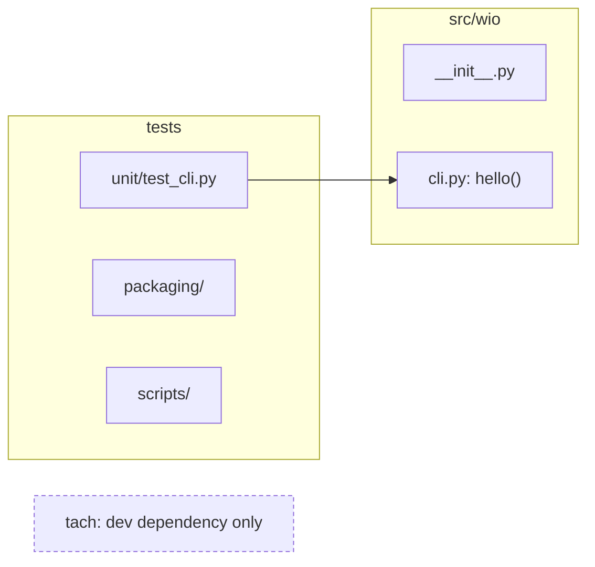
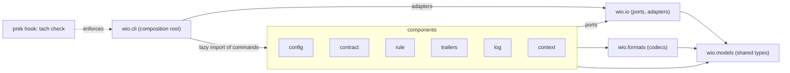

<!-- wio
id = "zpnbj3"
template = "feature.parent"
roots = ["@descendants"]
depends_on = []
-->

# v0.1 foundation

## Purpose

Every v0.1 component needs a fixed place, a typed boundary to the others and a
test setup before any of them is built, so that each can be delivered alone.

## Goals

- The repository's own checks reject a change that breaks the architecture.
- The place of every v0.1 component and the boundaries it must honor can be read
  from `src/wio` and its stubs.
- Each component can be built against fakes of the ports it consumes, with an
  acceptance test setup that already runs the `wio` command.

## Glossary

- **Component**: the package under `src/wio` of one v0.1 subcommand, which is
  `config`, `contract`, `rule`, `trailers`, `log` or `context`.
- **Port**: a `typing.Protocol` declared in a `.pyi` stub by the package that
  consumes it, saying what that package needs from the outside.
- **Adapter**: the implementation of a port, one per port for now; real
  adapters are imported only by `cli`, and fakes live in the tests.
- **Command**: the object a component exposes to the command line, with a name,
  a help text, a function that configures its argparse subparser and a function
  that runs it.

## Non-Goals

- Implementing any component's behavior, formats or model fields beyond what a
  port signature needs.
- Fixing the config schema, the directive grammar or the rule metadata, which
  the Works of the components settle.
- Writing the `wio-define` skill.
- Committing a test that proves tach rejects a forbidden import.
- Making the bare `wio` command print its description, which the `cli`
  component's Work does.

## Assumptions

- **A-1**: Tach 0.35.3 reads no imports inside `.pyi` files, so the imports of
  the stubs follow the dependency direction by convention and review.
- **A-2**: Ruff, pyrefly and tach, at the locked versions, accept the Python
  3.15 `lazy import` syntax, and tach counts a lazy import as a dependency.
- **A-3**: The scope document's six components are all of v0.1, and
  `wio-define` lives outside `src`.
- **A-4**: A component's package has the name of its subcommand.
- **A-5**: Tach's refusal of a forbidden import is trusted from its behavior
  and from the reviewer's local trial, so no negative test is committed.
- **A-6**: Tach starts with `exact = false`, because no `.py` code uses the
  declared dependencies yet, and turning `exact` on is a later Work.

## Mechanisms

- `tach check`, configured in `tach.toml`, enforces the dependency table
  between the packages of `src/wio`.
- A `prek` hook runs `tach check`, so `make lint`, `make check` and the
  continuous integration cover it.
- `typing.Protocol` classes in `.pyi` stubs declare the ports, and `pyrefly
  check` verifies that their names and signatures resolve.
- `argparse` subparsers, one per command, and Python 3.15 `lazy from ... import`
  in `wio.cli`, so one invocation loads only the command it runs.
- `pytest.mark.xfail(strict=True)` marks the scenario that waits for the `cli`
  component.

## Constraints

- **Dependency direction**: `wio.models` imports nothing else from `wio`;
  `wio.formats` and `wio.io` import only `wio.models`; a component imports only
  `wio.models`, `wio.formats` and the ports of `wio.io`; `wio.cli` is the only
  package that imports the commands of the components and the adapters of
  `wio.io`.
- **No component imports another component.** They meet only in `wio.cli`, which
  gives each the implementation of the ports it consumes.
- **Ports are owned by their consumer**, declared in `<package>/ports.pyi`,
  imported only under `TYPE_CHECKING`, and satisfied structurally, so a provider
  never imports the stub of its consumer.
- **A shared-type stub is the spec until the Work that implements the type
  replaces it**: that Work writes a `.py` with the same annotations and
  docstrings and deletes the stub, while a port stays a `.pyi` for good.
- **One adapter per port.** An extra adapter needs a reason that the contract of
  the Work that adds it states.
- **Components reach the filesystem, standard streams, git and the environment
  only through the ports of `wio.io`.** The architecture review of each Work
  verifies it, because no tool checks it yet.
- **Tach counts `TYPE_CHECKING` imports**, so a dependency that exists only for
  a type is still a dependency.

## Visuals

The before state is drawn from `main` at commit `125ea3e` and checked against
`src/wio`, `tests`, `pyproject.toml` and `prek.toml` at that commit. The after
state is provisional, and the packages and their edges are required while the
names inside each `ports.pyi` are not.

Before: one placeholder module, and `tach` installed but not configured.

After: layers with one direction, and one hook that enforces them.

## Acceptance criteria

### **AC-1** The repository's checks reject a change that breaks the architecture

With every child Work delivered, `make check` passes, and the dependency check
and the type check it runs both cover the skeleton.

#### Clean tree

- **Given** the tree with every child Work delivered.
- **When** `make check` runs.
- **Then** it exits 0 and reports `tach check` and `pyrefly check` as passed.

#### Broken dependency

- **Given** the delivered tree plus a `.py` module of one component that imports
  another component.
- **When** `make lint` runs.
- **Then** it exits non-zero and the `tach check` output names both packages.

The reviewer tries the second scenario locally at the system review, and no
test for it is committed (A-5).

### **AC-2** The first acceptance scenario is ready for the first component

With every child Work delivered, the bare-`wio` scenario is reported as xfailed
once per channel and no run fails.

#### Both channels

- **Given** the tree with every child Work delivered.
- **When** `uv run pytest` runs, and then `uv run pytest -m slow`.
- **Then** the first reports the in-process case of the scenario as xfailed, the
  second reports the CLI case as xfailed, and both exit 0.

#### The component arrives

- **Given** a command that prints its description and exits 0.
- **When** the scenario runs.
- **Then** it fails as an unexpected pass, so the marker is removed with the
  change.

### **AC-3** The layout and the dependency rules describe the same packages

Every package directly under `src/wio` is a module in `tach.toml`, and every
module there is such a package, with the dependency table that the constraints
state.

#### Same packages

- **Given** the delivered tree.
- **When** the packages under `src/wio` are compared with the modules in
  `tach.toml`.
- **Then** the two lists are equal, and each module's allowed dependencies are
  those of the dependency direction constraint.

## Additional context

- [v0.1 scope](../../../../docs/v0.1-scope.md) names the components and their
  order of work; the skeleton leaf updates it to match this Work.
- [Test strategy](../../../../tests/README.md) describes the DSL that the test
  leaf builds.
