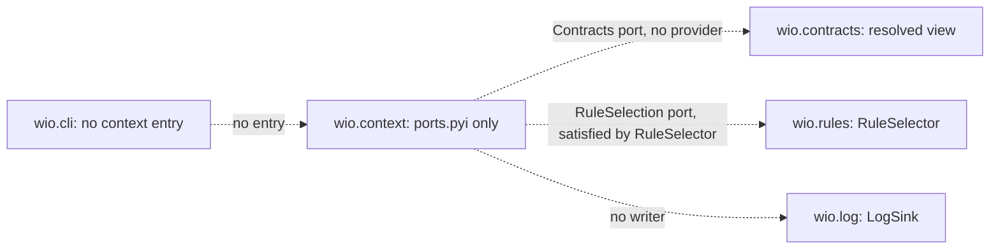
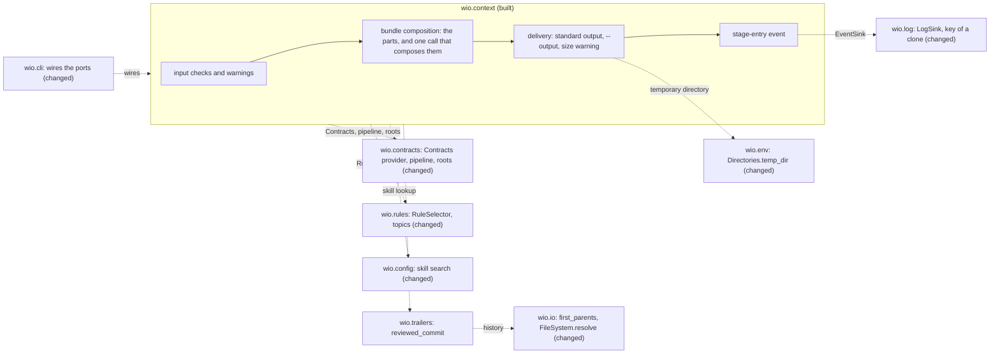

<!-- wio
id = "j85eh5"
template = "feature.parent"
roots = ["@descendants"]
depends_on = []
-->

# wio context

## Purpose

`wio context` is missing, so an agent that starts a stage has no single,
repeatable place to learn what it must produce and which rules apply, and nobody
can tell what two sessions were given or compare their results.

## Goals

- An agent starting a stage of a Work can read, from one command, what the stage
  must produce, the Work's resolved contract and the rules that apply to it.
- Two sessions given the same inputs can be shown to have seen the same context,
  because the bundle and its id are the same.
- A change to the text of the goal, of the resolved contract, of the name or
  body of a selected rule, or to a file of the stage's skill shows in the bundle
  id.
- A driver is told when a choice looks wrong, such as a stage outside the
  action's pipeline, and is never blocked by it.
- An unknown Work, action or stage, and an unknown root of a Work at a stage
  that selects the Work's roots, is refused, so a mistaken bundle is never taken
  for success.
- A session can read the bundle from a file when its harness truncates long
  output.
- Each stage entry is recorded, including the commit a gate's review starts
  from.

## Glossary

### Bundle body

The text of a [bundle](../../../../GLOSSARY.md) after its metadata, its header
and the blank lines that follow them, up to the end: the labelled parts and the
closing line, as
[Assemble the bundle](bundle-composition/assemble-the-bundle/README.md) defines
them. The size that the header states is that of the body. It is neither a
rule's body nor a contract's body, and "the body" means this one unless a Work
says "a rule's body".

### Metadata

The first line of a bundle, `bundle: <id>`, which holds the values derived from
the header and the body and is never hashed, so that the bundle id, which hashes
the text after the metadata, does not depend on itself. Today it holds the id
alone.

### Canonical command

The command the header states and the closing line asks the session to run
again: `wio context` with the Work, the action and the stage as parsed, and no
option that changes only where the bundle goes. Running it again prints the same
bundle to standard output.

## Non-Goals

- A bundle without a Work, such as `wio context --root <name>`, which a later
  Work may add.
- Explaining why a rule was selected, which `wio rules list --explain` does.
- Running the command automatically, which a harness does, and enforcing the
  order of stages or the result of a gate, which a later orchestrator does.

## Assumptions

### A-1

The goal or skill pointer, the contract section and the rules section can each
be composed without the others, so that a bundle without a Work stays possible
later.

### A-2

Where `docs/concepts.md` and `docs/v0.1-scope.md` differ, the concepts are
right: the scope document says that `wio context` can explain why a rule was
included, which the concepts give to `wio rules list --explain`, and the docs
stage corrects it. The children declare their other departures from the
concepts, each in the Work that makes it: the metadata, the labels, the id and
the fixed blank line in [Bundle composition](bundle-composition/README.md), the
separator in
[Rule rendering](bundle-composition/rules-section/rule-rendering/README.md), the
size of the body in
[Warn about an oversized bundle](delivery-of-the-bundle/warn-about-an-oversized-bundle/README.md)
and the forms of `--output` in
[Write the bundle to a file](delivery-of-the-bundle/write-the-bundle-to-a-file/README.md).

### A-3

For a Work with no roots at a stage that selects the Work's roots, a bundle with
a warning is right where the concepts have the stage fail, and the docs stage
corrects the concepts; [Warn about a Work with no
roots](check-the-inputs/warn-about-a-work-with-no-roots/README.md) states the
warning.

## Mechanisms

The names of the ports, the types and the modules below are provisional, except
the command and the `context` event, which `docs/concepts.md` fixes; the
bundle's parts are as the children define them. The ports that `wio.context`
declares are in `src/wio/context/ports.pyi`, which the architecture stage of the
leaf that adds a port extends.

- **`wio.context` package** — the compiler of the bundle and the `wio context`
  command, built by the children below; it imports no other component.
- **The `Contracts` port** — in `src/wio/context/ports.pyi`, satisfied by
  `wio.contracts`; it gives the resolved contract, which the rule selection
  takes as its input, and the text of the resolved view, so that `wio.context`
  never lays the view out itself.
- **The `RuleSelection` port** — in the same file, satisfied by `RuleSelector`
  of `wio.rules`, which the composition asks once.
- **`render_resolved`** — in `wio.contracts`, the one function that writes a
  Work's resolved view; the provider of the `Contracts` port calls it, which
  [Contract section](bundle-composition/contract-section/README.md) builds.
- **The topics port** — in the same file, satisfied by `wio.rules` from its
  manifests, which
  [Ordering and topics](bundle-composition/rules-section/ordering-and-topics/README.md)
  declares and builds.
- **`Selection` and `Decision`** — in `wio.models.rules`, what the rules section
  groups and prints.
- **`ContextEvent` and `EventSink`** — in `wio.models.events` and `wio.ports`,
  what `Record a stage entry` writes.
- **`reviewed_commit`** — in `wio.trailers`, which `Record where a gate review
  starts` reuses through a port.
- **The skill search** — in `wio.config`, which `Skill lookup` makes reusable.
- **The effective pipeline and the roots** — `WorkLookup.pipeline` and
  `WorkLookup.roots_of` of `wio.contracts`, which the checks reuse through ports
  that their Works declare.
- **`rule_hash`** — in `wio.formats`, which hashes a rule's file; the
  composition hashes the bytes of each printed rule's file with it.
- **`Directories`** — in `wio.env`, whose `temp_dir` gives the temporary
  directory that `--output` writes to and which
  [Write the bundle to a file](delivery-of-the-bundle/write-the-bundle-to-a-file/README.md)
  implements.
- **The compiler** — provisional, in layers: the command Work builds the
  function that runs the checks and then asks the composition port for the
  bundle, and returns the result that the command Work defines;
  [Compose the bundle](bundle-composition/compose-the-bundle/README.md) builds
  the composition behind that port from the other Works under Bundle
  composition, asks for the selection once and hashes the printed rules. The
  command, not the compiler, delivers the result and writes the event.
- **The `wio.cli` entry** — `component_entry("context", wire)`, built by the
  command child, which wires only the shell; each Work that adds a port extends
  `Services` and `wire` for it, and the integration stage of this Work checks
  that every port is wired to its component.

## Constraints

### C-1

`wio.context` depends only on the ports that it declares, the shared ones of
`wio.ports`, `wio.io` and `wio.env`, and `wio.models`, `wio.formats` and
`wio.errors`, and imports no adapter and no other component; `wio.cli` wires
each port to the component on its other side. `uv run tach check` and the review
of the imports verify it, because `docs/known-issues.md` says that `tach check`
sometimes passes a forbidden import.

### C-2

The command writes only the bundle, to standard output or to the file that
`--output` names, and the `context` event, and nothing else in the worktree; a
failure to write the event is a warning and never blocks, as `wio.log` states.
AC-5 verifies that a refusal of an unknown input writes no event, AC-8 verifies
that a run leaves the worktree as it found it, and the criteria of Record a
stage entry verify that a failed delivery writes no event and that a failed
write of the event never blocks.

### C-3

The exit codes are those of `wio`, and `context` uses no 1: 0 for success,
warnings included, 2 for an error that the user must fix and 70 for a bug in
wio. AC-4 and AC-5 verify 0 and 2, and AC-3 of
[The wio context command](the-wio-context-command/README.md) verifies 70.

### C-4

The bundle is deterministic: it holds no timestamp and no path of the machine
that ran it, and its order depends on no hash and on no order of the config's
tables. AC-2 verifies it with golden files.

### C-5

The selection is the one that `wio rules list` shows for the same Work and
stage, which AC-9 verifies. The reuses leave the output of their owners
unchanged, as their Works state: the existing tests of `wio.config`,
`wio.contracts`, `wio.io`, `wio.env`, `wio.log` and `wio.rules` pass, changed
only where a Work names the change, such as the test of `wio.env` that expects
`temp_dir` to raise, the key of a clone that moves, and the empty history of a
repository with no commit that Record where a gate review starts gives.

### C-6

A normal run loads only the modules that it needs. This is a qualitative
requirement that no criterion claims, because only the integrated command can
show it; the system review of this Work checks it with an integration test in a
fresh interpreter that lists the modules a run must not import, as the one for
`wio contracts show` does, and the architecture stage of
[The wio context command](the-wio-context-command/README.md) names them.

## Visuals

The diagrams are drawn from commit `8edc675` of the branch `main`, and show only
what the Work changes.

### Before

`wio.cli` has no `context` entry, and `wio.context` holds only the stubs of two
ports, one of which `RuleSelector` already satisfies. `wio.contracts`,
`wio.rules` and `wio.log` already provide what a bundle is made of, and
`temp_dir` of `wio.env` raises.

### After

`wio.context` compiles the bundle from the resolved contract, the rule
selection, the stage's goal or skill and the config, delivers it to standard
output or a file, and writes the stage-entry event. It reaches every other
component through a port that `wio.cli` wires. Changed parts are marked.

## Acceptance criteria

### **AC-1** One command gives a stage its context

`wio context <work> <action> <stage>` prints, in this order, the metadata, the
header, the stage's goal or the pointer to its skill, the Work's resolved
contract, the rules that apply to the stage and the closing line, and exits 0.

#### A stage with a goal

- **Given** a defined Work with a root, an action with a stage whose goal is
  set, and a rule that the stage selects.
- **When** `wio context` runs for that Work, action and stage.
- **Then** the output holds the metadata, the header, the goal, the resolved
  contract, the rule and the closing line in that order, and the exit code is 0.

#### A stage with a skill

- **Given** the same Work and a stage that names a skill found in the
  repository.
- **When** `wio context` runs for it.
- **Then** the output holds the instruction to read the skill's `SKILL.md` where
  the goal was, and does not hold the skill's text.

### **AC-2** The same inputs give the same bytes

Running the command twice on unchanged inputs prints byte-identical output with
the same bundle id.

#### Two runs

- **Given** the Work, action and stage of AC-1 and a golden file of their
  bundle.
- **When** `wio context` runs twice, once with the tables of the config in
  another order.
- **Then** both outputs equal the golden file byte for byte.

### **AC-3** A change to any input shows in the bundle id

Changing the text of the stage's goal, of the Work's resolved contract or of a
selected rule's name or body, or a file of the stage's skill, gives a different
bundle id, and changing only where the bundle goes does not.

#### Four changes and one that is not

- **Given** the bundle of AC-1 and its id, and the bundle of the same Work at a
  stage with a skill and its id.
- **When** the goal, the contract and a selected rule's body are changed one at
  a time in the first, a file of the skill is changed in the second, and then
  the command runs with `--output`.
- **Then** each of the four changes gives an id that differs from that of its
  bundle before the change, and the run with `--output` prints a path whose file
  holds the first id in its metadata.

### **AC-4** A questionable choice never blocks

A stage outside the action's pipeline, a Work with no roots at a stage that
selects the Work's roots and a bundle over the configured size each give a
warning on standard error, the bundle on standard output, and exit 0.

#### Three warnings

- **Given** a Work and a stage that is outside its action's pipeline, a Work
  with no roots at a stage that selects the Work's roots, and a size threshold
  below the size of its body.
- **When** `wio context` runs for each, and for the last again without the
  threshold.
- **Then** each prints a warning on standard error and the bundle on standard
  output, the exit code is 0, and the bundle printed with the threshold equals
  the one printed without it.

### **AC-5** An unknown input produces no bundle

An unknown Work, action or stage, and an unknown root of a Work at a stage that
selects the Work's roots, exit 2, print no bundle on standard output and record
no event.

#### Four unknowns

- **Given** a repository and the id of no Work, the name of no action, the name
  of no stage and a Work whose `roots` list the name of no root, run at a stage
  that selects the Work's roots.
- **When** `wio context` runs for each.
- **Then** each exits 2 with no bundle on standard output, and the event log
  holds no new `context` event; the case of a stage with roots of its own, which
  gets its bundle, is AC-4 of
  [Refuse an unknown action, stage or root](check-the-inputs/refuse-an-unknown-action-stage-or-root/README.md).

### **AC-6** A file holds the same bundle

With `--output`, the file holds the bytes that standard output holds for the
same inputs, and the command prints where it wrote them.

#### Default and given path

- **Given** the Work, action and stage of AC-1.
- **When** `wio context <work> <action> <stage> --output` and the same with
  `--output <path>` run.
- **Then** each prints its path, and the file at each holds the bytes of the
  golden file of AC-2.

### **AC-7** A stage entry is recorded

A run records one `context` event whose bundle id is the one in the metadata,
whose `rules` are the rules printed in the bundle, in the order printed, each
with the hash of its file, and for a gate stage the event also holds the commit
the review starts from, when the repository has one, and whether the tree was
dirty.

#### A stage and a gate

- **Given** a repository with a commit, a stage and a gate stage of an action of
  a Work, each selecting two rules from real rule files.
- **When** `wio context` runs for each.
- **Then** the log holds one event for each whose bundle id equals the id in
  that run's metadata, whose `rules` hold the qualified codes in the order that
  the bundle prints them, each with the `rule_hash` of its file, the gate's
  event holds the commit and the dirty flag, and the other event holds neither.

### **AC-8** A run leaves the worktree as it found it

A run without `--output` changes no file of the worktree, and a run with
`--output` changes only the file it names.

#### Before and after

- **Given** a repository with a Work and a stage, `$WIO_HOME` outside its
  worktree, and a snapshot of the files of the worktree.
- **When** `wio context` runs without `--output`, and then with `--output` and a
  path outside the worktree.
- **Then** the snapshot after each run equals the first, and the second run
  wrote its file outside the worktree.

### **AC-9** The rules are those that `wio rules list` shows

The rules printed in the bundle are the included rules that `wio rules list`
shows for the same Work and stage, in the same count.

#### The same selection

- **Given** a repository with a Work, a stage and rulesets that include, exclude
  and leave out rules.
- **When** `wio rules list` and `wio context` run for that Work and stage.
- **Then** the qualified codes in the bundle's rules section are exactly the
  included ones of the list, each once.

## Additional context

- The guarantees of one part, such as every field of the header, each warning's
  wording, the order of the rules, the lookup of a skill and the rules for the
  temporary directory, are the criteria of the children that own them, so this
  contract states only what the integrated result establishes.
- `src/wio/context/ports.pyi` already declares `Contracts.resolved` and
  `RuleSelection.select`. `RuleSelector` of `wio.rules` satisfies the second and
  gives a Work with no roots a selection with no included rule, which is why
  A-3 makes the warning the way to say it.
- `wio.trailers` finds the reviewed commit with
  `reviewed_commit(action, stage, history, reader)`; a later form of
  `wio trailers --result` will compare it with the start that the `context`
  event of the gate records.
- A bundle without a Work would reuse the rules section and the closing line,
  which is the reason for A-1 and for keeping the canonical command the one as
  parsed.
