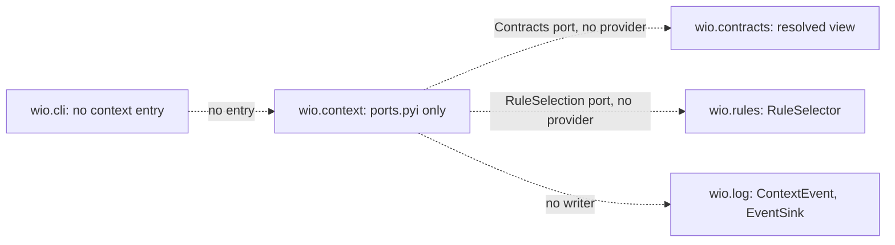
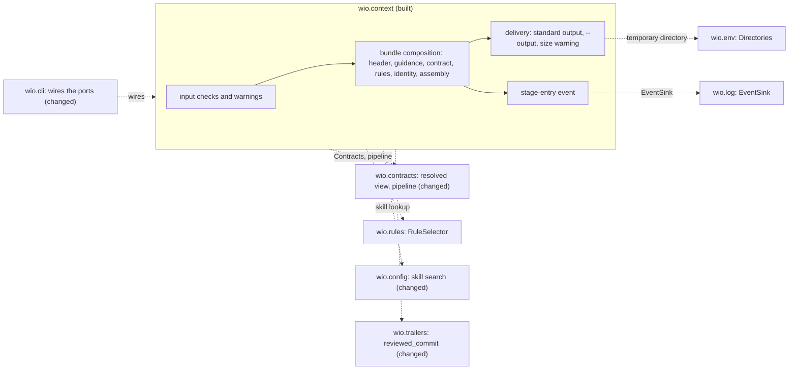

<!-- wio
id = "j85eh5"
template = "feature.parent"
roots = ["@descendants"]
depends_on = []
-->

# wio context

## Purpose

`wio context` is missing, so an agent that starts a stage has no single,
repeatable place to learn what it must produce and which rules apply, and nobody
can tell what two sessions were given or compare their results.

## Goals

- An agent starting a stage of a Work can read, from one command, what the stage
  must produce, the Work's resolved contract and the rules that apply to it.
- Two sessions given the same inputs can be shown to have seen the same context,
  because the bundle and its id are the same.
- Any change to the goal, the contract, the rules or the skill's files shows in
  the bundle id.
- A driver is told when a choice looks wrong, such as a stage outside the
  action's pipeline, and is never blocked by it.
- An unknown Work, action, stage or root is refused, so a mistaken bundle is
  never taken for success.
- A session can read the bundle from a file when its harness truncates long
  output.
- Each stage entry is recorded, including the commit a gate's review starts
  from.

## Glossary

### Body

The parts of a [bundle](../../../../GLOSSARY.md) below its header: the stage's
goal or the pointer to its skill, the resolved contract, the rules and the
closing line. The bundle id and the size that the header states are those of
the body, so that neither depends on the header that contains it.

### Canonical command

The command the header states and the closing line asks the session to run
again: `wio context` with the Work, the action and the stage as parsed, and no
option that changes only where the bundle goes. Running it again prints the same
bundle to standard output.

## Non-Goals

- A bundle without a Work, such as `wio context --root <name>`, which a later
  Work may add.
- Explaining why a rule was selected, which `wio rules list --explain` does.
- Running the command automatically, which a harness does, and enforcing the
  order of stages or the result of a gate, which a later orchestrator does.

## Assumptions

### A-1

`ContextEvent`, `EventSink` and the identification of the harness session in
`wio.log` carry everything that a stage entry records, so `wio.log` needs no
change.

### A-2

The `size` of the `context` event is the size of the body, the number that the
header states.

### A-3

The reviewed-commit finder `reviewed_commit` of `wio.trailers` can be shared by
changing only who may call it.

### A-4

The search for a skill that `wio.config` uses to check that a stage's skill
exists can be shared by changing only who may call it.

### A-5

The effective pipeline of an action for a Work can be had from the actions that
`wio.contracts` already resolves, without computing it again.

### A-6

The resolved view of a Work already starts after the metadata block, so the
contract section needs no stripping of its own.

### A-7

The hash of each rule's file that the event records is the `rule_hash` of
`wio.formats`, the one that `wio trailers` cites.

### A-8

A `Selection` carries what the grouping of rules needs: whether each rule is
included, its roots and whether its ruleset is root-independent.

### A-9

The goal or skill pointer, the contract section and the rules section can each
be composed without the others, so that a bundle without a Work stays possible
later.

### A-10

Where `docs/concepts.md` and `docs/v0.1-scope.md` differ, the concepts are
right: the scope document says that `wio context` can explain why a rule was
included, which the concepts give to `wio rules list --explain`, and the docs
stage corrects it.

### A-11

For a Work with no roots at a stage that selects the Work's roots, a bundle with
a warning is right where the concepts say the stage "fails loudly", as the
`RuleSelection` port already says by giving such a Work a selection with no
included rule, and the docs stage corrects the concepts.

## Mechanisms

The names of the ports, the types and the modules below are provisional, except
the ones that `docs/concepts.md` already fixes: the command, the bundle's parts
and the `context` event. The ports that `wio.context` declares are in
`src/wio/context/ports.pyi`, which the architecture stage extends.

- **`wio.context` package** — the compiler of the bundle and the `wio context`
  command, built by the children below; it imports no other component.
- **`Contracts` and `RuleSelection` ports** — in `src/wio/context/ports.pyi`,
  satisfied by `wio.contracts` and by `RuleSelector` of `wio.rules`; the
  stage-entry and input checks add ports of their own for what the other
  children consume.
- **`render_resolved`** — in `wio.contracts`, the one function that writes a
  Work's resolved view, which the contract section embeds.
- **`Selection` and `Decision`** — in `wio.models.rules`, what the rules section
  groups and prints.
- **`ContextEvent` and `EventSink`** — in `wio.models.events` and `wio.ports`,
  what `Record a stage entry` writes.
- **`reviewed_commit`** — in `wio.trailers`, which `Record where a gate review
  starts` reuses through a port.
- **The skill search** — in `wio.config`, which `Skill lookup` reuses through a
  port.
- **`resolve_actions`** — in `wio.contracts`, whose result the pipeline warning
  reuses through a port.
- **`rule_hash`** — in `wio.formats`, which hashes a rule's file.
- **`Directories`** — in `wio.env`, which gives the temporary directory that
  `--output` writes to.
- **The `wio.cli` entry** — `component_entry("context", wire)`, built by the
  command child, which wires every port to its component.

## Constraints

### C-1

`wio.context` depends only on the ports that it declares and the shared ones of
`wio.ports`, and imports no adapter and no other component; `wio.cli` wires each
port to the component on its other side. `uv run tach check` verifies it.

### C-2

The command writes only the bundle, to standard output or to the file that
`--output` names, and the `context` event, and nothing else in the worktree; a
failure to write the event is a warning and never blocks, as `wio.log` states.
AC-5 verifies that a refusal writes no event, and the unit tests of the
children that write verify the rest on fakes of the ports.

### C-3

The exit codes are those of `wio`: 0 for success, warnings included, 2 for an
error that the user must fix and 70 for a bug in wio. AC-4 and AC-5 verify them.

### C-4

The output is deterministic: it holds no timestamp and no path of the machine
that ran it, and its order depends on no hash and on no order of the config's
tables. AC-2 verifies it with golden files.

### C-5

The contract section is the text of `render_resolved`, the selection is the one
that `wio rules list` shows for the same Work and stage, and the three reuses of
A-3, A-4 and A-5 leave the output of their owners unchanged: the existing tests
of `wio.config`, `wio.trailers` and `wio.contracts` pass without a change.

### C-6

A normal run loads only the modules that it needs. This is a qualitative
requirement, verified by the Work itself with an integration test in a fresh
interpreter that lists the modules a run must not import, as the one for
`wio contracts show` does; the architecture stage names them. No criterion of
this parent claims it.

## Visuals

The diagrams are drawn from commit `8edc675` of the branch `main`, and show only
what the Work changes.

### Before

`wio.cli` has no `context` entry, and `wio.context` holds only the stubs of two
ports that nothing satisfies. `wio.contracts`, `wio.rules` and `wio.log` already
provide what a bundle is made of.

### After

`wio.context` compiles the bundle from the resolved contract, the rule
selection, the stage's goal or skill and the config, delivers it to standard
output or a file, and writes the stage-entry event. It reaches every other
component through a port that `wio.cli` wires. Changed parts are marked.

## Acceptance criteria

### **AC-1** One command gives a stage its context

`wio context <work> <action> <stage>` prints, in this order, the header, the
stage's goal or the pointer to its skill, the Work's resolved contract, the
rules that apply to the stage and the closing line, and exits 0.

#### A stage with a goal

- **Given** a defined Work with a root, an action with a stage whose goal is
  set, and a rule that the stage selects.
- **When** `wio context` runs for that Work, action and stage.
- **Then** the output holds the header, the goal, the resolved contract, the
  rule and the closing line in that order, and the exit code is 0.

#### A stage with a skill

- **Given** the same Work and a stage that names a skill found in the
  repository.
- **When** `wio context` runs for it.
- **Then** the output holds the instruction to read the skill's `SKILL.md` where
  the goal was, and does not hold the skill's text.

### **AC-2** The same inputs give the same bytes

Running the command twice on unchanged inputs prints byte-identical output with
the same bundle id.

#### Two runs

- **Given** the Work, action and stage of AC-1 and a golden file of their
  bundle.
- **When** `wio context` runs twice, once with the tables of the config in
  another order.
- **Then** both outputs equal the golden file byte for byte.

### **AC-3** A change to any input shows in the bundle id

Changing the stage's goal, the Work's contract, the file of a selected rule or a
file of the stage's skill gives a different bundle id, and changing only the
invocation does not.

#### Four changes and one that is not

- **Given** the bundle of AC-1 and its id.
- **When** the goal, the contract, a selected rule's file and a file of the
  skill are changed one at a time, and then the command runs with `--output`.
- **Then** each of the four changes gives an id that differs from the first, and
  the run with `--output` gives the first id.

### **AC-4** A questionable choice never blocks

A stage outside the action's pipeline, a Work with no roots at a stage that
selects the Work's roots and a bundle over the configured size each give a
warning, the same bundle bytes as without the warning, and exit 0.

#### Three warnings

- **Given** a Work and a stage that is outside its action's pipeline, a Work
  with no roots at a stage that selects the Work's roots, and a size threshold
  below the size of a bundle.
- **When** `wio context` runs for each.
- **Then** each prints a warning and the bundle, the bundle of each is the one
  that the same inputs give without the cause of the warning, where only the
  Work, the stage or the threshold differs, and the exit code is 0.

### **AC-5** An unknown input produces no bundle

An unknown Work, action, stage or root exits 2, prints no bundle on standard
output and records no event.

#### Four unknowns

- **Given** a repository and the id of no Work, the name of no action, the name
  of no stage and a Work whose `roots` list the name of no root.
- **When** `wio context` runs for each.
- **Then** each exits 2 with no bundle on standard output, and the event log
  holds no new `context` event.

### **AC-6** A file holds the same bundle

With `--output`, the file holds the bytes that standard output holds for the
same inputs, and the command prints where it wrote them.

#### Default and given path

- **Given** the Work, action and stage of AC-1.
- **When** `wio context --output` and `wio context --output <path>` run.
- **Then** each prints its path, and the file at each holds the bytes of the
  golden file of AC-2.

### **AC-7** A stage entry is recorded

A run records one `context` event whose bundle id is the header's, and for a
gate stage the event also holds the commit the review starts from and whether
the tree was dirty.

#### A stage and a gate

- **Given** a repository with a commit, a stage and a gate stage of an action of
  a Work.
- **When** `wio context` runs for each.
- **Then** the log holds one event for each whose bundle id equals the id in
  that run's header, the gate's event holds the commit and the dirty flag, and
  the other event holds neither.

## Additional context

- The guarantees of one part, such as every field of the header, each warning's
  wording, the order of the rules, the lookup of a skill and the rules for the
  temporary directory, are the criteria of the children that own them, so this
  contract states only what the integrated result establishes.
- `src/wio/context/ports.pyi` already declares `Contracts.resolved` and
  `RuleSelection.select`. `RuleSelector` of `wio.rules` satisfies the second and
  gives a Work with no roots a selection with no included rule, which is why
  A-11 makes the warning the way to say it.
- `wio.trailers` finds the reviewed commit with `reviewed_commit(action, stage,
  history, reader)`, and `wio trailers --result` compares it with the start that
  the `context` event of the gate records.
- A bundle without a Work would reuse the rules section and the closing line,
  which is the reason for A-9 and for keeping the canonical command the request
  as parsed.
