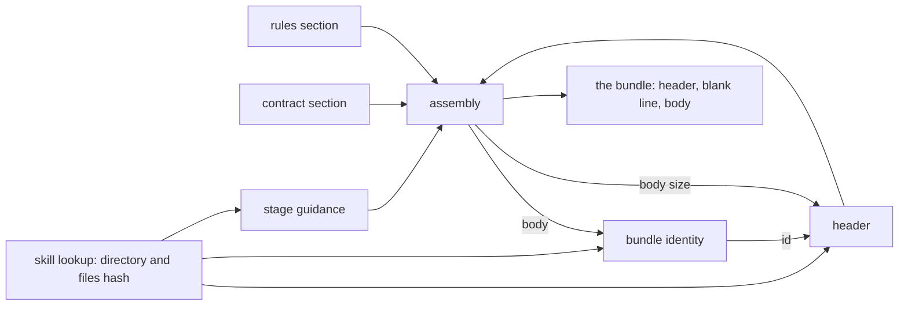

<!-- wio
id = "v2dxyw"
template = "feature.parent"
roots = ["@descendants"]
depends_on = []
-->

# Bundle composition

## Purpose

The parts of a bundle are specified one by one, but nothing yet joins them into
one text whose id and size describe it, so a session cannot be given a bundle
that can be compared with another.

## Goals

- The id and the size that the header states are those of the body, so a reader
  can check them against the text.
- A skill that a stage names is found, pointed to and counted in the id.

## Non-Goals

- Delivering the bundle, which the delivery does.
- Recording the stage entry, which the event does.

## Assumptions

### A-1

Where the concepts and the scope document give the header "the size of the
bundle", it is right for it to state the size of the body, and the docs stage
corrects both documents.

### A-2

The parts of the body carry the labels that the assembly gives them, which the
concepts do not name, and the docs stage records them.

### A-3

The bundle id is 12 hexadecimal digits for every stage, where the skill's files
count through the input of the hash and not through a longer id, which keeps the
id short as the concepts say, and it hashes the whole body, labels and closing
line included, where the concepts say the goal, the contract and the rules, so a
change of a label changes the id too.

### A-4

The parts of a bundle are joined by a fixed blank line, and `[bundle] separator`
is read only for the items of the rules section, as Rule rendering says, so the
docs stage corrects the description of that setting.

## Mechanisms

The names below are provisional.

- **The lookup, the guidance, the contract section, the rules section, the
  identity, the header and the assembly** — the seven Works below, each building
  one part of the bundle or one fact that the header states.
- **`wio.context`** — the package that holds them, which imports no other
  component.

## Visuals

The diagram is drawn from commit `8edc675` of the branch `main`. Before, no part
of a bundle is built. After, each part is built by one Work, and the assembly
builds the body first and then gives the header the id and the size of the body.

## Acceptance criteria

### **AC-1** The header states the id and the size of the body

The id in the header is the id that the identity gives for the body, with the
skill's files for a stage that has a skill, and the size is the body's bytes and
lines, so both can be recomputed from the text.

#### A stage with a goal

- **Given** a bundle printed for a stage with a goal.
- **When** its body, the text after the first blank line, is counted, and its id
  is computed by the identity.
- **Then** the id and the counts equal the ones in the header.

#### A stage with a skill

- **Given** a bundle printed for a stage with a skill.
- **When** its body is counted, and its id is computed by the identity from the
  body and the files hash in the header.
- **Then** the id and the counts equal the ones in the header.

### **AC-2** A skill is found once and agreed on everywhere

The path in the pointer, the directory in the header and the files hash in the
header and in the id come from one lookup of the skill.

#### A skill with two files

- **Given** a stage whose skill has `SKILL.md` and a reference file.
- **When** the bundle is printed.
- **Then** the pointer's path is the header's directory and `/SKILL.md`, the
  body holds none of the skill's text, and the hash in the header is the hash of
  those two files.
