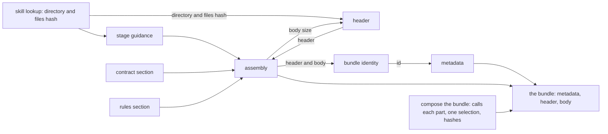

<!-- wio
id = "v2dxyw"
template = "feature.parent"
roots = ["@descendants"]
depends_on = []
-->

# Bundle composition

## Purpose

The parts of a bundle are specified one by one, but nothing yet joins them into
one text whose id and size describe it, so a session cannot be given a bundle
that can be compared with another.

## Goals

- The id that the metadata states is that of the header and the body, and the
  size that the header states is that of the body, so a reader can check both
  against the text.
- A skill that a stage names is found, pointed to and counted in the id.

## Non-Goals

- Delivering the bundle, which the delivery does.
- Recording the stage entry, which the event does.

## Assumptions

### A-1

Where the concepts and the scope document give the header "the size of the
bundle", it is right for it to state the size of the body, and the docs stage
corrects both documents.

### A-2

The parts of the body carry the labels that the assembly gives them, which the
concepts do not name, and the docs stage records them.

### A-3

The bundle id is 12 hexadecimal digits for every stage, which keeps the id short
as the concepts say, and the skill's files count through the files hash in the
header's skill line, not through a longer id.

### A-4

The id hashes the header and the whole body, labels and closing line included,
where the concepts say the goal, the contract and the rules, so a change of the
request, of a label or of the closing sentence changes the id too, and the id
stands in a metadata section that is not hashed, which the concepts do not have,
and the docs stage records it.

### A-5

The parts of a bundle are joined by a fixed blank line, and `[bundle] separator`
is read only for the items of the rules section, as Rule rendering says, so the
docs stage corrects the description of that setting, and the description of
`Bundle` in `src/wio/models/config.py` is corrected with it.

### A-6

Where the concepts and the scope document give the header "the exact command
that produced the bundle", it is right for it to state the canonical command,
without an option that changes only where the bundle goes, and the docs stage
corrects both documents.

## Mechanisms

The names below are provisional.

- **The lookup, the guidance, the contract section, the rules section, the
  identity, the header and the assembly** — the seven Works below, each building
  one part of the bundle or one fact that the header states.
- **The composition** — the eighth Work, Compose the bundle, which calls them.
- **`wio.context`** — the package that holds them, which imports no other
  component; the composition that calls them is built by Compose the bundle,
  behind the port that the command Work declares.

## Visuals

The diagram is drawn from commit `8edc675` of the branch `main`, which gives the
before. Before, no part of a bundle is built. After, the design is: each part is
built by one Work, and the assembly builds the body first, then the header from
its size, then the id from the header and the body, and last the metadata that
holds the id. At `9480404` on `main`, assembly gives the identity the header
and body together, so the skill's files hash reaches the id through the header.

## Acceptance criteria

### **AC-1** The metadata and the header state what the text gives

The id in the metadata is the id that the identity gives for the text after the
first blank line, and the
size in the header is the body's bytes and lines, so both can be recomputed from
the text.

#### A stage with a goal

- **Given** a bundle composed for a stage with a goal.
- **When** the text after its first blank line is given to the identity, and the
  text after its second blank line is counted.
- **Then** the id equals the one in the metadata, and the counts equal the size
  in the header.

#### A stage with a skill

- **Given** a bundle composed for a stage with a skill.
- **When** the text after its first blank line is given to the identity, and the
  body is counted.
- **Then** the id and the counts equal the ones in the metadata and the header,
  and the header's files hash is the one that the id counts.

### **AC-2** The skill's directory and hash agree everywhere

The path in the pointer and the directory in the header, and the files hash in
the header, come from one lookup of the skill.

#### A skill with two files

- **Given** a stage whose skill has `SKILL.md` and a reference file.
- **When** the bundle is composed.
- **Then** the pointer's path is the header's directory and `/SKILL.md`, and the
  hash in the header is the hash of those two files.
