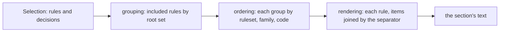

<!-- wio
id = "4h73tb"
template = "feature.parent"
roots = ["@descendants"]
depends_on = []
-->

# Rules section

## Purpose

The rules that a stage selects reach the session only as a selection, so nothing
yet groups them by where they apply, puts them in a fixed order and prints them
as written.

## Goals

- The rules that apply to a stage are printed grouped by the roots they apply
  to.
- The rules of a group are in an order that depends only on their names.
- Each rule is printed with its qualified name and its body as written.
- A selection that includes no rule gives an empty section.

## Non-Goals

- Selecting the rules, which `wio rules` does.
- Saying why a rule was selected, which `wio rules list --explain` does.
- Labelling the section and joining it to the other parts of the bundle, which
  the assembly does.

## Assumptions

None.

## Mechanisms

The names below are provisional.

- **The rules section builder** — in `wio.context`, which turns a `Selection`
  into the text of the section by the three children below, and returns with the
  text the qualified codes of the included rules in the order the text prints
  them, which Compose the bundle hashes for the event.
- **The builder's inputs** — the `Selection`, the paths of the roots through the
  shared `Settings` port, and the topic of each family through the topics port
  that Ordering and topics declares and builds in `wio.rules` from its
  manifests.

## Visuals

The diagram is drawn from commit `8edc675` of the branch `main`. Before, a
selection is a map of rules to decisions. After, the rules that apply become one
section.



## Acceptance criteria

### **AC-1** A selection becomes one section

The section built from a selection is the groups, the family lines and the
rendered rules that the children specify, in one text, and an empty text when no
rule is included; the codes returned with it are those of the rules in the text,
in the order of the text.

#### Rules of different reach

- **Given** a selection that includes `process.FIX001`, from a root-independent
  ruleset, `mattpocock.ARC002` and `mattpocock.ARC001`, in that order, from a
  ruleset that `api` reaches, and `python.API001`, from a ruleset that `api` and
  `web` reach, with the roots `api` at `services/api` and `web` at `apps/web`,
  the topics `Process` for `FIX`, `Architecture` for `ARC` and `Python API` for
  `API`, the names and bodies shown below, and the default separator.
- **When** the section is built.
- **Then** the codes are `process.FIX001`, `mattpocock.ARC001`,
  `mattpocock.ARC002` and `python.API001`, and the text equals this text, the
  golden text of the integrated section, in
  the provisional wording of the group lines, which is regenerated when that
  wording changes; the group lines, the family lines and the rules in it are
  specified by the children:

  ```text
  Rules for every root:

  process: Process (FIX)

  process.FIX001 fix-the-cause
  Fix the underlying problem.

  Rules for root api (services/api):

  mattpocock: Architecture (ARC)

  mattpocock.ARC001 keep-it-small
  Keep each module small.

  mattpocock.ARC002 depend-inward
  Depend on abstractions.

  Rules for roots api, web (services/api, apps/web):

  python: Python API (API)

  python.API001 adapters-return-typed-results
  Adapters return typed results.
  ```

#### No rule is included

- **Given** a selection in which every rule is excluded, vetoed, cut by the
  roots or not selected.
- **When** the section is built.
- **Then** the text is empty.
