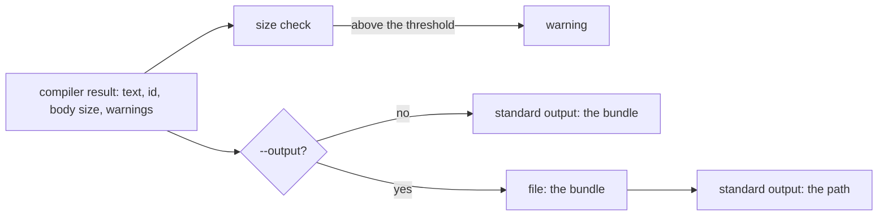

<!-- wio
id = "ymckyf"
template = "feature.parent"
roots = ["@descendants"]
depends_on = []
-->

# Delivery of the bundle

## Purpose

A harness truncates long command output and a truncated bundle looks complete,
so a session must be able to read the bundle from a file and must be told when
it is large.

## Goals

- A session can read the bundle from a file when it asks for one.
- A driver is warned when the bundle is larger than the configured threshold.

## Non-Goals

- Compiling the bundle, which the composition does.
- Shortening a bundle that is large, which a project does with its rules.

## Assumptions

None.

## Visuals

The diagram is drawn from commit `8edc675` of the branch `main`. Before, the
command prints only to standard output. After, it can also write the bundle to a
file and print the file's path, and it warns when the body is larger than the
configured threshold, whichever way the bundle is delivered.

## Acceptance criteria

### **AC-1** A large bundle is warned about and read from a file

With `--output` and a body over the threshold, standard output holds the path
alone, the warning is reported, the file holds the whole bundle, and the exit
code is 0.

#### An oversized bundle through a file

- **Given** a size threshold below the size of the body of a bundle.
- **When** `wio context <work> <action> <stage> --output` runs for it.
- **Then** standard output is the path of the file and a newline and nothing
  else, a warning about the size is reported, the file holds the whole bundle,
  and the exit code is 0.
