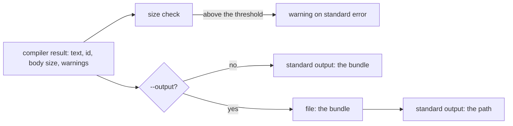

<!-- wio
id = "ymckyf"
template = "feature.parent"
roots = ["@descendants"]
depends_on = []
-->

# Delivery of the bundle

## Purpose

A harness truncates long command output and a truncated bundle looks complete,
so a session must be able to read the bundle from a file and must be told when
it is large.

## Goals

- A session can read the bundle from a file when it asks for one.
- A driver is warned when the bundle is larger than the configured threshold.

## Non-Goals

- Compiling the bundle, which the composition does.
- Shortening a bundle that is large, which a project does with its rules.

## Assumptions

None.

## Visuals

The diagram is drawn from commit `8edc675` of the branch `main`. Before, the
command prints only to standard output. After, it can also write the bundle to a
file and print the file's path, and it warns when the body is larger than the
configured threshold, whichever way the bundle is delivered.

## Acceptance criteria

### **AC-1** The size warning is the same whichever way the bundle is delivered

A body over the threshold gives the same warning with and without `--output`,
and with `--output` standard output holds the path alone and the file holds the
whole bundle.

#### Both destinations

- **Given** a size threshold below the size of the body of a bundle.
- **When** `wio context <work> <action> <stage>` runs, and then with `--output`.
- **Then** both runs report the same warning on standard error and exit 0, the
  first prints the bundle on standard output, and the second prints the path of
  the file and a newline and nothing else, and the file holds the whole bundle.

### **AC-2** A failed write still reports the size warning

When the file cannot be written, the size warning is reported before the error.

#### An unwritable path over the threshold

- **Given** a size threshold below the size of the body and an `--output` path
  that cannot be written.
- **When** `wio context` runs.
- **Then** the size warning is reported, the error follows, and the exit code is
  2.
