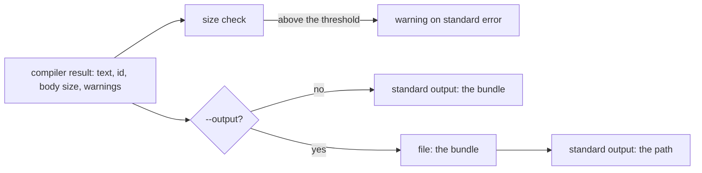

<!-- wio
id = "ymckyf"
template = "feature.parent"
roots = ["@descendants"]
depends_on = []
-->

# Delivery of the bundle

## Purpose

A harness truncates long command output and a truncated bundle looks complete,
so a session must be able to read the bundle from a file and must be told when
it is large.

## Goals

- A session can read the bundle from a file when it asks for one.
- A driver is warned when the body of the bundle is larger than the configured
  threshold.

## Non-Goals

- Composing the bundle, which the Works under Bundle composition do.
- Shortening a bundle that is large, which a project does with its rules.

## Assumptions

None.

## Visuals

The diagram is drawn from commit `8edc675` of the branch `main`. Before, the
command prints only to standard output. After, it can also write the bundle to a
file and print the file's path, and it warns when the body is larger than the
configured threshold, whichever way the bundle is delivered.

## Acceptance criteria

### **AC-1** The size warning is the same whichever way the bundle is delivered

A body over the threshold gives the same warning with and without `--output`.

#### Both destinations

- **Given** a size threshold below the size of the body of a bundle.
- **When** `wio context <work> <action> <stage>` runs, and then with `--output`.
- **Then** both runs report the same warning on standard error and exit 0.

### **AC-2** A failed write still reports the size warning

When the file cannot be written, the size warning is reported before the error.

#### An unwritable path over the threshold

- **Given** a size threshold below the size of the body and an `--output` path
  that cannot be written.
- **When** `wio context` runs.
- **Then** the size warning is reported, the error follows, and the exit code is
  2.

### **AC-3** Several warnings come in one order

The compiler's warnings come first, then the size warning, then the warning
about a path inside the worktree, which is the order that
[The wio context command](../the-wio-context-command/README.md) states.

#### All three kinds

- **Given** a compiler result with one warning, a size threshold below the size
  of the body, and `--output` given a path under the repository root.
- **When** `wio context` runs.
- **Then** the three warnings are lines on standard error in that order, and the
  exit code is 0.
