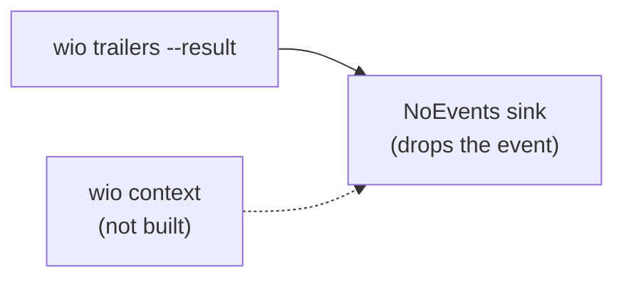
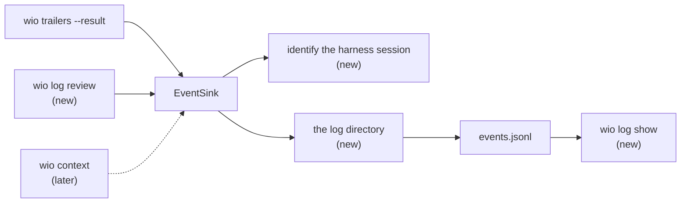

<!-- wio
id = "t8embw"
template = "feature.parent"
roots = ["@descendants"]
depends_on = []
-->

# wio log

## Purpose

A gate's review leaves no trace outside the commit history, because the
`EventSink` that `wio trailers --result` writes to drops every event, and no
session's start is recorded at all; the engine needs the personal event log so
that a project can learn what each stage cost and when a session started it.

## Goals

- A `review` event that `wio trailers --result` writes reaches the event log of
  its repository.
- A review can be recorded without records, with `wio log review`, and leaves
  the same event.
- Every event is stamped with its time, its working directory and, when the
  environment shows it, the harness session that wrote it.
- What was recorded is readable with `wio log show`: when each stage of a Work
  was last entered and the latest review of each gate for each judge.
- A `context` event, with every field `wio context` will fill in, is written and
  read back, so `wio context` needs only to build it.
- Writing the log never blocks a command, and a user can switch it off.

## Glossary

### Envelope

What every line of the log wraps around its event: the format version, the event
type, the time, the working directory, the harness session, the harnesses whose
variables were set and the raw values of the variables that identify it. The
sink stamps it, so an event type carries only what the session knows.

### Harness

The agent program that runs a session, such as Claude Code or Codex, named in
the config.

### Harness session

One agent's run inside a harness, as its own transcript is named. Codex has a
main session and a thread for each agent it spawns, and a subagent's thread is
its own harness session.

## Non-Goals

- Writing the `context` event, which `wio context` does once it exists, and the
  warnings of `wio trailers --result` that compare the reviewed commit with the
  `context` event, together with `--reviewed`.
- Writing a review for a list of Works, which `wio trailers` takes later and
  `wio log review` takes at the same time.
- Rotating the log, writing a file for each session, and bounding its size.
- Reading progress from the log, which `wio next` does from the history.
- Joining events to the harness's transcripts for token and cost totals.

## Assumptions

### A-1

Git is installed and on the `PATH`, because a repository is identified by its
git common directory.

### A-2

Claude Code puts the id of its session in `CLAUDE_CODE_SESSION_ID`, and Codex
puts the id of the agent that runs a tool call in `CODEX_THREAD_ID` and the id
of its main session in `CODEX_SESSION_ID`.

### A-3

A harness does not clear the variables of another harness that started it, so
inside a nested run both sets are visible.

### A-4

One write of one line to a file opened for append is not interleaved with the
write of another process, on the local file system that the Wio home is on.

### A-5

The log stays small enough that reading all of it for one `wio log show` is fast
enough, so rotating it can wait for a later Work.

## Mechanisms

- **`wio.log` package** — the sink that stamps and appends events, the locating
  of the log and the `wio log` command, built by the children below.
- **`EventSink` port** — in `wio.ports`, the only way that `wio trailers` and,
  later, `wio context` write an event; `wio.cli` wires the real sink in place of
  `NoEvents`.
- **`ReviewEvent` and `ContextEvent`** — in `wio.models.events`, the types of
  the two events, which `5pes9b` completes.
- **The `[log]` settings** — the `[log.harnesses.<name>]` tables and the
  `prefer_harness` list of the config, built by `m7yp42`.
- **The log directory** — `$WIO_HOME/log/<name>-<hash>/`, where the hash is of
  the resolved git common directory and the sink appends to `events.jsonl`,
  built by `jk2yz0`; a reader reads every `*.jsonl` file in it.
- **The envelope and the line format** — one JSON object per line with a
  version, built by `5pes9b`.
- **The sink** — the `EventSink` that stamps and appends, built by `wt49bz`,
  which uses the harness session that `xfy1mq` identifies; `7v8amt` joins the
  two.
- **`wio log review`** — the command that records a review without records,
  built by `9m32d0`.
- **`wio log show`** — the command that reads the log back, built by `zj4ja0`.

## Constraints

### C-1

The log holds ids, hashes, codes, times, the working directory and the values of
the variables that the config names for it, and no prompts, no code, no free
text and no other environment variable. The system-level tests check it, with a
secret in a variable the config does not name.

### C-2

Writing the log raises nothing and does not change a command's exit code: a
failure is a warning that names the path. `$WIO_LOG=off` writes nothing, creates
nothing and warns of nothing, and any other value of it that is set and not
empty is a warning and leaves the log on. Each child that writes verifies its
own failure, and the system-level tests verify a command that succeeds on an
unwritable Wio home.

### C-3

Each event is one line, written with one append, and wio never rewrites or
deletes a line. A reader skips a line that it does not understand, such as a
torn last line, an unknown event type or a higher version, and the format starts
at version 1.

### C-4

Components reach the log only through the `EventSink` port, and `wio.log`
reaches the environment, the clock, the Wio home and the repository only through
their ports, so no module outside `wio.cli` imports an adapter. `uv run tach
check` and a reviewer's reading of the imports verify it.

## Visuals

The Before diagram is drawn from `5fbdd18` on `main`; the After diagram is the
design this Work delivers, and marks as new everything it adds.

### Before

### After

## Acceptance criteria

### **AC-1** A recorded review is shown by `wio log show`

A gate's review recorded with `wio trailers --result` appears in `wio log show`
with its result, its judge and the commit it judged.

#### A review of a gate

- **Given** a repository with a Work whose pipeline has a gate, and a commit
  that the gate reviews.
- **When** `wio trailers <work> <action> <gate> --result pass --cite AC-1=pass`
  runs, and then `wio log show <work>` runs.
- **Then** `wio log show` lists the gate with the result `pass`, the judge
  `agent`, the full sha of the reviewed commit and the cited item with its
  result.

#### A refusal leaves nothing

- **Given** the same repository.
- **When** `wio trailers` is refused for a result outside `gates.results`.
- **Then** it exits 1, and `wio log show` lists no review of the gate.

### **AC-2** A review recorded without records leaves the same event

`wio log review` writes the event that `wio trailers --result` writes for the
same arguments, and prints no record.

#### The same arguments, the two commands

- **Given** two repositories in the same state, each with a Work and a gate.
- **When** `wio trailers <work> <action> <gate> --result fail --cite AC-1=fail`
  runs in one and `wio log review` with the same arguments in the other.
- **Then** both logs hold one `review` event with the same fields, and the
  second command printed no `Wio-*` line.

### **AC-3** Writing never blocks a command

A command that writes an event gives the same output and exit code when the log
cannot be written, and with `$WIO_LOG` set, as it does when it can.

#### An unwritable Wio home

- **Given** a `$WIO_HOME` that names a path that cannot be written.
- **When** `wio trailers <work> <action> <gate> --result pass` runs.
- **Then** it prints its record, exits 0, and standard error carries a warning
  that names the path.

#### Switched off

- **Given** `$WIO_LOG` set to `off`.
- **When** the same command runs.
- **Then** it prints its record and exits 0, no file or directory appears in the
  Wio home, and nothing is warned.

#### A value that is not recognized

- **Given** `$WIO_LOG` set to `maybe`.
- **When** the same command runs.
- **Then** it exits 0, a warning names the variable, and the event is in the
  log.

### **AC-4** Sessions that write at once lose no event

Events that several processes write at the same time are all readable.

#### Concurrent writers

- **Given** one repository and a Wio home.
- **When** many processes each record a review at the same moment.
- **Then** `wio log show --json` lists every review, and each line of the log is
  a complete JSON object.

### **AC-5** A written `context` event is read back, and a damaged log still reads

`wio log show` lists a stage entered by a `context` event with every field
filled in, and still lists the events around a line it cannot understand.

#### A `context` event with every field

- **Given** a sink that writes a `context` event whose every field is filled in,
  including the fields that only a gate has.
- **When** `wio log show <work>` runs.
- **Then** it lists the stage with the time of the event.

#### A damaged line

- **Given** a log with a complete event, a torn line and a line of a higher
  version, in that order, and a later complete event.
- **When** `wio log show --json` runs.
- **Then** it exits 0, lists both complete events, and says that two lines were
  skipped.

### **AC-6** Only what the config names reaches the log

No environment variable except those the config names for the log reaches it.

#### A secret in the environment

- **Given** a variable named `SECRET_TOKEN` with a value, set in the environment
  of the command, and the variables of exactly one harness.
- **When** a review is recorded.
- **Then** the value of `SECRET_TOKEN` is in no file under the Wio home, and the
  event carries that harness and its session.

#### Two harnesses at once

- **Given** the variables of two harnesses, and no `prefer_harness`.
- **When** a review is recorded.
- **Then** the event has no derived harness, session or parent, names both
  harnesses in `matches`, and holds the raw value of each named variable that
  was set.

## Additional context

The shape of the two events, the envelope and the mapping of variables are
[concepts.md](../../../../docs/concepts.md#the-event-log)'s, and the children
state what each owns. The list of Works that `wio log review` and `wio trailers`
take later is one open change to both commands.
