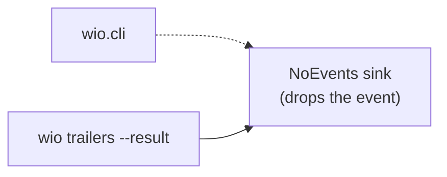
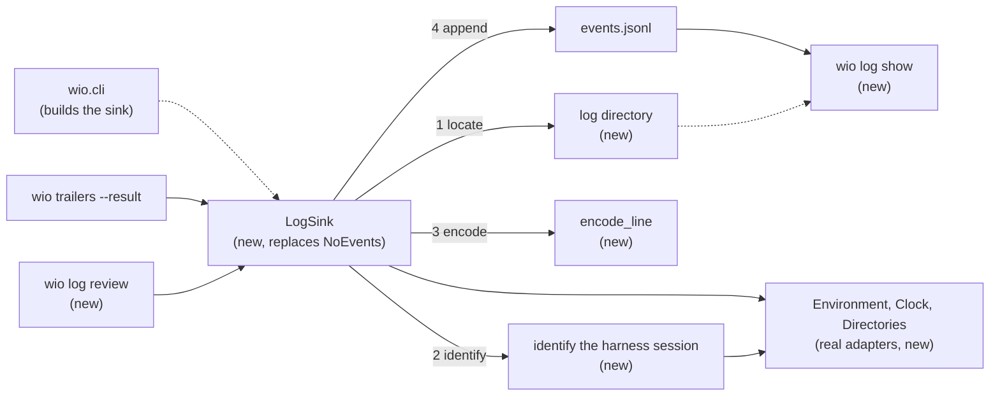

<!-- wio
id = "t8embw"
template = "feature.parent"
roots = ["@descendants"]
depends_on = []
-->

# wio log

## Purpose

A gate's review leaves no trace outside the commit history, because the
`EventSink` that `wio trailers --result` writes to drops every event; the engine
needs the personal event log, so that later Works can learn what each stage cost
and when a session started it.

## Goals

- A `review` event that `wio trailers --result` writes reaches the event log of
  its repository.
- A review can be recorded without records, with `wio log review`, and leaves
  the same event.
- Every event is stamped with its time, its working directory and, when the
  environment shows it, the harness session that wrote it.
- What was recorded is readable with `wio log show`: when each stage of a Work
  was last entered and the latest review of each gate for each judge.
- The sink and the format carry a `context` event with every field that
  `wio context` will fill in, and `wio log show` reads it back, so `wio context`
  needs only to build it.
- Writing the log never blocks a command, and a user can switch it off.

## Glossary

The event log, the Wio home, a gate and a record are the terms of the
repository's [glossary](../../../../GLOSSARY.md).

### Envelope

What a line of the log holds around its event, besides a format version and an
event type: the time, the working directory, the harness session and its parent,
the harnesses that matched and the raw values of the variables that identify it.
The sink stamps it, so an event type carries only what the session knows.

### Harness

The agent program that runs a session, such as Claude Code or Codex, named in
the config.

### Harness session

One agent's run inside a harness, as its own transcript is named. Codex has a
main session and a thread for each agent it spawns, and a subagent's thread is
its own harness session, whose parent session is the main session.

## Non-Goals

- Writing the `context` event, which `wio context` does once it exists, and the
  warnings of `wio trailers --result` that compare the reviewed commit with the
  `context` event, together with `--reviewed`.
- Writing a review for a list of Works, which `wio trailers` takes later and
  `wio log review` takes at the same time.
- Rotating the log, writing a file for each session, and bounding its size.
- Reading progress from the log, which `wio next` does from the history.
- Joining events to the harness's transcripts for token and cost totals.

## Assumptions

### A-1

Git is installed and on the `PATH`, because a repository is identified by its
git common directory.

### A-2

Claude Code puts the id of its session in `CLAUDE_CODE_SESSION_ID`, and Codex
puts the id of the agent that runs a tool call in `CODEX_THREAD_ID` and the id
of its main session in `CODEX_SESSION_ID`.

### A-3

A harness does not clear the variables of another harness that started it, so
inside a nested run both sets are visible.

### A-4

One write of one line to a file opened for append is not interleaved with the
write of another process, on the local file system that the Wio home is on, and
a line is short, well under the buffer of the file object.

### A-5

The log stays small enough that reading all of it for one `wio log show` is fast
enough, so rotating it can wait for a later Work.

### A-6

A torn line costs the event that is appended right after it, because the next
line is written straight after the torn text; a crash in the middle of one write
of a few hundred bytes is rare enough to accept, and the reader skips the
damaged line.

## Mechanisms

- **`wio.log` package** — the sink that stamps and appends events, the locating
  of the log and the `wio log` command, built by the children below.
- **`EventSink` port** — in `wio.ports`, the only way that `wio trailers` and,
  later, `wio context` write an event; `wio.cli` wires the real sink in place of
  `NoEvents`, which stays for the tests that need a sink that drops.
- **`ReviewEvent` and `ContextEvent`** — in `wio.models.events`, the types of
  the two events, which `5pes9b` completes.
- **The `[log]` settings** — the `[log.harnesses.<name>]` tables, the
  `prefer_harness` list and the `record_env_vars` list of the config, built by
  `m7yp42`.
- **The variables of the log** — `$WIO_LOG`, which switches the log off and is
  read by the sink of `wt49bz`, and `$WIO_PREFER_HARNESS`, which replaces
  `prefer_harness` and is read by the identification of `xfy1mq`.
- **The process adapters** — the real `Environment.get`, `Clock` and
  `Directories.wio_home` that the other children read the surroundings with,
  built by `hnakzm`.
- **The log directory** — `$WIO_HOME/log/<name>-<hash>/`, where the hash is of
  the resolved git common directory and the sink appends to `events.jsonl`,
  built by `jk2yz0`; a reader reads every `*.jsonl` file in it.
- **The envelope and the line format** — one JSON object per line with a
  version, built by `5pes9b`.
- **The sink** — the `EventSink` that stamps and appends, built by `wt49bz`,
  which uses the harness session that `xfy1mq` identifies; `7v8amt` joins the
  two.
- **`wio log review`** — the command that records a review without records,
  built by `9m32d0` with the `ReviewChecker` port that `wio.log` declares and
  the checks that `wio.trailers` factors out for `wio.cli` to wire to it.
- **`wio log show`** — the command that reads the log back, built by `zj4ja0`.

## Constraints

### C-1

The log holds ids, hashes, codes, times, the working directory and the values of
the variables that the config names for it, and no prompts, no code, no free
text and no other environment variable. AC-8 verifies it with a secret in a
variable the config does not name.

### C-2

Writing the log raises nothing and does not change a command's exit code: a
failure is a warning that says what failed and names the events file when it is
known. `$WIO_LOG=off` writes nothing, creates nothing and warns of nothing, and
any other value of it that is set and not empty is a warning that names the
variable and leaves the log on. A config that cannot be loaded, including one
with an error in `[log]`, is out of its scope and exits 2 as for every command.
Each child that writes verifies its own failure, `wt49bz` AC-4 is the check of a
failure in a real process, and AC-4 verifies the switch end to end.

### C-3

Each event is one line, written with one append, and wio never rewrites or
deletes a line. A reader skips a line that it does not understand, such as a
torn last line, an unknown event type or a higher version, and the format starts
at version 1. AC-5 and AC-7 verify the single append and the skipping reader,
`5pes9b` verifies the line format, and a reviewer checks that no code appends to
the log except through `append_text`.

### C-4

Components reach the log only through the `EventSink` port, and `wio.log`
reaches the environment, the clock and the Wio home only through the ports that
`hnakzm` C-1 names and the repository through its port, so no module outside
`wio.cli` imports an adapter. `uv run tach check` and a reviewer's reading of
the imports verify it.

## Visuals

The Before diagram is drawn from `5fbdd18` on `main`; the After diagram is the
design this Work delivers, with the steps of the sink numbered in the order that
`wt49bz` states, and marks as new everything it adds.

### Before

### After

## Acceptance criteria

### **AC-1** A recorded review is shown by `wio log show`

A gate's review recorded with `wio trailers --result` appears in `wio log show`
with its result, its judge and the commit it judged.

#### A review of a gate

- **Given** a real repository with a Work that has the item `AC-1` and whose
  pipeline has a gate, a commit that the gate reviews, and a `$WIO_HOME` that
  names an empty directory.
- **When** `wio trailers <work> <action> <gate> --result pass --cite AC-1=pass`
  runs, and then `wio log show --json <work>` runs.
- **Then** `works.<work>` holds a row of the gate whose `reviews` has one review
  with the result `pass`, the judge `agent`, the full sha of the reviewed commit
  and the `cited` `{"AC-1": "pass"}`.

#### A refusal leaves nothing

- **Given** the same repository and a `$WIO_HOME` that names an empty directory.
- **When** `wio trailers <work> <action> <gate> --result maybe` is refused.
- **Then** it exits 1, and `$WIO_HOME` still holds nothing.

### **AC-2** Every event is stamped with its time and its working directory

An event that a command writes carries the time it was written and the
directory it was written from.

#### The stamp of a real run

- **Given** the same repository and a command run from a subdirectory of it.
- **When** `wio trailers <work> <action> <gate> --result pass` runs.
- **Then** the line in `events.jsonl` decodes with `decode_lines` to an envelope
  whose time, compared to the millisecond, is between the truncated time taken
  before the command and the time taken after it, and whose directory is that
  subdirectory as the process reports it, the two paths compared after
  resolving them.

### **AC-3** A review recorded without records leaves the same event

`wio log review` writes the event that `wio trailers --result` writes for the
same arguments, and prints no record.

#### The same arguments, the two commands

- **Given** one real repository with a Work and a gate, and a `$WIO_HOME` that
  names an empty directory.
- **When** `wio trailers <work> <action> <gate> --result fail --cite AC-1=fail`
  runs, and then `wio log review` runs with the same arguments.
- **Then** `events.jsonl` holds two lines whose events are equal in every field
  except the envelope, and the second command printed nothing on standard
  output.

### **AC-4** The log can be switched off, and an unrecognized switch stops nothing

A command that writes an event gives the same output and exit code when the log
is switched off, or when its switch is not recognized, as when the log is on.

#### Switched off

- **Given** `$WIO_LOG` set to `off` and a `$WIO_HOME` that names an empty
  directory.
- **When** `wio trailers <work> <action> <gate> --result pass` runs.
- **Then** it prints its record and exits 0, `$WIO_HOME` still holds nothing,
  and standard error is empty.

#### A value that is not recognized

- **Given** `$WIO_LOG` set to `maybe` and a `$WIO_HOME` that names an empty
  directory.
- **When** the same command runs.
- **Then** it prints its record and exits 0, standard error has a warning that
  names `WIO_LOG`, and `events.jsonl` holds the event.

### **AC-5** Sessions that write at once lose no event

Events that several processes write at the same time are all in the log, each
as one whole line.

#### Concurrent writers

- **Given** one real repository with a Work and a gate, and a `$WIO_HOME` that
  names an empty directory.
- **When** twenty processes of `wio trailers <work> <action> <gate> --result
  pass` start at the same moment.
- **Then** every line of `events.jsonl` decodes to a `review` event, and there
  are twenty lines.

### **AC-6** A written `context` event is read back

A `context` event with every field filled in survives the real sink and the real
reader, so `wio context` only has to build it.

#### A `context` event with every field

- **Given** the real sink, built over the real adapters of a real repository,
  writing a `context` event whose every field is filled in, including `start`
  and `dirty`, and a `$WIO_HOME` that names an empty directory.
- **When** `wio log show <work>` runs.
- **Then** it lists the stage with the time of the event, and the line in
  `events.jsonl` decodes with `decode_lines` to a `ContextEvent` equal to the
  one written, its `rules` in the order given.

### **AC-7** A damaged log still reads

`wio log show` still lists the events around a line it cannot understand.

#### A damaged line

- **Given** a log that the real sink wrote with two events, and a torn line and
  a line of a higher version, each ending in a newline, inserted between the two
  lines of `events.jsonl`.
- **When** `wio log show --json` runs.
- **Then** it exits 0, lists both events, and says `"skipped": 2`.

### **AC-8** Only what the config names reaches the log

No environment variable except those the config names for the log reaches it.

#### A secret in the environment

- **Given** a variable named `SECRET_TOKEN` with a value, set in the environment
  of the command, and the variables of exactly one harness, and a `$WIO_HOME`
  that names an empty directory.
- **When** `wio trailers <work> <action> <gate> --result pass` runs.
- **Then** the value of `SECRET_TOKEN` is in no file under the Wio home.

## Additional context

The shape of the two events, the envelope and the mapping of variables are
[concepts.md](../../../../docs/concepts.md#the-event-log)'s, and the children
state what each owns. The directory `log/<name>-<hash>/` with the file
`events.jsonl` refines the "one file per repository" of concepts.md and of the
v0.1 scope, which the docs stage carries. The list of Works that
`wio log review` and `wio trailers` take later is one open change to both
commands.
