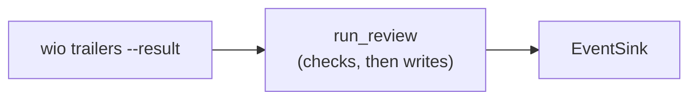
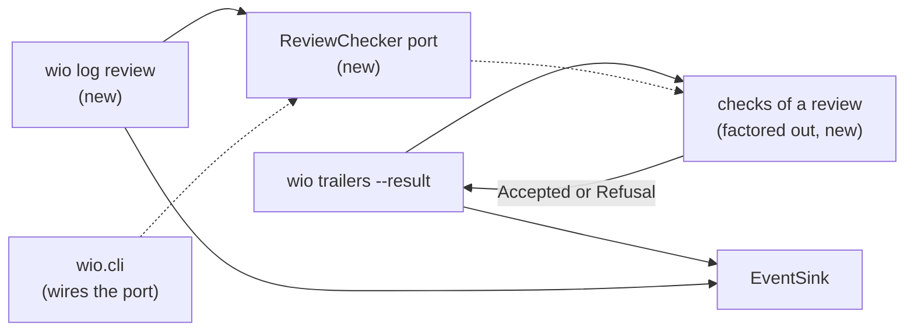

<!-- wio
id = "9m32d0"
template = "feature.leaf"
roots = ["wio"]
depends_on = ["7v8amt", "zj4ja0"]
-->

# Record a review without records

## Purpose

A workflow that keeps no `Wio-*` records in its commits still has gates, and
their reviews would leave no trace; the engine needs a command that records a
review in the log alone.

## Goals

- A review is recorded in the log with one command, and no record is printed.
- The command checks what `wio trailers --result` checks and writes the event
  it writes, so a log does not show which command wrote it.
- A refusal writes nothing.
- A sink that fails never changes the result of the command.
- `wio trailers` behaves as it did before the checks were shared.

## Non-Goals

- Printing a record, or adding a record to a commit.
- A list of Works, which `wio trailers` takes later and this command takes at
  the same time.
- The `--reviewed` override.
- Accepting a cited rule code, which `wio trailers` refuses as not selected
  until the rules component exists, and this command with it.
- The Work `none`, which `wio trailers none` handles with a form of its own and
  which `wio log review` refuses, as the field checks of `wio trailers` do.
- Deciding whether a gate has passed.

## Assumptions

### A-1

The gate form of `wio trailers` does all its checks before it writes its event,
as its README says, so the checks can be separated from the write and from the
print of the record.

### A-2

The wiring loads the config before any check, as the wiring of `wio trailers`
does, so a config that cannot be loaded fails before a review is judged.

## Mechanisms

- **`wio log review <work> <action> <stage> --result RESULT [--judge JUDGE]
  [--cite KEY=RESULT]...`** — the subcommand of `wio log` that `zj4ja0` created,
  which declares `--json`.
- **The usage** — one Work, `--result` required and the judge `agent` by
  default, and a missing `--result`, a list of Works, an unknown option, a
  working directory outside a repository and a config that cannot be loaded are
  usage mistakes.
- **The port `ReviewChecker`** — in `wio.log`: `check(work: str, action: str,
  stage: str, result: str, judge: str, cites: Sequence[str]) -> Accepted |
  Refusal`.
- **The result of the port** — `Accepted(event: ReviewEvent, warnings:
  tuple[str, ...])` and `Refusal(lines: tuple[str, ...])`, frozen dataclasses of
  `wio.models`, the second carrying every line that `wio trailers` writes on a
  refusal, its warnings and the offending lines included, in its order.
- **The factoring** — `wio.trailers` separates the checks of a review into one
  function that runs the field checks, the judge check and the Work lookup of
  the write form, then the cite checks and then the finder of the reviewed
  commit, in the order that its README states, and returns an `Accepted` or a
  `Refusal`; `wio trailers` then uses it, and this Work owns the change.
- **The wiring** — `wio.cli` builds the `ReviewChecker` from that function with
  the services that `wio trailers` is wired with and gives it, with the sink of
  `wt49bz`, to `wio log review`, and `wio.log` never imports `wio.trailers`.
- **The command** — prints the warnings of an `Accepted` on standard error and
  then hands its event to the sink, and prints the lines of a `Refusal` on
  standard error and writes nothing.
- **The order of the refusals** — the field errors first, then the cites, then a
  history with no reviewed commit, and the first group that finds something
  stops the rest.
- **The output** — nothing on standard output when it succeeds, and with
  `--json` one document `{"event": {...}}` whose keys are, in this order,
  `work`, `action`, `stage`, `commit` in full, `judge`, `result`, `cited`, a
  mapping in the order cited, and `hashes`, a mapping that stays empty until the
  rules component exists, and the criteria compare the parsed document.
- **The exit codes** — 0 when the event was handed to the sink, 1 for a refusal
  with the `error:` lines on standard error and nothing on standard output, and
  2 for a usage mistake with its message on standard error and nothing on
  standard output.
- **The sink** — the `EventSink` port, wired by `wio.cli` to the `LogSink` of
  `wt49bz`, which warns and raises nothing when it fails.
- **What is required** — the behaviors, the output, the order of the refusals
  and the exit codes are required, and the names `ReviewChecker`, `Accepted` and
  `Refusal` and that of the factored function are provisional.

## Visuals

The diagrams are drawn from `5fbdd18` on `main`; the After diagram is the design
this Work delivers, and marks as new what it adds.

### Before

### After

## Acceptance criteria

The examples use the Work `k3m9xq`, with the items `AC-1` and `AC-3`, the action
`deliver` and the gate `docs-review`, a history with a work commit of 40 `a`
under a pure gate commit, and a recording `EventSink`.

### **AC-1** The event is the one `wio trailers` writes

A review recorded without records leaves exactly the event that
`wio trailers --result` leaves.

#### The same arguments, the two commands

- **Given** the two commands with the arguments `k3m9xq deliver docs-review
  --result fail --judge human --cite AC-1=fail --cite AC-3=pass`, on the same
  history.
- **When** `wio log review` runs and `wio trailers` runs, each with `--result`.
- **Then** the sink received two equal `ReviewEvent`s, and `wio log review`
  printed nothing on standard output.

### **AC-2** It prints nothing, or a JSON document

A person or a script reads the result of the command as nothing or as one JSON
document.

#### The output

- **Given** `k3m9xq deliver docs-review --result fail --cite AC-1=fail --cite
  AC-3=pass`, without `--judge`.
- **When** `wio log review` runs, and runs with `--json`.
- **Then** the first exits 0 and prints nothing, and the second prints one
  document that parses to
  `{"event": {"work": "k3m9xq", "action": "deliver", "stage": "docs-review",
  "commit": "aaaaaaaaaaaaaaaaaaaaaaaaaaaaaaaaaaaaaaaa", "judge": "agent",
  "result": "fail", "cited": {"AC-1": "fail", "AC-3": "pass"}, "hashes": {}}}`
  with the keys in that order.

### **AC-3** A warning does not stop the review

A review that `wio trailers` records with a warning is recorded here with the
same warning.

#### A stage outside the pipeline

- **Given** the gate `system-review`, which is outside the pipeline of the
  action `deliver` of the Work.
- **When** `wio log review k3m9xq deliver system-review --result pass` runs, and
  `wio trailers` runs with the same arguments.
- **Then** each exits 0, prints the same warning on standard error, and the sink
  received an equal event from each.

### **AC-4** A refusal writes nothing

A review that `wio trailers` refuses is refused here too, with the same lines,
and writes nothing.

#### What `wio trailers` refuses

- **Given** the gate and the Work above.
- **When** `wio log review` runs, each time with `--result pass` unless it names
  another, with `--result maybe`, with `--judge bogus`, with the stage
  `nonesuch`, with the Work `nope99`, with `--cite AC-99=pass`, with
  `--cite AC-1=pass --cite AC-1=fail` and with `--cite docs.DOC001=fail`.
- **Then** each exits 1, prints nothing on standard output, prints on standard
  error the lines that `wio trailers` prints for the same arguments, which the
  criterion compares, and the sink received no event.

#### A history with no reviewed commit

- **Given** the gate and the Work above, and a history of commits that each
  carry only a gate record.
- **When** `wio log review k3m9xq deliver docs-review --result pass` runs.
- **Then** it exits 1, prints nothing on standard output, prints
  `error: Wio-Work: no reviewed commit was found` on standard error, and the
  sink received no event.

#### The first group of refusals stops the rest

- **Given** the same gate and Work.
- **When** `wio log review` runs with `--result maybe --cite AC-99=pass`.
- **Then** it exits 1 and prints only the error that names the result, and none
  that names `AC-99`.

#### A refusal with `--json`

- **Given** the same gate and Work.
- **When** `wio log review --json` runs with `--result maybe`.
- **Then** it exits 1, prints nothing on standard output and the same lines on
  standard error as without `--json`.

### **AC-5** A usage mistake exits 2

A usage mistake is told apart from a refused review by its exit code.

#### Usage mistakes

- **Given** the gate and the Work above.
- **When** `wio log review k3m9xq deliver docs-review` runs without `--result`,
  `wio log review k3m9xq,other1 deliver docs-review --result pass` runs, and
  `wio log review k3m9xq deliver docs-review --result pass --bogus` runs.
- **Then** each exits 2, prints nothing on standard output, says what is wrong
  on standard error, and the sink received no event.

#### Outside a repository

- **Given** a working directory that is not in a repository.
- **When** `wio log review k3m9xq deliver docs-review --result pass` runs.
- **Then** it exits 2, prints nothing on standard output, says what is wrong on
  standard error, and the sink received no event.

#### A config with an error

- **Given** a config with an error.
- **When** `wio log review` and `wio trailers` run with the same arguments.
- **Then** both exit 2, print the same lines on standard error and nothing on
  standard output.

### **AC-6** The help of the command names the subcommand

A person finds `review` in the help of `wio log`, beside `show`.

#### The help

- **Given** any working directory.
- **When** `wio log -h` runs.
- **Then** the help names `review` and `show`.

### **AC-7** A review reaches the log and is shown

A review recorded without records is shown by `wio log show` on a real
repository.

#### On a real repository

- **Given** a real clone with the Work and the gate, and a `$WIO_HOME` that
  names an empty directory.
- **When** `wio log review <work> <action> <gate> --result pass` runs, and then
  `wio log show <work>` runs.
- **Then** the first exits 0 and prints nothing, and the second prints under the
  Work the line `<action> <gate>  agent pass <commit>  <time>`, with the first
  12 characters of the commit that the gate reviewed and the time of the
  event.

### **AC-8** A sink that fails never changes the result

The result of the command is the same when the log cannot be written or has been
switched off; the guarantee of the sink itself is owned by `wt49bz`.

#### An unwritable home

- **Given** a real clone with the Work and the gate, and a `$WIO_HOME` that
  names a path under a regular file.
- **When** `wio log review <work> <action> <gate> --result pass` runs.
- **Then** it exits 0, prints nothing on standard output, and standard error
  holds `warning: the event log could not be written:`.

#### Switched off

- **Given** the same clone, `$WIO_LOG=off` and a `$WIO_HOME` that names an empty
  directory.
- **When** the same command runs.
- **Then** it exits 0, prints nothing on standard output or standard error, and
  the directory is still empty.

### **AC-9** `wio trailers` is unchanged by the sharing

Sharing the checks changes nothing that `wio trailers` prints, exits or records.

#### The scenarios of `wio trailers`

- **Given** the scenarios of `tests/acceptance/trailers/test_write.py` and the
  tests of `tests/unit/trailers/test_gate.py` with a recording sink.
- **When** they run after the checks were factored out.
- **Then** they pass without any edit.
