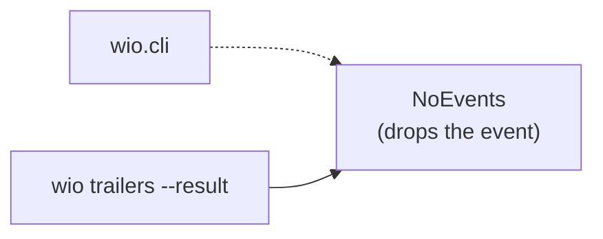
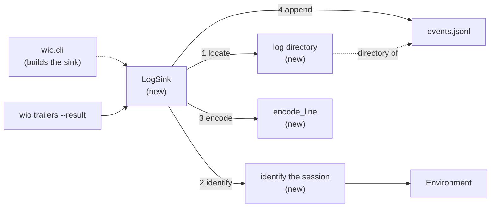

<!-- wio
id = "7v8amt"
template = "feature.parent"
roots = ["@descendants"]
depends_on = ["jk2yz0", "5pes9b", "m7yp42", "hnakzm"]
-->

# Record events

## Purpose

An event that reaches the log without the session that wrote it cannot be joined
to a transcript, so the engine needs a sink that identifies the session from
the real environment and appends the stamped event to the real log.

## Goals

- An event written by a command on a real repository carries the harness
  session that the real environment shows.
- A harness that the config names, and a preference for a nested run, change
  what the stamp holds without a code change.
- A run that shows several harnesses is stamped without a guess, and says which
  harnesses it saw.

## Non-Goals

- Reading the events back, which `zj4ja0` does.

## Assumptions

### A-1

The system-level tests run `wio` with a controlled environment, so they set
exactly the variables a scenario names and no others.

## Mechanisms

- **`identify`** — the identification of the session, built by `xfy1mq`.
- **`LogSink`** — the sink that stamps with it and appends, built by `wt49bz`.
- **The order of the steps** — the sink's own, which `wt49bz` states: the
  switch, the location, the identification, the encoding and the append.
- **The log location and the line format** — built by `jk2yz0` and `5pes9b`,
  and used by the sink.
- **The `[log]` settings** — read by the identification, built by `m7yp42`.

## Visuals

The Before diagram is drawn from `5fbdd18` on `main`, and the After diagram is
the design this Work delivers, with the steps of the sink numbered in the order
that `wt49bz` states.

### Before

### After

## Acceptance criteria

### **AC-1** A real review carries the real session

An event written on a real repository carries the harness session that the real
environment shows.

#### Claude Code

- **Given** a real clone, a Work whose pipeline has a gate, a `$WIO_HOME` that
  names an empty directory, and `CLAUDE_CODE_SESSION_ID=c1` and
  `AI_AGENT=claude-code_2` in the environment.
- **When** `wio trailers <work> <action> <gate> --result pass` runs.
- **Then** the one line of the log has the harness `claude-code`, the session
  `c1`, no parent and `ids` holding both variables.

#### Codex subagent

- **Given** the same clone, and `CODEX_SESSION_ID=s1` and `CODEX_THREAD_ID=t2`
  and no other mapped variable.
- **When** the same command runs.
- **Then** the line has the harness `codex`, the session `t2` and the parent
  `s1`.

### **AC-2** The config decides what a stamp holds

A new harness and a preference for a nested run change what a stamp holds
without a code change.

#### A harness of the config

- **Given** a config with `[log.harnesses.cursor]` and `session =
  ["CURSOR_TRACE_ID"]`, and `CURSOR_TRACE_ID=r9` in the environment and no other
  mapped variable.
- **When** the same command runs.
- **Then** the line has the harness `cursor` and the session `r9`.

#### A preference of the config

- **Given** `CLAUDE_CODE_SESSION_ID=c1` and `CODEX_THREAD_ID=t2`, and a config
  with `prefer_harness = ["codex"]`.
- **When** the same command runs.
- **Then** the line has the harness `codex` and the session `t2`.

#### A preference of the variable

- **Given** the same variables and config, and `$WIO_PREFER_HARNESS` set to
  `claude-code`.
- **When** the same command runs.
- **Then** the line has the harness `claude-code` and the session `c1`.

### **AC-3** A nested run is stamped without a guess

A run that shows several harnesses is stamped without a guess and says which
harnesses it saw.

#### A nested run with no preference

- **Given** `CLAUDE_CODE_SESSION_ID=c1` and `CODEX_THREAD_ID=t2`, and a config
  with no `prefer_harness`.
- **When** the same command runs.
- **Then** the line has no harness, session or parent, and `matches` holds
  `claude-code` and `codex`.

#### A preference that is switched off

- **Given** the same variables, a config with `prefer_harness = ["codex"]`, and
  `$WIO_PREFER_HARNESS=none`.
- **When** the same command runs.
- **Then** the line has no harness, session or parent, and `matches` holds
  `claude-code` and `codex`.
