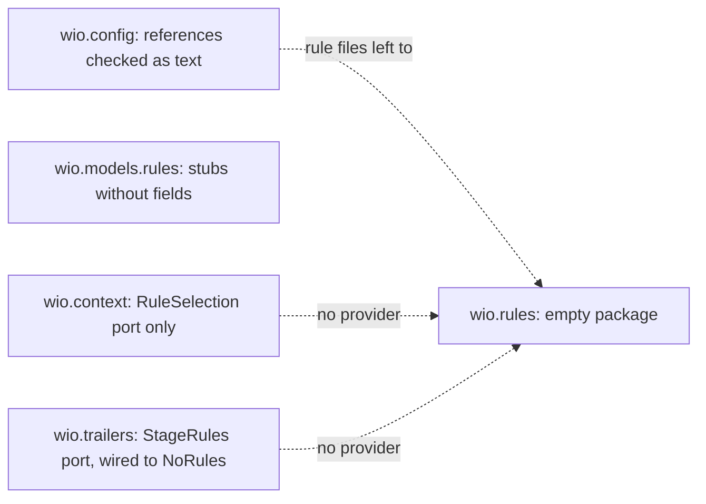
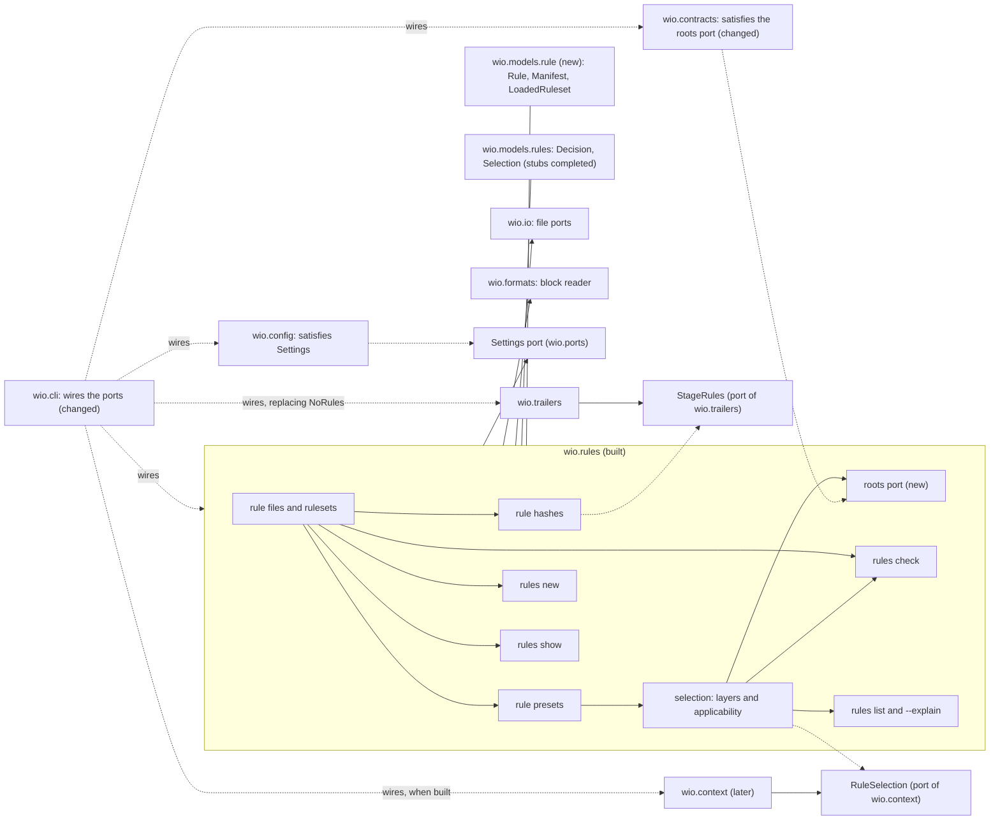

<!-- wio
id = "50fnb0"
template = "feature.parent"
roots = ["@descendants"]
depends_on = []
-->

# wio rules

## Purpose

`wio rules` and the rule selection that `wio context` will use are missing, so a
stage's guidance cannot be created with stable codes, checked or listed, and
`wio context` has no selection to compile.

## Goals

- A rule is created in a ruleset with the next code of its family, so codes
  never clash.
- Rule files and rulesets are checked beyond what `wio config check` can see,
  with the errors and warnings that
  [the concepts](../../../../docs/concepts.md#checking-rules) give to
  `wio rules check`.
- A fault in a rule file or a manifest is reported by `wio rules check` and
  makes `wio rules new`, `list` and `show` refuse, so a rule that is left out
  never goes unnoticed.
- The rules of a rule preset, a root, a stage, a Work at a stage or a file can
  be listed, and with `--explain` each rule shows where it came from or why it
  is out.
- A rule is shown by its qualified code with its metadata and its body as the
  reader returns it, and a listing shows each rule by its code, name and
  description.
- Which rules apply to a stage is decided by one selection that `wio rules list`
  and, later, `wio context` share, and it is the same for the same inputs.
- `wio trailers` can cite the rules that a stage selects, with the hash of each
  rule's file.
- Every `wio rules` command reads a rule file in either metadata block form, a
  `<!-- wio -->` comment or `+++` front matter, whatever the file is named.

## Non-Goals

- Building `wio context`: the bundle, its header, `--output` and the `context`
  event.
- Reporting the note on `rules_always_include`, which `wio config check` reports
  already.
- Rewriting, renaming, moving or deleting a rule or a ruleset, which no
  `wio rules` command does.
- Copying or updating a ruleset from another repository.
- Checking a rule's body beyond a Markdown heading in it, because whether a rule
  is good or atomic is for a reviewer.
- Writing a rule with `+++` front matter, because `wio rules new` writes the
  comment form that `wio contracts new` writes for a bare contract.

## Assumptions

### A-1

The config that reaches `wio rules` is already loaded and valid, because a
config with an error makes every command exit 2, so `wio rules` never judges
the references that `wio config check` judges as text.

### A-2

The rulesets are the directories under `.agents/wio/rules/`, a fixed location
that no setting changes.

### A-3

Reading every rule file of a repository on each command is fast enough, so
nothing caches or indexes them.

### A-4

How a bundle orders, groups and prints rules is `wio context`'s, so `wio rules`
fixes only a deterministic order of the rules it lists and selects.

### A-5

Where `docs/concepts.md` and `docs/v0.1-scope.md` differ, the concepts are
right, as for the note on `rules_always_include`, which the scope document gives
to `wio rules check`.

### A-6

A resolved contract holds a Work's roots as written, with `@descendants`
unexpanded, so the expanded roots of a Work have to come from `wio.contracts`
through a port.

### A-7

The order of diagnostics that every `check` command uses is the one that
`wio.models.diagnostics` provides for them, whichever function that is.

### A-8

Rules are ordered by ruleset name, then family, then the number of the code,
then the text of the code, so `ARC999` comes before `ARC1000` and `ARC001`
before `ARC01`.

### A-9

A `Rule` is immutable and hashable, because a `Selection` maps each rule to its
decision.

### A-10

A listing of a Work at a stage shows the roots that each rule applies to, so a
reader sees which root brought it.

### A-11

For what this Work adds, which is `wio rules show`, `--json` on every
subcommand, the optional `description` that a listing shows before the summary,
the discovery of rule files at any depth of a ruleset, the form of a rule file's
metadata block, and names that are unique within a ruleset, this contract is
right, and the docs stage corrects the concepts and the scope document.

### A-12

A reference that names nothing, such as a family that its ruleset does not
declare, selects no rule and is reported by `check`, so `list` and the selection
go on past it.

## Mechanisms

The names of the types, the ports and the modules below are provisional, except
the ones that `docs/concepts.md` already fixes: the commands, the rule file and
the manifest. This Work settles one open point of the concepts, that a rule file
may carry either metadata block form.

- **`wio.rules` package** — the `wio rules` command and the selection, built by
  the children below.
- **`Rule`, `Manifest` and `LoadedRuleset`** — in `wio.models.rule`, a new
  module: `ht39xt` builds `Rule` and `8zn10d` builds `Manifest` and
  `LoadedRuleset`, a ruleset's name, manifest and rules found by family and by
  code, which is not the `Ruleset` of `wio.models.config` that holds the
  settings the config gives a ruleset.
- **`Decision` and `Selection`** — in `wio.models.rules`, today stubs without
  fields, with `Rule` which moves to `wio.models.rule`; `5yb4tz` completes them,
  where a `Decision` holds the roots of an included rule and the layers that
  selected it, or the reason a rule is out.
- **The rule file** — a Markdown file with a `wio` metadata block that holds
  `code`, `name` and an optional `description`, read in either block form by the
  shared reader of `wio.formats` and built by `ht39xt`; the file's name carries
  no meaning for any command.
- **`ruleset.toml`** — the manifest of a ruleset with its `description`,
  `[families]` and `[rule_presets.<name>]`, read by `8zn10d`, which also
  discovers the rulesets.
- **Rule presets** — the expansion of a rule preset of the config or of a
  manifest into a set of rules, built by `cyeth5`.
- **The four layers** — the rule presets of the roots, the stage's include and
  exclude, and the two always fields, applied in that order, built by `cm25z9`.
- **Applicability** — the rule that a selected rule applies when its ruleset is
  root-independent or reached by a selected root, which gives each rule its
  `Decision`, built by `5yb4tz`.
- **The roots port** — a port that `wio.rules` declares and `wio.cli` wires to
  `wio.contracts`, which gives the roots of a Work with `@descendants` expanded,
  built by `ndwemw`, which also finds the roots that contain a file from the
  paths of the roots in the config.
- **`RuleSelection`** — the port of `wio.context` that `wio.rules` satisfies
  with the same selection that `wio rules list` shows; its form is provisional
  and is in `src/wio/context/ports.pyi`, except that a `Selection` holds every
  rule considered, with the roots of an included rule and the layers that
  selected it, or the reason a rule is out; `5yb4tz` builds its adapter.
- **`StageRules`** — the port of `wio.trailers` that `wio.rules` satisfies,
  which maps each rule that a stage selects for a Work to the hash of its file,
  in place of the `NoRules` that `wio.cli` wires today, built by `9pfyfe`; it is
  in `src/wio/trailers/ports.pyi`.
- **`wio rules new`** — creates a rule with the next code of its family, built
  by `km9cmc`.
- **`wio rules check`** — the checks that need the rule files and the manifests,
  with the faults of reading them, built by `5qgs79` for the errors and `785y9k`
  for the warnings.
- **`wio rules list`** — the listing by rule preset, root, stage, Work or file,
  showing each rule by its code, name and description or, without one, its
  summary, built by `fjvj3x`, and `--explain`, built by `qxfpg9`.
- **`wio rules show`** — prints one rule by its qualified code with its metadata
  and its body, built by `ca70ny`.

## Constraints

### C-1

`wio.rules` imports no other component, which `uv run tach check` verifies, and
it reads files, the config and the roots of a Work only through the `wio.io`
ports, the shared `Settings` port and the roots port, which the unit tests of
its children verify by running it on fakes of them.

### C-2

The output is deterministic: the same files, config and arguments give the same
bytes, in text and in JSON; rules are ordered by ruleset, family, the number of
the code and then its text, and diagnostics in the order that A-7 names. AC-3
verifies it.

### C-3

Only `wio rules new` writes a file; `check`, `list` and `show` read only. AC-11
verifies it for the last three, and AC-9 verifies that `new` writes nothing for
a ruleset with a fault.

### C-4

In its text form, `check` reports each diagnostic on a line of the form
`<severity>: <where>: <message>`, exits 1 when it reports an error, and exits 0
for a warning alone, as `wio config check` does. AC-5 verifies it.

### C-5

A rule that was read is named by its canonical ruleset name and code together
with its name, such as `py.API001 adapters-return-typed-results`, wherever
`wio rules` shows or cites it, never by a bare code or an alias. AC-1, AC-5 and
AC-6 verify it.

### C-6

Every `wio rules` subcommand takes `--json`, which prints the information of its
text form as one JSON document; AC-3 verifies that `list` and `check` carry in
it what their text forms carry, and the criteria of the children of `new` and
`show` verify theirs.

## Visuals

The diagrams are drawn from commit `a29b066` of the branch
`docs/define-rules-tree`, and show only what the Work changes.

### Before

`wio.config` judges rule references as text and leaves the rule files to a Work
that does not exist; `wio.rules` is an empty package, the rule types are stubs
without fields, and `wio.context` and `wio.trailers` declare ports that nothing
satisfies.

### After

`wio.rules` reads rules and rulesets through the `wio.io` ports and the shared
reader of `wio.formats`, selects rules in layers and applies the roots, and
offers `new`, `check`, `list` and `show`. It gets the config through the shared
`Settings` port and the expanded roots of a Work through a port of its own, and
satisfies the `RuleSelection` port of `wio.context` and the `StageRules` port of
`wio.trailers`; `wio.cli` wires each port to the component on its other side.
Changed parts are marked.

## Acceptance criteria

### **AC-1** A new rule is created, accepted, listed and selected

A rule made by `wio rules new` is accepted by `wio rules check`, listed by
`wio rules list` and selected for a Work at a stage, without any edit.

#### From creation to the listing

- **Given** a ruleset `demo` whose manifest declares the family `ARC` and a rule
  preset `recommended` that includes `ARC`, holding `ARC001`, a root `api` with
  `rule_presets = ["demo.recommended"]`, a Work whose `roots` list `api`, and a
  stage with no `roots`.
- **When** a rule named `keep-it-small` is created in `ARC` of `demo`.
- **Then** `wio rules check` reports no error for it, and
  `wio rules list --work <id> --stage <name>` shows `demo.ARC002 keep-it-small`
  with the root `api`.

#### The selection through the port holds it too

- **Given** the same repository after the rule is created.
- **When** the selection for that Work and stage is asked for through
  `RuleSelection`.
- **Then** it includes `demo.ARC002` with the root `api`.

### **AC-2** `wio rules list` and `wio context` see the same selection

The selection that `wio.rules` gives `wio.context` for a Work at a stage,
through `RuleSelection`, is the one that
`wio rules list --work <id> --stage <name>` shows: the same rules with the same
decisions, where a decision is the roots of an included rule and the layers that
selected it, or the reason a rule is out.

#### Same set, same decisions

- **Given** a Work and a stage with an included rule, a rule excluded by the
  stage and a rule cut by the roots.
- **When** the selection is asked for through `RuleSelection` and
  `wio rules list --explain` runs for the same Work and stage.
- **Then** the included rules, their roots, and the reasons for the others are
  identical.

#### A Work without roots fails loudly

- **Given** a Work that lists no roots, and a stage with no `roots`, so that it
  selects the Work's roots.
- **When** the selection is asked for it, through the port and by
  `wio rules list --work <id> --stage <name>`.
- **Then** the port raises the error that its declaration gives for it, a
  `ValueError` in its provisional form, and `list` turns it into a refusal that
  exits 2, never 70, with a message on standard error that says the Work has no
  roots.

### **AC-3** The same inputs give the same bytes, in order

`wio rules list`, `wio rules show` and `wio rules check` print the same bytes,
in text and, for `list` and `check`, in `--json`, for the same repository,
config and arguments, whatever the order of the files on disk, of the tables of
the config and of the entries in each root's `rule_presets`; `list` orders the
rules as C-2 says and `--json` carries what the text carries.

#### Order does not matter

- **Given** one repository with rules in two rulesets and two families, `demo`
  with `ARC001`, `ARC002` and `PAY001` and `other` with `ARC001` and `ZZZ001`,
  whose manifests declare the families they use, all selected for a stage except
  `other.ZZZ001`, which no layer selects, and with a `rules_include` entry for
  `demo.XYZ`, a family that `demo` does not declare; the rules are written in
  two different file orders, and the config lists its tables and each root's
  `rule_presets` in two different orders.
- **When** `wio rules list --work <id> --stage <name>`, `wio rules check` and
  `wio rules show demo.ARC001` run on each, in text and, for the first two, with
  `--json`.
- **Then** the outputs are byte for byte the same, `list` shows `demo.ARC001`,
  `demo.ARC002`, `demo.PAY001` and `other.ARC001` in that order, `check` prints
  its error for `demo.XYZ` and its warning for `other.ZZZ001` in the same order
  each time, and the JSON of each command holds the same rules and diagnostics
  as its text.

### **AC-4** `check` and `list` agree about what applies

A reference that `wio rules check` reports as dead is cut by the roots in
`wio rules list --work <id> --stage <name>` for a Work whose roots the stage
selects.

#### A selection from an unreached ruleset

- **Given** a ruleset `py` that holds `API001` and is not root-independent, a
  config in which no root reaches `py`, a stage with no `roots` whose
  `rules_include` has `py.API001`, and a Work whose `roots` list `web`.
- **When** `wio rules check` runs, and
  `wio rules list --explain --work <id> --stage <name>` runs.
- **Then** `check` reports a warning for the reference, `list` does not show
  `py.API001` among the applied rules, and `--explain` says the roots cut it.

### **AC-5** A repository's faults are reported with the standard exit

`wio rules check` reports an error and a warning that different children own,
exits 1 for the error, and exits 0 when only the warning is left.

#### An error and a warning

- **Given** a ruleset `demo` that declares the families `ARC` and `ZZZ`, is
  reached by a root whose rule preset includes `demo.ARC`, and holds `ARC001`,
  which that preset selects, and `ZZZ001` named `unused-rule`, which no layer
  selects, and a stage whose `rules_include` has `demo.XYZ`, a family that
  `demo` does not declare.
- **When** `wio rules check` runs.
- **Then** it prints one error line for the reference and one warning line for
  `demo.ZZZ001 unused-rule`, each of the form `<severity>: <where>: <message>`,
  and exits 1.

#### Only a warning

- **Given** the same repository with the stage's reference changed to
  `demo.ARC`.
- **When** `wio rules check` runs.
- **Then** it prints no error line and the one warning line for
  `demo.ZZZ001 unused-rule`, and exits 0.

### **AC-6** One rule reaches every view of a listing

A rule that a root's rule preset, a stage and a Work select is shown alike, with
its qualified code, name and summary, by every view of `wio rules list`, when
the rule has no description.

#### One rule in five views

- **Given** a ruleset `demo` with the alias `d` in the config, whose manifest
  declares `ARC` and a rule preset `recommended` that includes `ARC`, holding
  `ARC001`, a root `api` with `rule_presets = ["d.recommended"]` and the path
  `src/api`, a stage `s` with `rules_include = ["d.recommended"]`, and a Work
  whose `roots` list `api`.
- **When** `wio rules list` runs with `--preset demo.recommended`, with
  `--root api`, with `--path src/api/app.py`, with `--stage s`, and with
  `--work <id> --stage s`, and the last again with `--explain`.
- **Then** each listing shows `demo.ARC001`, never `d.ARC001`, with the same
  name and summary; its header names the layers it applied, which are none for
  `--preset`, the root's rule presets and the always fields for `--root` and
  `--path`, the stage and the always fields for `--stage`, and all of them for
  `--work`; and `--explain` names among the sources of the rule the root `api`
  and the rule preset `demo.recommended`.

### **AC-7** A rule file of either form is treated alike

A rule file whose metadata is `+++` front matter is read, checked, listed, shown
and selected like one with a `<!-- wio -->` block, and a rule file may have any
name.

#### Both forms in one ruleset

- **Given** a ruleset with `ARC001` in the comment form and `ARC002` in the
  front matter form, both selected for a Work at a stage.
- **When** `wio rules check` runs, `wio rules list --work <id> --stage <name>`
  runs, `wio rules show` runs for each, and the selection is asked for through
  `RuleSelection`.
- **Then** `check` reports no error, both rules are listed and selected alike,
  and `show` prints each with its metadata and its body as the reader returns
  it.

#### A file with any name

- **Given** a ruleset whose manifest declares `ARC` and a rule file named
  `notes.md` whose block holds `code = "ARC003"` and a name, selected for a Work
  at a stage.
- **When** `wio rules check` runs, and
  `wio rules list --work <id> --stage <name>` runs.
- **Then** `check` reports no error and the rule is listed as `demo.ARC003`.

#### The next code reads a `+++` rule

- **Given** a ruleset `demo` whose manifest declares `ARC` and whose highest
  `ARC` rule, `ARC003`, has `+++` front matter.
- **When** a rule is created in `ARC` of `demo`.
- **Then** the new rule is `ARC004`, and `wio rules check` reports no error.

### **AC-8** `show` and `list` describe a rule alike

`wio rules show` prints a rule by its qualified code with its metadata and its
body as the reader returns it, and `wio rules list` shows the same rule by its
code and name and its description or, without one, its summary.

#### A rule with a description and one without

- **Given** a ruleset `demo` whose manifest declares `ARC` and a rule preset
  `recommended` that includes `ARC`, holding `ARC001` with a description and
  `ARC002` without one.
- **When** `wio rules show demo.ARC001` and `wio rules show demo.ARC002` run,
  and `wio rules list --preset demo.recommended` runs.
- **Then** each `show` prints the qualified code and the name, the description
  for `ARC001`, and the body, and `list` shows `demo.ARC001` with its
  description and `demo.ARC002` with its summary.

### **AC-9** A fault reaches `check` and stops the other commands

A fault in a rule file or a ruleset is reported by `wio rules check`, and
`wio rules new`, `list` and `show` refuse instead of working from a ruleset that
has left a rule out, while a warning refuses nothing.

#### Two rules with one code

- **Given** a ruleset `demo` whose manifest declares `ARC` and a rule preset
  `recommended` that includes `ARC`, holding `ARC001` and two rules with the
  code `ARC002`.
- **When** `wio rules check`, `wio rules new` in `ARC` of `demo`,
  `wio rules list --preset demo.recommended` and `wio rules show demo.ARC001`
  run.
- **Then** `check` prints an error that names both files and exits 1, `new`
  writes no file and exits 2, and `list` and `show` each exit 2 with that error
  on standard error and print no rule.

#### A fault that belongs to no ruleset

- **Given** a marked rule file directly in `.agents/wio/rules/` and a valid
  ruleset `demo` whose manifest declares a rule preset `recommended`.
- **When** `wio rules list --preset demo.recommended` runs.
- **Then** it exits 2 with the error on standard error and prints no rule.

#### A warning refuses nothing

- **Given** a valid ruleset `demo` whose manifest declares a rule preset
  `recommended` that includes a rule whose block has an unknown key.
- **When** `wio rules list --preset demo.recommended` and `wio rules check` run.
- **Then** `list` shows the rule and exits 0, and `check` prints a warning for
  the key and exits 0.

### **AC-10** `wio trailers` cites the rules that a stage selects

`wio trailers` accepts a cited rule that the stage selects for the Work and
records the hash of its file, and refuses one that the stage does not select.

#### A cited rule

- **Given** the repository of AC-1 with a commit that holds the rule files and
  the Work, a Work whose `roots` list `api`, and a gate stage in the Work's
  pipeline that selects `demo.ARC001`.
- **When** `wio trailers <id> <action> <stage> --result pass --cite
  demo.ARC001=pass` runs, then the file of `ARC001` is edited and committed and
  the command runs again, and then it runs with `--cite demo.ARC999=pass`.
- **Then** the first run is accepted and the review event it writes holds a hash
  for `demo.ARC001`, the second run holds a different hash, and the third prints
  nothing on standard output, writes no event and exits 1 because the stage does
  not select `demo.ARC999`.

### **AC-11** `check`, `list` and `show` write nothing

`wio rules check`, `list` and `show` leave the files of the repository as they
were.

#### The files are unchanged

- **Given** a repository with a valid ruleset and one with a faulty one.
- **When** `wio rules check`, `wio rules list` and `wio rules show` run on each.
- **Then** every file of the repository, tracked or not, is byte for byte what
  it was before.

## Additional context

- The guarantees of one command, such as the arguments and refusals of
  `wio rules new` and `wio rules show`, every error and warning of `check`,
  every flag and reason of `list` and `--explain`, and the form that `new`
  writes, are the criteria of the children that own them, so this contract
  states only what the integrated result establishes. The roots boundaries other
  than a Work without roots, such as `@work` beside other roots, `roots = []`
  and a leaf that lists `@descendants`, belong to the children of the selection.
- The criteria cite the port of `wio.context` as `RuleSelection` by its role,
  and an amendment of its name changes no guarantee.
- `tach.toml` does not list `wio.rules` among the modules the unit and
  integration tests may depend on, so the children that add tests change it;
  `uv run tach check` then verifies C-1.
- `wio.context` already declares a provisional port
  `RuleSelection.select(contract, stage) -> Selection` in
  `src/wio/context/ports.pyi`, which takes the resolved contract, so `ndwemw`
  may need to change that signature; `wio.context` is not built yet, so the
  change costs nothing there.
- `wio.trailers` declares `StageRules.selected(work_id, action, stage)` in
  `src/wio/trailers/ports.pyi`, and `wio.cli` wires a `NoRules` that selects
  nothing until `wio.rules` satisfies it, so that a cited rule is refused today.
- `cyeth5` moves `parse_reference` and `find_cycles` from `wio.config` into
  `wio.formats`, because `wio.rules` may not import `wio.config`, so
  `wio.config` changes; its criteria say that `wio config check` reports what it
  did before.
- `Hierarchy.roots` of `wio.contracts` already holds the roots of each Work with
  `@descendants` expanded, and `wio contracts show` reads it; what is missing is
  a way for `wio.rules` to ask for them, which is the roots port.
- The scope document [v0.1-scope.md](../../../../docs/v0.1-scope.md) and
  [the concepts](../../../../docs/concepts.md#checking-rules) differ from this
  contract in what A-5 and A-11 say.
