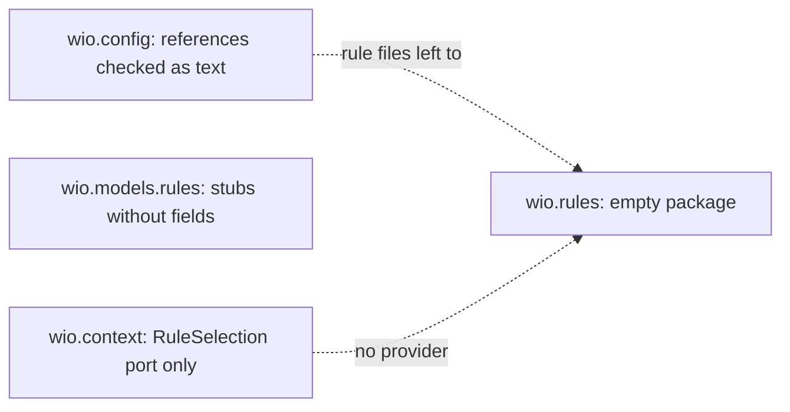
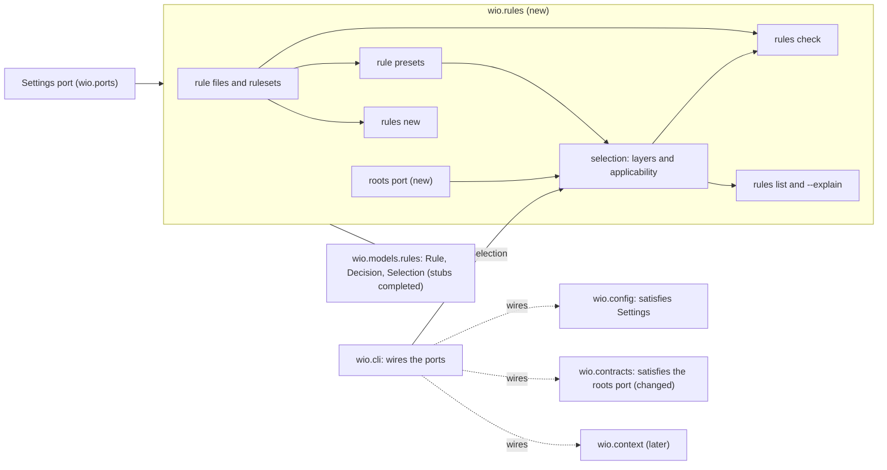

<!-- wio
id = "50fnb0"
template = "feature.parent"
roots = ["@descendants"]
depends_on = []
-->

# wio rules

## Purpose

`wio rules` and the rule selection that `wio context` will use are missing, so
the guidance for a stage cannot be created with stable codes, checked, listed or
compiled from rule files.

## Goals

- A rule is created in a ruleset with the next code of its family, so codes
  never clash.
- Rule files and rulesets are checked beyond what `wio config check` can see,
  with the errors and warnings that
  [the concepts](../../../../docs/concepts.md#checking-rules) give to
  `wio rules check`.
- The rules of a rule preset, a root, a stage, a Work at a stage or a file can
  be listed, and with `--explain` each rule shows where it came from or why it
  is out.
- Which rules apply to a stage is decided by one selection that `wio rules list`
  and, later, `wio context` share, and it is the same for the same inputs.
- A rule file keeps the metadata block form it has, a `<!-- wio -->` comment or
  `+++` front matter, and every command reads both.

## Non-Goals

- Building `wio context`: the bundle, its header, `--output` and the `context`
  event.
- Reporting the note on `rules_always_include`, which `wio config check` reports
  already.
- Rewriting, renaming, moving or deleting a rule or a ruleset, which no
  `wio rules` command does.
- Copying or updating a ruleset from another repository.
- Checking a rule's body beyond a Markdown heading in it, because whether a rule
  is good or atomic is for a reviewer.
- Hashing a rule's file, which the producer of the `context` event does.
- Writing a rule with `+++` front matter, because `wio rules new` writes the
  comment form that `wio contracts new` writes for a bare contract.

## Assumptions

### A-1

The config that reaches `wio rules` is already loaded and valid, because a
config with an error makes every command exit 2, so `wio rules` never judges
the references that `wio config check` judges as text.

### A-2

The rulesets are the directories under `.agents/wio/rules/`, a fixed location
that no setting changes.

### A-3

Reading every rule file of a repository on each command is fast enough, so
nothing caches or indexes them.

### A-4

How a bundle orders, groups and prints rules is `wio context`'s, so `wio rules`
fixes only a deterministic order of the rules it lists and selects.

## Mechanisms

The names of the types, the ports and the modules below are provisional, except
the ones that `docs/concepts.md` already fixes: the commands, the rule file and
the manifest.

- **`wio.rules` package** — the `wio rules` command and the selection, built by
  the children below.
- **`Rule`, `Decision` and `Selection`** — in `wio.models.rules`, today stubs
  without fields; `ht39xt` completes `Rule` and `5yb4tz` completes `Decision`
  and `Selection`.
- **The rule file** — `<code>-<name>.md` with a `wio` metadata block that holds
  `code` and `name`, read in either block form by the shared reader of
  `wio.formats` and built by `ht39xt`.
- **`ruleset.toml`** — the manifest of a ruleset with its `description`,
  `[families]` and `[rule_presets.<name>]`, and the discovery of the rulesets on
  disk, built by `8zn10d`.
- **Rule presets** — the expansion of a rule preset of the config or of a
  manifest into a set of rules, built by `cyeth5`.
- **The four layers** — the rule presets of the roots, the stage's include and
  exclude, and the two always fields, applied in that order, built by `cm25z9`.
- **Applicability** — the rule that a selected rule applies when its ruleset is
  root-independent or reached by a selected root, which gives each rule its
  `Decision`, built by `5yb4tz`.
- **The roots port** — a port that `wio.rules` declares and `wio.cli` wires to
  `wio.contracts`, which gives the roots a stage selects for a Work and the
  roots that contain a file, built by `ndwemw`.
- **`RuleSelection`** — the port of `wio.context` that `wio.rules` satisfies
  with the same selection that `wio rules list` shows; its provisional form is
  in `src/wio/context/ports.pyi`.
- **`wio rules new`** — creates a rule with the next code of its family, built
  by `km9cmc`.
- **`wio rules check`** — the checks that need the rule files and the manifests,
  built by `5qgs79` for the errors and `785y9k` for the warnings.
- **`wio rules list`** — the listing by rule preset, root, stage, Work or file,
  built by `fjvj3x`, and `--explain`, built by `qxfpg9`.

## Constraints

### C-1

`wio.rules` imports no other component: it reads files through the `wio.io`
ports, gets the config through the shared `Settings` port, and gets the roots of
a Work through the roots port. `uv run tach check` verifies it.

### C-2

The output is deterministic: the same files, config and arguments give the same
bytes, in text and in JSON; rules are ordered by ruleset, family and code, and
diagnostics by the shared order that every `check` command uses. AC-3 and the
criteria of each child verify it.

### C-3

Only `wio rules new` writes a file; `check` and `list` read only. The criteria
of the children of `check` and `list` verify it.

### C-4

`check` reports each diagnostic on a line of the form
`<severity>: <where>: <message>`, exits 1 when it reports an error, and exits 0
for a warning alone, as `wio config check` does. AC-5 and the criteria of the
children of `check` verify it.

### C-5

A rule is named by its ruleset and code together with its name, such as
`py.API001 adapters-return-typed-results`, wherever `wio rules` shows or cites
it, and never by a bare code. AC-1 and AC-6 and the criteria of each child that
shows a rule verify it.

### C-6

Every `wio rules` subcommand takes `--json`, which prints the information of its
text form as one JSON document; the document's fields are the owning child's to
decide, and the criteria of each child verify them.

## Visuals

The diagrams are drawn from commit `79d918e` of the branch
`docs/define-rules-tree`, and show only what the Work changes.

### Before

`wio.config` judges rule references as text and leaves the rule files to a Work
that does not exist; `wio.rules` is an empty package, the rule types are stubs
without fields, and `wio.context` declares a port that nothing satisfies.

### After

`wio.rules` reads rules and rulesets, selects rules in layers and applies the
roots, and offers `new`, `check` and `list`. It gets the config through the
shared `Settings` port and the roots of a Work through a port of its own, and
`wio.cli` wires each to the component that satisfies it. Changed parts are
marked.

## Acceptance criteria

### **AC-1** A new rule is created, accepted, listed and selected

A rule made by `wio rules new` is accepted by `wio rules check`, listed by
`wio rules list` and selected for a Work at a stage, without any edit.

#### From creation to the listing

- **Given** a ruleset `demo` whose manifest declares the family `ARC` and a rule
  preset `recommended` that includes `ARC`, holding `ARC001`, a root `api` with
  `rule_presets = ["demo.recommended"]`, a Work in `api`, and a stage with no
  `roots`.
- **When** a rule is created in `ARC` of `demo`.
- **Then** `wio rules check` reports no error for it, and
  `wio rules list --work <id> --stage <name>` shows `demo.ARC002` with its name
  and summary and the root `api`.

#### The selection through the port holds it too

- **Given** the same repository after the rule is created.
- **When** the selection for that Work and stage is asked for through
  `RuleSelection`.
- **Then** it includes `demo.ARC002` with the root `api`.

### **AC-2** `wio rules list` and `wio context` see the same selection

The selection that `wio.rules` gives `wio.context` for a Work at a stage is the
one that `wio rules list --work <id> --stage <name>` shows: the same rules with
the same decisions.

#### Same set, same decisions

- **Given** a Work and a stage with an included rule, a rule excluded by the
  stage and a rule cut by the roots.
- **When** the selection is asked for through `RuleSelection` and
  `wio rules list --explain` runs for the same Work and stage.
- **Then** the included rules, their roots, and the reasons for the others are
  identical.

#### A Work without roots fails loudly

- **Given** a Work that lists no roots, and a stage with no `roots`, so that it
  selects the Work's roots.
- **When** the selection is asked for it, through the port and by
  `wio rules list --work <id> --stage <name>`.
- **Then** the port raises an error that says the Work has no roots, and `list`
  exits non-zero with a message that says so.

### **AC-3** The same inputs give the same bytes

`wio rules list` and `wio rules check` print the same bytes, in text and in
`--json`, for the same repository, config and arguments, whatever the order of
the files on disk or of the entries in the config.

#### Order does not matter

- **Given** one repository whose rules are written in two different file orders
  and whose config lists its roots and rule presets in two different orders.
- **When** `wio rules list --work <id> --stage <name>` and `wio rules check`
  run on each, in text and with `--json`.
- **Then** the outputs are byte for byte the same.

### **AC-4** `check` and `list` agree about what applies

A reference that `wio rules check` reports as dead is cut by the roots in every
`wio rules list` of that stage that applies the roots.

#### A selection from an unreached ruleset

- **Given** a stage with `roots = ["web"]` that includes `py.API001`, where `py`
  is not root-independent and the root `web` does not reach it, and a Work in
  `web`.
- **When** `wio rules check` runs, and
  `wio rules list --explain --work <id> --stage <name>` runs.
- **Then** `check` reports a warning for the reference, `list` does not show
  `py.API001` among the applied rules, and `--explain` says the roots cut it.

### **AC-5** A repository's faults are reported with the standard exit

`wio rules check` reports an error and a warning that different children own in
the shared order, exits 1 for the error, and exits 0 when only the warning is
left.

#### An error and a warning

- **Given** a repository with a reference whose family does not exist in its
  ruleset, and a rule that no layer selects.
- **When** `wio rules check` runs.
- **Then** it prints one error line and one warning line, each of the form
  `<severity>: <where>: <message>`, in the shared order, and exits 1.

#### Only a warning

- **Given** the same repository with the reference corrected.
- **When** `wio rules check` runs.
- **Then** it prints the warning line alone and exits 0.

### **AC-6** The views of a listing agree

`wio rules list` shows a rule alike, with its qualified code, name and summary,
whether it is asked for by rule preset, root, file or Work at a stage.

#### One rule in four views

- **Given** a root `api` whose rule preset `recommended` includes the rule
  `demo.ARC001`, a file under the paths of `api`, and a Work in `api` at a stage
  with no `roots`.
- **When** `wio rules list` runs with `--preset demo.recommended`, with
  `--root api`, with `--path <file>` and with `--work <id> --stage <name>`.
- **Then** each listing shows `demo.ARC001` with the same name and summary, and
  its header names the layers it applied.

### **AC-7** A rule file of either form is treated alike

A rule file whose metadata is `+++` front matter is read, checked, listed and
selected like one with a `<!-- wio -->` block.

#### Both forms in one ruleset

- **Given** a ruleset with one rule in each form, both selected for a stage.
- **When** `wio rules check` and `wio rules list` run.
- **Then** both rules are accepted and listed alike.

## Additional context

- The guarantees of one command, such as the arguments and refusals of
  `wio rules new`, every error and warning of `check`, every flag and reason of
  `list` and `--explain`, and the form that `new` writes, are the criteria of
  the children that own them, so this contract states only what the integrated
  result establishes.
- `wio.context` already declares a provisional port
  `RuleSelection.select(contract, stage) -> Selection` in
  `src/wio/context/ports.pyi`, which takes the resolved contract. A resolved
  contract holds a Work's roots as written, with `@descendants` unexpanded, so
  `ndwemw` may need to change that signature; `wio.context` is not built yet, so
  the change costs nothing there.
- `Hierarchy.roots` of `wio.contracts` already holds the roots of each Work with
  `@descendants` expanded, and `wio contracts show` reads it; what is missing is
  a way for `wio.rules` to ask for them, which is the roots port.
- The scope document [v0.1-scope.md](../../../../docs/v0.1-scope.md) lists no
  `--json` for `wio rules` and gives the note on `rules_always_include` to
  `wio rules check`, where
  [the concepts](../../../../docs/concepts.md#checking-rules) give it to
  `wio config check`. The concepts also list the form of a rule file's metadata
  among their open points.
