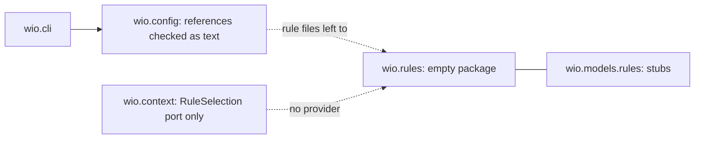
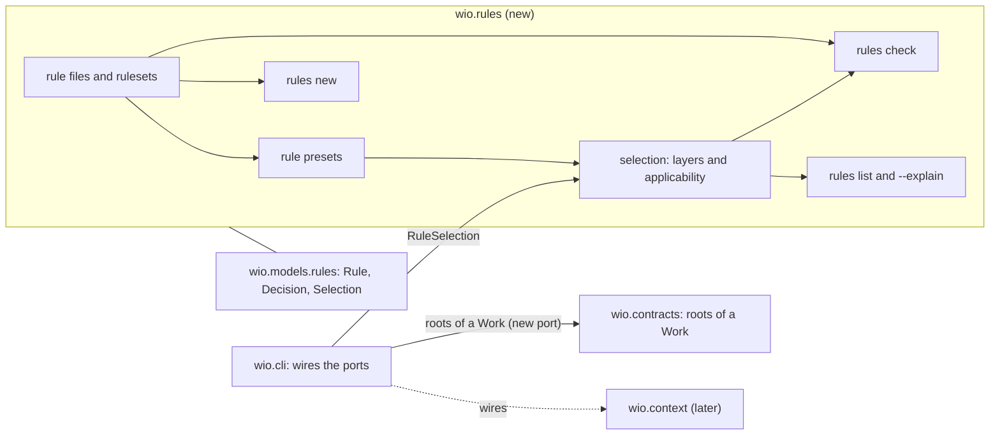

<!-- wio
id = "50fnb0"
template = "feature.parent"
roots = ["@descendants"]
depends_on = []
-->

# wio rules

## Purpose

`wio rules` and the selection of rules that `wio context` will use are missing,
so rules cannot be created with stable codes, checked against their files, or
listed for a stage.

## Goals

- A rule is created in a ruleset with the next code of its family, so codes
  never clash.
- Rule files and rulesets are checked beyond what `wio config check` can see,
  with the errors, warnings and notes that
  [the concepts](../../../../docs/concepts.md#checking-rules) list.
- The rules of a rule preset, a root, a stage, a Work at a stage or a file can
  be listed, and with `--explain` each rule shows where it came from or why it
  is out.
- Which rules apply to a stage is decided by one selection that `wio rules list`
  and, later, `wio context` share, and it is the same for the same inputs.

## Non-Goals

- Building `wio context`: the bundle, its header, `--output` and the `context`
  event.
- Rewriting, renaming, moving or deleting a rule or a ruleset, because
  `wio rules new` only creates a rule.
- Copying or updating a ruleset from another repository.
- Checking a rule's body beyond a Markdown heading in it, because whether a rule
  is good or atomic is for a reviewer.
- Hashing a rule's file, which the producer of the `context` event does.
- Writing a rule with `+++` front matter, because `wio rules new` writes the
  comment form that `wio contracts new` writes for a bare contract.

## Assumptions

### A-1

The config that reaches `wio rules` is already loaded and valid, because a
config with an error makes every command exit 2, so `wio rules` never judges
the references that `wio config check` judges as text.

### A-2

The rulesets are the directories under `.agents/wio/rules/`, a fixed location
that no setting changes.

### A-3

Reading every rule file of a repository on each command is fast enough, so
nothing caches or indexes them.

### A-4

How a bundle orders, groups and prints rules is `wio context`'s, so `wio rules`
fixes only a deterministic order of the rules it lists and selects.

## Mechanisms

The names of the types, the ports and the modules below are provisional, except
the ones that `docs/concepts.md` already fixes: the commands, the rule file and
the manifest.

- **`wio.rules` package** — the `wio rules` command and the selection, built by
  the children below; it imports no other component.
- **`Rule`, `Decision` and `Selection`** — in `wio.models.rules`, today stubs
  without fields; `ht39xt` completes `Rule` and `5yb4tz` completes `Decision`
  and `Selection`.
- **The rule file** — `<code>-<name>.md` with a `wio` metadata block that holds
  `code` and `name`, read in either block form by the shared reader of
  `wio.formats` and built by `ht39xt`.
- **`ruleset.toml`** — the manifest of a ruleset with its `description`,
  `[families]` and `[rule_presets.<name>]`, and the discovery of the rulesets on
  disk, built by `8zn10d`.
- **Rule presets** — the expansion of a preset of the config or of a manifest
  into a set of rules, built by `cyeth5`.
- **The four layers** — the roots' presets, the stage's include and exclude, and
  the two always fields, applied in that order, built by `cm25z9`.
- **Applicability** — the rule that a selected rule applies when its ruleset is
  root-independent or reached by a selected root, which gives each rule its
  `Decision`, built by `5yb4tz`.
- **The roots of a Work or a path** — the roots a stage selects for a Work with
  `@descendants` expanded, which `wio.contracts` computes today and does not
  expose, and the roots that contain a file, built by `ndwemw`; it adds a port
  that `wio.cli` wires to `wio.contracts`, and keeps `wio contracts` unchanged.
- **`RuleSelection`** — the port of `wio.context` that `wio.rules` satisfies
  with the same selection that `wio rules list` shows; its provisional form is
  in `src/wio/context/ports.pyi`.
- **`wio rules new`** — creates a rule with the next code of its family, built
  by `km9cmc`.
- **`wio rules check`** — the checks that need the rule files and the manifests,
  built by `5qgs79` for the errors and `785y9k` for the warnings and the note.
- **`wio rules list`** — the listing by preset, root, stage, Work or file, built
  by `fjvj3x`, and `--explain`, built by `qxfpg9`.

## Constraints

### C-1

`wio.rules` imports no other component: it reads files through the `wio.io`
ports and gets the roots of a Work through a port that `wio.cli` wires.

### C-2

The output is deterministic: the same files, config and arguments give the same
bytes, in text and in JSON, and every ordering is fixed by ruleset, family and
code.

### C-3

Only `wio rules new` writes a file; `check` and `list` read only.

### C-4

`check` reports each diagnostic on a line of the form
`<severity>: <where>: <message>`, exits 1 when it reports an error, and exits 0
for a warning or a note alone, as `wio config check` does.

### C-5

A rule is named by its ruleset and code together with its name, such as
`py.API001 adapters-return-typed-results`, wherever `wio rules` shows or cites
it, and never by a bare code.

### C-6

Every `wio rules` subcommand takes `--json`, which prints the information of its
text form as one JSON document; the document's fields are the owning child's to
decide and its criteria verify them.

## Visuals

The diagrams are drawn from commit `79d918e` of the branch
`docs/define-rules-tree`, and show only what the Work changes.

### Before

`wio.config` judges rule references as text and leaves the rule files to a Work
that does not exist; `wio.rules` is an empty package, the rule types are stubs,
and `wio.context` declares a port that nothing satisfies.

### After

`wio.rules` reads rules and rulesets, selects rules in layers and applies the
roots, and offers `new`, `check` and `list`. `wio.cli` wires the roots of a Work
from `wio.contracts` into it and the selection into `wio.context`, which is
added later.

## Acceptance criteria

### **AC-1** A new rule is valid, listed, and has the next code of its family

`wio rules new` writes a rule that `check` accepts and `list` shows without any
edit, and its code is the number after the highest in its family, so no code is
reused.

#### The next code leaves a gap alone

- **Given** a ruleset `demo` whose family `ARC` holds `ARC001` and `ARC003`.
- **When** a rule is created in `ARC` of `demo`.
- **Then** the new rule is `ARC004`, `wio rules check` reports no error for it,
  and `wio rules list` shows `demo.ARC004` with its name and summary.

#### An unknown family or ruleset is refused

- **Given** a repository whose ruleset `demo` declares only `ARC`.
- **When** a rule is created in a family `XYZ` of `demo`, or in a ruleset that
  does not exist.
- **Then** no file is written and the command reports what exists.

### **AC-2** A broken ruleset is reported with its place

`wio rules check` passes a repository whose rules, manifests and references are
valid, and reports each error it owns with the file or key it is in, and exits
1.

#### Each error is reported

- **Given** a repository with a reference whose family does not exist in its
  ruleset, a qualified reference inside a `ruleset.toml`, a ruleset that defines
  a rule preset named `all`, and a root-independent ruleset that a root reaches.
- **When** `wio rules check` runs.
- **Then** it reports one error for each, in the form of C-4, and exits 1.

#### A valid repository passes

- **Given** a repository whose rulesets and references are valid.
- **When** `wio rules check` runs.
- **Then** it reports no error and exits 0.

### **AC-3** Warnings and the note do not fail the check

`wio rules check` reports a rule that nothing selects, a ruleset that is neither
reached nor selected, a dead selection, a rule in both always fields, a Markdown
heading in a rule body and, as a note, `rules_always_include`, and exits 0 when
nothing else is wrong.

#### A repository with only warnings exits 0

- **Given** a valid repository with a rule that no layer selects and a non-empty
  `rules_always_include`.
- **When** `wio rules check` runs.
- **Then** it reports a warning for the rule and a note for the always field,
  and exits 0.

### **AC-4** A listing shows the rules of any selection and says what it covers

`wio rules list` shows each rule of a rule preset, a root, a stage, a Work at a
stage and a file with its qualified code, name and summary, and its header names
the layers applied, so a partial view never looks complete.

#### A Work at a stage

- **Given** a Work whose roots include `api` and a stage that adds a review
  preset.
- **When** `wio rules list --work <id> --stage <name>` runs.
- **Then** it lists the rules of the `api` root's presets and the stage, with
  the always fields applied and those not applied named in the header.

#### A file

- **Given** a file under the paths of two overlapping roots.
- **When** `wio rules list --path <file>` runs.
- **Then** it lists the rules of both roots' presets and the always fields.

#### Conflicting selectors are refused

- **Given** a repository with roots and stages.
- **When** `wio rules list` is given `--root` together with `--path`, or
  `--work` without `--stage`.
- **Then** it refuses and says which flags conflict.

### **AC-5** `--explain` says where a rule came from or why it is out

With `--explain`, each listed rule shows its source chain, such as
`py.API002 <- root api <- backend <- py.API`, and each rule that is out shows
whether a layer excluded it, `rules_always_exclude` vetoed it, or the roots cut
it.

#### The three reasons

- **Given** one rule excluded by a stage, one vetoed by `rules_always_exclude`,
  and one whose ruleset no selected root reaches.
- **When** `wio rules list --explain` runs for that stage and Work.
- **Then** each of the three is shown out, with its own reason.

### **AC-6** `wio rules list` and `wio context` see the same selection

The selection that `wio.rules` returns through `RuleSelection` for a Work at a
stage is the one that `wio rules list --work <id> --stage <name>` shows: the
same rules with the same decisions.

#### Same set, same decisions

- **Given** a Work and a stage with an included rule, a rule excluded by the
  stage and a rule cut by the roots.
- **When** `select` is called through the port and `wio rules list --explain`
  runs for the same Work and stage.
- **Then** the included rules, their roots, and the reasons for the others are
  identical.

#### A Work without roots fails loudly

- **Given** a Work with no roots and a stage that selects the Work's roots.
- **When** the selection is asked for it, through the port or by `list`.
- **Then** it fails and says that the Work has no roots.

### **AC-7** The same inputs give the same bytes

Running `new`, `check` and `list` twice on the same repository, config and
arguments gives the same output in text and in `--json`, whatever the order of
the files on disk or of the entries in the config.

#### Order does not matter

- **Given** one repository whose rules are written in two different file orders
  and whose config lists its roots in two different orders.
- **When** `wio rules list --work <id> --stage <name>` and
  `wio rules check` run on each.
- **Then** the outputs are byte for byte the same.

### **AC-8** A rule with front matter is treated like one with a comment block

A rule file whose metadata is `+++` front matter is read, checked and listed
like one with a `<!-- wio -->` block, and `wio rules new` writes only the
comment form.

#### Both forms in one ruleset

- **Given** a ruleset with one rule in each form.
- **When** `wio rules check` and `wio rules list` run.
- **Then** both rules are accepted and listed alike.

#### New writes a comment block

- **Given** a ruleset whose existing rules use front matter.
- **When** `wio rules new` creates a rule in it.
- **Then** the new file starts with `<!-- wio` and the existing files are
  unchanged.

## Additional context

- `wio.context` already declares a provisional port
  `RuleSelection.select(contract, stage) -> Selection` in
  `src/wio/context/ports.pyi`, which takes the resolved contract. A resolved
  contract holds a Work's roots as written, with `@descendants` unexpanded, so
  `ndwemw` may need to change that signature; `wio.context` is not built yet, so
  the change costs nothing there.
- The scope document [v0.1-scope.md](../../../../docs/v0.1-scope.md) lists no
  `--json` for `wio rules`; the docs stage adds it with the rest.
