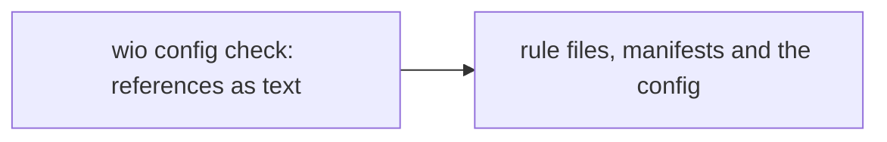
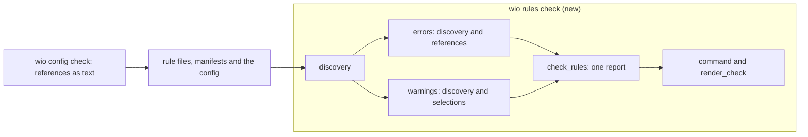

<!-- wio
id = "zc62j9"
template = "feature.parent"
roots = ["@descendants"]
depends_on = []
-->

# wio rules check

## Purpose

The faults that only the rule files and the config show together are reported by
no command, so a repository can hold a reference that names nothing or a
selection that no root can reach without anyone being told.

## Goals

- `wio rules check` reports in one report every fault of the rule files, the
  manifests and the references, with the errors and warnings that the concepts
  give it.
- Each finding names its place, and the report is in the shared order, in text
  and in JSON, with the standard exit code.
- It judges the whole repository on every run, reports each fault once, and
  writes nothing.

## Non-Goals

- Judging the config itself, and the note on `rules_always_include`, which
  `wio config check` does.
- Judging a rule's body beyond a Markdown heading in it.
- Listing the rules that nothing selects, which `wio rules list --not-selected`
  does, so `check` does not warn about them.
- Fixing what it finds.

## Assumptions

### A-1

The config that `wio rules check` reads is already valid, as A-1 of
[wio rules](../README.md) says, so its references are well-formed and its rule
presets do not cycle, and the references that this command judges are those
whose item after the dot needs the rule files to be found.

### A-2

A fault that the discovery of `8zn10d` reports is shown by `check` as the
discovery returns it, an error or a warning, and `check` does not judge it
again.

## Mechanisms

The names of the functions below are provisional.

- **`check_errors`** — every error: the errors of the discovery and the errors
  of the references, built by `5qgs79`.
- **`check_warnings`** — every warning: the warnings of the discovery and the
  warnings of the selections and of the rule bodies, built by `785y9k`.
- **`check_rules(root, config, files) -> tuple[Diagnostic, ...]`** — in
  `wio.rules`, runs the discovery once, joins what the two functions return in
  the shared order, and is built by the integration of this Work.
- **The command** — `wio rules check`, with `--json`, built by the integration
  of this Work over `render_check` of `wio.formats`, which writes the lines or
  the JSON and says `The rules pass.` for a clean repository.

## Constraints

### C-1

The place of a fault is the one that C-6 of [wio rules](../README.md) states,
with the manifest's key as `<path>#<key path>` and the config's as its key path.
AC-5 verifies it, and the criteria of both leaves.

### C-2

Every fault is one line, and no finding is repeated by two paths of this
command, such as an error of the discovery that the references check would
report again. AC-3 verifies it.

## Visuals

The diagrams are drawn from commit `eb82e71` of the branch
`docs/define-rules-tree`, and show only what the Work changes.

### Before

`wio config check` judges the references of the config as text and does not read
a rule file, and no command reads the rule files to judge them.

### After

`wio rules check` runs the discovery once, adds the faults of the references and
the warnings of the selections and the rule bodies, and prints one report. New
parts are marked.

## Acceptance criteria

### **AC-1** One report holds every kind of finding

`wio rules check` prints one line for each error and each warning of the rule
files, the manifests and the references, exits 1 when there is an error, exits 0
when there is only a warning, and says that the rules pass when there is
nothing.

#### Errors and warnings together

- **Given** a ruleset `demo` that declares `ARC` and `ZZZ`, holding `ARC001`,
  whose block has the unknown key `owner`, selected by the preset of a root, and
  `ZZZ001` named `loud-rule`, whose body holds a Markdown heading, and a stage
  whose
  `rules_include` has `demo.XYZ`, a family that `demo` does not declare.
- **When** `wio rules check` runs.
- **Then** it prints three lines, an error for `demo.XYZ`, a warning for the
  unknown key and a warning for `demo.ZZZ001 loud-rule`, each of the form
  `<severity>: <where>: <message>`, and exits 1.

#### Only warnings, and nothing

- **Given** the same repository with the stage's reference changed to `demo.ARC`
  and the key `owner` removed, and then the heading removed from `ZZZ001`.
- **When** `wio rules check` runs on each.
- **Then** the first prints the one warning for `demo.ZZZ001 loud-rule` and
  exits 0, and the second prints `The rules pass.` and exits 0.

### **AC-2** The report is the same bytes in order, as text and as JSON

`wio rules check` prints the same bytes for the same repository, whatever the
order of the files and of the config, and `--json` holds the same findings as
the text.

#### Order and JSON

- **Given** the repository of AC-1 with its files and its config in two orders.
- **When** `wio rules check` and `wio rules check --json` run on each.
- **Then** the text outputs are equal in the order of C-2 of
  [wio rules](../README.md) names, the JSON outputs are equal, and each JSON
  document has the severity, the place and the message of every line.

### **AC-3** Each fault is reported once

A fault that the discovery reports is one line, and the references check does
not report it again.

#### No duplicates

- **Given** a ruleset `demo` with a rule whose block does not close, which the
  discovery leaves out, and a manifest whose rule preset `local` includes
  `Docs`.
- **When** `wio rules check` runs.
- **Then** it prints one error for the rule file that names its line and one for
  `Docs`, and no other line about either.

### **AC-4** A repository with no rulesets passes

A repository with no `.agents/wio/rules` directory has nothing to report.

#### No rulesets

- **Given** a repository with no `.agents/wio/rules` directory.
- **When** `wio rules check` runs, with and without `--json`.
- **Then** it prints `The rules pass.` and `[]`, and exits 0.

### **AC-5** A fault in the manifest is placed in its key

A fault in a key of a manifest is placed by the manifest's path and the key
path, and a fault in the config by its key path.

#### Places

- **Given** a manifest whose rule preset `local` includes `Docs`, and a stage
  whose `rules_include` has `demo.XYZ`.
- **When** `wio rules check` runs.
- **Then** the first error's place is
  `.agents/wio/rules/demo/ruleset.toml#rule_presets.local.rules_include[0]` and
  the second's is `stages.s.rules_include[0]`.

## Additional context

- The errors and warnings that each child builds, and what makes each of them,
  are the criteria of `5qgs79` and `785y9k`; this contract states only what the
  report establishes as a whole.
- The shared `render_check` writes the lines of a check and the JSON for every
  `check` command, so the format of a line and the exit code are the
  repository's and not this Work's.
- The references are judged against the rules that the discovery returned, so a
  reference to a rule that the discovery left out because of its own fault is
  reported as well, a consequence of that fault and not a repeat of it.
