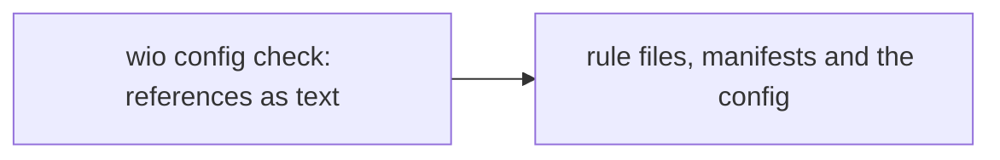
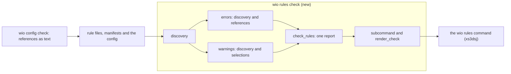

<!-- wio
id = "zc62j9"
template = "feature.parent"
roots = ["@descendants"]
depends_on = ["xs3dsj"]
-->

# wio rules check

## Purpose

The faults that only the rule files and the config show together are reported by
no command, so a repository can hold a reference that names nothing or a
selection that no root can reach without anyone being told.

## Goals

- `wio rules check` reports in one report every fault of the rule files, the
  manifests and the references, with the errors and warnings that the concepts
  give it.
- Each finding names its place, and the report is in the shared order, in text
  and in JSON, with the standard exit code.
- It judges the whole repository on every run, reports each fault once, and
  writes nothing.

## Non-Goals

- Judging the config itself, and the note on `rules_always_include`, which
  `wio config check` does.
- Judging a rule's body beyond a Markdown heading in it.
- Listing the rules that nothing selects, which `wio rules list --not-selected`
  does, so `check` does not warn about them.
- Fixing what it finds.

## Assumptions

### A-1

The config that `wio rules check` reads is already valid, as A-1 of
[wio rules](../README.md) says, so its references are well-formed and its rule
presets do not cycle, and the references that this command judges are those
whose item after the dot needs the rule files to be found.

### A-2

A fault that the discovery of `8zn10d` reports is shown by `check` as the
discovery returns it, an error or a warning, and `check` does not judge it
again.

## Mechanisms

The names of the functions below are provisional.

- **`check_errors` and `check_warnings`** — the functions of `5qgs79` and
  `785y9k`, each taking the `Config` and the `Discovery` and returning the
  errors or the warnings; this Work states only what it does with them.
- **`check_rules(root, config, files)`** — in `wio.rules`, with `root: Path`,
  `config: Config` and `files: FileSystem`, returning a
  `tuple[Diagnostic, ...]`; it runs the discovery once, joins what the two
  functions return in the order of C-2 of [wio rules](../README.md), and is
  built by the integration of this Work.
- **The command** — `wio rules check`, with `--json`, built by the integration
  of this Work as an entry of `SUBCOMMANDS` of `xs3dsj`; it renders the report
  with `render_check` of `wio.formats`, which writes the lines or the JSON and
  says `The rules pass.` for a clean repository, and it returns the exit code
  that `has_error` gives, 1 for an error and 0 otherwise.

## Constraints

### C-1

Every fault is one line, and no finding is repeated by two paths of this
command, such as an error of the discovery that the references check would
report again. AC-2 verifies it.

## Visuals

The diagrams are drawn from commit `d1f3d5d` of the branch
`docs/define-rules-tree`, and show only what the Work changes.

### Before

`wio config check` judges the references of the config as text and does not read
a rule file, and no command reads the rule files to judge them.

### After

`wio rules check` runs the discovery once, adds the faults of the references and
the warnings of the selections and the rule bodies, and prints one report. New
parts are marked.

## Acceptance criteria

### **AC-1** One report holds every kind of finding

`wio rules check` prints one line for each error and each warning of the rule
files, the manifests and the references, in the shared order, exits 1 when there
is an error, exits 0 when there is only a warning, and says that the rules pass
when there is nothing.

#### Errors and warnings together

- **Given** a ruleset `demo` that declares `ARC` and `ZZZ`, holding
  `ARC001-keep-it-small.md`, whose block has the unknown key `owner` and which a
  root's preset selects, and `ZZZ001-loud-rule.md`, whose block takes lines 1 to
  4, followed by a blank line and a body whose first line, line 6, is a Markdown
  heading, and a stage `s` whose `rules_include` has `demo.XYZ`, a family that
  `demo` does not declare.
- **When** `wio rules check` runs.
- **Then** it prints three lines, in this order: a warning at
  `.agents/wio/rules/demo/ARC001-keep-it-small.md` for the key `owner`, a
  warning at `.agents/wio/rules/demo/ZZZ001-loud-rule.md:6` for the heading of
  `demo.ZZZ001 loud-rule`, and an error at `stages.s.rules_include[0]` for
  `demo.XYZ`, each of the form `<severity>: <where>: <message>`, and exits 1.

#### Only warnings, and nothing

- **Given** the same repository with the stage's reference changed to
  `demo.ARC`, and then the key `owner` and the heading removed.
- **When** `wio rules check` runs on each.
- **Then** the first prints the two warnings and exits 0, and the second prints
  `The rules pass.` and exits 0.

### **AC-2** Each fault is reported once in the joined report

A fault that the discovery returns is one line of the report, whichever of the
two functions it comes through, and the references check does not report it
again.

#### No duplicates

- **Given** a ruleset `demo` with a rule whose block does not close, which the
  discovery leaves out, a rule whose block has an unknown key, a manifest with
  an unknown key, and a manifest whose rule preset `local` includes `Docs`.
- **When** `wio rules check` runs.
- **Then** it prints one error for the rule file that names its line, one
  warning for the key of the rule, one warning for the key of the manifest and
  one error for `Docs`, and no other line about any of them.

### **AC-3** The whole repository is judged on every run

A fault in a ruleset that no root or stage selects is reported with the faults
of the others in the same run.

#### Two rulesets

- **Given** a ruleset `used` selected by a root and a ruleset `spare` that no
  root or stage includes, each with a rule whose block has an unknown key.
- **When** `wio rules check` runs.
- **Then** it prints a warning for each of the two rules and exits 0.

### **AC-4** The exit codes and the JSON hold with `--json`

With `--json`, standard output holds one JSON array of the findings and nothing
else, and the exit code is 1 for an error, 0 for a warning alone and 0 for
nothing, in which case the array is empty.

#### Three outcomes

- **Given** a repository with an error, one with only a warning, and one with
  none.
- **When** `wio rules check --json` runs on each.
- **Then** the first prints one array with the error and exits 1, the second
  prints one array with the warning and exits 0, and the third prints `[]` and
  exits 0.

### **AC-5** A repository with no rulesets passes

A repository with no `.agents/wio/rules` directory has nothing to report.

#### No rulesets

- **Given** a repository with no `.agents/wio/rules` directory.
- **When** `wio rules check` runs, with and without `--json`.
- **Then** it prints `The rules pass.` and `[]`, and exits 0.

## Additional context

- The errors and warnings that each child builds, and what makes each of them,
  are the criteria of `5qgs79` and `785y9k`, the places of their faults are
  those of C-6 of [wio rules](../README.md), the order and the bytes of the
  report in text and in JSON are verified by AC-3 of that Work, and that `check`
  writes nothing by its AC-11; this contract states only what the join and the
  command add.
- The shared `render_check` writes the lines or the JSON of a check and the
  passing sentence, and the exit code is the command's, from `has_error`.
- The references are judged against the rules that the discovery returned, so a
  reference to a rule that the discovery left out because of its own fault is
  reported as well, a consequence of that fault and not a repeat of it.
