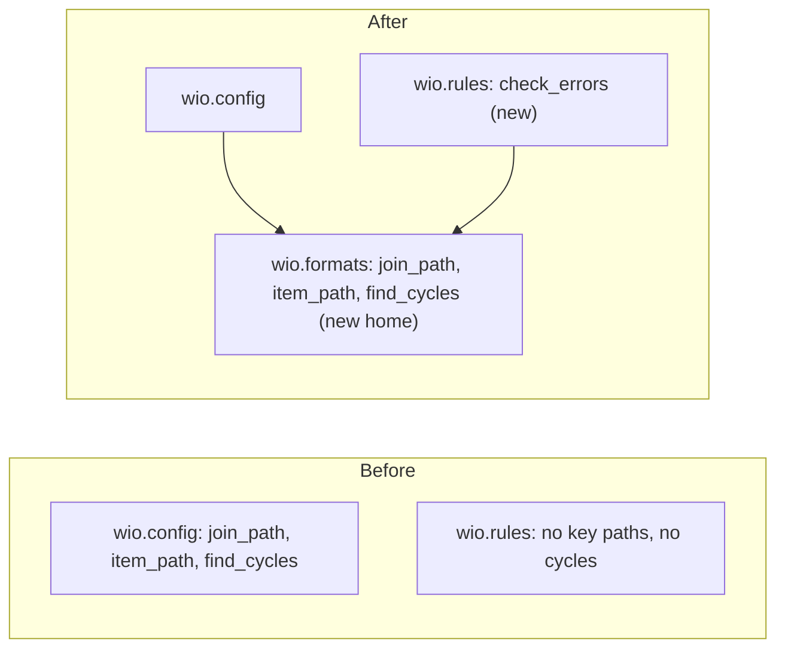

<!-- wio
id = "5qgs79"
template = "feature.leaf"
roots = ["wio"]
depends_on = ["cm25z9", "w3k7vd"]
-->

# Errors of rules and rulesets

## Purpose

A reference that names nothing in its ruleset, a cycle of rule presets and a
root-independent ruleset that a root reaches are faults that only the rule files
and the config show together, and no command reports them.

## Goals

- Every error that `wio rules check` owns is found and placed: the errors of the
  discovery, and the errors of the references of the config and of the
  manifests.
- Each fault is reported once, at the key where it is written, whatever the
  number of entries that reach it.
- The key paths that name a place in the config and the finding of cycles are
  written and done by functions that `wio config check` shares.

## Non-Goals

- The warnings, which `785y9k` builds, and the report that joins them, which the
  parent builds.
- Judging the form of a reference in the config or that a ruleset of the config
  exists, which `wio config check` does.
- Expanding a rule preset, which `cyeth5` does.

## Assumptions

### A-1

The config is valid, as A-1 of [wio rules](../../README.md) says, so every
reference in it is well-formed and names a ruleset or a rule preset of the
config; what needs the rule files is whether the item after the dot exists.

### A-2

An entry is judged where it is written and by itself, so a fault found inside a
rule preset that the entry reaches is not the entry's and is reported at the
preset's own key.

## Mechanisms

The names of the functions below are provisional.

- **`check_errors(config: Config, discovery: Discovery) -> tuple[Diagnostic, ...]`**
  — in `wio.rules`, with the `Config` and the `Discovery` of `8zn10d`; it does
  no input or output. It returns the errors of the discovery as they are, and
  for the references it expands each entry on its own with `expand` of `cyeth5`
  over the `Sources` that `build_sources` of `w3k7vd` gives: an entry of the
  config in the config scope, and each entry of each rule preset of a manifest,
  include or exclude, in the `RulesetScope` of its ruleset. A problem whose
  route is not empty belongs to a rule preset that the entry reached and is not
  the entry's, and a `cycle` problem is dropped, because cycles come from
  `find_cycles`.
- **The key paths and the cycles** — `join_path` and `item_path`, moved from
  `wio.config.messages`, and `find_cycles`, moved from `wio.config.pipelines`,
  to `wio.formats`, which `wio.config` and `wio.rules` both import.
- **The reach of the roots** — the `rulesets` of the `Expansion` of each entry
  of a root's rule presets, with the nested rule presets of the config, for the
  roots that reach a root-independent ruleset.

## Constraints

### C-1

`wio.config` imports `join_path`, `item_path` and `find_cycles` from
`wio.formats` and does not keep a copy. `uv run tach check` and
`uv run jscpd src tests` verify it, and AC-9 that the output of
`wio config check` is unchanged.

## Visuals

The diagram is drawn from commit `d1f3d5d` of the branch
`docs/define-rules-tree`, and shows only what the Work changes.

### Before and after

The key paths and the finding of cycles are private to `wio.config`, so
`wio.rules`, which may not import it, cannot write a place or find a cycle.
After the move both import them from `wio.formats`. New parts are marked.

## Acceptance criteria

### **AC-1** The errors of the discovery are shown

Every error of the discovery is returned as it is, and its warnings are not.

#### Pass-through

- **Given** a discovery with a rule whose block does not close, a manifest that
  does not parse and an unknown key in a rule's block.
- **When** `check_errors` runs.
- **Then** it returns the two errors with their places and messages unchanged,
  and not the warning.

### **AC-2** A reference of the config that names nothing is an error

An entry of the config whose family, code or rule preset after the dot is not in
its ruleset is one error at the entry's key path, and an entry that names
something is not.

#### Every field that takes references

- **Given** a ruleset `demo` that declares `ARC` and holds `ARC001`, with a rule
  preset `recommended`; a root `api` with
  `rule_presets = ["demo.none", "demo.recommended"]`; and the lists
  `["demo.ZZZ", "demo.ARC999", "demo.none", "demo.ARC", "demo.ARC001",
  "demo.recommended"]` in `stages.s.rules_include`, `stages.s.rules_exclude`,
  `rule_presets.backend.rules_include` and `rules_always_include`, and
  `["demo.ZZZ", "demo.ARC999"]` in `rules_always_exclude`.
- **When** `check_errors` runs.
- **Then** it returns an error at `roots.api.rule_presets[0]`, and at indexes 0,
  1 and 2 of each of the four lists, and at indexes 0 and 1 of
  `rules_always_exclude`, each at its key path such as
  `stages.s.rules_include[1]`, and none for the valid entries; the message of an
  unknown family lists the families that the ruleset declares, that of an
  unknown code lists the codes of its family, and that of an unknown rule preset
  lists the rule presets of its manifest.

### **AC-3** A reference of a manifest that cannot be used is an error

An entry of a manifest that names nothing in its own ruleset, is not in the form
of a reference, or is qualified is one error at the manifest's key.

#### Three kinds

- **Given** a ruleset `demo` that declares `ARC` and holds `ARC001`, whose
  manifest has a rule preset `local` with `rules_include = ["ZZZ", "Docs",
  "demo.ARC"]` and `rules_exclude = ["ARC999"]`.
- **When** `check_errors` runs.
- **Then** it returns four errors, whose places are
  `.agents/wio/rules/demo/ruleset.toml#rule_presets.local.rules_include[0]`,
  `…rules_include[1]`, `…rules_include[2]` and `…rules_exclude[0]`, saying that
  `ZZZ` names nothing, `Docs` is not a reference, `demo.ARC` is qualified and a
  manifest names only its own items, and `ARC999` names nothing.

### **AC-4** Each fault is reported once, where it is written

A fault in a manifest or in a rule preset of the config is one error however
many entries reach that rule preset.

#### A preset reached three times

- **Given** the manifest of AC-3, a rule preset `backend` of the config that
  includes `demo.local`, a root `api` and a stage that both include `backend`,
  and an entry of `rules_always_include` of `demo.local`.
- **When** `check_errors` runs.
- **Then** the four errors of AC-3 are returned once each, and no error is
  placed at the entries that reach `demo.local` or `backend`.

### **AC-5** A cycle of rule presets is an error that names them

Rule presets of a manifest that include each other, or one that includes itself,
are one error for each cycle, at the key of the first of them by name.

#### Cycles

- **Given** a manifest with rule presets `a` and `b` that include each other,
  `c` that includes itself, and `d` that includes `a`.
- **When** `check_errors` runs.
- **Then** it returns one error at `…#rule_presets.a.rules_include` that names
  `a` and `b`, and one at `…#rule_presets.c.rules_include` that names `c`, and
  none for `d`, so that each cycle is one error and the `cycle` problems of the
  expansion add none.

### **AC-6** A manifest cannot define `all`

A rule preset called `all` in a manifest is one error at its key, and a
reference to `all` is valid.

#### The reserved name

- **Given** a manifest with a rule preset `all` and a rule preset `x` that
  includes `all`, and a config entry `demo.all`.
- **When** `check_errors` runs.
- **Then** it returns one error at `…#rule_presets.all` that says `all` is
  reserved for the whole ruleset, and none for `x` or `demo.all`.

### **AC-7** A root-independent ruleset must not be reached by a root

A root whose rule presets name a root-independent ruleset, directly or through a
rule preset of the config, is one error at the entry of the root that reaches
it, and a stage that includes it is not.

#### A root and a stage

- **Given** a root-independent ruleset `process` that holds `FIX001`, a root
  `api` whose rule presets are `["demo.recommended", "process.all"]`, and a
  stage that includes `process.FIX001`.
- **When** `check_errors` runs.
- **Then** it returns one error at `roots.api.rule_presets[1]` that names
  `process` and `api`, and none for the stage or for the first entry.

#### Through a rule preset of the config

- **Given** a rule preset `backend` of the config that includes `process.all`, a
  root `api` whose rule presets are `["demo.recommended", "backend"]`, and a
  stage that includes `backend`.
- **When** `check_errors` runs.
- **Then** it returns one error at `roots.api.rule_presets[1]` that names
  `process`, `api` and `backend`, none for the stage, and none at the key of
  `backend`.

### **AC-8** A reference to a rule or a ruleset that was left out is reported

A reference is judged against what the discovery returned, so a reference to a
rule, or to a whole ruleset, that it left out for its own fault is an error too.

#### A rule left out

- **Given** two rules with the code `ARC001` in `demo`, which the discovery
  leaves out, and a stage that includes `demo.ARC001`.
- **When** `check_errors` runs.
- **Then** it returns the error of the discovery for the shared code and one
  error at the stage's entry that `demo.ARC001` names nothing.

#### A ruleset left out

- **Given** a ruleset `broken` whose manifest does not parse, which the
  discovery leaves out, and a stage that includes `broken.ARC001`.
- **When** `check_errors` runs.
- **Then** it returns the error of the discovery for the manifest and one error
  at the stage's entry that `broken` is not a ruleset that was read.

### **AC-9** `wio config check` is unchanged by the move

Moving `join_path`, `item_path` and `find_cycles` to `wio.formats` changes
nothing that `wio config check` reports.

#### Every key path and cycle

- **Given** the configs that the acceptance scenarios of `wio config check` use,
  including cycles of rule presets and of `after`.
- **When** `wio config check` runs on each after the move.
- **Then** every diagnostic, with its place, and every exit code is what it was
  before.

### **AC-10** A family that holds no rule is not an error

A family that the manifest declares and that holds no rule is a valid reference.

#### An empty family

- **Given** a ruleset `demo` whose manifest declares `ARC` and `PAY` and that
  holds only `ARC001`, and a stage that includes `demo.PAY`.
- **When** `check_errors` runs.
- **Then** it returns no error.

### **AC-11** The errors do not depend on order and need no file

The same config and discovery give the same errors in the same order, whatever
the order of the tables and entries, and `check_errors` reads no file.

#### Two orders

- **Given** the config and the discovery of AC-3 to AC-7 declared in two orders,
  and no file system.
- **When** `check_errors` runs on each.
- **Then** the results are equal.

## Additional context

- `join_path` and `item_path` are in `src/wio/config/messages.py` and
  `find_cycles` in `src/wio/config/pipelines.py` today; `wio.rules` may not
  import `wio.config`, so the delivery moves them, as `cyeth5` moves
  `parse_reference`.
- The place `…#rule_presets.local.rules_include[0]` is the form that C-6 of
  [wio rules](../../README.md) states, and the cycle is placed at
  `rules_include` as `wio config check` places a cycle of the config's rule
  presets.
