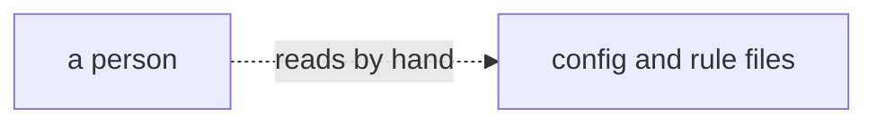
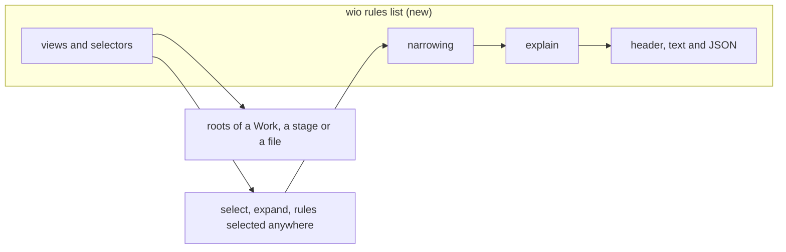

<!-- wio
id = "ak7n2y"
template = "feature.parent"
roots = ["@descendants"]
depends_on = ["xs3dsj"]
-->

# wio rules list

## Purpose

What a root, a stage, a Work or a file is given, and which rules nothing
selects, can be learned only by reading the config and the rule files by hand,
so nobody can ask which rules apply or where a rule came from.

## Goals

- `wio rules list` lists the rules of a root, a stage, a Work at a stage or a
  file, or of the rules that references name, each by its qualified code, name
  and description or summary, with a header that names the layers it applied.
- References narrow every view, and `--not-selected` limits it to the rules that
  nothing selects anywhere.
- `--explain` shows where each rule came from or why it is out.
- Selectors that conflict, a reference that names nothing and a fault in the
  rules are refused, and every listing is also available as JSON.

## Non-Goals

- Deciding which rules apply, which the selection does, and which rules nothing
  selects, which `1gs341` does.
- Showing one rule's body, which `wio rules show` does.
- Checking the rules, which `wio rules check` does.

## Assumptions

### A-1

The views are the concepts' table of views with the flag `--preset` replaced by
references: no selector lists the rules that the references name with no layers,
`--root`, `--stage`, `--work` and `--path` give the roots and the stage, and a
reference is one of the forms `<ruleset>.<item>`, such as
`demo.ARC001` or `demo.all`, or the bare name of a rule preset of the config.

### A-2

At most one of `--root`, `--path` and `--work` is given and each takes one
value; `--work` alone selects the Work's own roots and `--stage` with it makes
the stage decide which roots count, so `--work` does not need `--stage`.

### A-3

With a view that applies roots, `--not-selected` takes as its candidates the
rules whose ruleset is root-independent or reached by the roots of the view, and
keeps those that no entry includes anywhere in the config; without roots every
rule is a candidate.

## Mechanisms

The names of the functions below are provisional.

- **`wio rules list`** — the command, built by the integration of this Work from
  the pieces below, which reads the config and the rule files through the ports
  and writes through `render` of `wio.formats`.
- **The views and the output** — the selectors, their refusals, the header and
  the text and JSON of a listing, built by `fjvj3x` over `select` of `5yb4tz`
  and the roots of `ndwemw`.
- **Narrowing** — the references that filter a view and `--not-selected`, built
  by `9r1zpd` over `expand` of `cyeth5` and the rules selected anywhere of
  `1gs341`.
- **`--explain`** — the source of each rule and the reason a rule is out, built
  by `qxfpg9` from the effects and the routes of the selection.

## Constraints

### C-1

A refusal, a conflict of selectors, a reference that names nothing or a fault in
the rules, exits 2 with its message on standard error and prints nothing on
standard output. AC-3 verifies it.

## Visuals

The diagrams are drawn from commit `f8b00d8` of the branch
`docs/define-rules-tree`, and show only what the Work changes.

### Before

No command lists rules, so what a root, a stage, a Work or a file is given is
read from the config and the rule files by hand.

### After

`wio rules list` turns its flags into the roots and the stage, asks the
selection or the expansion for the rules, narrows them, explains them if asked,
and prints them. New parts are marked.

## Acceptance criteria

### **AC-1** One command serves every view with references and explanations

`wio rules list` combines a view, references and `--explain` in one listing: the
rules of the view that the references name, each by its qualified code, name and
description or summary, with its source or the reason it is out.

#### A Work at a stage, narrowed and explained

- **Given** a ruleset `demo` that declares `ARC` and `PAY` and holds `ARC001`,
  `ARC002`, `PAY001` with a description and `PAY002`, a rule preset
  `recommended` that includes `ARC` and excludes `ARC002`, a root `api` with
  `rule_presets = ["demo.recommended"]`, a stage `s` that includes
  `demo.PAY001`, and a Work whose `roots` list `api`.
- **When** `wio rules list demo.all --work <id> --stage s --explain` and
  `wio rules list demo.ARC --work <id> --stage s` run.
- **Then** the first shows `demo.ARC001` with the root `api` and the route
  `demo.recommended`, `demo.PAY001` with its description and the layer `stage`,
  and `demo.ARC002` and `demo.PAY002` out with their reasons, and a header that
  names the layers applied; the second shows `demo.ARC001` only.

### **AC-2** `--not-selected` limits any view to the rules that nothing selects

`--not-selected` keeps the rules that no root, stage or always field includes,
among the candidates of the view as A-3 says.

#### The same modifier on several views

- **Given** the repository of AC-1 with a second ruleset `web` whose rule
  `WEB001` no root reaches.
- **When** `wio rules list --not-selected`, `wio rules list --root api
  --not-selected`, `wio rules list demo.PAY --not-selected` and
  `wio rules list --stage s --not-selected` run.
- **Then** the first shows `demo.ARC002`, `demo.PAY002` and `web.WEB001`, the
  second shows `demo.ARC002` and `demo.PAY002` because `api` does not reach
  `web`, the third shows `demo.PAY002`, and the fourth shows `demo.ARC002`,
  `demo.PAY002` and `web.WEB001`.

### **AC-3** What cannot be listed is refused

Conflicting selectors, a Work that does not exist or has no roots, a reference
that names nothing, the flag that was dropped and a fault in the rules are each
refused before anything is printed.

#### Usage refusals

- **Given** the repository of AC-1.
- **When** `wio rules list --root api --path src/x.py`,
  `wio rules list --work none`, `wio rules list recommended`,
  `wio rules list Docs` and `wio rules list --preset demo.recommended` run.
- **Then** each exits 2, with a message on standard error that says which flags
  conflict, that no Work has the id `none`, that `recommended` names no rule
  preset of the config, that `Docs` is not a reference, and that `--preset` is
  not an option, and each prints nothing on standard output.

#### A Work without roots

- **Given** a Work that lists no roots.
- **When** `wio rules list --work <id>` and
  `wio rules list --work <id> --stage s`, with a stage `s` that has no `roots`,
  run.
- **Then** each exits 2 with a message on standard error that says the Work has
  no roots, and prints nothing on standard output.

#### A fault in the rules

- **Given** a repository with a ruleset `bad` that holds two rules of one code.
- **When** `wio rules list demo.all` runs.
- **Then** it exits 2 with the error of the duplicate code on standard error and
  prints nothing on standard output.

### **AC-4** The JSON holds the same listing as the text

`--json` prints one document with the same rules, header information, sources
and reasons as the text.

#### Text and JSON

- **Given** the repository of AC-1.
- **When** `wio rules list demo.all --work <id> --stage s --explain` runs as
  text and with `--json`.
- **Then** the document holds the layers applied, the roots, and every rule with
  its qualified code, name, description or summary, roots, sources and reason,
  and nothing that the text lacks.

### **AC-5** `--work` alone gives the Work's roots, `--stage` adds the stage

`--work` without `--stage` lists the rules of the Work's own roots with no stage
layer, and `--stage` with it adds the stage's layer and lets the stage decide
which roots count.

#### With and without a stage

- **Given** the repository of AC-1, a ruleset `web` that holds `WEB001` and a
  rule preset `core` that includes it, a root `web` with
  `rule_presets = ["web.core"]`, and a stage `t` with `roots = ["web"]`.
- **When** `wio rules list --work <id>`, `wio rules list --work <id> --stage s`
  and `wio rules list --work <id> --stage t` run.
- **Then** the first shows `demo.ARC001` and not `demo.PAY001`, the second also
  shows `demo.PAY001`, and the third shows `web.WEB001` and no rule of `demo`.

### **AC-6** Without a view or a reference every rule is listed

`wio rules list` with no selector and no reference lists every rule of every
ruleset in order, with no layers applied.

#### Everything

- **Given** the repository of AC-2.
- **When** `wio rules list` runs.
- **Then** it shows every rule of `demo` and `web` in the order of C-2 of
  [wio rules](../README.md), and its header says that no layers were applied.

## Additional context

- The roots rule that a stage with no `roots` needs a Work with roots, the order
  of the layers and what each exclude reaches belong to the selection, so this
  contract states only what the command shows of them.
- `--preset` of the concepts and the scope document is dropped in favour of
  references; the top Work's A-8 records the divergence.
