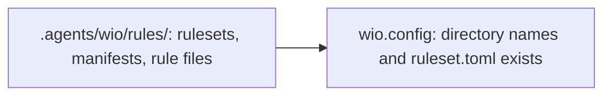
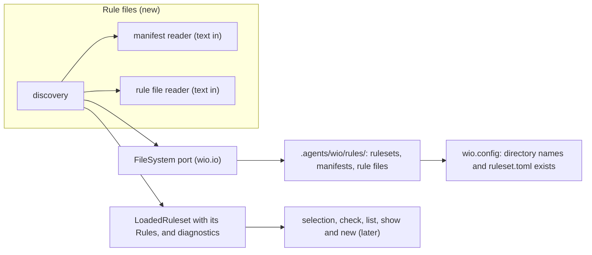

<!-- wio
id = "gtqngp"
template = "feature.parent"
roots = ["@descendants"]
depends_on = []
-->

# Rule files

## Purpose

Rules and rulesets exist only as files that no code reads, so nothing else in
`wio rules` can select, check or list a rule.

## Goals

- A rule file is read into a `Rule` with its code, name, optional description,
  summary and body, in either metadata block form.
- A ruleset's manifest is read for its description, its families and its rule
  presets.
- The rulesets of a repository are discovered under `.agents/wio/rules/` as
  `LoadedRuleset`s, each with its manifest and its rules, found at any depth of
  the ruleset's directory, in a fixed order and by family and by code.
- A malformed rule file, a malformed manifest or a stray file is reported with
  its place, and everything else is still read.

## Non-Goals

- Judging references, rule presets or selection, which `wio rules check` and the
  selection do with what this Work reads.
- Writing a rule file or a manifest, which `wio rules new` does.
- Nested rulesets, because a ruleset is named by its directory directly under
  `.agents/wio/rules/` and a reference cannot name a nested one.
- The settings that the config gives a ruleset, its alias and its root
  independence, which stay in the config and which the selection joins to a
  `LoadedRuleset`.

## Assumptions

### A-1

A file is a rule file only when it is found by the shared `walk_markdown`, which
reads files ending in `.md` with that case and skips directories whose names
start with `.` and every symbolic link, so a rule file behind a link is never
read, while a ruleset directory that is a link is reported.

## Mechanisms

The names of the types and the modules below are provisional.

- **`Rule`** — built by `ht39xt` from one marked file, in `wio.models.rule`.
- **The rule file reader** — `read_rule`, built by `ht39xt`: it reads the text
  of one file into a `Rule` or reports its faults, and does no input or output.
- **`Manifest` and `LoadedRuleset`** — in `wio.models.rule`, built by `8zn10d`;
  a `LoadedRuleset` is a ruleset's name, its manifest and its rules, found by
  family and by code, and is not the config's `Ruleset`.
- **The manifest reader** — `read_manifest`, built by `8zn10d`: it reads the
  text of one `ruleset.toml`.
- **The discovery** — `discover(root, files) -> Discovery`, built by `8zn10d`,
  which reads the files through the `FileSystem` port of `wio.io` and joins what
  the two readers return; `Discovery` holds the rulesets and the diagnostics
  together, as that of `wio.templates` does.

## Constraints

### C-1

Reading never raises for a problem of a file, a manifest or a directory,
including a file that cannot be read or is not valid UTF-8, and a rules
directory or a manifest that is a symbolic link or not what it should be: each
is an error diagnostic that names its place, and the other rulesets and rules
are still read. AC-2 and AC-5 to AC-7 of `8zn10d` verify it.

### C-2

A rule with an error, and a ruleset whose own `ruleset.toml` is missing or has
an error, are left out of what is returned, so no consumer receives a half-read
one; a stray file is reported and leaves nothing out. AC-2 here and AC-4 and
AC-6 of `8zn10d` verify it.

### C-3

The diagnostics that the discovery returns are in the order of C-2 of
[wio rules](../README.md), whatever the order in which the files are listed.
AC-8 of `8zn10d` verifies it.

## Visuals

The diagrams are drawn from commit `52b58f2` of the branch
`docs/define-rules-tree`, and show only what the Work changes.

### Before

`wio.config` looks at the directories of `.agents/wio/rules/` and whether each
has a `ruleset.toml`, and nothing reads a rule file or a manifest.

### After

The discovery reads every ruleset through the `FileSystem` port, hands the text
of each file to the manifest reader and the rule file reader, and returns the
rulesets with their rules and the diagnostics together. Parts that are new are
marked.

## Acceptance criteria

### **AC-1** A repository's rulesets are discovered with their rules

The discovery returns each ruleset under `.agents/wio/rules/` with its manifest
and its rules, read from rule files of either form at any depth of the ruleset's
directory, in the order of C-2 of [wio rules](../README.md) and found by family
and by code.

#### Rulesets, manifests and rules

- **Given** a ruleset `demo` whose manifest declares the families `ARC` and
  `PAY` and a rule preset, holding `ARC001-keep-it-small.md` in the comment form
  with a description and the body `Keep it small.`, `PAY001-pay-first.md` in the
  `+++` form with no body, and `ARC002-name-things.md` in a subdirectory `arc/`,
  an unmarked `README.md` and a file that is not Markdown, and a ruleset `other`
  whose manifest declares `ARC` and that holds `ARC001-other-rule.md`.
- **When** the discovery runs.
- **Then** it returns `demo` and `other` in that order, the manifest of `demo`
  with its description, its families and its rule preset, the rules of `demo` as
  `ARC001`, `ARC002`, `PAY001`, found by family as `ARC` holding `ARC001` and
  `ARC002` and `PAY` holding `PAY001`, and by code, the description of `ARC001`
  and none for the others, the summary `Keep it small.` for `ARC001` and an
  empty summary for `PAY001`, each body as written, and no diagnostic; the
  README and the other file are not rules.

### **AC-2** Faults of a rule, a manifest and a stray file are reported together

A faulty rule, a faulty manifest and a stray file in one repository are each one
error that names its place, the faulty rule and ruleset are left out, and the
valid rest is still returned.

#### One repository, three faults

- **Given** a ruleset `demo` whose manifest declares `ARC`, holding a valid
  `ARC001` and a rule whose block does not close, a ruleset `broken` whose
  `ruleset.toml` does not parse, a stray rule file directly in
  `.agents/wio/rules/`, and a valid ruleset `other`.
- **When** the discovery runs.
- **Then** it reports three errors, each in the form of C-6 of
  [wio rules](../README.md) and naming the file of the rule that does not close
  with its line, the manifest of `broken` with its line, and the stray file;
  `demo` holds `ARC001` only, `other` is returned whole, and `broken` is not
  returned.

## Additional context

- The reading of one file, such as the form of a code and of a name and a block
  that does not close, the reading of one manifest, such as the wrong type of a
  key, and every fault of a directory, a file or the relation between the rules
  of one ruleset, are the criteria of the leaves that own them, so this contract
  states only what the two together establish.
- A directory under `.agents/wio/rules/` without a `ruleset.toml` is an error of
  `wio config check` already, and the discovery reports it again for
  `wio rules check` to show, which is intended.
