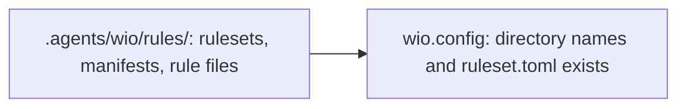
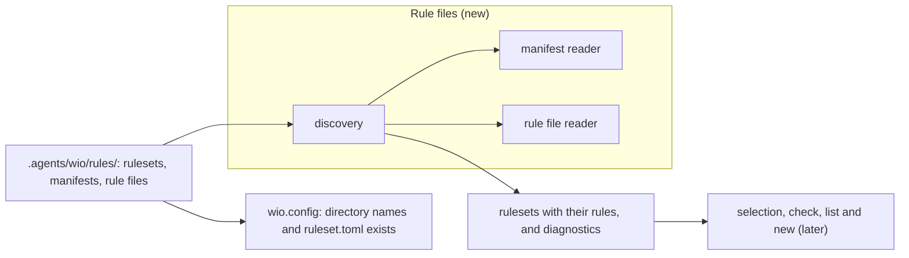

<!-- wio
id = "gtqngp"
template = "feature.parent"
roots = ["@descendants"]
depends_on = []
-->

# Rule files

## Purpose

Rules and rulesets exist only as files that no code reads, so nothing else in
`wio rules` can select, check or list a rule.

## Goals

- A rule file is read into a `Rule` with its code, name, optional description,
  summary and body, in either metadata block form.
- A ruleset's manifest is read for its description, its families and its rule
  presets.
- The rulesets of a repository are discovered under `.agents/wio/rules/`, each
  with its rules in a fixed order, found at any depth of the ruleset's
  directory.
- A malformed rule file, a malformed manifest or a stray file is reported with
  its place, and everything else is still read.

## Non-Goals

- Judging references, rule presets or selection, which `wio rules check` and the
  selection do with what this Work reads.
- Writing a rule file or a manifest, which `wio rules new` does.
- Nested rulesets, because a ruleset is named by its directory directly under
  `.agents/wio/rules/` and a reference cannot name a nested one.

## Assumptions

### A-1

The summary of a rule is the first paragraph of its body, as
[the concepts](../../../../../docs/concepts.md#what-a-rule-is) say, and a body
with no paragraph has an empty summary and is not an error.

## Mechanisms

The names of the types and the modules below are provisional.

- **`Rule`** — in `wio.models.rules`, built by `ht39xt` from one marked file:
  its ruleset, code, name, optional description, summary and body, which it
  keeps as written.
- **The rule file reader** — reads one file into a `Rule` or reports its faults,
  through the shared reader of the metadata block in `wio.formats`, built by
  `ht39xt`.
- **`Ruleset`** — in `wio.models.rules`, built by `8zn10d`: its name, its
  manifest and its rules.
- **The manifest reader** — reads `ruleset.toml` for the `description`,
  `[families]` and `[rule_presets.<name>]`, built by `8zn10d`.
- **The discovery** — walks `.agents/wio/rules/` with the shared
  `walk_markdown` and the `FileSystem` port of `wio.io`, reads each ruleset with
  the two readers above, and returns the rulesets and the diagnostics together,
  as `wio.templates` does for templates; built by `8zn10d`, which uses the rule
  file reader of `ht39xt`.

## Constraints

### C-1

Reading never raises for a problem of a file, a manifest or a directory: each
is an error diagnostic that names its place, and the other rulesets and rules
are still read. AC-2 verifies it.

### C-2

A rule or a ruleset with an error is left out of what is returned, so no
consumer receives a half-read one. AC-2 verifies it.

## Visuals

The diagrams are drawn from commit `f4b2691` of the branch
`docs/define-rules-tree`, and show only what the Work changes.

### Before

`wio.config` looks at the directories of `.agents/wio/rules/` and whether each
has a `ruleset.toml`, and nothing reads a rule file or a manifest.

### After

The discovery reads every ruleset: the manifest reader and the rule file reader
feed it, and it returns the rulesets with their rules and the diagnostics
together. Parts that are new are marked.

## Acceptance criteria

### **AC-1** The rulesets of a repository are discovered with their rules in order

The discovery returns each ruleset under `.agents/wio/rules/` with its manifest
and its rules, the rules in the order of ruleset, family and code, whatever the
depth they sit at in the ruleset's directory.

#### Rulesets, manifests and rules

- **Given** a ruleset `demo` whose manifest declares the families `ARC` and
  `PAY` and a rule preset, holding `ARC001` with a description, `PAY001` and
  `ARC002` in a subdirectory `arc/`, an unmarked `README.md` and a file that is
  not Markdown, and a ruleset `other` holding `ARC001`.
- **When** the discovery runs.
- **Then** it returns `demo` and `other` in that order, the manifest of `demo`
  with its description, its families and its rule preset, the rules of `demo` as
  `ARC001`, `ARC002`, `PAY001`, each with its code, name, summary and body as
  written, the description of `ARC001` and none for the others, and no
  diagnostic; the README and the other file are not rules.

#### No rulesets

- **Given** a repository with no `.agents/wio/rules/` directory.
- **When** the discovery runs.
- **Then** it returns no ruleset and no diagnostic.

### **AC-2** A fault is reported and everything else is still read

Each fault of a rule file, a manifest or a directory is one error that names its
place, the rule or the ruleset it concerns is left out, and the rest is still
returned.

#### Faults of rules

- **Given** a ruleset `demo` whose manifest declares `ARC`, holding a rule whose
  block does not close, a rule of the family `ZZZ`, a second rule with the code
  `ARC001`, a rule with no `name`, and a valid `ARC002`; and a valid ruleset
  `other`.
- **When** the discovery runs.
- **Then** it reports an error for the block that does not close, the family
  `ZZZ` that `demo` does not declare, the code that two rules share, which names
  both files, and the missing `name`, each with its place; `demo` has only the
  valid `ARC002`, because neither rule that shares a code is returned, and
  `other` is returned whole.

#### Faults of rulesets

- **Given** a directory under `.agents/wio/rules/` without a `ruleset.toml`, a
  ruleset with a `ruleset.toml` that does not parse, a `ruleset.toml` below the
  directory of a ruleset, a marked rule file directly in `.agents/wio/rules/`,
  and a valid ruleset.
- **When** the discovery runs.
- **Then** it reports one error for each, naming the directory or the file, and
  returns the valid ruleset whole.

### **AC-3** A rule file of either form is read alike

A rule file whose metadata is `+++` front matter with `wio = 1` is read into the
same `Rule` as one with a `<!-- wio -->` block, and front matter without the
marker is not a rule.

#### Both forms in one ruleset

- **Given** a ruleset with one rule in each form and a Markdown file whose
  `+++` front matter has no `wio = 1`.
- **When** the discovery runs.
- **Then** it returns both rules alike, the file with unmarked front matter is
  not a rule, and there is no diagnostic.

## Additional context

- The reading of one file, such as the form of a code and of a name, and the
  reading of one manifest, such as the wrong type of a key, are the criteria of
  the children that own them, so this contract states only what the two together
  establish.
- `.agents/wio/rules/` has no ruleset in a repository that uses none, and
  `wio config check` already reports a directory there without a `ruleset.toml`
  as an error, so the discovery reports it too for `wio rules check` to show.
