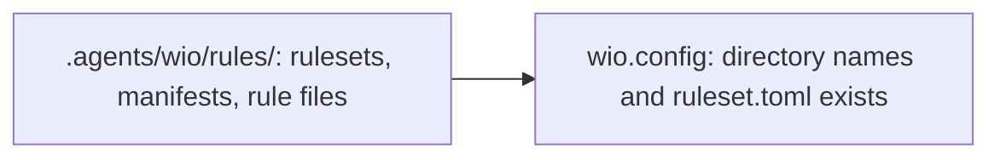
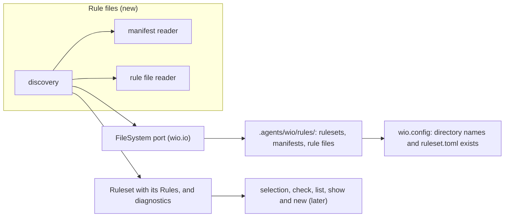

<!-- wio
id = "gtqngp"
template = "feature.parent"
roots = ["@descendants"]
depends_on = []
-->

# Rule files

## Purpose

Rules and rulesets exist only as files that no code reads, so nothing else in
`wio rules` can select, check or list a rule.

## Goals

- A rule file is read into a `Rule` with its code, name, optional description,
  summary and body, in either metadata block form.
- A ruleset's manifest is read for its description, its families and its rule
  presets.
- The rulesets of a repository are discovered under `.agents/wio/rules/` as
  `Ruleset`s, each with its manifest and its rules, found at any depth of the
  ruleset's directory, in a fixed order and by family and by code.
- A malformed rule file, a malformed manifest or a stray file is reported with
  its place, and everything else is still read.

## Non-Goals

- Judging references, rule presets or selection, which `wio rules check` and the
  selection do with what this Work reads.
- Writing a rule file or a manifest, which `wio rules new` does.
- Nested rulesets, because a ruleset is named by its directory directly under
  `.agents/wio/rules/` and a reference cannot name a nested one.
- The settings that the config gives a ruleset, its alias and its root
  independence, which stay in the config and which the selection joins to a
  `Ruleset`.

## Assumptions

### A-1

The summary of a rule is the first paragraph of its body, as
[the concepts](../../../../../docs/concepts.md#what-a-rule-is) say, and a body
with no paragraph has an empty summary and is not an error.

### A-2

A file is a rule file only when it is found by the shared `walk_markdown`, which
reads files ending in `.md` with that case and skips directories whose names
start with `.` and every symbolic link, so a rule in such a place is never read.

### A-3

Rules are ordered as [wio rules](../README.md) says in its A-8, by ruleset name,
then family, then the number of the code.

## Mechanisms

The names of the types and the modules below are provisional.

- **`Rule`** — in `wio.models.rules`, built by `ht39xt` from one marked file:
  its ruleset, code, name, optional description, summary and body, which it
  keeps as written.
- **The rule file reader** — reads one file into a `Rule` or reports its faults,
  through the shared reader of the metadata block in `wio.formats`, built by
  `ht39xt`.
- **`Ruleset`** — in `wio.models.rules`, built by `8zn10d`: its name, its
  manifest and its rules, immutable, with the rules ordered by family and code
  and found by family and by code.
- **The manifest reader** — reads `ruleset.toml` for the `description`,
  `[families]` and `[rule_presets.<name>]`, built by `8zn10d`.
- **The discovery** — `discover(root, files) -> Discovery` of the rule files,
  where `Discovery` holds the rulesets and the diagnostics together, as that of
  `wio.templates` does; it lists `.agents/wio/rules/` with the `FileSystem` port
  of `wio.io`, which it needs to see a directory that holds no Markdown file,
  walks each ruleset's directory with `walk_markdown`, and reads each with the
  two readers above; built by `8zn10d`, which uses the rule file reader of
  `ht39xt`.
- **A place** — how a diagnostic names where it is: the path of the file
  relative to the repository root, written with `/` and followed by `:<line>`
  when the fault has a line, or the path of the directory, as `wio.templates`
  writes it.

## Constraints

### C-1

Reading never raises for a problem of a file, a manifest or a directory,
including a file that cannot be read or is not valid UTF-8, and a rules
directory or a manifest that is a symbolic link or not what it should be: each
is an error diagnostic that names its place, and the other rulesets and rules
are still read. AC-2 verifies it.

### C-2

A rule with an error, and a ruleset whose own `ruleset.toml` is missing or has
an error, are left out of what is returned, so no consumer receives a half-read
one; a stray file is reported and leaves nothing out. AC-2 verifies it.

## Visuals

The diagrams are drawn from commit `52b58f2` of the branch
`docs/define-rules-tree`, and show only what the Work changes.

### Before

`wio.config` looks at the directories of `.agents/wio/rules/` and whether each
has a `ruleset.toml`, and nothing reads a rule file or a manifest.

### After

The discovery reads every ruleset: the manifest reader and the rule file reader
feed it through the `FileSystem` port, and it returns the rulesets with their
rules and the diagnostics together. Parts that are new are marked.

## Acceptance criteria

### **AC-1** The rulesets of a repository are discovered with their rules in order

The discovery returns each ruleset under `.agents/wio/rules/` with its manifest
and its rules, the rules in the order of A-3 and found by family and by code,
whatever the depth they sit at in the ruleset's directory.

#### Rulesets, manifests and rules

- **Given** a ruleset `demo` whose manifest declares the families `ARC` and
  `PAY` and a rule preset, holding `ARC001` with a description and the body
  `Keep it small.`, `PAY001` with no body and `ARC002` in a subdirectory `arc/`,
  an unmarked `README.md` and a file that is not Markdown, and a ruleset `other`
  holding `ARC001`.
- **When** the discovery runs.
- **Then** it returns `demo` and `other` in that order, the manifest of `demo`
  with its description, its families and its rule preset, the rules of `demo` as
  `ARC001`, `ARC002`, `PAY001`, found by family as `ARC` holding `ARC001` and
  `ARC002` and `PAY` holding `PAY001`, and by code, the description of `ARC001`
  and none for the others, the summary `Keep it small.` for `ARC001` and an
  empty summary for `PAY001`, each body as written, and no diagnostic; the
  README and the other file are not rules.

#### No rulesets

- **Given** a repository with no `.agents/wio/rules/` directory.
- **When** the discovery runs.
- **Then** it returns no ruleset and no diagnostic.

### **AC-2** A fault is reported and everything else is still read

Each fault of a rule file, a manifest or a directory is one error that names its
place, the rule or the ruleset it concerns is left out as C-2 says, and the rest
is still returned.

#### Faults of rules

- **Given** a ruleset `demo` whose manifest declares `ARC`, holding a rule whose
  block does not close, a rule of the family `ZZZ`, two rules with the code
  `ARC001`, a rule with no `name`, a rule file that is not valid UTF-8, and a
  valid `ARC002`; and a valid ruleset `other`.
- **When** the discovery runs.
- **Then** it reports an error for the block that does not close, the family
  `ZZZ` that `demo` does not declare, the code that two rules share, which names
  both files, the missing `name` and the file that is not valid UTF-8, each with
  its place; `demo` has only the valid `ARC002`, because no rule with an error
  is returned, and `other` is returned whole.

#### Faults of rulesets

- **Given** a directory `bare` without a `ruleset.toml`, a ruleset `broken`
  whose `ruleset.toml` does not parse, a valid ruleset `outer` that has a
  subdirectory with its own `ruleset.toml`, a stray rule file, which is a marked
  rule file directly in `.agents/wio/rules/`, and a valid ruleset `good`.
- **When** the discovery runs.
- **Then** it reports one error for each, naming the directory or the file, and
  returns `outer` and `good` whole, and neither `bare` nor `broken`.

#### Faults of the file system

- **Given** one repository where `.agents/wio/rules` is a symbolic link, and
  another where it is a file, and a third where a ruleset's `ruleset.toml` is a
  symbolic link next to a valid ruleset.
- **When** the discovery runs on each.
- **Then** it reports one error naming the path for each, raises nothing, and in
  the third returns the valid ruleset.

### **AC-3** The discovery reads either form of a rule file alike

A rule file whose metadata is `+++` front matter with `wio = 1` is discovered
into the same `Rule` as one with a `<!-- wio -->` block, and front matter
without the marker is not a rule, which is the discovery's half of
[wio rules](../README.md) AC-7.

#### Both forms in one ruleset

- **Given** a ruleset with one rule in each form and a Markdown file whose
  `+++` front matter has no `wio = 1`.
- **When** the discovery runs.
- **Then** it returns both rules alike, the file with unmarked front matter is
  not a rule, and there is no diagnostic.

## Additional context

- The reading of one file, such as the form of a code and of a name and a block
  that does not close, and the reading of one manifest, such as the wrong type
  of a key, are the criteria of the children that own them, so this contract
  states only what the two together establish.
- A directory under `.agents/wio/rules/` without a `ruleset.toml` is an error of
  `wio config check` already, and the discovery reports it again for
  `wio rules check` to show, which is intended.
