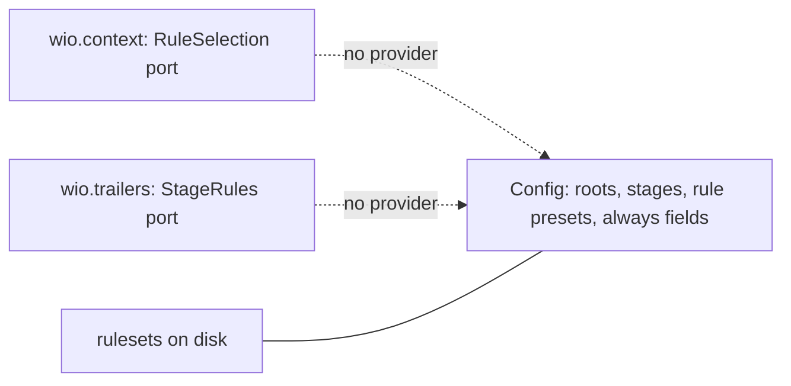
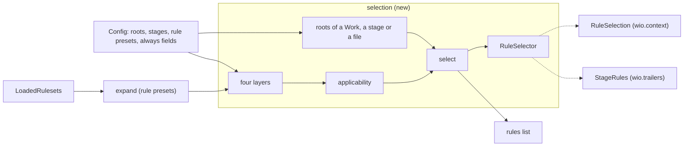

<!-- wio
id = "00c3zr"
template = "feature.parent"
roots = ["@descendants"]
depends_on = []
-->

# Selection

## Purpose

Which rules apply to a stage is decided nowhere, so `wio rules list`,
`wio context` and `wio trailers` cannot agree on what a session was given.

## Goals

- One selection decides the rules for any view of a listing and for a Work at a
  stage: the layers in their order, the roots that apply, and a decision for
  every rule considered.
- The roots that apply to a Work at a stage, to a file or to a named root are
  found from the roots the stage selects.
- Whether any entry of the config includes a rule is known, so the rules that
  nothing selects can be listed and a new rule can say whether it is selected.
- `wio context` and `wio trailers` receive the selection of a Work at a stage
  through the ports they declare, from one class, and `wio trailers` receives
  with it the hash of each selected rule's file.

## Non-Goals

- Expanding a rule preset, which `cyeth5` does and this selection uses.
- Printing a selection or explaining it, which `wio rules list` does.
- Choosing the bundle's order and grouping of rules, which `wio context` does.

## Assumptions

### A-1

A view of a listing differs from another only in which layers it applies and
which roots it gives, so one function serves them all: `--root`, `--path` and
`--work` give the roots, `--stage` gives the stage, and a view without roots
applies none.

### A-2

A listing of references with no selector is the expansion of those references
alone and is outside the four layers, as the concepts say of the `--preset`
view, so it does not use the selection.

### A-3

A root reaches a ruleset when the include entries of its rule presets name it,
as the concepts say, and a rule preset's exclude entry reaches nothing.

## Mechanisms

The names of the types and the functions below are provisional.

- **`select(roots, stage, config, rulesets) -> Selection`** — in `wio.rules`,
  where `roots` is a `tuple[str, ...]` of root names or `None` when the roots
  are not applied, `stage` is a stage name or `None`, and `config` and
  `rulesets` are what the layers read; built by `5yb4tz`, which joins the layers
  and the applicability.
- **The four layers** — the rule presets of the roots, the stage's include and
  exclude, `rules_always_include` and `rules_always_exclude`, applied in that
  order to the expansions of `cyeth5`, built by `cm25z9`.
- **Applicability** — the decision for each rule from its layers, the roots and
  the rulesets that the roots reach, built by `5yb4tz`.
- **Rules selected anywhere** — `selected_anywhere`, the rules that some include
  entry of the config delivers with the entries that do, built by `1gs341` over
  `expand` of `cyeth5`.
- **The roots** — the roots a stage selects for a Work with `@work` and the
  roots that contain a file, built by `ndwemw`, over the roots port that
  `wio.contracts` satisfies.
- **The selector** — `RuleSelector`, one class that satisfies the
  `RuleSelection` port of `wio.context` and the `StageRules` port of
  `wio.trailers`, runs `select` for a Work at a stage with the roots of
  `ndwemw`, and hashes the file of each rule it includes with `rule_hash` of
  `wio.formats`; built by `9pfyfe`.

## Constraints

### C-1

`select` does no input or output and every ordering in a `Selection` is that of
A-8 of [wio rules](../README.md); only the selector of `9pfyfe` reads a rule
file for a hash, through the `FileSystem` port. AC-4 verifies `select`, and AC-5
and `9pfyfe` the selector.

### C-2

A `Selection` holds every rule of every ruleset, each with one decision, so a
listing, an explanation and the hashes are views of it and not a second
computation. AC-1 and AC-2 verify it.

## Visuals

The diagrams are drawn from commit `dd02c05` of the branch
`docs/define-rules-tree`, and show only what the Work changes.

### Before

`wio.context` and `wio.trailers` each declare a port for the rules of a stage
and nothing satisfies either, and no code applies the layers or the roots.

### After

`select` expands the references of each layer, applies the layers in order and
the roots that apply, and returns one `Selection`. The listing and the
`RuleSelection` port read it, and the selector reads it for both ports and adds
the hashes for `wio trailers`. New parts are marked.

## Acceptance criteria

### **AC-1** A Work at a stage gets one decision for every rule

The selection for a Work at a stage applies the layers in order and the roots
the stage selects, and gives every rule of every ruleset one decision: included
with its roots and the layers that selected it, or out with the reason.

#### Included and out

- **Given** a ruleset `demo` that declares `ARC` and `PAY` and holds `ARC001`,
  `ARC002`, `PAY001` and `PAY002`, a root `api` whose rule preset
  `demo.recommended` includes `ARC`, a stage with no `roots` whose
  `rules_exclude` has `demo.ARC002`
  and whose `rules_include` has `demo.PAY001`, `rules_always_exclude` of
  `demo.PAY001`, a ruleset `web` not reached by `api` whose rule `WEB001` the
  stage includes, and a Work whose `roots` list `api`.
- **When** the selection for that Work and stage is asked for.
- **Then** `demo.ARC001` is included with the root `api` and the layer of the
  root, `demo.ARC002` is out because the stage excluded it, `demo.PAY001` is out
  because `rules_always_exclude` vetoed it, `demo.PAY002` is out because nothing
  selected it, `web.WEB001` is out because the roots cut it, and every rule has
  exactly one decision.

### **AC-2** A view without roots lists the roots that reach each rule

When the roots are not applied, the selection lists each included rule that is
not root-independent with the roots that reach its ruleset, and cuts none by
roots.

#### A stage alone

- **Given** the repository of AC-1 and a root-independent ruleset `process` with
  `FIX001` that `rules_always_include` names.
- **When** the selection is asked for that stage with no roots applied.
- **Then** `demo.ARC001` is included with the root `api` as the root that
  reaches it, `web.WEB001` is included with no root because none reaches `web`,
  `process.FIX001` is included for every root, and no rule is out because of the
  roots.

### **AC-3** The stage decides which roots count

A stage with its own `roots` selects exactly those, with `@work` for the Work's
roots, and the roots it selects decide the rules.

#### Roots of the stage

- **Given** the repository of AC-1 and the ruleset `process` of AC-2, a root
  `contract` with `rule_presets = ["web.core"]`, where the rule preset `core` of
  `web` includes `WEB001`, a stage with `roots = ["contract"]`, a stage with
  `roots = ["contract", "@work"]`, a stage with `roots = []`, and the Work of
  AC-1 and a Work with no roots.
- **When** the selection is asked for each stage and Work.
- **Then** the first includes `web.WEB001` and not `demo.ARC001` for either
  Work, the second includes both for the Work in `api` and fails for the Work
  with no roots, and the third includes only `process.FIX001` for both.

### **AC-4** The same inputs give the same selection

The same config, rulesets and arguments give the same selection, whatever the
order of the tables of the config and of the entries of its lists.

#### Two orders

- **Given** the repository of AC-1 declared in two orders, the roots, the stages
  and the rule presets of the config and the entries of each list.
- **When** the selection is asked for on each.
- **Then** the two selections are equal, with their rules in the order of A-8.

### **AC-5** `wio context` and `wio trailers` get the selection

The selector gives `wio context` the selection of a Work at a stage, and gives
`wio trailers` the qualified code and the hash of the file of every rule that
the selection includes for it, and no other.

#### The selection and the hashes

- **Given** the repository of AC-1 committed, with its Work and stage.
- **When** the selector's `select` is asked for the Work's contract and the
  stage, and its `selected` for that Work, action and stage, then the file of
  `ARC001` is edited and `selected` is asked again.
- **Then** `select` gives the selection of AC-1, the first `selected` gives
  `demo.ARC001` with a hash and no other rule, and the second gives a different
  hash for `demo.ARC001`.

### **AC-6** A rule that is not selected anywhere is never included

A rule that `selected_anywhere` does not select is out in every view of
`select`, and a rule that `select` includes is selected by `selected_anywhere`.

#### The two answers agree

- **Given** the repository of AC-1, where no entry includes `demo.PAY002`.
- **When** `selected_anywhere` runs, and `select` runs for each Work, stage and
  root of the config, and for no roots and no stage.
- **Then** every rule that `select` includes is a key of its `selected`,
  `demo.ARC002` and `demo.PAY001` are keys although the stage excludes the first
  and the veto removes the second, and `demo.PAY002` is not a key and is out in
  every view.

## Additional context

- The roots boundaries, the order in which the layers apply and what each
  exclude reaches are the criteria of the leaves; this contract states only what
  the four establish together.
- The hash algorithm is not stated by `wio.trailers` or the event models, which
  only carry the hash, so `9pfyfe` decides and verifies it; `wio context` will
  need the same function for the `context` event, which is why it lives in
  `wio.formats`.
