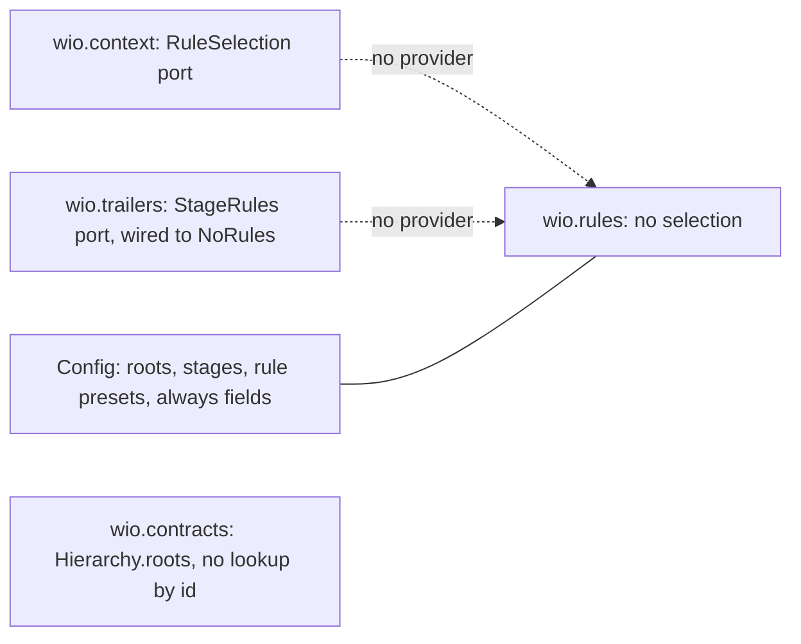
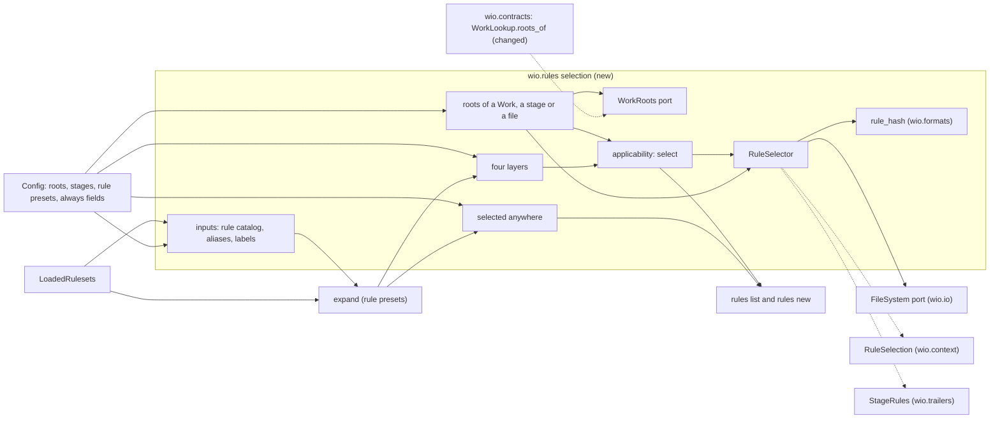

<!-- wio
id = "00c3zr"
template = "feature.parent"
roots = ["@descendants"]
depends_on = []
-->

# Selection

## Purpose

Which rules apply to a stage is decided nowhere, so `wio rules list`,
`wio context` and `wio trailers` cannot agree on what a session was given.

## Goals

- One selection decides the rules for any view of a listing and for a Work at a
  stage: the layers in their order, the roots that apply, and a decision for
  every rule considered.
- The roots of a Work at a stage, and of a file, are found, so that the roots
  that apply to a view are known.
- Whether any entry of the config includes a rule is known, so the rules that
  nothing selects can be listed and a new rule can say whether it is selected.
- `wio context` and `wio trailers` receive the selection of a Work at a stage
  through the ports they declare, from one class, and `wio trailers` receives
  with it the hash of each selected rule's file.

## Non-Goals

- Expanding a rule preset, which `cyeth5` does and this selection uses.
- Printing a selection or explaining it, which `wio rules list` does.
- Choosing the bundle's order and grouping of rules, which `wio context` does.

## Assumptions

### A-1

A view of a listing differs from another only in which layers it applies and
which roots it gives, so one function serves them all: `--root`, `--path` and
`--work` give the roots, `--stage` gives the stage, and a view without roots
applies none.

## Mechanisms

The names of the types and the functions below are provisional.

- **`select`** — the function of `wio.rules` that decides every rule for the
  roots and the stage it is given, built by `5yb4tz`, which joins the layers and
  the applicability.
- **The four layers** — the rule presets of the roots, the stage's include and
  exclude, `rules_always_include` and `rules_always_exclude`, applied in that
  order to the expansions of `cyeth5`, built by `cm25z9`.
- **The inputs** — the rulesets by name, the `RuleCatalog` of the expansion, the
  resolution of an alias and the labels of a chain, built once by `w3k7vd` for
  every function below and for the commands.
- **Applicability** — the decision for each rule from its layers, the roots and
  the rulesets that the roots reach, built by `5yb4tz`.
- **Rules selected anywhere** — `selected_anywhere`, the rules that some include
  entry of the config delivers with the entries that do, built by `1gs341` over
  `expand` of `cyeth5`.
- **The roots** — the roots a stage selects for a Work with `@work` and the
  roots that contain a file, built by `ndwemw`, over the roots port that
  `wio.contracts` satisfies.
- **The selector** — `RuleSelector`, one class that satisfies the
  `RuleSelection` port of `wio.context` and the `StageRules` port of
  `wio.trailers`, runs `select` for a Work at a stage with the roots of
  `ndwemw`, and hashes the file of each rule it includes with `rule_hash` of
  `wio.formats`; built by `9pfyfe`.

## Constraints

### C-1

The function `select` does no input or output and every ordering in a
`Selection` is that of C-2 of [wio rules](../README.md); only the selector of
`9pfyfe` reads a rule file for a hash, through the `FileSystem` port. AC-8 of
`5yb4tz` verifies `select`, and AC-2 of `9pfyfe` the selector.

### C-2

A `Selection` holds every rule of every ruleset, each with one decision, so a
listing, an explanation and the hashes are views of it and not a second
computation. AC-1 and AC-6 of `5yb4tz` verify it.

## Visuals

The diagrams are drawn from commit `3219010` of the branch
`docs/define-rules-tree`, and show only what the Work changes.

### Before

`wio.context` and `wio.trailers` each declare a port for the rules of a stage
and nothing satisfies either, no code applies the layers or the roots, and
`wio.contracts` resolves a Work's roots but offers no lookup by id.

### After

`select` expands the references of each layer, applies the layers in order and
the roots that apply, and returns one `Selection`. The listing reads it, the
selector reads it for both ports and adds the hashes for `wio trailers`, and
`selected_anywhere` answers whether any entry includes a rule for the listing
and for `wio rules new`. The roots of a Work come through a port that
`wio.contracts` satisfies. New parts are marked.

## Acceptance criteria

### **AC-1** A Work at a stage gets one decision for every rule

The selection for a Work at a stage applies the layers in order and the roots
the stage selects, and gives every rule of every ruleset one decision: included
with its roots and the layers that selected it, or out with the reason.

#### Included and out

- **Given** a ruleset `demo` that declares `ARC` and `PAY` and holds `ARC001`,
  `ARC002`, `PAY001` and `PAY002`, a root `api` whose rule preset
  `demo.recommended` includes `ARC`, a stage with no `roots` whose
  `rules_exclude` has `demo.ARC002`
  and whose `rules_include` has `demo.PAY001`, `rules_always_exclude` of
  `demo.PAY001`, a ruleset `web` not reached by `api` whose rule `WEB001` the
  stage includes, and a Work whose `roots` list `api`.
- **When** the selection for that Work and stage is asked for.
- **Then** `demo.ARC001` is included with the root `api` and the layer of the
  root, `demo.ARC002` is out because the stage excluded it, `demo.PAY001` is out
  because `rules_always_exclude` vetoed it, `demo.PAY002` is out because nothing
  selected it, `web.WEB001` is out because the roots cut it, and every rule has
  exactly one decision.

### **AC-2** The stage decides which roots count

A stage with its own `roots` selects exactly those, with `@work` for the Work's
roots, and the roots it selects decide the rules.

#### Roots of the stage

- **Given** the repository of AC-1, a root-independent ruleset `process` with
  `FIX001` that `rules_always_include` names, a root `contract` with
  `rule_presets = ["web.core"]`, where the rule preset `core` of `web` includes
  `WEB001`, stages with `roots = ["contract"]`, with
  `roots = ["contract", "@work"]` and with `roots = []`, and the Work of AC-1
  and a Work with no roots.
- **When** the selection is asked for each stage and Work.
- **Then** the first includes `web.WEB001` and not `demo.ARC001` for either
  Work, the second includes both for the Work in `api` and no rule for the Work
  with no roots, whose rules are all out as `not-selected`, and the third
  includes only `process.FIX001` for both.

### **AC-3** `wio context` and `wio trailers` get the selection

The selector gives `wio context` the selection of a Work at a stage, and gives
`wio trailers` the qualified code and the hash of the file of every rule that
the selection includes for it, and no other.

#### The selection and the hashes

- **Given** the repository of AC-1 committed, with its Work and stage.
- **When** the selector's `select` is asked for the Work's contract and the
  stage, and its `selected` for that Work, action and stage, then the file of
  `ARC001` is edited and `selected` is asked again.
- **Then** `select` gives the selection of AC-1, the first `selected` gives
  `demo.ARC001` with a hash and no other rule, and the second gives a different
  hash for `demo.ARC001`.

### **AC-4** A rule that is not selected anywhere is never included

A rule that `selected_anywhere` does not select is out in every view of
`select`, and a rule that `select` includes is selected by `selected_anywhere`.

#### The two answers agree

- **Given** the repository of AC-1, where no entry includes `demo.PAY002`.
- **When** `selected_anywhere` runs, and the function `select` of `5yb4tz` runs
  for each Work, stage and root of the config, and for no roots and no stage.
- **Then** every rule that `select` includes is a key of
  `SelectedAnywhere.selected`,
  `demo.ARC002` and `demo.PAY001` are keys although the stage excludes the first
  and the veto removes the second, and `demo.PAY002` is not a key and is out in
  every view.

## Additional context

- The roots boundaries, the order in which the layers apply and what each
  exclude reaches are the criteria of the leaves; this contract states only what
  the four establish together.
- The hash algorithm is not stated by `wio.trailers` or the event models, which
  only carry the hash, so `9pfyfe` decides and verifies it; `wio context` will
  need the same function for the `context` event, which is why it lives in
  `wio.formats`.
