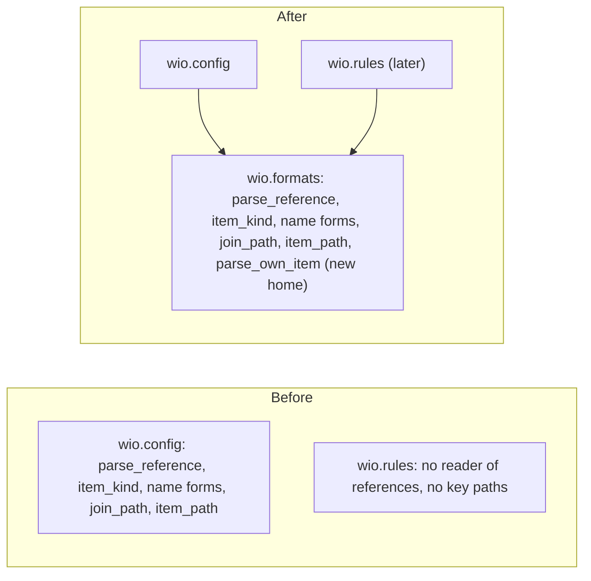

<!-- wio
id = "zq07av"
template = "feature.leaf"
roots = ["wio"]
depends_on = []
-->

# Shared grammar and key paths

## Purpose

What a reference is, the form of a ruleset name, a family, a code and a rule
preset name, and how a key path is written are private to `wio.config`, so
`wio.rules`, which may not import it, cannot read a reference or name the place
of a fault in a manifest, and a second copy would be flagged as duplicate code
and could disagree with `wio config check`.

## Goals

- The grammar of a reference and the forms of the names it is made of are in
  `wio.formats`, which `wio.config` and `wio.rules` both import, so the two
  never disagree about what a reference is.
- A bare entry of a manifest is read by one function that accepts a bare
  upper-case name, which the grammar of the config keeps malformed.
- The key path of a fault is written by two functions that `wio.config` and
  `wio.rules` share, so a place reads the same in both.
- `wio config check` reports what it reported before the move.

## Non-Goals

- Expanding a reference, which `expand` of `cyeth5` does with this grammar.
- Judging a reference against the rule files, which `wio rules check` does.
- Moving the finding of cycles, which `5qgs79` does for its own use.

## Assumptions

### A-1

The behaviour of `parse_reference` in the config is what `wio config check`
relies on, so the move changes none of it.

### A-2

A manifest names only its own items, so a bare name in it is a family, a code or
a rule preset of its own ruleset, and a qualified name is a fault that the
caller reports.

## Mechanisms

The names of the types and the functions below are provisional.

- **`parse_reference(text)`** — in `wio.formats`, moved from `wio.config` as it
  is, returning `Bare`, `Qualified` or `Malformed`, where a bare upper-case name
  is malformed.
- **`Bare`, `Qualified` and `Malformed`** — the frozen results of
  `parse_reference`, moved with it.
- **`item_kind`** — the private `_item_kind` of `wio.config` made public in
  `wio.formats`, which says whether an item written after the dot is a family, a
  code or a rule preset name.
- **`parse_own_item(text)`** — new in `wio.formats`, reading the entry of a
  manifest, where a bare upper-case name is a family or a code and a qualified
  name is returned as `Qualified` for the caller to report.
- **`join_path(parent, key)` and `item_path(parent, index)`** — in
  `wio.formats`, moved from `wio.config.messages`, which add a key, quoted as
  TOML does when it needs it, or a list index to a key path.
- **The name forms** — `_NAME`, `_FAMILY`, `_CODE` and `_NAME_FORM` of
  `wio.config` made public in `wio.formats`, which `8zn10d` reuses for the forms
  of a ruleset name, a family and a rule preset name and `ht39xt` for the form
  of a code.

## Constraints

### C-1

`wio.config` imports all of these from `wio.formats` and keeps no copy.
`uv run tach check` and `uv run jscpd src tests` verify it, and AC-1 that the
output of `wio config check` is unchanged.

## Visuals

The diagram is drawn from commit `a29b066` of the branch
`docs/define-rules-tree`, and shows only what the Work changes.

### Before and after

The grammar of a reference and the key paths are private to `wio.config`, so
`wio.rules`, which may not import them, has no way to read a reference or write
a place. After the move both import them from `wio.formats`. New parts are
marked.

## Acceptance criteria

### **AC-1** `wio config check` is unchanged by the move

Moving the grammar and the name forms to `wio.formats` changes nothing that
`wio config check` reports.

#### Every reference

- **Given** the configs that the acceptance scenarios of `wio config check` use
  for references of every fault, including a bare upper-case name, and for every
  key path, including a key that needs quotes.
- **When** `wio config check` runs on each after the move.
- **Then** every diagnostic, with its place, and every exit code is what it was
  before.

### **AC-2** A reference of the config is bare, qualified or malformed

`parse_reference` reads a rule preset name as bare, `<ruleset>.<item>` as
qualified, and anything else, a bare upper-case name included, as malformed.

#### Three references

- **Given** the texts `recommended`, `demo.ARC` and `ARC001`.
- **When** `parse_reference` reads each.
- **Then** the first is `Bare`, the second is `Qualified` with the ruleset
  `demo` and the item `ARC`, and the third is `Malformed`.

### **AC-3** An entry of a manifest is read as its own item

`parse_own_item` reads a bare family, code or rule preset name as bare, a
qualified name as qualified, and anything else as malformed.

#### Five entries

- **Given** the texts `ARC`, `ARC001`, `local`, `demo.ARC` and `Docs`.
- **When** `parse_own_item` reads each.
- **Then** the first three are `Bare`, the fourth is `Qualified`, and `Docs` is
  `Malformed`.

### **AC-4** The name forms accept and reject

The form of a ruleset name is a lower-case letter followed by lower-case
letters, digits, `-` and `_`, a family is upper-case letters, and a code is
upper-case letters followed by digits.

#### Each form

- **Given** the ruleset names `demo`, `my-rules_2`, `My_Rules` and `2x`, the
  families `ARC` and `Arc`, and the codes `ARC001`, `A1`, `arc001` and `ARC`.
- **When** each is matched against its form.
- **Then** `demo` and `my-rules_2` match and `My_Rules` and `2x` do not, `ARC`
  matches and `Arc` does not, and `ARC001` and `A1` match and `arc001` and `ARC`
  do not.

### **AC-5** A name is told apart by its form

`item_kind` says whether the item after the dot is a family, a code or a rule
preset name, and none for any other text.

#### Five items

- **Given** the items `ARC`, `ARC001`, `recommended`, `arc001` and `Docs`.
- **When** `item_kind` runs on each.
- **Then** the results are `family`, `code`, `rule preset`, `rule preset`, which
  has the form of a rule preset name although it looks like a code, and none.

### **AC-6** A key path is written as TOML writes it

`join_path` adds a key and `item_path` adds an index, and a key that is not made
of letters, digits, `_` and `-` is quoted.

#### Keys and indexes

- **Given** the parents and keys `""` and `description`, `rule_presets` and `x`,
  and `families` and `a.b`, and the list `rules_include` with the index 0.
- **When** `join_path` runs for each pair and `item_path` for the list.
- **Then** the paths are `description`, `rule_presets.x` and `families."a.b"`,
  and `rules_include[0]`.

## Additional context

- `parse_reference`, its result types, `_item_kind` and the name forms are in
  `src/wio/config/selection.py` and `join_path` and `item_path` in
  `src/wio/config/messages.py` today, and `wio.config` is their only user;
  `wio.rules` may not import `wio.config`, so the delivery moves them.
- The message of a malformed reference that `wio config check` writes uses
  `_NAME_FORM`, which is why the form is moved with its text.
