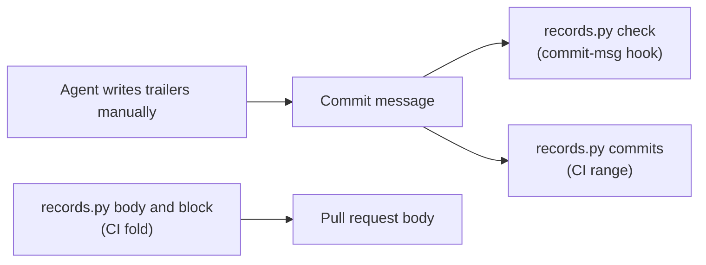
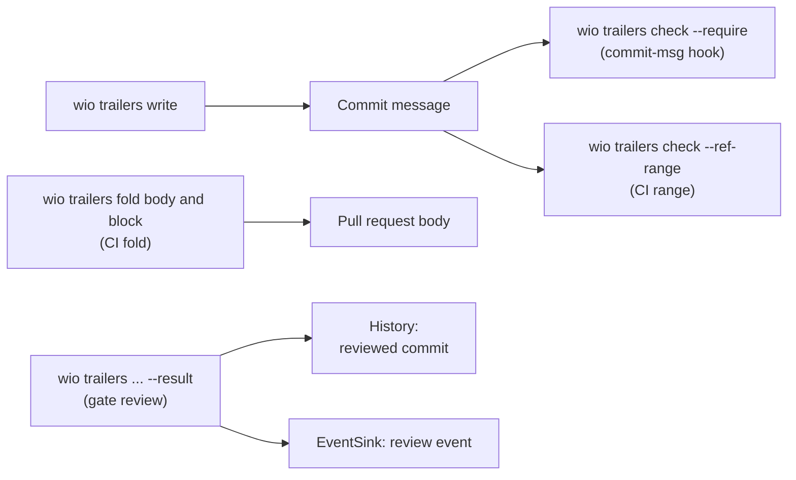

<!-- wio
id = "3jbrzz"
template = "feature.parent"
roots = ["@descendants"]
depends_on = []
-->

# wio trailers

## Purpose

Commit records are written by hand and checked and folded by a script outside
the engine, so nothing validates them against the live config and a gate cannot
find the commit it reviews; the engine needs to own the records that tie every
commit to a stage.

## Goals

- A checked `Wio-*` record paragraph is available for any named Work, action
  and stage, with each field validated against the live config and the Work's
  own item ids.
- Commit messages and revision ranges are checkable against the live config at
  commit time and over a range in CI.
- Records of a commit range are foldable into a pull request body that
  survives a squash merge.
- The reviewed commit of a gate is identifiable from the history, even when
  pure gate commits sit on top of it.
- A gate's result, judge and cited items are recordable with one command.

## Non-Goals

- Writing one record for a list of Works, `wio trailers none`, the `--reviewed`
  override and the warnings that concepts.md gives `wio trailers` beyond what
  the criteria state.
- Writing the `review` event to the event log, which arrives with `wio log`
  (C-4).

## Assumptions

### A-1

Git is installed and on PATH, because the `History` adapter runs git commands
directly.

### A-2

The configured reader (`scan` or `git`) matches the project's merge workflow.

### A-3

The names `check --ref-range` and `fold body|block` are provisional: concepts.md
names only `--require` and a range of commits, and the driver may rename them.

### A-4

A test of the `review` event injects a recording `EventSink`, because the wired
sink is a no-op (C-4).

## Mechanisms

- **`scan` reader** — reads every record from a message, outside fenced code
  blocks, as specified in `docs/concepts.md`. Shared by write, check and fold.
- **`git` reader** — delegates to git's own trailer parsing for
  last-paragraph-only workflows, as specified in `docs/concepts.md`.
- **`History` port and adapter** — gives the first-parent commits from HEAD
  for the reviewed-commit walk and the commits of a range for check and fold,
  each with its sha and message; the adapter arrives with this Work.
- **`EventSink` port** — accepts the `review` event.
- **Record parser and renderer** — the canonical parser and renderer for
  `Wio-*` records, shared by write, check and fold.

## Constraints

### C-1

All history reads go through the `History` port. No child calls git directly.
A reviewer judges this by reading the children's imports.

### C-2

The `review` event is written through the `EventSink` port. No child imports
from `wio.log`. `uv run tach check` verifies it.

### C-3

The record parser and renderer live in `wio.formats`. No child reimplements
them. `uv run jscpd src tests` and a reviewer's reading verify it.

### C-4

The `EventSink` wired to `wio trailers --result` is a no-op until `wio log`
builds the real adapter. No child wires a real event sink.

## Visuals

The Before diagram is drawn from `9bfd62b` on `main`; the After diagram is
the design this Work delivers.

### Before

### After

## Acceptance criteria

### **AC-1** A written record is accepted by check

`wio trailers <work> <action> <stage>` prints a record paragraph that
`wio trailers check --require` accepts in a commit message.

#### Round trip for a Work and stage

- **Given** a Work in the working tree and one of its stages.
- **When** `wio trailers <work> <action> <stage>` prints a record, and that
  record is the paragraph of a commit message that `wio trailers check
  --require` reads.
- **Then** both commands exit 0.

#### An item the Work does not have

- **Given** a Work that has no item `AC-99`.
- **When** `wio trailers <work> <action> <stage> --items AC-99` runs.
- **Then** the command exits 1, prints no record and names `AC-99`.

### **AC-2** Check validates a message and a range against the live config

#### A stage the config does not have fails at commit time

- **Given** a commit message whose record has `Wio-Stage: nosuch`.
- **When** `wio trailers check --require` reads it.
- **Then** the command exits 1 and names the stage.

#### A malformed commit in a range fails

- **Given** a range in which one commit carries a `Wio-Work` value that is not
  a valid id.
- **When** `wio trailers check --ref-range` reads the range.
- **Then** the command exits 1 and names that commit.

### **AC-3** Fold keeps what a later reader relies on

`wio trailers fold body` and `wio trailers fold block` fold the records of a
range as [concepts.md](../../../../docs/concepts.md#records) specifies.

#### A re-delivered child stays after its parent's integration

- **Given** a range of commits whose records are, in order, child `a`
  delivering `implementation`, parent `p` integrating, and `a` delivering
  `implementation` again.
- **When** `wio trailers fold block` runs on the range.
- **Then** it prints three record paragraphs in that order, and the two
  deliveries of `a` are not merged.

#### A body ends with the folded records

- **Given** a body of prose and a range with records.
- **When** `wio trailers fold body` runs on the body and the range.
- **Then** it prints the prose unchanged, followed by the folded records.

### **AC-4** A gate's reviewed commit is found under its pure gate commits

#### The walk reaches the work commit

- **Given** commits on HEAD where one or more of the latest carry only
  records for one gate's action and stage, and the next earlier commit is
  the work commit.
- **When** `wio trailers <work> <action> <stage> --result pass` runs for that
  gate with a recording `EventSink`.
- **Then** the sink receives one `review` event whose reviewed commit is the
  work commit's sha.

### **AC-5** A gate's result, judge and cited items are recorded in one call

#### The record and the event carry what was passed

- **Given** a gate stage, a Work with an item `AC-1` and a recording
  `EventSink`.
- **When** `wio trailers <work> <action> <stage> --result pass --judge human
  --items AC-1 --cite AC-1=pass` runs.
- **Then** the printed record holds `Wio-Result: pass`, `Wio-Judge: human` and
  `Wio-Items: AC-1`, and the sink receives one `review` event citing `AC-1`
  with the result `pass`.

### **AC-6** Every subcommand follows the exit-code contract

A `wio trailers` subcommand exits 0 on success, 1 on a failed check and 2 on a
usage error or `WioError`. A refused field of a record is a failed check.

#### A malformed record is a failed check

- **Given** a commit message with a `Wio-Work` value that is not a valid id.
- **When** `wio trailers check` reads it.
- **Then** the command exits 1 and reports the problem on stderr.

#### A usage error exits 2

- **Given** a call that gives a Work and no action or stage.
- **When** `wio trailers <work>` runs.
- **Then** the command exits 2 and prints no record.

### **AC-7** The hook and the workflows no longer use `records.py`

#### The script and its references are gone

- **Given** the repository after this Work.
- **When** `prek.toml`, the workflows and `scripts/` are searched for
  `records.py`.
- **Then** the script and every reference to it are absent, and the hook and
  the `records` workflow call `wio trailers`.

## Additional context

The fold rules and the readers are specified in
[concepts.md](../../../../docs/concepts.md#records), the baseline the children
implement. The hook and workflow change is the `22j7aw` child's; the reader
choice, the exempt subjects, the reviewed-commit boundaries and the checks of
each field belong to the `check`, `write` and `fold` children.
