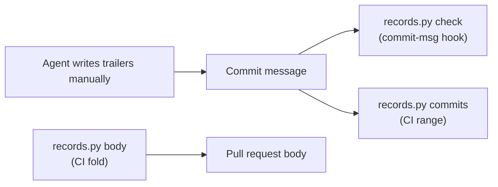
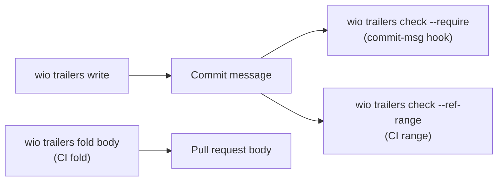

<!-- wio
id = "3jbrzz"
template = "feature.parent"
roots = ["@descendants"]
depends_on = []
-->

# wio trailers

## Purpose

Records tie every commit to the stage it belongs to, so progress is readable
from the history and a gate can find the commit it is reviewing. Without a
command to write and check them, agents must remember the format, cannot
validate against the live config, and have no way to locate the reviewed
commit. `records.py` fills part of that gap today but is a stand-in with no
access to the config and no write path.

This Work delivers `wio trailers`: one command that writes validated records,
checks them at commit time and over a range, folds them for a pull request
body, and identifies the reviewed commit for a gate.

## Goals

- Write a checked `Wio-*` record paragraph for a named Work, action and stage,
  validating each field against the live config and the Work's own item ids.
- Check a commit message, by file or stdin, at commit time (`--require`) or
  afterwards.
- Check a revision range in CI.
- Fold the records of a commit range into a pull request body, retiring
  `records.py`.
- Find the reviewed commit of a gate by walking first-parent commits back past
  its pure gate commits, for use with `--result`.
- Record a gate's result with `--result`, writing the trailer record now and
  stubbing the `review` event write until `wio log` is built.

## Glossary

### Pure gate commit

A commit whose every record belongs to one gate's action and stage, after
lists are expanded. Used when walking back from HEAD to find where the
artifact under review ends.

### Fold

Merging consecutive same-action-and-stage records per Work into one, then
merging consecutive same-shape records across Works into one list. The result
is a compact history that survives a squash merge.

### Reviewed commit

The first non-pure-gate commit found by following first parents back from
HEAD. The commit a gate is judging.

## Assumptions

### A-1

Git is installed and on PATH. The `History` adapter runs git commands
directly.

### A-2

The configured reader (`scan` or `git`) matches the project's merge workflow.
`wio trailers` does not change it.

### A-3

The `review` event write in `--result` is a no-op stub until `wio log` wires
an `EventSink`. It returns without error and writes nothing.

## Mechanisms

- **`scan` reader** — paragraph scanner that accepts every paragraph in which
  every line is a `Key: value` trailer and some key starts with `Wio-`,
  outside fenced code blocks and skipping `#` lines.
- **`git` reader** — delegates to `git log --format=%(trailers)` for
  last-paragraph-only workflows.
- **`History` port and adapter** — declared in `wio.io`, walks first-parent
  commits from HEAD, returning each commit's sha and message. Its adapter
  arrives with this Work, the first to consume it.
- **`EventSink` port** — declared in `wio.ports`, accepts the `review` event;
  wired to a no-op until `wio log` builds the real adapter.
- **`wio.formats` record module** — the canonical record parser and renderer,
  shared by write, check and fold.

## Constraints

### C-1

All history reads go through the `History` port. No child calls git directly.

### C-2

The `review` event is written through the `EventSink` port. No child imports
from `wio.log`.

### C-3

The record parser and renderer live in `wio.formats`. No child reimplements
them.

## Visuals

### Before

### After

## Acceptance criteria

### **AC-1** Folded output matches `records.py` for the same range

For any revision range, `wio trailers fold body` produces an equivalent
result to `records.py body`, and `wio trailers fold block` produces an
equivalent result to `records.py block`.

#### Equivalent fold for a range with a re-delivered child

- **Given** a range of commits with records for two Works, one delivering
  again after integration.
- **When** `wio trailers fold block` and `records.py block` are run on the
  same range.
- **Then** both produce the same folded record paragraphs and
  outside-revert lines.

### **AC-2** The CI workflow uses `wio trailers` after this Work

The `records.yml` workflow calls `wio trailers check --ref-range` and
`wio trailers fold body` instead of `records.py`. `records.py` is deleted.

#### CI check passes with the updated workflow

- **Given** a pull request with commits carrying valid records.
- **When** the `records` CI job runs after this Work.
- **Then** it passes using `wio trailers` commands and `records.py` is
  absent from the repository.

### **AC-3** All subcommands share the reader, the parser and the exit-code contract

Every `wio trailers` subcommand uses the same configured reader and the same
record parser from `wio.formats`, and follows the exit-code contract: 0 for
success, 1 for a failed check, 2 for a usage error or a `WioError`.

#### Shared reader picked up by all subcommands

- **Given** a project configured with `reader = "git"`.
- **When** `wio trailers write`, `check` and `fold` each process a message.
- **Then** all three use `git log --format=%(trailers)` and not the paragraph
  scanner.

## Additional context

`records.py` is the reference implementation for the fold algorithm and the
`scan` reader. Its logic and behaviour are the normative baseline for the
leaves that replace it.

The `History` port adapter runs `git log --reverse --topo-order
--format=%H%n%B%x00` and parses the null-delimited output, matching
`commits_in` in `records.py`.
