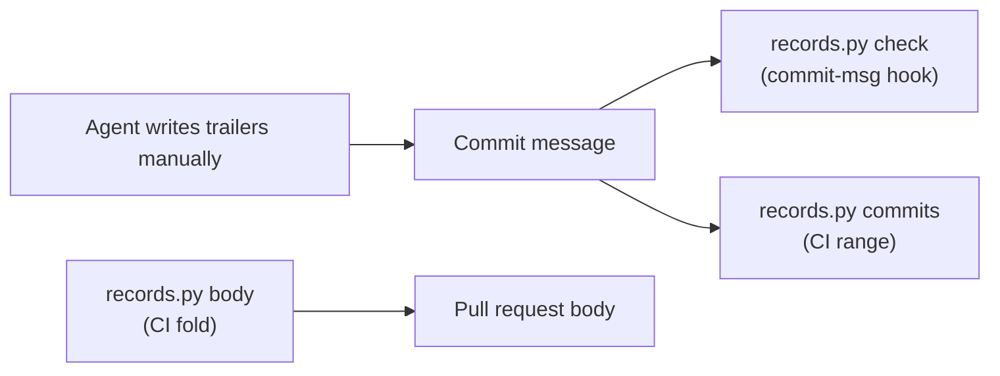
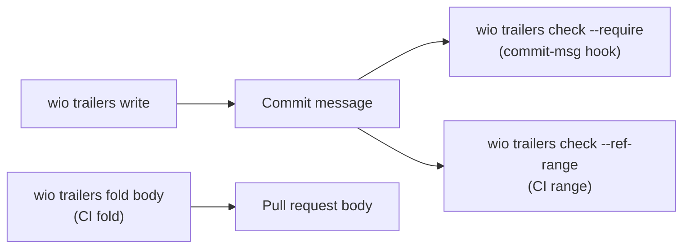

<!-- wio
id = "3jbrzz"
template = "feature.parent"
roots = ["@descendants"]
depends_on = []
-->

# wio trailers

## Purpose

Without a command that knows the live config, agents construct records by
hand with no validation, `records.py` fills only part of the gap, and a gate
cannot locate the commit it is reviewing.

## Goals

- A checked `Wio-*` record paragraph is available for any named Work, action
  and stage, with each field validated against the live config and the Work's
  own item ids.
- Commit messages and revision ranges are checkable against the live config at
  commit time (by file or stdin) and over a range in CI.
- Records of a commit range are foldable into a pull request body that
  survives a squash merge, retiring `records.py`.
- The reviewed commit of a gate is identifiable from the history by walking
  back past its pure gate commits.
- A gate's result, judge and cited items are recordable with one command; the
  review event write is stubbed until `wio log` is built.

## Glossary

### Pure gate commit

A commit whose every record belongs to one gate's action and stage, after
lists are expanded. Used when walking back from HEAD to find where the
artifact under review ends.

### Fold

Merging consecutive same-action-and-stage records per Work into one, then
merging consecutive same-shape records across Works into one list. The result
is a compact history that survives a squash merge.

### Reviewed commit

The first non-pure-gate commit found by following first parents back from
HEAD. The commit a gate is judging.

## Assumptions

### A-1

Git is installed and on PATH. The `History` adapter runs git commands
directly.

### A-2

The configured reader (`scan` or `git`) matches the project's merge workflow.
`wio trailers` does not change it.

### A-3

The `review` event write in `--result` is a no-op stub until `wio log` wires
an `EventSink`. It returns without error and writes nothing.

## Mechanisms

- **`scan` reader** — paragraph scanner that accepts every paragraph in which
  every line is a `Key: value` trailer and some key starts with `Wio-`,
  outside fenced code blocks and skipping `#` lines.
- **`git` reader** — delegates to `git log --format=%(trailers)` for
  last-paragraph-only workflows.
- **`History` port and adapter** — declared in `wio.io`, walks first-parent
  commits from HEAD, returning each commit's sha and message. Its adapter
  arrives with this Work, the first to consume it.
- **`EventSink` port** — declared in `wio.ports`, accepts the `review` event.
- **`wio.formats` record module** — the canonical record parser and renderer,
  shared by write, check and fold.

## Constraints

### C-1

All history reads go through the `History` port. No child calls git directly.

### C-2

The `review` event is written through the `EventSink` port. No child imports
from `wio.log`.

### C-3

The record parser and renderer live in `wio.formats`. No child reimplements
them.

### C-4

The `EventSink` wired to `wio trailers --result` is a no-op until `wio log`
builds the real adapter. No child wires a real event sink.

## Visuals

### Before

### After

## Acceptance criteria

### **AC-1** Folded output matches `records.py` semantically

Semantically equivalent means the same records in the same order with the
same trailer key-value pairs; whitespace and line endings may differ.
`wio trailers fold body` produces an equivalent result to `records.py body`,
and `wio trailers fold block` produces an equivalent result to
`records.py block`.

#### Equivalent fold for a range with a re-delivered child

- **Given** a range of commits with records for two Works, one delivering
  again after integration.
- **When** `wio trailers fold block` and `records.py block` are run on the
  same range.
- **Then** both produce the same folded record paragraphs and
  outside-revert lines.

### **AC-2** The CI workflow uses `wio trailers` after this Work

The `records.yml` workflow calls `wio trailers check --ref-range` and
`wio trailers fold body` instead of `records.py`. `records.py` is deleted.

#### CI check passes with the updated workflow

- **Given** a pull request with commits carrying valid records.
- **When** the `records` CI job runs after this Work.
- **Then** it passes using `wio trailers` commands and `records.py` is
  absent from the repository.

### **AC-3** All subcommands use the same configured reader

Every `wio trailers` subcommand uses the reader named in the project config,
whether `scan` or `git`.

#### Reader setting picked up by all subcommands

- **Given** a project configured with `reader = "git"`.
- **When** `wio trailers write`, `check` and `fold` each process a message.
- **Then** all three use the git reader and not the paragraph scanner.

### **AC-4** All subcommands follow the exit-code contract

Every `wio trailers` subcommand exits 0 on success, 1 on a failed check and
2 on a usage error or `WioError`.

#### Check exits 1 on a malformed record, not 2

- **Given** a commit message with a `Wio-Work` value that is not a valid id.
- **When** `wio trailers check` reads it.
- **Then** the command exits 1 and reports the problem on stderr.

### **AC-5** `--result` identifies the reviewed commit correctly

The reviewed commit is the first commit reachable from HEAD that is not a
pure gate commit for this gate.

#### Walk skips pure gate commits

- **Given** three commits on HEAD: the latest two carry only records for one
  gate's action and stage, and the third is the work commit.
- **When** `wio trailers --result` runs for that gate.
- **Then** the reviewed commit is the third commit.

### **AC-6** `--result` writes the gate record and does not error on the stub sink

- **Given** a gate stage and the no-op `EventSink` stub.
- **When** `wio trailers <work> <action> <stage> --result pass` runs.
- **Then** the record paragraph is printed and the command exits 0.

## Additional context

`records.py` is the reference implementation for the fold algorithm and the
`scan` reader. Its logic and behaviour are the normative baseline for the
leaves that replace it.
