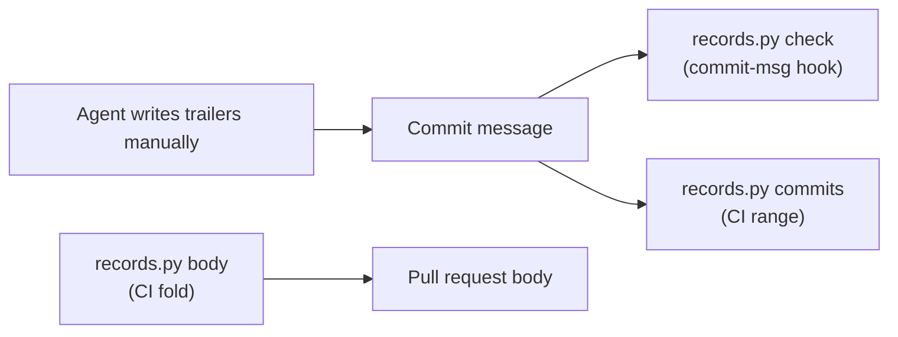
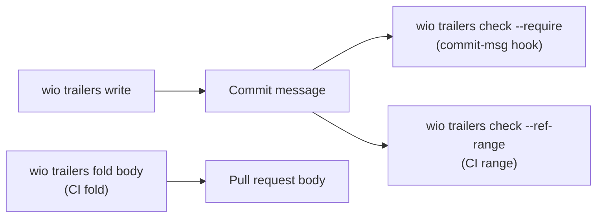

<!-- wio
id = "3jbrzz"
template = "feature.parent"
roots = ["@descendants"]
depends_on = []
-->

# wio trailers

## Purpose

Commit records are written by hand and checked and folded by a script outside
the engine, so nothing validates them against the live config and a gate cannot
find the commit it reviews; the engine needs to own the records that tie every
commit to a stage.

## Goals

- A checked `Wio-*` record paragraph is available for any named Work, action
  and stage, with each field validated against the live config and the Work's
  own item ids.
- Commit messages and revision ranges are checkable against the live config at
  commit time (by file or stdin) and over a range in CI.
- Records of a commit range are foldable into a pull request body that
  survives a squash merge, retiring `records.py`.
- The reviewed commit of a gate is identifiable from the history, even when
  pure gate commits sit on top of it.
- A gate's result, judge and cited items are recordable with one command.

## Glossary

### Pure gate commit

A commit whose every record belongs to one gate's action and stage, after
lists are expanded. Used when walking back from HEAD to find where the
artifact under review ends.

### Fold

Merging consecutive same-action-and-stage records per Work into one, then
merging consecutive same-shape records across Works into one list. The result
is a compact history that survives a squash merge.

### Reviewed commit

The first non-pure-gate commit found by following first parents back from
HEAD. The commit a gate is judging.

## Assumptions

### A-1

Git is installed and on PATH. The `History` adapter runs git commands
directly.

### A-2

The configured reader (`scan` or `git`) matches the project's merge workflow.
`wio trailers` does not change it.

## Mechanisms

- **`scan` reader** — reads every record from a message, outside fenced code
  blocks, as specified in `docs/concepts.md`. Shared by write, check and fold.
- **`git` reader** — delegates to git's own trailer parsing for
  last-paragraph-only workflows, as specified in `docs/concepts.md`.
- **`History` port and adapter** — walks first-parent commits from HEAD,
  returning each commit's sha and message. Its adapter arrives with this Work,
  the first to consume it.
- **`EventSink` port** — accepts the `review` event; wired to a no-op until
  `wio log` builds the real adapter.
- **Record parser and renderer** — the canonical parser and renderer for
  `Wio-*` records, shared by write, check and fold. Lives in `wio.formats`
  (C-3).

## Constraints

### C-1

All history reads go through the `History` port. No child calls git directly.

### C-2

The `review` event is written through the `EventSink` port. No child imports
from `wio.log`.

### C-3

The record parser and renderer live in `wio.formats`. No child reimplements
them.

### C-4

The `EventSink` wired to `wio trailers --result` is a no-op until `wio log`
builds the real adapter. No child wires a real event sink.

## Visuals

### Before

### After

## Acceptance criteria

### **AC-1** Write produces a validated record paragraph

`wio trailers <work> <action> <stage>` prints a `Wio-*` record paragraph
that `wio trailers check` accepts, and exits 0 when every field is valid.
Validation covers: the Work exists in the working tree or in `HEAD`, the
item ids are among the Work's own ids, the result is in the vocabulary, and
a result is present exactly when the stage is a gate. Any failing field
exits 1 with a diagnostic.

#### Result required exactly on a gate stage

- **Given** a gate stage and a Work that exists in the working tree.
- **When** `wio trailers <work> <action> <stage>` is called without
  `--result`.
- **Then** the command exits 1 and reports that a result is required.

#### Result rejected on a non-gate stage

- **Given** a non-gate stage and a Work that exists in the working tree.
- **When** `wio trailers <work> <action> <stage> --result pass` is called.
- **Then** the command exits 1 and reports that the stage is not a gate.

### **AC-2** Fold follows the fold rules

`wio trailers fold body` and `wio trailers fold block` fold the records of a
range in two steps, as [concepts.md](../../../../docs/concepts.md#records)
specifies. For each Work, consecutive records of the same action and stage
become one record at the later position. Then consecutive records that differ
only in the Work become one list. Records that are not consecutive stay apart.

#### A re-delivered child stays after its parent's integration

- **Given** a range of commits whose records are, in order, child `a`
  delivering `implementation`, parent `p` integrating, and `a` delivering
  `implementation` again.
- **When** `wio trailers fold block` runs on the range.
- **Then** it prints three record paragraphs in that order, and the two
  deliveries of `a` are not merged.

#### Consecutive records of two Works merge into one list

- **Given** a range whose consecutive commits carry the same action, stage and
  result for Works `a` and `b`.
- **When** `wio trailers fold block` runs on the range.
- **Then** it prints one record paragraph whose `Wio-Work` lists `a` and `b`.

### **AC-3** The CI workflow uses `wio trailers` after this Work

The `records.yml` workflow calls `wio trailers check --ref-range` and
`wio trailers fold body` instead of `records.py`. `records.py` is deleted.

#### CI check passes with the updated workflow

- **Given** a pull request with commits carrying valid records.
- **When** the `records` CI job runs after this Work.
- **Then** it passes using `wio trailers` commands and `records.py` is
  absent from the repository.

### **AC-4** All subcommands use the same configured reader

Every `wio trailers` subcommand uses the reader named in the project config,
whether `scan` or `git`.

#### Reader setting picked up by all subcommands

- **Given** a project configured with `reader = "git"`.
- **When** `wio trailers write`, `check` and `fold` each process a message.
- **Then** all three use the git reader and not the paragraph scanner.

### **AC-5** All subcommands follow the exit-code contract

Every `wio trailers` subcommand exits 0 on success, 1 on a failed check and
2 on a usage error or `WioError`.

#### Check exits 1 on a malformed record, not 2

- **Given** a commit message with a `Wio-Work` value that is not a valid id.
- **When** `wio trailers check` reads it.
- **Then** the command exits 1 and reports the problem on stderr.

#### Check --require exits 1 when no record is present

- **Given** a non-exempt commit message (subject does not start with
  `Merge `, `Revert `, `Reapply `, `fixup!` or `squash! `) with no
  `Wio-*` record.
- **When** `wio trailers check --require` reads it.
- **Then** the command exits 1 and reports that no record was found.

### **AC-6** `--result` identifies the reviewed commit correctly

The reviewed commit is the first commit reachable from HEAD that is not a
pure gate commit for this gate.

#### Walk skips one or more pure gate commits

- **Given** commits on HEAD where one or more of the latest carry only
  records for one gate's action and stage, and the next earlier commit is
  the work commit.
- **When** `wio trailers --result` runs for that gate.
- **Then** the reviewed commit is the work commit, not any of the gate
  commits.

### **AC-7** `--result` prints the gate record with its result, judge and cites

#### The printed record carries what was passed

- **Given** a gate stage and a Work with an item `AC-1`.
- **When** `wio trailers <work> <action> <stage> --result pass --judge human
  --items AC-1` runs.
- **Then** the printed record paragraph holds `Wio-Result: pass`,
  `Wio-Judge: human` and `Wio-Items: AC-1`, and `wio trailers check` accepts
  it.

#### A result outside the vocabulary is refused

- **Given** a gate stage and a config whose results do not include `maybe`.
- **When** `wio trailers <work> <action> <stage> --result maybe` runs.
- **Then** the command exits 1, prints no record and reports the allowed
  results.

## Additional context

The fold rules and the `scan` reader are specified in
[concepts.md](../../../../docs/concepts.md#records), which is the baseline the
leaves implement. `records.py` is deleted once they do (AC-3).
