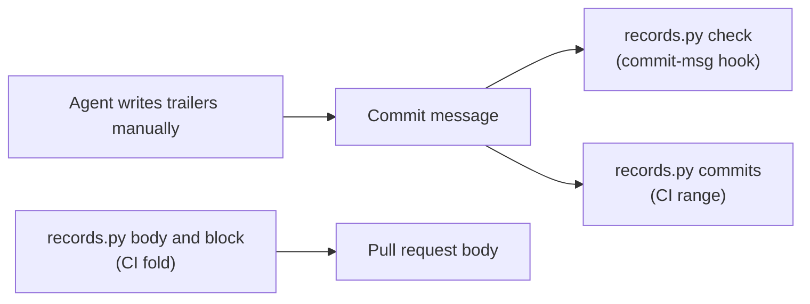
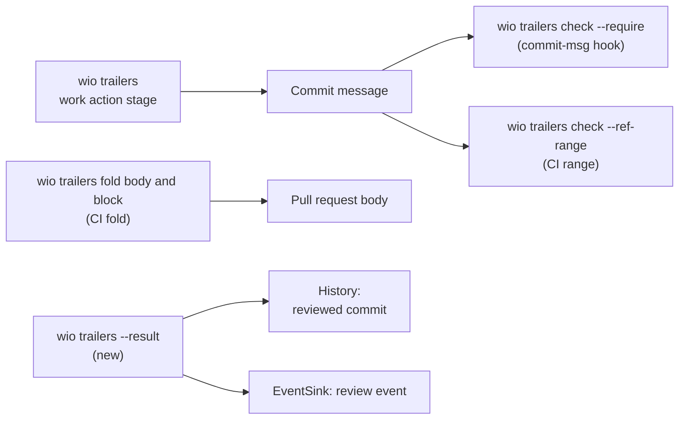

<!-- wio
id = "3jbrzz"
template = "feature.parent"
roots = ["@descendants"]
depends_on = []
-->

# wio trailers

## Purpose

Commit records are written by hand and checked and folded by a script outside
the engine, so nothing validates them against the live config and a gate cannot
find the commit it reviews; the engine needs to own the records that tie every
commit to a stage.

## Goals

- A checked `Wio-*` record paragraph is available for any named Work, action
  and stage, with its fields checked against the config and the Work's own
  item ids.
- A commit message is checked against the live config at commit time, and a
  range of commits is checked in CI for the shape of its records, so an old
  record never fails later.
- Records of a commit range are foldable into a pull request body that ends
  with them.
- The hook and the pull request workflow of this repository check and fold
  records with `wio trailers`.
- The commands run as one `wio trailers` command on a real repository.
- The reviewed commit of a gate is identifiable from the history, even when
  pure gate commits sit on top of it.
- A gate's result, judge and cited items are recordable with one command.

## Non-Goals

- Writing one record for a list of Works, and `wio trailers none`.
- The `--reviewed` override and the warnings that
  [concepts.md](../../../../docs/concepts.md#records) gives `wio trailers`
  beyond what the criteria state.
- Writing the `review` event to the event log, which arrives with `wio log`
  (C-4).

## Assumptions

### A-1

Git is installed and on PATH, because the `History` adapter and the `git`
reader run git commands.

### A-2

The configured reader (`scan` or `git`) matches the project's merge workflow.

### A-3

The names `check --ref-range` and `fold body|block`, which the After diagram
uses, are provisional, because concepts.md names only `--require` and a range of
commits.

## Mechanisms

- **Record parser with both readers** — one parser in `wio.formats`, built by
  `pnf585`, that reads a record with the `scan` or the `git` reader of
  [concepts.md](../../../../docs/concepts.md#records).
- **Record renderer** — the one renderer of `Wio-*` records in `wio.formats`,
  built by `eh62g6`.
- **Field validator** — the one validator of a record's fields, built by
  `hk3qt5`, which the write command and the commit-time check share.
- **The git adapters** — the adapter of the `History` port, which gives commits
  and files at a revision, and the `show_index` and `is_dirty` members of the
  `Repository` port, which give the staged index and the state of the working
  tree, built by `chqy1s`.
- **`Contracts` port and its adapter** — provisional, gives a Work's items and
  pipelines, and its adapter is built by `jzvrtx`.
- **`EventSink` port** — accepts the `review` event.
- **Stage-rules port** — provisional, gives the rules a stage selects with their
  hashes, which the rules Work satisfies; `jyhy64` consumes it. Until the rules
  Work exists, `wio trailers` wires a null adapter that selects no rule, so a
  cited rule code is refused.
- **The `wio trailers` command** — in `wio.cli`, built by `37vw05`, which wires
  every adapter and the no-op `EventSink`.

## Constraints

### C-1

All reads of the history and of the index go through the `History` and
`Repository` ports. No child calls git directly. A reviewer judges this by
reading the children's imports.

### C-2

The `review` event is written through the `EventSink` port. No child imports
from `wio.log`. `uv run tach check` verifies it.

### C-3

The record parser and renderer live in `wio.formats`. No child reimplements
them. `uv run jscpd src tests` and a reviewer's reading verify it.

### C-4

The `EventSink` wired to `wio trailers --result` is a no-op until `wio log`
builds the real adapter, so a test of the `review` event injects a recording
sink. No child wires a real event sink, and a reviewer judges it from the wiring
in `wio.cli`.

## Visuals

The Before diagram is drawn from `9bfd62b` on `main`; the After diagram is
the design this Work delivers. The After diagram marks `G` as new because it is
the one flow with no counterpart in the Before diagram: every other flow
replaces one of `records.py`.

### Before

### After

## Acceptance criteria

### **AC-1** A written record is accepted by check

`wio trailers <work> <action> <stage>` prints a record paragraph that
`wio trailers check --require` accepts in a commit message.

#### Round trip for a Work and stage

- **Given** a Work in the working tree and one of its stages.
- **When** `wio trailers <work> <action> <stage>` prints a record, and that
  record is the paragraph of a commit message that `wio trailers check
  --require` reads.
- **Then** both commands exit 0.

#### An item the Work does not have

- **Given** a Work that has no item `AC-99`.
- **When** `wio trailers <work> <action> <stage> --items AC-99` runs.
- **Then** the command exits 1, prints no record and names `AC-99`.

### **AC-2** Check refuses a wrong message and tolerates an old record

#### A stage the config does not have fails at commit time

- **Given** a commit message whose record has `Wio-Stage: nosuch`.
- **When** `wio trailers check --require` reads it.
- **Then** the command exits 1 and names the stage.

#### A malformed commit in a range fails

- **Given** a range in which one commit carries a `Wio-Work` value that is not
  a valid id.
- **When** `wio trailers check --ref-range` reads the range.
- **Then** the command exits 1 and names that commit.

#### A commit with a stage the config no longer lists passes

- **Given** a range in which one commit has a well-formed record with
  `Wio-Stage: nosuch`.
- **When** `wio trailers check --ref-range` reads the range.
- **Then** the command exits 0 and warns about the stage.

### **AC-3** Fold keeps what a later reader relies on

`wio trailers fold body` and `wio trailers fold block` fold the records of a
range as [concepts.md](../../../../docs/concepts.md#records) specifies.

#### A re-delivered child stays after its parent's integration

- **Given** a range of commits whose records are, in order, child `a`
  delivering `implementation`, parent `p` integrating, and `a` delivering
  `implementation` again.
- **When** `wio trailers fold block` runs on the range.
- **Then** it prints three record paragraphs in that order, and the two
  deliveries of `a` are not merged.

#### A body ends with the folded records

- **Given** a body of prose and a range with records.
- **When** `wio trailers fold body` runs on the body and the range.
- **Then** it prints the prose unchanged, followed by the folded records.

### **AC-4** A gate's result is recorded, accepted and folded

#### One call that the check and the fold take back

- **Given** a gate stage, a Work with an item `AC-1`, commits on `HEAD` where
  the latest carry only the gate's record above the work commit, and a recording
  `EventSink`.
- **When** `wio trailers <work> <action> <stage> --result pass --judge human
  --items AC-1 --cite AC-1=pass` prints a record, that record is the paragraph
  of a commit message that `wio trailers check --require` reads, and
  `wio trailers fold block` runs on a range with that commit.
- **Then** the record holds `Wio-Result: pass`, `Wio-Judge: human` and
  `Wio-Items: AC-1`, the check exits 0, the fold prints the record, and the sink
  received one `review` event citing `AC-1` with `pass` whose reviewed commit is
  the work commit's sha.

### **AC-5** Every subcommand follows the exit-code contract

A `wio trailers` subcommand exits 0 on success, 1 on a failed check and 2 on a
usage error or `WioError`. A refused field of a record is a failed check.

#### A malformed record is a failed check

- **Given** a commit message with a `Wio-Work` value that is not a valid id.
- **When** `wio trailers check` reads it.
- **Then** the command exits 1 and reports the problem on stderr.

#### A usage error exits 2

- **Given** a path and `--ref-range` given together to `check`, an unknown
  revision given to `fold block`, and a call with a Work and an action and no
  stage.
- **When** `wio trailers check <path> --ref-range main..HEAD`,
  `wio trailers fold block nosuch..nosuch2` and `wio trailers <work> <action>`
  run.
- **Then** each command exits 2.

### **AC-6** The command works on a real repository

#### A round trip with no injected adapter

- **Given** a repository with a Work and one of its stages, and no injected
  adapter.
- **When** `wio trailers <work> <action> <stage>` prints a record, a commit
  carries it in its message, and `wio trailers check --ref-range HEAD~1..HEAD`
  and `wio trailers fold block HEAD~1..HEAD` run.
- **Then** each exits 0 and the fold prints that record.

### **AC-7** The hook and the workflows no longer use `records.py`

#### The script and its references are gone

- **Given** the repository after this Work.
- **When** `prek.toml`, the workflows and `scripts/` are searched for
  `records.py`.
- **Then** the script and every reference to it are absent, and the hook and
  the `records` workflow call `wio trailers`.

## Additional context

The fold rules and the readers are specified in
[concepts.md](../../../../docs/concepts.md#records), the baseline the children
implement. The hook and workflow change is `22j7aw`'s; the reader choice, the
exempt subjects, the reviewed-commit boundaries and the checks of each field
belong to the `check`, `write` and `fold` children; the git adapters are
`chqy1s`'s, the `Contracts` adapter is `jzvrtx`'s, and the command and its
wiring are `37vw05`'s.
